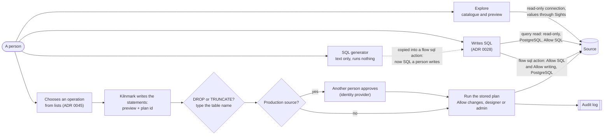

# 0045 Database tools: explore a source, generate its SQL, and change it only with controls

Status: Accepted (5 November 2026). Amends [ADR 0028](0028-sql-in-reads-and-flow-actions.md).

## Context

A designer working on a pipeline keeps leaving Kilnmark for a database client: to see which
tables a source has and what their columns, keys and indexes are, to look at a few rows, to get
the `CREATE TABLE` for a target, or to add a column or an index before a load. Other data
integration tools have this in the product: a database explorer beside the connection, a SQL
editor that writes DDL for a table, and connection settings on tabs. The owner decided on
5 November 2026 that Kilnmark has it too, in four parts:

1. **Explore** on a source's page: live schemas, then tables and views, then columns, keys,
   indexes and row counts, and a preview of the first rows.
2. **A SQL generator**: `CREATE TABLE` (from a table, or from what a pipeline's write node would
   create), `ALTER TABLE` for added columns, `CREATE INDEX` and `DROP`, in each database's
   dialect, to copy or save.
3. **Connection settings as tabs**: General, Advanced, Options, Pooling and Partitioning.
4. **Operations that change a database**, which the owner chose to allow *with controls* rather
   than leave to other tools: a per-source switch off by default, designers and admins only, a
   preview of every statement, typing the table's name to confirm a drop or a truncate, an audit
   event for each, and a second person's approval on production sources.

The first three only read or only write text, and fit the rules Kilnmark already has. The fourth
does not: [ADR 0028](0028-sql-in-reads-and-flow-actions.md) says a statement that changes a
source runs in one place only, a flow's `sql` action, on PostgreSQL, with Allow SQL on, written by
a designer with the unmask grant and saved as a version. This record says what the database tools
may do, and exactly what in ADR 0028 changes and what stays.

## Decision

### 1. Explore reads the catalogue, and previews rows through `Sights`

- **What it shows.** For a database source: its schemas, the tables and views in one, and for a
  table its columns (name, type as the database names it, size, nulls, default shown as "has a
  default", never its text), primary key, foreign keys, unique constraints and indexes, and a row
  count. Nothing is stored: each view asks the database, so Explore shows what is there now, also
  before a scan. Listings are capped (1,000 schemas, 5,000 tables a schema) and say when they are
  cut.
- **How.** Through the driver's own catalogue (`DatabaseMetaData`) and, where a database has a
  better one, its system views (PostgreSQL's `pg_catalog`, SQL Server's `sys`, Oracle's `ALL_`
  views, MySQL's `information_schema`). Every catalogue query is one Kilnmark writes, with the
  schema and table names bound as parameters, on a **read-only** connection, within the time limit
  people's checks have (`SourceChecks.forPerson`, which also caps how many run at once). No text a
  person types is put into SQL. Indexes are new: the scan never read them (`getIndexInfo`).
- **Row counts** are the database's estimate (PostgreSQL `reltuples`, SQL Server partition stats,
  Oracle `NUM_ROWS`, MySQL `TABLE_ROWS`), labelled as an estimate. An exact count is a button
  that runs `SELECT COUNT(*)` on the read-only connection, within the timeout.
- **The preview** is the source's existing live preview (`GET /api/v1/sources/{name}/preview`,
  `SourceService.preview`), unchanged: the first rows of a table or view, read by the connector,
  never stored, and shown **through `Sights`** (`Sights.catalogue`), so a column marked sensitive is
  masked for everyone without the unmask grant (ADR 0027), admins included.
- **Who.** Stewards, designers and admins, as for the source's containers, assets and preview
  today. Viewers do not see Explore. It is not offered to the assistant or the MCP server in this
  record.
- **Which sources.** PostgreSQL, SQL Server, MySQL and MariaDB, Oracle, and Generic JDBC (through
  `DatabaseMetaData` only). File and object-store sources keep their own listing.

### 2. The SQL generator writes text and runs nothing

- `CREATE TABLE` from a table Explore shows, or from a pipeline's write node (the table its
  `create` mode would make from its input's columns), `ALTER TABLE ... ADD` for columns, `CREATE
  INDEX` (unique or not) for chosen columns, `DROP TABLE`, `DROP INDEX` and `TRUNCATE TABLE`.
- **One dialect code.** The statements come from the same per-database code as the write node's
  `create` mode (`WriteSql`), extended to the other statements, so the type chosen for a column
  and the quoting of a name are the same whether a pipeline creates the table or a person copies
  the statement. Generic JDBC uses the types its driver lists, as `create` does, and quotes names
  with the driver's quote string.
- **No values.** The generator writes names, types, nulls, keys and indexes. It never copies a
  default, a check, a comment, a partition bound or a generated column's expression: they can quote
  values, and they are each database's own. The page says what was left out.
- **Copy or save.** The text can be copied, or saved as a `.sql` file. Nothing is run from the
  generator, and nothing typed into it reaches a database. Anyone who may see the source may use
  it; it shows only names and types.

### 3. Connection settings on tabs

The source form becomes five tabs; the settings in them keep the rules they have:

- **General**: name, kind, host, port, database, login, Allow writing, Allow SQL, Allow changes.
- **Advanced**: the vetted driver settings of ADR 0030 (time limits, TLS, characters, the
  database's harmless named settings) and identifier quoting: how Kilnmark quotes names it writes
  (always, the default; or only when a name needs it).
- **Options**: other driver properties, from the vetted list only (ADR 0030). Nothing off the
  list can be typed in; the tab is a picker over that list, not a free key and value table.
- **Pooling**: the largest number of connections Kilnmark holds open to the source at once, how
  long one may stay idle, how long to wait for one, a statement timeout for the source (today the
  server's settings set it for all sources), and a JDBC **socket timeout** (the backlog item), so a
  connection whose server stopped answering is given up rather than held. Kilnmark opens a
  connection for each use today; keeping them open between uses comes with this tab. Bounded: at
  most 50 connections, each timeout at most an hour.
- **Partitioning**: splitting a big read by key range. A source sets how many parts a read may be
  split into at most (1, the default, means never); a `read` node names a numeric or date column
  to split on, and Kilnmark reads its minimum and maximum and reads the parts at once, each a range
  of that column, bound as parameters. Each part takes a place under the source's **Most runs at
  once** (ADR 0040), so splitting never exceeds what the source allows.

There is no clustering tab: Kilnmark does not spread one source over several servers.

### 4. Operations that change a database: a third way, with controls

A **database operation** is one of: create a table (from the generator), add columns, create an
index, drop an index, drop a table, truncate a table. It is not SQL a person writes: the person
chooses the operation, the table and the columns from lists, and **Kilnmark writes every
statement**. The text cannot be edited before it runs; a person who wants different SQL copies it
and runs it elsewhere, or writes a flow `sql` action under ADR 0028.

Controls, every one checked by the server, not only by the page:

1. **Allow changes**, a per-source switch beside Allow writing and Allow SQL, **off by default**.
   A designer or an admin turns it on or off; each change is an audit event
   (`source.allow_changes`), from the form or an import. It is independent of the other two: Allow
   writing lets pipelines write rows, Allow SQL lets people's own SQL run, Allow changes lets these
   operations run.
2. **Designers and admins only**, by role. The unmask grant is not needed: an operation shows no
   values and the statements carry none. Stewards and viewers can use Explore and the generator.
   The assistant and the MCP server cannot run operations.
3. **Names come from the catalogue.** A table, column or index an operation acts on must exist in
   the live catalogue at the moment it runs; a new name must match the database's rules for an
   unquoted identifier and its length limit, and is always quoted. Types come from the dialect's
   list, never typed in. Defaults, checks and expressions are not offered.
4. **A preview of every statement.** The server answers a request with the exact statements, the
   database they will run on, and a plan id. The plan is kept on the server (who asked, the source,
   the statements and a hash of each, and a fingerprint of the catalogue entries it depends on); it
   lasts 15 minutes. **Run** names the plan id, and the server runs those stored statements, no
   others, after checking the catalogue still matches the fingerprint (if a table changed since
   the preview, the plan is refused and must be made again).
5. **Typing the table's name** confirms a `DROP TABLE` or a `TRUNCATE TABLE`: the run request
   carries the name as typed, and the server compares it, case for case, with the plan's table.
6. **An audit event for each** (ADR 0029): `db.change.planned`, `db.change.ran` (with the
   outcome, rows affected where the database says, and how long it took) and `db.change.failed`,
   each with the source, the operation, the object, the statements (names and types only, no
   values), who asked, and for production sources who approved.
7. **A second person on production sources.** A source can be marked **Production**. On such a
   source a plan is not run when made: it waits for approval by **another person**, a designer or an
   admin, as the unmask grant does (ADR 0038). Both people must be signed in with the identity
   provider (ADR 0036), and they are compared by the provider's fixed id (issuer and subject), so
   neither an API token nor the same person under another name can approve; with sign-in off,
   operations on a production source are refused. An approved plan runs once, within 24 hours of
   approval, after the catalogue check of point 4; a refused, expired or already run plan cannot
   run. Approving, refusing and running are each audit events (`db.change.approved`,
   `db.change.refused`).
   - **Until environments exist** (backlog, "change approval and environments"), Production is a
     setting on the source, which **only an admin** may change. Turning it **off** needs a second
     person too: an admin asks, another admin signed in with the provider approves, and both are in
     the audit log (`source.production`). Turning it on takes effect at once. When environments
     arrive, a source in the production environment is Production, and this setting becomes that
     environment's.
8. **How it runs.** On the source's ordinary (not read-only) connection, in one transaction where
   the database can undo DDL (PostgreSQL, SQL Server), statement by statement where it cannot
   (MySQL, MariaDB, Oracle commit DDL by themselves), saying which statements ran if one fails.
   Within the source's statement timeout (Pooling tab), or 5 minutes when it has none, and on
   PostgreSQL with a `lock_timeout` of 10 seconds,
   so a `DROP` waiting behind a long read gives up rather than blocks the table for everyone.
9. **Never Kilnmark's own database.** An operation is refused on a source that points at the
   database Kilnmark itself uses (same server and database name, and on PostgreSQL the same
   `system_identifier`).
10. **Which databases.** PostgreSQL, SQL Server, MySQL and MariaDB, and Oracle: the databases whose
    dialect `WriteSql` already writes. Generic JDBC sources get Explore and the generator, not
    operations, until a database there has a dialect of its own.

## What changes in ADR 0028, and what stays

**Changes:**

- ADR 0028's "a statement that changes a source runs only in a flow `sql` action" becomes: a
  statement that changes a source runs in a flow `sql` action (ADR 0028) **or as a database
  operation (this record)**, and nowhere else.
- Database operations run on PostgreSQL, SQL Server, MySQL, MariaDB and Oracle, not PostgreSQL
  only, because no text a person wrote is parsed or run: Kilnmark writes each statement from a
  fixed set of shapes, with names checked against the catalogue and quoted.
- They are gated by **Allow changes**, not Allow SQL, and are open to designers and admins
  without the unmask grant, because they neither read nor show values.

**Stays as it was:**

- SQL a person writes still runs in exactly two shapes, a `read` with a `query` and a flow `sql`
  action, both on PostgreSQL only, both behind Allow SQL, written only by designers with the
  unmask grant, checked by `SqlTokens`, saved as versions, under the login check.
- Query reads, Explore and the preview run on the **read-only** connection, in a read-only
  transaction. Whatever a query read returns is marked sensitive.
- The generator's text becomes SQL a person writes the moment someone puts it into a flow `sql`
  action, and then every rule of ADR 0028 applies to it.
- Allow writing still governs pipelines' writes; Allow SQL still governs people's own SQL;
  neither turns on database operations, and Allow changes turns on neither of them.
- The expression language still never runs code, and no parameter or variable can name a table.

## Consequences

- A designer can see a source, get its DDL and make routine changes (a staging table, a missing
  index, an added column) without leaving Kilnmark, and every change is previewed, confirmed,
  logged, and on production approved by a second person.
- An operation can still do damage within its shape: dropping the wrong table is possible, and the
  name typed to confirm it is the guard, with the database's own backups behind it. The login
  matters most: a source whose login cannot drop tables cannot drop them through Kilnmark. The
  guide says which rights each operation needs and recommends a login without them when Allow
  changes is off.
- Explore runs catalogue queries on demand, which a busy database feels a little. They are small,
  bounded and on the read-only connection; the source's **Most runs at once** does not count them.
- Production as a setting is a stop-gap with a known weakness: an admin who is also the second
  admin's colleague in collusion can turn it off. That is the same limit ADR 0038 accepts: the
  provider decides who is a person; two people are needed, and the audit log shows both.
- The SQL generator follows `WriteSql`: when a database's `create` types change, so does the
  generated DDL, and the guide's type table stays the one source of truth.
- One new table in Kilnmark's own database, `db_change_plan` (the plans, their approval and their
  outcome), in a migration of its own. Allow changes, Production, the pooling settings and the
  partitioning limit are keys of the source's settings, as Allow writing and Allow SQL are
  (`CommonSettings`).
- **Open owner decision: a table never scanned.** The source's live preview, which Explore reuses,
  masks by the marks the catalogue holds; a table never scanned has none yet, so a steward sees its
  values. This is how the preview has always worked, and Explore does not change it. The owner may
  choose to mask every value of a table without marks for callers without the unmask grant, in
  every preview, until a scan has run and a steward has had the chance to mark it.
- docs/design/database-tools.md carries the design (API, pages, per-database notes and the order
  of work); the guide gets a "Database tools" page as each part ships.
