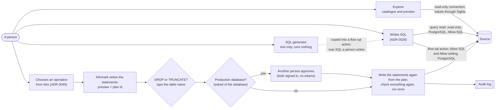

# 0045 Database tools: explore a source, generate its SQL, and change it only with controls

Status: Accepted (5 November 2026). Amends [ADR 0028](0028-sql-in-reads-and-flow-actions.md).

## Context

A designer working on a pipeline keeps leaving Kilnmark for a database client: to see which
tables a source has and what their columns, keys and indexes are, to look at a few rows, to get
the `CREATE TABLE` for a target, or to add a column or an index before a load. Other data
integration tools have this in the product: a database explorer beside the connection, a SQL
editor that writes DDL for a table, and connection settings on tabs. The owner decided on
5 November 2026 that Kilnmark has it too, in four parts:

1. **Explore** on a source's page: live schemas, then tables and views, then columns, keys,
   indexes and row counts, and a preview of the first rows.
2. **A SQL generator**: `CREATE TABLE` (from a table, or from what a pipeline's write node would
   create), `ALTER TABLE` for added columns, `CREATE INDEX` and `DROP`, in each database's
   dialect, to copy or save.
3. **Connection settings as tabs**: General, Advanced, Options, Pooling and Partitioning.
4. **Operations that change a database**, which the owner chose to allow *with controls* rather
   than leave to other tools: a per-source switch off by default, designers and admins only, a
   preview of every statement, typing the table's name to confirm a drop or a truncate, an audit
   event for each, and a second person's approval on production sources.

The first three only read or only write text, and fit the rules Kilnmark already has. The fourth
does not: [ADR 0028](0028-sql-in-reads-and-flow-actions.md) says a statement that changes a
source runs in one place only, a flow's `sql` action, on PostgreSQL, with Allow SQL on, written by
a designer with the unmask grant and saved as a version. This record says what the database tools
may do, and exactly what in ADR 0028 changes and what stays.

## Decision

### 1. Explore reads the catalogue, and previews rows through `Sights`

- **What it shows.** For a database source: its schemas, the tables and views in one, and for a
  table its columns (name, type as the database names it, size, nulls, and whether it has a
  default or is generated, never the default's text), primary key, foreign keys, the tables whose
  keys point at it, indexes (unique or not), and a row count. An index on an expression, or a
  partial (filtered) index, shows as "expression" or "partial", never its text: either can quote a
  value (`WHERE ssn = '…'`). Nothing is stored: each view asks the database, so Explore shows what is
  there now, also before a scan. Listings are paged as the source's asset listing is.
- **How.** Through the driver's own catalogue (`DatabaseMetaData`) and the per-database estimate
  queries the scan already uses. Names reach the catalogue as the driver asks for them: exact
  names for keys and indexes, search patterns with `_` and `%` escaped for columns, and every
  answer is kept to the exact table asked for, so a driver that ignores the escape cannot show a
  look-alike table. A table is first found by the source's own lookup (`Connector.asset`), so a
  name not in the catalogue is refused before any other call. Every query is one Kilnmark writes;
  no text a person types is put into SQL. Each call runs within the time limit people's checks
  have (`SourceChecks.forPerson`, which also caps how many run at once), on a connection set
  read-only (`setReadOnly`, in a transaction that is rolled back). On PostgreSQL, MySQL and Oracle
  the database enforces that; on SQL Server it is a hint only, which is acceptable because only
  Kilnmark's own catalogue and count queries run there. Indexes are new: the scan never read them
  (`getIndexInfo`, with `approximate` on, so Oracle does not analyse the table to answer).
- **Row counts** are the database's estimate (PostgreSQL `reltuples`, SQL Server partition stats,
  Oracle `NUM_ROWS`, MySQL `TABLE_ROWS`), labelled as an estimate. **Count exactly** runs
  `SELECT COUNT(*)` of the table, its names quoted as reads quote them, on the read-only
  connection within the same time limit.
- **The preview** is the source's existing live preview (`GET /api/v1/sources/{name}/preview`,
  `SourceService.preview`), unchanged: the first rows of a table or view, read by the connector,
  never stored, and shown **through `Sights`** (`Sights.catalogue`), so a column marked sensitive is
  masked for everyone without the unmask grant (ADR 0027), admins included.
- **Who.** Stewards, designers and admins, as for the source's containers, assets and preview
  today. Viewers do not see Explore. It is not offered to the assistant or the MCP server in this
  record.
- **Which sources.** PostgreSQL, SQL Server, MySQL and MariaDB, and Oracle in full. Generic JDBC
  sources show their schemas, tables, columns and primary key as the scan reads them, without
  foreign keys, indexes or counts: drivers place schemas and catalogues their own ways, and quote
  names only once connected. File and object-store sources keep their own listing.

### 2. The SQL generator writes text and runs nothing

- `CREATE TABLE` from a table Explore shows, or from a pipeline's write node (the table its
  `create` mode would make from its input's columns), `ALTER TABLE ... ADD` for columns, `CREATE
  INDEX` (unique or not) for chosen columns, `DROP TABLE`, `DROP INDEX` and `TRUNCATE TABLE`.
- **One dialect code.** The statements come from the same per-database code as the write node's
  `create` mode (`WriteSql`), extended to the other statements, so the type chosen for a column
  and the quoting of a name are the same whether a pipeline creates the table or a person copies
  the statement. Names are always quoted and schema-qualified.
- **Types.** A column's type is the dialect's type for its kind (`JdbcColumn.Kind`), from the
  dialect's own list. A column whose type has no kind (a range, `hierarchyid`, an enum) is listed
  under "left out", never copied as the catalogue spells it: a type's name is text from the
  database and can carry anything.
- **No values.** The generator writes names, types, nulls, keys and plain indexes. It never copies
  a default, a check, a comment, a partition bound, a generated column's expression, an index on an
  expression or a partial index's condition: they can quote values, and they are each database's
  own. The page lists what was left out.
- **Copy or save.** The text can be copied, or saved as a `.sql` file. Nothing is run from the
  generator, and nothing typed into it reaches a database. Stewards, designers and admins use it,
  as they use Explore.

### 3. Connection settings on tabs

The source form becomes five tabs; the settings in them keep the rules they have:

- **General**: name, kind, host, port, database, login, Allow writing, Allow SQL, Allow changes,
  and Production (admins; point 4.7).
- **Advanced**: the connector's own vetted settings (ADR 0030: time limits, TLS, characters, the
  database's harmless named settings) and identifier quoting for what pipelines write (always, the
  default; or only when a name needs it). Database operations always quote, whatever it says.
- **Options**: driver properties, picked from the list each connector allows: for a registered
  driver, the properties its registration allows (`allowedProperties`, itself within
  `RegisteredDriver.VETTED`), and the block-list still applies over any list. Nothing off the list
  can be typed in; the tab is a picker, not a free key and value table.
- **Pooling**: the largest number of connections Kilnmark holds open to the source at once, how
  long one may stay idle, how long to wait for one, a statement timeout for the source (today the
  server's settings set it for all sources), and a JDBC **socket timeout** (the backlog item), so a
  connection whose server stopped answering is given up rather than held. Kilnmark opens a
  connection for each use today; keeping them open between uses comes with this tab, with two
  rules: read-only and writable connections are kept in **separate pools**, and a connection is
  reset when it comes back (PostgreSQL `DISCARD ALL`, or closed where a database has no reset).
  Connections used by SQL a person writes (query reads, flow `sql` actions) and by database
  operations are **never pooled**: a `SET ROLE`, a `search_path` or a temporary table must not
  reach the next use. Bounded: at most 50 connections, each timeout at most an hour.
- **Partitioning**: splitting a big read by key range. A source sets how many parts a read may be
  split into at most (1, the default, means never); a `read` node of a table names a column of
  that read (a whole number, decimal, date or timestamp) to split on, quoted as reads quote names.
  Kilnmark reads its minimum and maximum and reads the parts at once, each a range bound as
  parameters, one more part for nulls. A `read` with a `query` cannot be split. Each part takes a
  place under the source's **Most runs at once** (ADR 0040), so splitting never exceeds what the
  source allows. A run's record shows how many parts there were and the rows of each, **never the
  bounds**: they are values of the column, which may be marked.

There is no clustering tab: Kilnmark does not spread one source over several servers.

### 4. Operations that change a database: a third way, with controls

A **database operation** is one of: create a table (from the generator), add columns, create an
index, drop an index, drop a table, truncate a table. It is not SQL a person writes: the person
chooses the operation, the table and the columns from lists, and **Kilnmark writes every
statement**. The text cannot be edited before it runs; a person who wants different SQL copies it
and runs it elsewhere, or writes a flow `sql` action under ADR 0028.

Controls, every one checked by the server, not only by the page. They govern **database
operations**; what they do not cover is said in point 12.

1. **Allow changes**, a per-source switch beside Allow writing and Allow SQL, **off by default**.
   A designer or an admin turns it on or off; each change is an audit event
   (`source.allow_changes`), from the form or an import. It is independent of the other two: Allow
   writing lets pipelines write rows, Allow SQL lets people's own SQL run, Allow changes lets these
   operations run. **It is bound to the connection**: any change to what the source connects to
   (URL, host, port, database, login, password or password reference, or a driver property that
   names a database, catalogue, schema or server) turns Allow changes off again and cancels the
   source's open plans, so a source cannot be turned on in one place and pointed at another.
2. **Designers and admins only**, by role, and only with authentication on (tokens or the identity
   provider): with sign-in off, where every caller on the machine is an admin, operations are
   refused. The unmask grant is not needed: an operation shows no values and the statements carry
   none. Stewards and viewers can use Explore and the generator. The assistant and the MCP server
   cannot run operations.
3. **A plan is a shape, not text.** A plan stores the operation and its fields: the schema and the
   table as separate names, the columns with their kinds, the index's columns. Statements are
   written from those fields by the dialect code, with every name quoted and schema-qualified, and
   types only from the dialect's list; nothing is taken as text from a request or from the catalogue
   (a type's name, a default, an expression). A table, column or index an operation acts on must
   exist in the live catalogue; a new name must be a plain identifier within the database's length
   limit. **Only the source's own database**: an operation acts on schemas of the database the
   connection is to, never another database on the same server, and a MySQL or MariaDB source with
   no database set gets no operations. Objects in the database's own schemas (`pg_catalog`, `sys`,
   `information_schema`, Oracle-maintained schemas) are refused. `DROP` and `TRUNCATE` never cascade
   (no PostgreSQL `CASCADE`, no Oracle `CASCADE CONSTRAINTS`): a table other objects depend on is
   refused by the database, and the failure says so.
4. **A preview of every statement.** The server answers a request with the exact statements, the
   database they will run on, what the run will need (a typed name, an approval) and a plan id. The
   plan lasts 15 minutes (24 hours once approved). It is **bound** to: who made it; the source; the
   source's connection target and the database's identity (point 7); and a fingerprint of the
   objects it acts on, including each one's identity in the database (PostgreSQL `oid`, SQL Server
   `object_id`, Oracle `OBJECT_ID`, MySQL the table's creation time, and a MySQL table without one is
   refused), so a table dropped and re-created, or swapped for one of the same shape, no longer
   matches. **Run** names the plan id. The server then:
   - checks the plan's **seal**: an HMAC, with a key derived (HKDF) from the key that seals source
     passwords and so never kept in Kilnmark's own database, over the plan's id, source, maker,
     fields, statements, target, identity, fingerprint and expiry. An approval adds a second HMAC
     over the plan's id, its seal, the approver and the time. A row whose seals do not match is
     refused, so no one who can write Kilnmark's database can change a plan, its maker or its
     approval;
   - writes the statements again from the plan's fields and refuses the run if they differ from
     those previewed;
   - checks again, as they are now, everything it checked when planning: Allow changes, the
     caller's role, authentication, the source's kind and connection target, and **whether an
     approval is needed now** (point 7), whatever the plan said; and that the approver is not the
     maker;
   - on the run's own connection, inside its transaction: reads the database's identity and the
     own-database marker again (points 7 and 9), takes the table's lock where the database's DDL is
     transactional (PostgreSQL, SQL Server), re-reads the fingerprint, and refuses on any
     difference. A `CREATE TABLE`, which has no fingerprint, is still bound by the identity;
   - runs the statements once (`UPDATE … WHERE ran_at IS NULL` decides who runs it).
   On MySQL, MariaDB and Oracle, and for the online forms of point 8, DDL commits by itself, so the
   check and the statement are not under one lock: a change made in that moment by someone else is
   not caught. The identity and fingerprint checks narrow it to that moment.
5. **Typing the table's name** confirms a `DROP TABLE` or a `TRUNCATE TABLE`: the run request
   carries the name as typed, and the server compares it, case for case, with the plan's table.
6. **An audit event for each** (ADR 0029): `db.change.planned`, `db.change.approved`,
   `db.change.refused`, `db.change.ran` (rows affected where the database says, and how long it
   took) and `db.change.failed`, each with the source, the operation, the object, the statements
   (names and types only), who made it and who approved it. **Errors never carry the database's
   text**: a failed unique index quotes the duplicated value on PostgreSQL, MySQL and SQL Server
   ("Key (ssn)=(…)"). A failure is reported, shown and stored as the statement that failed, its
   SQLSTATE or error code, and a fixed message Kilnmark writes for that code. Explore and **Count
   exactly** report their failures the same way (a cast in a view can quote a value).
7. **A second person on production databases.**
   - **What is Production.** An admin marks a source **Production**. Kilnmark then reads the
     database's own identity through that source and keeps it in a **register of production
     databases**, apart from the source record: PostgreSQL `system_identifier` with
     `current_database()`, SQL Server `service_broker_guid` with `DB_NAME()`, MySQL and MariaDB
     `@@server_uuid` (the whole server: a MySQL database is a schema of it), Oracle `DBID` with
     `CON_DBID`. An operation needs approval when the database it runs on, read live through
     whichever source, is in the register, **or when its identity cannot be read** (a login without
     the right to read it: the guide says which right to grant). Host names, aliases, proxies,
     password references and second sources over the same database therefore make no difference:
     the database is asked who it is. Editing or deleting the source that was marked leaves the
     register as it was.
   - **Who approves.** Another person, a designer or an admin, as for the unmask grant (ADR 0038).
     **Only people signed in with the identity provider** (ADR 0036) may make, approve or run a
     plan that needs approval; an API token is refused (403), so no one can make a plan with a token
     and approve it as themselves. People are compared by the provider's fixed id (issuer and
     subject), never by name. Only the person who made the plan runs it. Without the identity
     provider, operations that need approval are refused.
   - An approved plan runs once, within 24 hours of approval; a refused, expired, cancelled or
     already run plan cannot run.
   - **Until environments exist** (backlog, "change approval and environments"), only an admin
     marks a source Production, and the register is changed only by two people: removing a
     database from it, changing the connection settings of a source marked Production, or deleting
     that source each needs an admin signed in with the provider to ask and another to approve, and
     both are in the audit log (`source.production`). A save or an import that leaves Production out
     keeps it. When environments arrive, the register becomes the production environment's list of
     databases.
8. **How it runs.** On a fresh, unpooled, writable connection, in one transaction where the
   database can undo DDL (PostgreSQL, SQL Server), statement by statement where it cannot (MySQL,
   MariaDB, Oracle commit DDL by themselves), saying which statements ran if one fails. Within the
   source's statement timeout (Pooling tab), or 5 minutes when it has none; the socket timeout of an
   operation's connection is set above the statement timeout, so a statement is never abandoned by
   the driver while the database is still running it. **A wait for locks is bounded on every
   database**, so an operation queued behind a long read gives up rather than blocks the table for
   everyone: PostgreSQL `lock_timeout`, MySQL and MariaDB `lock_wait_timeout`, SQL Server
   `SET LOCK_TIMEOUT`, Oracle `ddl_lock_timeout`, each 10 seconds. Building an index blocks writes to
   the table while it builds; the preview says so, and where the database has an online form
   (PostgreSQL `CONCURRENTLY`, MySQL `ALGORITHM=INPLACE, LOCK=NONE`, Oracle `ONLINE`, SQL Server
   `ONLINE = ON` on editions that have it) it is offered as a choice, run outside a transaction.
9. **Never Kilnmark's own database.** Kilnmark's own database is PostgreSQL. It holds an instance
   marker: a table `kilnmark.instance` with a random id made when Kilnmark first starts. Before an
   operation on a PostgreSQL source, at planning and again on the run's connection, Kilnmark asks
   the source's database whether such a table exists, from `pg_class` and `pg_namespace`, which
   every login can read. If it exists and its id is Kilnmark's, or its id cannot be read, the
   operation is refused. As the database itself is asked, host names, aliases and proxies make no
   difference. Refusing every use of such a source (reads and SQL a person writes, ADR 0028's open
   decision) is for the owner; this record refuses operations.
10. **No login check, and why.** ADR 0028 refuses superuser and file or program rights before SQL a
    person writes, because such SQL can call functions and read files. An operation cannot: its
    statements are fixed shapes over objects of the source's own database, outside the database's
    own schemas. What it may drop is what the login may drop; the guide lists the rights each
    operation needs and recommends a login without them while Allow changes is off.
11. **Which databases.** PostgreSQL, SQL Server, MySQL and MariaDB, and Oracle: the databases whose
    dialect `WriteSql` already writes. Generic JDBC sources get Explore and the generator, not
    operations, until a database there has a dialect of its own.
12. **What this does not cover.** These controls govern database operations. A pipeline's write
    node (`replace` drops the old table after swapping in the new) and a flow's `sql` action can
    also change a production database, under their own controls (Allow writing; Allow SQL, the
    unmask grant and versions, ADR 0028), and one designer can run them. A second person's approval
    before a pipeline or flow version runs in production is the backlog's "change approval and
    environments" (Compliance, change management); until it ships, a production source that must
    have two people for every change keeps Allow writing and Allow SQL off and uses operations.

## What changes in ADR 0028, and what stays

**Changes:**

- ADR 0028's "a statement that changes a source runs only in a flow `sql` action" becomes: a
  statement that changes a source runs in a flow `sql` action (ADR 0028) **or as a database
  operation (this record)**, and nowhere else.
- Database operations run on PostgreSQL, SQL Server, MySQL, MariaDB and Oracle, not PostgreSQL
  only, because no text a person wrote is parsed or run: Kilnmark writes each statement from a
  fixed set of shapes, with names checked against the catalogue and quoted.
- They are gated by **Allow changes**, not Allow SQL, and are open to designers and admins
  without the unmask grant, because they neither read nor show values.

**Stays as it was:**

- SQL a person writes still runs in exactly two shapes, a `read` with a `query` and a flow `sql`
  action, both on PostgreSQL only, both behind Allow SQL, written only by designers with the
  unmask grant, checked by `SqlTokens`, saved as versions, under the login check.
- Query reads, Explore and the preview run on the **read-only** connection, in a read-only
  transaction. Whatever a query read returns is marked sensitive.
- The generator's text becomes SQL a person writes the moment someone puts it into a flow `sql`
  action, and then every rule of ADR 0028 applies to it.
- Allow writing still governs pipelines' writes; Allow SQL still governs people's own SQL;
  neither turns on database operations, and Allow changes turns on neither of them.
- The expression language still never runs code, and no parameter or variable can name a table.

## Consequences

- A designer can see a source, get its DDL and make routine changes (a staging table, a missing
  index, an added column) without leaving Kilnmark, and every database operation is previewed,
  confirmed, logged, and on a production database approved by a second person. Pipelines' writes
  and flows' `sql` actions are not yet under that approval (point 4.12).
- An operation can still do damage within its shape: dropping the wrong table is possible, and the
  name typed to confirm it is the guard, with the database's own backups behind it. The login
  matters most: a source whose login cannot drop tables cannot drop them through Kilnmark. The
  guide says which rights each operation needs and recommends a login without them when Allow
  changes is off.
- Explore runs catalogue queries on demand, which a busy database feels a little. They are small,
  bounded and on the read-only connection; the source's **Most runs at once** does not count them.
- The register of production databases is a stop-gap until environments: two admins acting
  together can remove a database from it. That is the same limit ADR 0038 accepts: the provider
  decides who is a person; two people are needed, and the audit log shows both. A login that cannot
  read its database's identity makes every operation through it need approval; the guide says
  which right to grant so that ordinary databases do not.
- **Related gap, not opened here: marks follow the source record.** A designer can add a second
  source over a database with marked columns, using a password reference (`env:` or `secret:`), and
  that source has no marks, so its preview shows those columns to stewards and admins. This is how
  sources have always worked; Explore uses the same preview. The fix belongs with marks, not here:
  keying marks by the database's identity (point 4.7), and making password references admin-only.
  It is added to the backlog's hardening item.
- The SQL generator follows `WriteSql`: when a database's `create` types change, so does the
  generated DDL, and the guide's type table stays the one source of truth.
- Three new tables in Kilnmark's own database, in a migration of their own: `db_change_plan` (the
  plans, sealed, with their approval and outcome), `production_database` (the register of point
  4.7) and `instance` (the random id that point 4.9 looks for). Allow changes, Production, the pooling settings and the
  partitioning limit are keys of the source's settings, as Allow writing and Allow SQL are
  (`CommonSettings`).
- **Open owner decision: a table never scanned.** The source's live preview, which Explore reuses,
  masks by the marks the catalogue holds; a table never scanned has none yet, so a steward sees its
  values. This is how the preview has always worked, and Explore does not change it. The owner may
  choose to mask every value of a table without marks for callers without the unmask grant, in
  every preview, until a scan has run and a steward has had the chance to mark it.
- docs/design/database-tools.md carries the design (API, pages, per-database notes and the order
  of work); the guide gets a "Database tools" page as each part ships.
