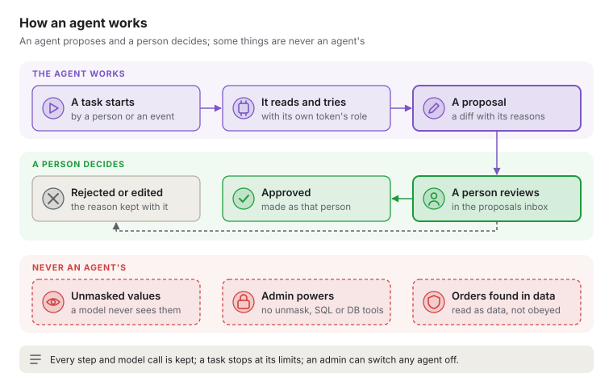

# 0052 Agents propose; people decide

Status: Accepted (6 November 2026)

## Context

An agent is a model that works in steps: it reads, calls tools, looks at what came back and
tries again until a task is done. Kilnmark's AI so far answers once and stops
([ADR 0012](0012-ai-runtime.md), [ADR 0016](0016-ai-runtime-choices.md)), and AI in pipelines
works row by row ([ADR 0050](0050-ai-in-pipelines.md)).

Agents already appear in the plans: a steward agent that works the queue overnight and an MCP
server agents act through (docs/product/architecture-spec.md), agents people build themselves,
an optimisation agent, and "agents that choose the next step in a flow"
(the plan and scope, "Beyond v0.1"). ADR 0050 lists explaining failed runs,
drafting a pipeline and suggesting quality rules as work beyond nodes. The MCP server is read-only:
`search_assets`, `get_asset`, `list_sources` and `search_docs`, under the caller's token.

Kilnmark runs inside banks. A bank must be able to say exactly what last night's load did and
why. An agent that changes a production run on its own breaks that. An agent that helps people
build, fix and look after pipelines, with a person deciding each change, makes it stronger. The
owner asked on 6 November 2026 for a decision on agents in the product, pipelines and flows.

## Decision

1. **Agents work at design time and in operations, not inside a run.** They draft, diagnose,
   suggest and report. A scheduled pipeline or flow runs the saved version a person approved,
   and no agent changes what it does while it runs.
2. **In flows, a model makes only bounded choices.** Free agents that choose a flow's next step
   are not built; this replaces that line in Plan & Scope. A flow may branch on a model's answer
   only through an `ai` node's `classify` (ADR 0050) followed by a `route` or `gate`, so the
   branches are fixed when the flow is saved, each answer carries its confidence, and rows below
   the threshold go to a person. Lineage and the run record show which branch a model chose and
   why.
3. **An agent is an identity.** Each agent acts with its own API token, given the least role that
   will do, never admin, and never with the unmask grant, since a model never sees a sensitive
   value unmasked ([ADR 0027](0027-unmasking-is-a-grant.md)). A token for an agent is marked as
   one and named `agent:`, as `sso:` marks people. When a person starts an agent, it acts with
   the lesser of the person's role and the agent's own, and the audit log names both
   ([ADR 0029](0029-audit-log.md)).
4. **Proposals, not actions.** Anything an agent would change (a pipeline, a flow, a rule, a
   schedule, the catalogue) lands as a proposal: a diff with the agent's steps, the facts it used,
   the model and the prompt version (ADR 0012, rule 3). A person approves, edits or rejects it,
   and the change is made as that person. Reads, checks and previews on masked samples need no
   approval. Starting a run of a saved version needs a steward-role agent and an administrator
   turning that on for it. Database operations ([ADR 0045](0045-database-tools.md)), SQL text
   ([ADR 0028](0028-sql-in-reads-and-flow-actions.md)), tokens, settings and the unmask grant
   are never an agent's: SQL a model wrote is not SQL a person wrote.
5. **Kilnmark's own tools only.** An agent's tools are Kilnmark's public API, the same actions
   the MCP server offers, so every value it reads goes through `Sights` and its role. It has no
   shell, no files outside Kilnmark, and no web access of its own; a web call is a pipeline's
   `http` node behind the allowed hosts an administrator sets (ADR 0049).
6. **What an agent reads is data, never orders.** Rows, descriptions, documents, run logs and web
   answers are given to the model marked as data. An instruction found in them is not followed,
   and cannot widen what the agent may do, because the limits above are checked by Kilnmark, not
   by the model. A proposal that came from such text is still only a proposal.
7. **Limits and an off switch.** Each task has a most steps, model calls, tokens and time; at a
   limit it stops and reports what it did. An administrator can switch any agent off, or all of
   them, at once. Agents use the `agents` feature's model (ADR 0012, per-feature routing): local
   by default, a hosted provider only if an administrator chooses one, and every call is in the
   usage log and the task's record.
8. **Every task is kept.** A task's record holds who or what started it, each step, each tool
   call and its result, each model call, and the proposal it ended with. The reviewer sees it
   beside the proposal.
9. **Scored before it ships, and useful with AI off** (ADR 0012, rules 4 and 5). Each agent is
   scored against the lab's answer key, with seeded faults and the known fix for each, and a
   release that scores worse does not ship. With AI off, the failed-run agent falls back to the
   built-in playbook; the others say they need a model.

## The agents, in order

1. **Failed runs.** When a run fails, the agent reads its record, the lineage and the source's
   current schema, finds the likely cause (a renamed column, a gate tripped by bad data, a source
   that refused the connection) and proposes a fix and a re-run. It grows from the playbook, and
   it shortens the night call-out most. It comes first.
2. **Drafting a pipeline.** From a description, it drafts the pipeline from the catalogue, checks
   it with Kilnmark's own checks and fixes its problems until it saves cleanly, then previews it
   on masked samples, and hands a designer a proposal. Kilnmark's checks and preview mean it
   cannot hand over a pipeline that does not check.
3. **Stewardship overnight.** It drafts descriptions and classifications, suggests quality rules
   from profiles, and reports drift, then leaves a morning digest for stewards to approve in
   batches.
4. **Outside agents through the MCP server.** Run tools (start, watch, read a run's record) and
   proposal tools join the read-only ones, so an assistant a customer already uses can work with
   Kilnmark under its own token's role. Each refusal is in the audit log.
5. **Agents people build** (Plan & Scope, "Building agents"): a model, instructions, tools from
   the list above and limits, saved and versioned like a pipeline. Last, once the four above
   have shown the rules hold.

## Consequences

- Proposals from every agent go to one inbox, with the task's record beside each. Stewards and
  designers approve there; the access review lists every agent token.
- New audit events for a task started, a proposal made, approved or rejected, and a refusal.
- Agents are slower and cost more than one model call: the run page and the usage log show
  each task's calls, tokens and time, and the benchmarks (docs/design/benchmarks.md) measure the
  failed-run agent's time to a proposal.
- An agent can still be wrong. It is accepted because a person decides every change, the record
  shows how it got there, and the score shows how often it is right.
