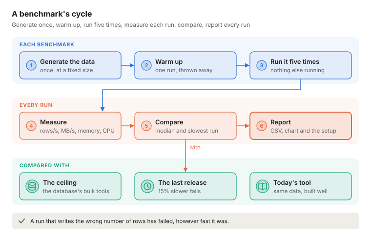
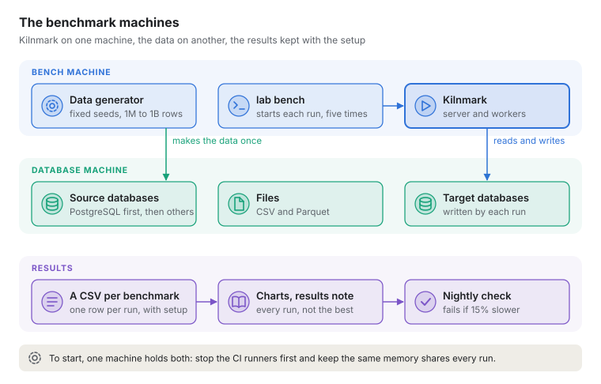

# Benchmarks: volume and throughput

**Status: planned.** Nothing here is built yet. This note says how Kilnmark will measure how much
data it moves and how fast, so the numbers can be trusted, repeated and compared. The work is on
the [backlog](../product/backlog.md), first in the Optimise item; the first builds follow the
steps in section 11.

The only figures today come from the engine spike
([spike 0001](../spikes/0001-arrow-row-sets.md)): on a 2-CPU container, about 2 million rows a
second in memory, and under 1 million rows a second reading PostgreSQL. That was one node type
on one machine. Nothing has yet measured a whole pipeline from source to target, at volume, next
to anything else.

## 1. What we want to know

- How many rows and megabytes a second a pipeline moves, end to end, for the common shapes of
  work, at 1 million to 1 billion rows.
- Where the time goes: which node, the source, the target, the engine or Kilnmark's own
  bookkeeping.
- What governance costs: the same pipeline with and without a quality gate, profiling and
  masking.
- How it grows: more workers, more CPUs, more runs at once.
- How it holds up: a day of scheduled runs, and a worker or database that stops mid-run.
- How it compares with the database's own bulk tools (the ceiling), with the last release (the
  regression check), and with the integration tool a customer runs today.

## 2. The data

All benchmark data is generated, never copied from anywhere. It lives with the lab and is never
shipped ([ADR 0024](../adr/0024-the-lab-is-not-the-product.md)).

| Set | Shape | Why |
| --- | --- | --- |
| **Orders** | The eight tables of the TPC-H schema (customers, orders, line items, parts, suppliers and so on), made by its own generator `dbgen` | Joins, lookups and aggregates on a schema everyone knows |
| **Wide** | One table of 100 columns, mixed types | Memory per row and the cost of many columns |
| **Text** | A table with long free-text columns (up to 4 KB) | Strings, encodings and memory pressure |
| **Dirty** | The orders set with about 2% of rows broken: nulls where a value is required, impossible dates, duplicates, numbers out of range | Quality gates have real work to do, and set rows aside |
| **Files** | The orders set as CSV and as Parquet, one file and many | Parsing, and reading many files |

- **Sizes:** 1 million, 10 million, 100 million and 1 billion rows in the largest table. The
  1-billion size is for release runs only.
- **Fixed seeds:** the same size always gives the same data, so two runs months apart read the
  same rows.
- **Naming:** results from the orders set are called "TPC-H-derived". Published TPC-H results
  must be audited by the TPC, and these are not.
- **Generated once per machine:** the data is made before the first run and kept, so generating
  it is never timed as part of a run.

## 3. The workloads

| | Workload | What it shows |
| --- | --- | --- |
| W1 | **Copy a table**: read one database table, write it to another database | Raw read and write speed, batch sizes, connections |
| W2 | **Load files**: CSV and Parquet into a database table | Parsing and loading |
| W3 | **Join, look up and aggregate**: line items joined to orders, a lookup to customers, totals per region and month | Memory, sorting, spilling to disk |
| W4 | **Governed load**: W1 with a quality gate, profiling and masked columns, on the dirty set | What governance costs in speed |
| W5 | **Wide and text**: W1 over the wide and text sets | Cost per column and per byte |
| W6 | **A flow at width**: a flow whose for-each node runs a pipeline for 50 regions at once | Parallel runs, queueing, worker slots, per-source limits ([ADR 0040](../adr/0040-parallel-runs-and-limits.md)) |
| W7 | **Many small runs**: 200 small pipelines started at once, by the scheduler and through the API | The queue, the scheduler and the connection pool under load |
| W8 | **Governed reads at size**: a masked preview, Explore and a profile on the largest tables | That what people use every day stays quick |

Each workload is a saved pipeline or flow, kept with the lab, so anyone can read exactly what was
measured. Sources and targets are PostgreSQL first, then SQL Server, Oracle and MySQL, as the
tests already run them.

## 4. What is measured

Every run records the same figures, in the same units:

- **Speed:** rows a second and megabytes a second, and the time from start to finish. Each
  node's own time comes from the run timeline, which Kilnmark already records.
- **The engine:** CPU, Java heap at its peak, Arrow memory at its peak, time spent collecting
  garbage, and bytes spilled to disk. These come from Java Flight Recorder, which runs with the
  benchmark and costs about 1% of speed.
- **The databases:** connections in use, rows read and written, and waits, from each database's
  own statistics.
- **The machine:** CPU, memory, disk and network use on each machine, every second.
- **The setup:** Kilnmark's version and settings (`kilnmark.worker.concurrency`, memory limits,
  batch sizes), the database versions and settings, and the hardware.

## 5. What it is compared with

- **The ceiling:** the database's own bulk tools moving the same data on the same machines:
  `COPY` for PostgreSQL, `bcp` for SQL Server, SQL\*Loader for Oracle, `LOAD DATA` for MySQL. No
  integration tool can beat them, so they show how close Kilnmark gets.
- **The last release:** the same workload on the release before, to catch anything that got
  slower.
- **The integration tool a customer runs today:** the same workloads built in it, on the same
  machines and data, by someone who knows that tool well and follows its own advice on tuning.
  A comparison is only fair if both sides are built well. Some products' licences forbid
  publishing benchmark results without their maker's consent: check the licence before any
  comparison is shown outside the team.

## 6. Where it runs

- **Two machines of fixed size,** used for nothing else while a benchmark runs:
  - the **bench machine** runs Kilnmark (server and workers), the data generator and the bench
    command;
  - the **database machine** runs the source and target databases and holds the files.
- A starting size is 16 CPUs and 64 GB each, with local SSDs and a fast network between them.
  Cloud machines of a named type are just as good, and anyone can hire the same ones.
- **Never a developer's own desktop** for figures that are published: other work on it changes
  the results.
- Every result file says which machines it ran on.

### What a machine needs

Kilnmark itself needs only 4 GB of memory and 10 GB of disk to run (INSTALL.md). A benchmark needs
far more, because the databases and the data sit beside it:

| Size | One machine (Kilnmark and databases together) | Disk free, fast SSD |
| --- | --- | --- |
| Up to 10 million rows (steps 1 to 3) | 8 CPU cores, 32 GB of memory | 100 GB |
| 100 million rows | 8 cores or more (16 threads), 48 GB | 250 GB, NVMe |
| 1 billion rows | Two machines of 16 CPUs and 64 GB each (section 6) | 1 TB NVMe on the database machine |

And on each machine:

- Podman 5 (on Windows inside WSL 2, as the project's runners use it), the lab's containers, and
  the project's build (Java 25 comes with it).
- The TPC-H data generator `dbgen`, built from the TPC's source under its licence, kept with the
  lab and never shipped.
- A wired network between the two machines, at least 10 Gbit/s, when there are two: anything
  slower measures the network, not Kilnmark.
- A way to read the CPU's temperature and clock speed, recorded with each run.

### Starting on one machine

Steps 1 to 3 of section 11 start on one machine: the owner's server, an Intel Core i9 with 48 GB
of DDR4, with Kilnmark and the databases side by side in its Podman machine. One machine is enough
to answer "how fast is it now", "where does the time go" and "did it get slower", because every
run is compared with runs on the same machine. It is not enough for figures shown to customers:
Kilnmark and the databases compete for the same CPUs, memory and disk, so those wait for the two
machines.

To keep its results steady:

- **Nothing else runs during a benchmark.** If the machine also hosts the project's CI runners,
  stop them first (`podman stop kilnmark-ci-runner kilnmark-ci-runner-2 kilnmark-ci-runner-3`) and
  start them again after; a heavy-databases job alone starts four database containers. The bench
  command refuses to start while a runner container is running, unless told otherwise.
- **Fixed shares of the machine.** For example, of 48 GB: 24 GB to the Podman machine, of which
  8 GB for Kilnmark's heap and Arrow memory and 12 GB for the databases, the rest for the system.
  The same shares every time, written into each result file.
- **The same power settings.** The high-performance power plan, and the machine left to cool
  between long runs: a desktop processor slows itself when hot, and the results show it as
  noise. The CPU's temperature and clock speed are recorded with each run.
- **Enough disk.** The orders set takes about 15 GB of database space at 100 million rows,
  counting indexes, and about 150 GB at 1 billion. The 1-billion size waits for a disk with room
  for the source, the target and the files at once.
- **Its own name in the results,** so its figures are never mixed with another machine's.

## 7. How a run goes

1. **Generate** the data set at the chosen size, once, with its fixed seed.
2. **Warm up:** run the workload once and discard the result, so caches and the JVM are ready.
3. **Run it five times.** Restart nothing between runs, so later runs see a server that has been
   working, as in real life.
4. **Measure** every run, as in section 4.
5. **Compare** the median and the slowest run with the baselines in section 5.
6. **Report** every run, not only the best: a CSV of the figures, a chart, and the setup.

A run whose rows written do not match the rows expected is a failure, however fast it was.

## 8. Beyond speed

- **Soak:** a day of scheduled runs of W1 to W4 at 10 million rows, every 15 minutes. The heap,
  Arrow memory, connections and open files must not grow from one hour to the next.
- **Failure:** stop a worker in the middle of W1, restart the target database in the middle of
  W2, and fill the disk during W3. Each run must fail cleanly, say why, and leave no table half
  written that a later run would trust.
- **Scaling:** W1, W3 and W6 with 1, 2 and 4 workers and with 4, 8 and 16 CPUs, to see whether
  speed grows with them and where it stops.
- **Profiling:** the slowest workloads under async-profiler or Flight Recorder, to find what
  costs the most time. That is where the Optimise work on the backlog starts.

## 9. Making it a habit

- **`lab bench`:** one command (with `lab samples` and the others in `lab/lab.sh` and
  `lab/lab.ps1`) that runs a named workload at a named size, warms up, repeats, and writes the
  results. For example `lab bench copy-table --rows 10m --runs 5`.
- **Results files:** one CSV per benchmark run, with one row per run: the workload, size, run
  number, start time, seconds, rows a second, megabytes a second, heap peak, Arrow peak, garbage
  collection time, bytes spilled, CPU, Kilnmark version, commit and machine. Charts are drawn from
  them.
- **A nightly check:** W1 to W4 at 10 million rows on the CI runner's machine. A median more than
  15% slower than the last release's fails the job and says which workload and how much. It runs
  on the project's own runners, never on GitHub's, so the machine is the same each night.
- **Release runs:** every workload at 100 million rows, and W1 to W3 at 1 billion, before each
  release, on the benchmark machines. The results go with the release notes.

## 10. Publishing results

- A results note, `docs/design/benchmark-results.md`, with the latest release runs, their charts
  and the setup. It is linked from the README once the first full set exists.
- Every published figure names the machines, the versions and the settings, and links the CSV it
  came from.
- No figure is shown without the slowest run beside the median, and without the ceiling for the
  same workload.
- Comparisons with another product follow section 5: built well on both sides, and only shown
  outside the team if its licence allows.

## 11. Building it, in order

1. **The data generator and `lab bench`,** with W1, W2 and W3 at 1 and 10 million rows on
   PostgreSQL, the results CSV and a first results note. This answers "how fast is it now?" and
   shows where to optimise first.
2. **The nightly regression check** at 10 million rows, failing on a 15% slowdown.
3. **W4 to W8,** the other databases, and the soak and failure runs.
4. **The two benchmark machines** and the first release run at 100 million and 1 billion rows.
   Until then, steps 1 to 3 run on the owner's server (section 6, "Starting on one machine").
5. **The comparison** with the integration tool a customer runs today, built by someone who
   knows it, once its licence has been checked.

Each step is its own change, with its decision record where it decides something (for example
the 15% threshold, or the machines' size), and its results in the results note.
