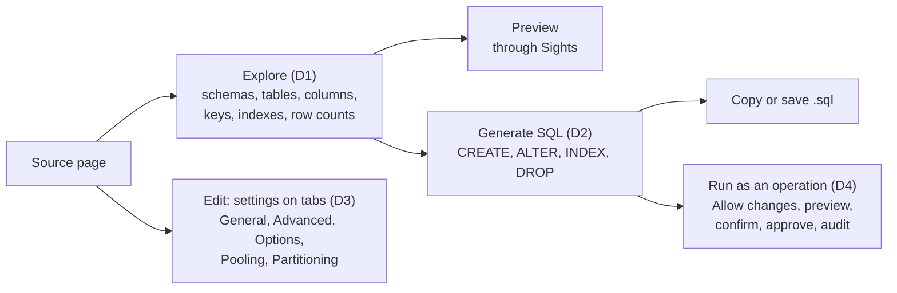
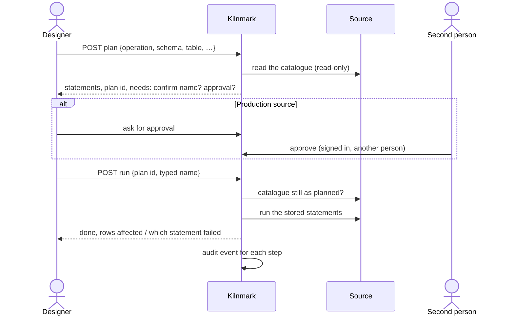

# Database tools

Status: design, 5 November 2026. [ADR 0045](../adr/0045-database-tools.md) records the decision
and what it changes in [ADR 0028](../adr/0028-sql-in-reads-and-flow-actions.md). Slices, in the
order they ship, each its own pull request: D1 Explore, D2 the SQL generator, D3 connection
settings on tabs, D4 database operations. Each is marked **planned** or **built**.

## D1. Explore (planned)

**Page.** A tab **Explore** on the source page, beside the source's settings and scans, for
stewards, designers and admins, on database sources (PostgreSQL, SQL Server, MySQL, MariaDB,
Oracle, Generic JDBC). Three panes, left to right; on a narrow screen they stack:

1. Schemas, with a filter box.
2. Tables and views of the chosen schema, each with its kind and estimated rows, and a filter.
3. The chosen table: tabs **Columns** (name, type, size, nulls, "has a default", in key), **Keys**
   (primary key, foreign keys with the table and columns they point to, unique constraints),
   **Indexes** (name, columns in order, unique, and the database's method where it says), and
   **Preview** (the first rows, masked as the source's preview is). A row count line says
   "about 1,204,000 rows (the database's estimate)" with **Count exactly**.

The chosen schema and table are kept in the address (`?tab=explore&schema=…&table=…`), as the
asset page keeps its tab, so a link opens the same table.

**API**, under `/api/v1/sources/{name}/explore`, all `@RolesAllowed(STEWARD)`, each answered with
`no-store`:

| Call | Answer |
| --- | --- |
| `GET .../schemas` | `{schemas: [name], truncated}`, at most 1,000 |
| `GET .../tables?schema=` | `{tables: [{name, kind: table\|view, estimatedRows}], truncated}`, at most 5,000 |
| `GET .../table?schema=&table=` | `{columns, primaryKey, foreignKeys, unique, indexes, estimatedRows}` |
| `POST .../count?schema=&table=` | `{rows}`: `SELECT COUNT(*)`, within the preview time limit |

The preview is the existing `GET /api/v1/sources/{name}/preview?asset=schema.table`; Explore adds
no new view of values, so `SightsUseTest` needs no new delegate.

**Engine.** A new `kiln-core` interface `connect.Explorer`, which a connector may offer
(`Connector.explorer()`, empty by default), with `schemas`, `tables`, `table` and `count`. One
implementation over `DatabaseMetaData` in `kiln-plugins` (`JdbcExplorer`): `getSchemas` (or
`getCatalogs` for MySQL and MariaDB, where a database is the container), `getTables`,
`getColumns`, `getPrimaryKeys`, `getImportedKeys`, `getIndexInfo(…, approximate=true)`. Each
database's connector overrides only what it does better:

| Database | Estimated rows | Notes |
| --- | --- | --- |
| PostgreSQL | `pg_class.reltuples` (−1 when never analysed: "not known") | system schemas (`pg_catalog`, `information_schema`, `pg_toast`) hidden |
| SQL Server | `sys.partitions` rows for heap or clustered index | `sys`, `INFORMATION_SCHEMA` hidden |
| MySQL, MariaDB | `information_schema.TABLES.TABLE_ROWS` | `mysql`, `sys`, `performance_schema`, `information_schema` hidden |
| Oracle | `ALL_TABLES.NUM_ROWS` | Oracle-maintained schemas hidden (`ALL_USERS.ORACLE_MAINTAINED`) |
| Generic JDBC | none (`getIndexInfo` cardinality where the driver gives it) | `DatabaseMetaData` only |

The schema and table come from the request as values and are only ever bound as parameters or
passed to `DatabaseMetaData` (which takes them as search patterns: `_` and `%` are escaped with
`getSearchStringEscape()`, so `my_table` never matches `myXtable`). `count` quotes the names with the
dialect's `quote` after checking the table exists in the catalogue. The connection is read-only
(`setReadOnly(true)`, and on PostgreSQL `SET TRANSACTION READ ONLY`) and runs through
`SourceChecks.forPerson`, so Explore shares people's time limit and concurrency cap. A source's
allowed hosts (`checkHosts`) are checked first, as for every live call.

**Tests.** `JdbcExplorerTest` against each database in the heavy-databases CI job (schemas,
tables, a table with a composite key, a foreign key, a unique and a plain index, a view;
`my_table` beside `myXtable`); `SourceResourceTest` for roles (a viewer gets 403) and for a file
source (404 "Explore is for database sources"); UI tests for the three panes, the address, and
the estimate's wording.

## D2. The SQL generator (planned)

**Page.** On Explore's table pane, **Generate SQL** opens a panel with a choice of statement:

- `CREATE TABLE` for this table (in this database's dialect, or another's: a designer moving a
  table from SQL Server to PostgreSQL picks PostgreSQL);
- `ALTER TABLE … ADD` for new columns, each a name and a column kind from a list;
- `CREATE INDEX` (or `CREATE UNIQUE INDEX`) over chosen columns, in order;
- `DROP INDEX`, `DROP TABLE`, `TRUNCATE TABLE`.

On a pipeline's write node, **Show the CREATE TABLE** gives what its `create` mode would run, from
the node's input columns (the pipeline's check already knows them).

The text is shown read-only, with **Copy** and **Save as .sql**, and a list of what was left out
("defaults, checks and comments are not copied").

**API.** `POST /api/v1/sources/{name}/explore/sql` (`STEWARD`) with
`{statement, schema, table, dialect?, columns?, index?}`; answer `{sql: [text], leftOut: [text]}`.
`POST /api/v1/pipelines/{id}/nodes/{node}/create-sql` (`STEWARD`) for a write node.

**Engine.** `WriteSql` is package-private; a public facade `jdbc.DdlWriter` (in `kiln-plugins`)
gives `createTable`, `addColumns`, `createIndex`, `dropIndex`, `dropTable`, `truncate`, built on
each dialect's `WriteSql` so types and quoting are the write node's own. A table read by Explore
maps each column to a `JdbcColumn.Kind` with the scan's own mapping, then to the target dialect's
type with `columnType`; a column whose type has no kind (a PostgreSQL range, SQL Server
`hierarchyid`) is kept as the database names it when the target is the same database, and listed
in `leftOut` otherwise. Primary keys become a `PRIMARY KEY` clause; indexes become `CREATE INDEX`
statements after the table. Names are checked with `identifierProblem` and quoted with `quote`.

**Tests.** Golden tests per dialect in `DdlWriterTest` (each statement, quoting a name with a
space or a quote in it, a composite key, a unique index), a round trip in the heavy-databases job
(generate `CREATE TABLE` for a table, run it under a new name, Explore it, compare columns), and
UI tests for copy and save.

## D3. Connection settings on tabs (planned)

`ConnectionPanel` keeps its steps for a new source (Connect, Test, Choose what to scan, Save). For
an existing source, **Edit** opens the same settings on five tabs, each saving the whole form:

| Tab | Settings |
| --- | --- |
| General | display name, description, host, port, database, login, password; Allow writing, Allow SQL, Allow changes, Production (admins), Most runs at once |
| Advanced | the connector's own vetted settings (TLS, time zone, application name…); identifier quoting: always (default) or when needed |
| Options | driver properties, picked from `RegisteredDriver.VETTED` with a value each; a property off the list cannot be added |
| Pooling | `pool_max` (1–50), `pool_idle_s`, `pool_wait_s`, `statement_timeout_s`, `socket_timeout_s` (each 1–3,600) |
| Partitioning | `max_parts` (1–32; 1 = never split) |

New common settings live in `CommonSettings` with their kinds and bounds, so the API, imports and
the form check them alike, and each change of Allow changes or Production is an audit event. The
socket timeout is set with `Connection.setNetworkTimeout` on every connection to the source; the
statement timeout through `SqlDialect.timeout`. The pool is one Agroal pool per source, made on
first use and dropped when the source's settings change; Generic JDBC keeps its connection opened
read-only.

Partitioning: a `read` node may say `split_by: column` (a whole number, decimal, date or
timestamp column); with `max_parts` above 1 Kilnmark reads `MIN` and `MAX` of the column, cuts the
range into that many parts, and reads them at once, each `WHERE column >= ? AND column < ?` (the
last with `<=`, and one part for nulls), each holding a place under Most runs at once. A run's
record shows the parts.

## D4. Database operations (planned)

The flow of one operation:

**Data.** `db_change_plan` (next free migration): `id`, `source_id`, `operation`, `target`
(schema and table), `statements text[]`, `statements_sha256`, `catalogue_fingerprint`,
`requested_by`, `requested_key` (the provider's issuer and subject, null for a token),
`requested_at`, `expires_at`, `needs_approval`, `approved_by`, `approved_key`, `approved_at`,
`refused_by`, `refused_at`, `ran_at`, `outcome` (`ran`, `failed`), `detail jsonb`. Checks in the
table: approved and refused are never both set; `ran_at` only after approval when it is needed; a
plan runs once (`UPDATE … WHERE ran_at IS NULL` decides who runs it).

**API**, under `/api/v1/sources/{name}/changes`, `@RolesAllowed(DESIGNER)` (admins hold it too):

| Call | What it does |
| --- | --- |
| `POST .../plans` | makes a plan: refuses unless Allow changes is on; returns statements and what it needs |
| `GET .../plans?state=` | plans of the source, newest first |
| `POST .../plans/{id}/approve`, `.../refuse` | another person, signed in with the provider (production) |
| `POST .../plans/{id}/run` | `{confirm}` for drop and truncate; runs the stored statements once |

The operations are the generator's (D2) with a fixed shape each; there is no "run this SQL".
The server re-reads the catalogue before running and compares it with the plan's fingerprint (the
table's columns, keys and indexes as Explore read them). Allow changes, the role, sign-in and the
source's kind are checked again at run time, not only when the plan was made.

**What the security review must try.** Running text that is not the plan's (changing the stored
statements, a plan of another source, replaying a run); a name that breaks out of quoting; a
table renamed or swapped between plan and run; approving one's own plan through a second token or
a changed name; turning Production off alone; an operation on Kilnmark's own database; Allow changes
on through an import; a plan made when Allow changes was on, run after it was turned off.

## Not in this plan

- A free SQL editor that runs what is typed: SQL a person writes stays under ADR 0028.
- Clustering, and spreading one source over several servers.
- Explore or operations for the assistant or the MCP server.
- Operations on Generic JDBC sources, until a database there has a dialect of its own.
