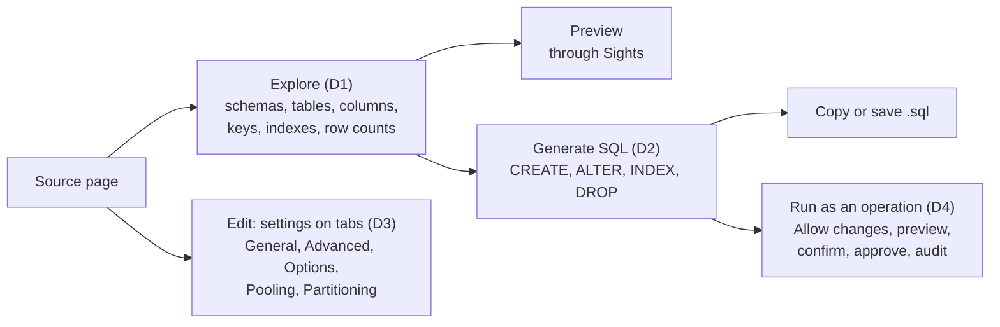
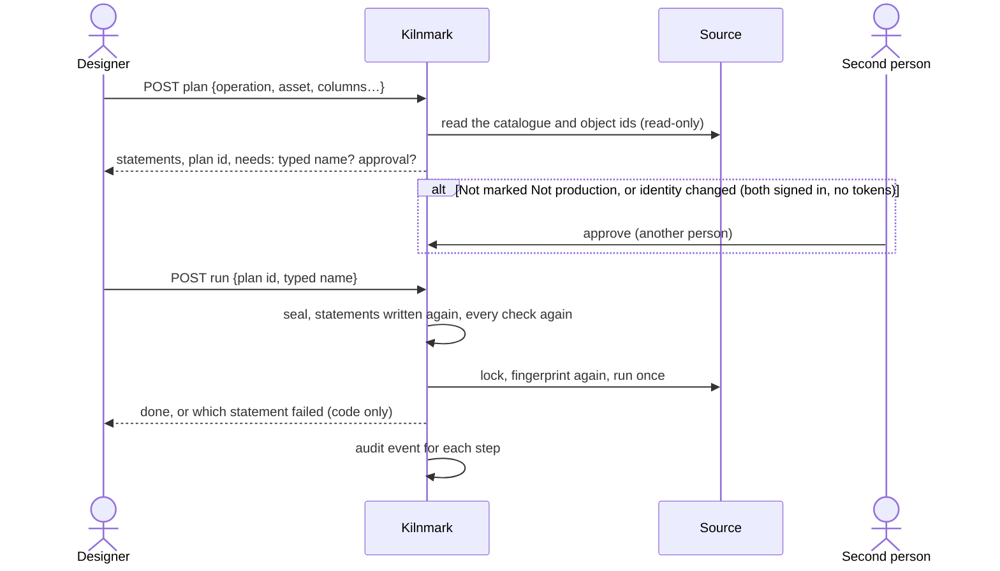

# Database tools

Status: design, 5 November 2026. [ADR 0045](../adr/0045-database-tools.md) records the decision
and what it changes in [ADR 0028](../adr/0028-sql-in-reads-and-flow-actions.md). Slices, in the
order they ship, each its own pull request: D1 Explore, D2 the SQL generator, D3 connection
settings on tabs, D4 database operations. Each is marked **planned** or **built**.

## D1. Explore (planned)

**Page.** An **Explore** section on the source page, for stewards, designers and admins, on
database sources (PostgreSQL, SQL Server, MySQL, MariaDB, Oracle, Generic JDBC). Three panes, left
to right; on a narrow screen they stack:

1. Schemas, with how many tables and views each holds.
2. Tables and views of the chosen schema, each with its kind, paged.
3. The chosen table: tabs **Columns** (name, type, size, nulls, "has a default", generated, in
   key), **Keys** (primary key, foreign keys with the table and columns they point to, and the
   tables whose keys point here), **Indexes** (name, columns in order, unique, primary key, and the
   database's method where it says; "expression" for an index on an expression), and **Preview**
   (the first rows, masked as the source's preview is). A row count line says "about 1,204,000
   rows (the database's estimate)" with **Count exactly**.

The chosen schema and table are kept in the address (`?schema=…&table=…`), so a link opens the
same table.

**API.** Schemas and tables are the source's existing listings (`GET .../containers`,
`GET .../assets?container=`, paged), and the preview its existing `GET .../preview?asset=`; Explore
adds no new view of values, so `SightsUseTest` needs no new delegate. Two calls are new, both
`@RolesAllowed(STEWARD)` and answered with `no-store`:

| Call | Answer |
| --- | --- |
| `GET /api/v1/sources/{name}/explore?asset=schema.table` | `{path, kind, columns, primaryKey, foreignKeys, referencedBy, indexes, estimatedRows}` |
| `GET /api/v1/sources/{name}/explore/count?asset=schema.table` | `{rows}`: `SELECT COUNT(*)`, within people's check time limit |

A source whose connector does not explore (files, object stores) answers 404. A table in one of
the database's own schemas (`information_schema`, `pg_catalog`, MySQL's `performance_schema`,
`sys` and `mysql`, SQL Server's `sys`, Oracle-maintained schemas) is refused by Explore, Count
exactly and the source's preview even when it is named: MySQL's `performance_schema` keeps other
sessions' statements with their values.

**Engine.** `Connector` gains `explores()`, `explore(source, path, timeout)` (a
`connect.TableDetail`) and `countRows(source, path, timeout)`; the defaults refuse. `JdbcConnector`
implements them over `DatabaseMetaData` (`JdbcExplorer`): the table is found first by
`Connector.asset`, the source's own lookup, so the catalogue's spelling is used and an unknown name
is refused; then `getColumns` (schema and table as search patterns, `_` and `%` escaped, results
kept to the exact table), `getPrimaryKeys`, `getImportedKeys` and `getExportedKeys`, and
`getIndexInfo(…, approximate=true)` (exact names, no escaping, as JDBC asks). MySQL and MariaDB
keep databases at the catalog level (`exploreScope`). An index column whose name is not a column of
the table is an expression and shows as "expression"; a partial index's condition is never read.
Estimates reuse each connector's `estimateRowsSql`, which the scan's sampling already uses:

| Database | Estimated rows |
| --- | --- |
| PostgreSQL | `pg_class.reltuples` (−1 when never analysed: "not known") |
| SQL Server | `sys.partitions` rows for the heap or clustered index |
| MySQL, MariaDB | `information_schema.TABLES.TABLE_ROWS` |
| Oracle | `ALL_TABLES.NUM_ROWS` |
| Generic JDBC | none; its Explore shows the columns and primary key the scan reads, no keys, indexes or count |

`countRows` is `SELECT COUNT(*) FROM` the schema and table, quoted by the connector's `quote`, with
`setQueryTimeout`, and only for an ordinary table kept in the database (`localTableSql` for each
database: no view, no foreign, federated, linked or external table, no table with children or a
foreign partition). The connection is set read-only in a transaction that is rolled back (enforced
by PostgreSQL, MySQL and Oracle, a hint on SQL Server), and every call runs through
`SourceChecks.forPerson`, so Explore shares people's time limit and concurrency cap. A source's
allowed hosts (`checkHosts`) are checked first, as for every live call.

**Tests.** Explore against each database in the heavy-databases CI job (a table with a composite
key, a foreign key, a unique and a plain index, an expression index, a view; `my_table` beside
`myXtable`); `SourceResourceTest` for roles (a viewer gets 403) and for a file source (404); UI
tests for the panes, the address, and the estimate's wording.

## D2. The SQL generator (planned)

**Page.** On Explore's table pane, **Generate SQL** opens a panel with a choice of statement:

- `CREATE TABLE` for this table (in this database's dialect, or another's: a designer moving a
  table from SQL Server to PostgreSQL picks PostgreSQL);
- `ALTER TABLE … ADD` for new columns, each a name and a column kind from a list;
- `CREATE INDEX` (or `CREATE UNIQUE INDEX`) over chosen columns, in order;
- `DROP INDEX`, `DROP TABLE`, `TRUNCATE TABLE`.

On a pipeline's write node, **Show the CREATE TABLE** gives what its `create` mode would run, from
the node's input columns (the pipeline's check already knows them).

The text is shown read-only, with **Copy** and **Save as .sql**, and a list of what was left out
("defaults, checks and comments are not copied").

**API.** `POST /api/v1/sources/{name}/explore/sql` (`STEWARD`) with
`{statement, asset, dialect?, columns?, index?}`; answer `{sql: [text], leftOut: [text]}`.
`POST /api/v1/pipelines/{id}/nodes/{node}/create-sql` (`STEWARD`) for a write node.

**Engine.** `WriteSql` is package-private; a public facade `jdbc.DdlWriter` (in `kiln-plugins`)
gives `createTable`, `addColumns`, `createIndex`, `dropIndex`, `dropTable`, `truncate`, built on
each dialect's `WriteSql` so types and quoting are the write node's own. A table read by Explore
maps each column to a `JdbcColumn.Kind` with the scan's own mapping, then to the target dialect's
type with `columnType`; a column whose type has no kind (a PostgreSQL range, SQL Server
`hierarchyid`, an enum) is listed in `leftOut`, never copied as text. Primary keys become a
`PRIMARY KEY` clause; plain indexes become `CREATE INDEX` statements after the table; indexes on
expressions and partial indexes are listed in `leftOut`. Names are checked with
`identifierProblem`, quoted with `quote` and always schema-qualified.

**Tests.** Golden tests per dialect in `DdlWriterTest` (each statement, quoting a name with a
space or a quote in it, a composite key, a unique index), a round trip in the heavy-databases job
(generate `CREATE TABLE` for a table, run it under a new name, Explore it, compare columns), and
UI tests for copy and save.

## D3. Connection settings on tabs (planned)

`ConnectionPanel` keeps its steps for a new source (Connect, Test, Choose what to scan, Save). For
an existing source, **Edit** opens the same settings on five tabs, each saving the whole form:

| Tab | Settings |
| --- | --- |
| General | display name, description, host, port, database, login, password; Allow writing, Allow SQL, Allow changes, Not production (admins), Most runs at once |
| Advanced | the connector's own vetted settings (TLS, time zone, application name…); identifier quoting for pipelines' writes: always (default), or unquoted only for a name that matches the dialect's plain-identifier pattern and is not a reserved word |
| Options | driver properties, picked from the list the connector allows (a registered driver's `allowedProperties`, within `RegisteredDriver.VETTED`; the block-list still applies); a property off the list cannot be added |
| Pooling | `pool_max` (1–50), `pool_idle_s`, `pool_wait_s`, `statement_timeout_s`, `socket_timeout_s` (each 1–3,600) |
| Partitioning | `max_parts` (1–32; 1 = never split) |

New common settings live in `CommonSettings` with their kinds and bounds, so the API, imports and
the form check them alike, and each change of Allow changes is an audit event. The Not production
mark is not a setting: it lives in `source_mark`, written only by
`POST /api/v1/sources/{name}/mark` (asked) and `.../mark/approve` (another admin), both people
signed in with the provider; a source form, PUT or import carrying a mark is refused. Any change
to what a source connects to clears Allow changes and the mark. The socket timeout is set with
`Connection.setNetworkTimeout` on every connection to the source; the statement timeout through
`SqlDialect.timeout`. Pools are per source and per use: one for read-only connections, one for
writable ones, made on first use and dropped when the source's settings change. A connection is
reset when it returns (PostgreSQL `DISCARD ALL`; closed instead where a database has no reset).
Query reads, flow `sql` actions, custom SQL quality rules and database operations never take a
pooled connection. A source's statement timeout may be lower than the server's setting for its
kind of work, never higher. Generic
JDBC keeps its connection opened read-only.

Partitioning: a `read` node of a table may say `split_by: column`, which must be a column of that
read (a whole number, decimal, date or timestamp), quoted as reads quote names; a `read` with a
`query` cannot split. With `max_parts` above 1 Kilnmark reads `MIN` and `MAX` of the column, cuts
the range into that many parts, and reads them at once, each `WHERE column >= ? AND column < ?`
(the last with `<=`, and one part for nulls), each holding a place under Most runs at once. A
run's record shows the number of parts and each part's rows, never the bounds.

## D4. Database operations (planned)

The flow of one operation:

**Data.** `db_change_plan` (next free migration): `id`, `source_id`, `operation`, `fields jsonb`
(the plan's shape: schema, table, columns with kinds, index columns, online or not), `statements
text[]` (as previewed), `target` (the connection target and the database's identity when planned),
`fingerprint jsonb` (each object's identity and shape), `seal` (an
HMAC over all of these with the key that seals source passwords), `requested_by`, `requested_key`
(the provider's issuer and subject; required when approval is needed), `requested_at`,
`expires_at`, `needs_approval`, `approved_by`, `approved_key`, `approved_at`, `refused_by`,
`refused_at`, `cancelled_at`, `ran_at`, `outcome` (`ran`, `failed`), `failure` (statement number,
SQLSTATE or code; never the database's text). The seal covers the plan's id, source, maker, fields,
statements, target, identity, fingerprint and expiry; `approval_seal` covers the id, the seal, the
approver and the time. Both are HMACs with a key derived (HKDF) from the key that seals source
passwords. Checks in the table: approved and refused are never both set. `instance` holds one
random id, made at first start, for the own-database check. `source_mark` holds each source's
Not production mark: the connection hash, the identity (database id and instance), who asked and
who approved, when, and its seal.

**API**, under `/api/v1/sources/{name}/changes`, `@RolesAllowed(DESIGNER)` (admins hold it too):

| Call | What it does |
| --- | --- |
| `POST .../plans` | makes a plan: refuses unless Allow changes is on; returns statements and what it needs |
| `GET .../plans?state=` | plans of the source, newest first |
| `POST .../plans/{id}/approve`, `.../refuse` | another person, signed in with the provider (production) |
| `POST .../plans/{id}/run` | `{confirm}` for drop and truncate; runs the plan once |

The operations are the generator's (D2) with a fixed shape each; there is no "run this SQL". At
run time the server checks both seals, writes the statements again from `fields` and refuses any
difference from those previewed, checks again Allow changes, the role, authentication, the
source's kind and target, and whether approval is needed now; then, on the run's own connection
inside its transaction, sets `search_path` to `pg_catalog, pg_temp` on PostgreSQL, reads the database's
identity and the own-database marker again, takes the table's lock where DDL is transactional, and
re-reads the fingerprint (identity, kind or engine, partitions and children). Only ordinary local
tables are acted on (an allow-list per database, never a table in a publication), and PostgreSQL
truncates with `TRUNCATE ONLY`. A plan id with a run already in
the audit log is refused. When approval is needed (the source is not marked Not production, or the
identity read now is not the one the mark holds) the maker and the approver
are both people signed in with the provider (tokens get 403), compared by issuer and subject, never
the same, and only the maker runs the plan. A change to what the source connects to turns Allow
changes off and cancels its open plans. Operations act only on the source's own database; a MySQL
source with no database set gets none. `DROP` and `TRUNCATE` never cascade. Every database's lock wait is bounded at
10 seconds (PostgreSQL `lock_timeout`, MySQL and MariaDB `lock_wait_timeout`, SQL Server
`SET LOCK_TIMEOUT`, Oracle `ddl_lock_timeout`).

**What the security review must try.** Running text that is not the plan's (changing the stored
statements, a plan of another source, replaying a run); a name that breaks out of quoting; a table
renamed, dropped and re-created, or swapped between plan and run; approving one's own plan through
a second token or a changed name; a plan made with a token and approved by its owner; a mark set by a new source, a
save or an import, or forged in Kilnmark's database; a second source over a production database; a
copy restored from production that a host name later points at, or a proxy or pooler in front of
production; a mark made over TLS without verification; a SQL Server system database or a shipped
table; `foreign_key_checks` turned off in a URL; an operation on Kilnmark's
own database; Allow changes on through an import; a plan made when Allow changes was on, run after
it was turned off; a value in a failure's message (a duplicate key in a unique index); a type name
or index expression from the catalogue reaching a statement; retargeting a source (URL, database,
a driver property) after Allow changes was turned on; another database on the same MySQL server; a
plan's maker or approval changed in Kilnmark's own database; DNS or a failover moving the run's
connection to another database; a foreign, federated or merge table, or a parent with foreign
children; a table in a logical-replication publication; a `search_path` set in the URL; a run state reset in Kilnmark's own database.

## Not in this plan

- A free SQL editor that runs what is typed: SQL a person writes stays under ADR 0028.
- Clustering, and spreading one source over several servers.
- Explore or operations for the assistant or the MCP server.
- Operations on Generic JDBC sources, until a database there has a dialect of its own.
