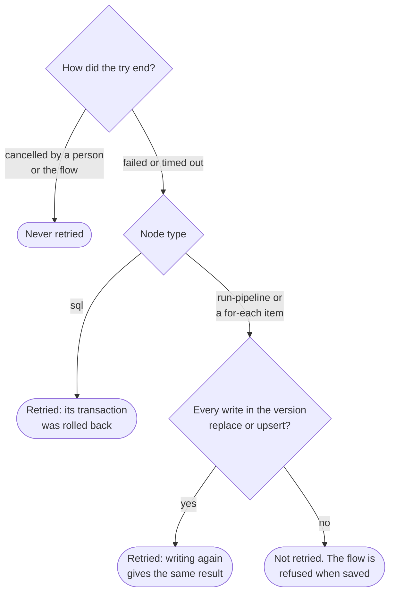

# Flow controls

Status: design, 4 November 2026. ADR 0041 records the decision. Slices: C1 `check-source`, C2
`wait-for`, C3 `timeout`, C4 `retries`, C5 `priority`. Each is marked **planned** or **built**.
It builds on [Flows](flows.md) and [Parallel runs](parallel-runs.md).

How a node with all five runs, start to end:


## C1. `check-source` (built)

```yaml
  - id: ready
    type: check-source
    source: warehouse
    tables: [sales.orders, sales.customers]   # optional: each must exist
    files: [incoming/today.csv]               # optional, on a file or object-store source
    timeout: 2m                               # optional (C3)
```

- `CheckSource.run` (server/flows): the saved source, its connector and secret, the allowed hosts as
  they are now, then `Connector.test` within `kilnmark.sources.check-timeout` (15 s), as a person's
  test. Then each name through `Connector.asset(config, path)`, which reads a name's fields as the
  catalogue would record them, never rows. A table is `schema.table` as the catalogue writes it; a
  file is its path below the source's folder.
- `asset` fails the same way for a name that is not there and for a source that stops answering, so
  reachability is decided by the test first; after it, a name the connector cannot show counts as
  missing (a login without rights on a schema's metadata too). When nothing is found at all, the
  test runs again, so a source that stopped answering reads as unreachable. A file path as the
  catalogue records it (`%23`) is tried on disk too, as `ReadNodeFactory.describe` does.
- What it reads: a table's columns from metadata (JDBC opens one connection per name); a file's
  columns from its start (`FileInspector`, up to 1 MiB; a spreadsheet whole). Nothing is kept or
  shown.
- Succeeds when all are there ("warehouse can be reached; the 3 tables it names are there"). Fails
  with "Could not reach warehouse", or "2 of 3 tables are missing on warehouse: a, b" (at most five
  names, then "and n more"). Only names the flow wrote and the source's name: never the driver's
  text, which can name hosts and users. Results: `missing` (a number; none when unreachable).
- Checked when saved (`CheckSource.sourceRefusal`): the source exists, has a connector, and holds
  tables (category `databases`) to look for tables and files (category `files`) for files. At most
  50 names, each written once, with no ${...}. Who may run the flow may use its sources, as for
  pipelines; no further check.
- Runs on a virtual thread beside the flow's watcher, as a sql node: no worker slot, and a
  connection only while it checks. Cancelling or stopping the flow interrupts it (the node ends
  cancelled) at once; its `timeout` (C3) ends it at once, failed ("Took longer than 2m and was
  stopped"), and with no timeout `CheckSource.DEFAULT_LIMIT` (10 minutes) does. Either way the node
  does not wait for the thread, which a hung driver may not let stop: it is interrupted and left.
- A `require-tls` refusal and an allowed-hosts refusal are said apart, in the flow's words.
- Pairs with `failure` connections: check, then notify and stop if anything is missing.
- Not a sample yet: the samples library takes a flow's `source:` as a sql node's and asks for a
  source with Allow SQL on.

## C2. `wait-for` (built)


```yaml
  - id: arrived
    type: wait-for
    source: landing                # a file or object-store source
    file: "incoming/orders-*.csv"  # a pattern below the source's folder: * and ?
    at_least: 1
    every: 5m
    timeout: 2h

  - id: loaded
    type: wait-for
    source: warehouse              # PostgreSQL, Allow SQL on
    query: "select max(loaded_at) > now() - interval '1 hour' from etl.batches"
    every: 2m
    timeout: 1h
```

- One of `file` or `query`. `every` 30 seconds to 1 hour (5 minutes by default); `timeout` up to
  24 hours (1 hour by default). The first check is at once.
- **File.** Lists the source's folder through its connector and counts names matching the pattern
  (no recursion past the pattern's own folders). Results: `found` (files matched).
- **Query.** Checked when saved as custom SQL rules are (ADR 0028): one read-only `SELECT`, on a
  PostgreSQL source with Allow SQL on, run on a read-only connection with a statement timeout of 30
  seconds; true when the first column of the first row is true. Nothing it returns is stored or
  shown. Results: `found` (1 or 0).
- Waits on the flow's watcher, holding no slot and no connection between checks. Cancelling the
  flow ends the wait. Results also: `waited_s`.
- Built as: `FlowDefinition.Until` (file, at_least, query, every) with the node's `timeout`;
  `WaitFor.look` (server/flows) makes one look on a virtual thread, as a check-source node does,
  and `FlowService.pollWait` schedules the next (`now + every` after a look ends). A look that cannot
  be made (`Look.problem`) is tried again; one that never can (`Look.refused`: the source gone, its
  kind or Allow SQL changed, a superuser login, the simple protocol) fails the node at once.
- File: the pattern's folder must be literal (`*` and `?` only in the last part, no `..`, `/` or
  `\` at the start). `FileSourceConnector.filesBelow(source, folder, timeout)` lists the files below
  that folder within `kilnmark.sources.check-timeout`, as the source's include and exclude patterns
  keep them, relative to the source's prefix (an S3 bucket's `prefix`); each path is matched whole
  (`*` → `[^/]*`, `?` → `[^/]`). The pattern is never opened as a path, only compared.
- Query: refused when saved unless the source is PostgreSQL with Allow SQL on (Allow writing is not
  needed) and `SqlTokens.checkCustomSql` accepts it. A flow with one counts as having SQL
  (`FlowService.hasSql`): saved only by a designer with the unmask grant, run only from a version
  saved with that check (`sql_checked`), and each run that starts the node records `flow.sql` in
  the audit log (target `flow/run/node`, details the source and `query: true`, never the text).
  `hasSql` looks for a `query` key as parsed, so a draft whose query the parser refused is gated
  too. `FlowStore.save` records `sql_checked` as whether the saver held the unmask grant (it was
  always true, V29), so a version saved without it never runs SQL, whatever a later Kilnmark reads
  in it. Before this node existed, anyone who could save a flow could have saved one as an unknown
  type, with `sql_checked` true; the YAML's text cannot say which (keys and values may be quoted,
  with escapes such as `"que\x72y"`), so V34 adds `query_checked`, false for every older version and
  since then the saver's grant. A version with a wait-for query runs only with both true.
- What a query shows: only `found` (1 or 0) on the run, to whoever may read the run, as a sql node's
  `rows_affected` is. Nothing it returns is stored; its errors give only their SQLSTATE.
- The flow's watcher, holding the flow job (`kilnmark.worker.flows` places), keeps polling while a
  node waits, as for `wait`: no pipeline worker slot and no connection between looks. At
  run time: the URL's rules again, TLS and hosts, no simple protocol, `RuleRunner.privileged`, a
  read-only transaction with the dialect's read-only and timeout settings (30 s), conforming
  strings, `setMaxRows(1)`, then a rollback. A failed query's message gives only its SQLSTATE.

## C3. `timeout` (built)

- On `run-pipeline`, `for-each` (each item), `sql` and, once C1 is built, `check-source`: a time
  written `90s`, `30m`, `2h` or `1d`, more than nothing and at most 7 days
  (`FlowDefinition.MAX_TIMEOUT`). Any other node type refuses the key when saved. No default: left
  out, there is no limit.
- The watcher measures from when the node's run started, not while it waited for a slot or a
  source's place: a pipeline run's `started_at` (set when a worker takes it, after its places on
  sources), a `sql` node's start on its thread (after its place). `started_at` is the database's
  clock and the watcher reads its own; they are the same machine's or close, and a timeout is
  minutes, not milliseconds.
- Past it:
  - **run-pipeline**: the run is cancelled (`PipelineService.cancel`, as a person's cancel), and the
    node says "Took longer than 2h and was stopped; its pipeline run is being cancelled" while it
    stops. Once the run has ended, the node **fails** ("...; its pipeline run was cancelled"), so
    nothing after it starts while it may still write. A run that succeeded as it was stopped
    succeeds.
  - **sql**: `SqlAction.Control.stop` cancels the statement and rolls back, as a flow cancel does;
    the node **fails** ("...; nothing was changed, as its statements run in one transaction").
  - **for-each**: the item's run is cancelled and the item counts as **failed**, not cancelled, so
    it does not stop the node or the flow as a run cancelled by hand does; the other items run. The
    node's message names the first item that timed out.
- A timed-out node fails, never ends cancelled, so its `failure` and `always` connections are taken.
  The flow run's error, when nothing handles a timed-out run-pipeline or sql node, is "Node load took
  longer than 2h and was stopped"; for a for-each node it stays "Node regions failed (the pipeline
  ...)", and the node's message names the first item that timed out. An item stopped for its
  timeout whose run succeeded all the same counts as succeeded, and is not marked.
- A sql node whose statements ended on their own (failed or committed) before the watcher looked
  keeps its own outcome, even past its timeout.
- The node's row records `timed_out: true` (a for-each node's, `timed_out_items: [0, 2]`), beside
  what it reported but never read by conditions. `GET /api/v1/flow-runs/{id}` returns it in
  `reported`, shows a timed-out item's status as `failed`, and the run page marks both **Timed out**.
- A worker that takes the flow over after another stopped finds a cancelled pipeline run that ran
  at least the timeout and counts it as timed out, as the first worker would have. It allows up to 5
  seconds (a tenth of a shorter timeout) for the first watcher's clock being ahead of the
  database's. A flow cancel the watcher itself asked for is never counted so. (Not covered by a
  test: a takeover needs a second worker.)
- No migration: the timeout is read from the flow's version each time.
- A timed-out try may be retried (C4) when retries allow.

## C4. `retries` (built)



- On `run-pipeline`, `for-each` and `sql`: `retries` 0 to 5, `retry_delay` 10s to 1h (1 minute by
  default), doubled after each try (`FlowDefinition.Retry.before`). `retry_delay` without `retries`
  is refused; any other node type refuses both keys.
- **Pipelines.** Checked when saved: every `write` node of the pipeline's version uses `replace`
  or `upsert`, or the flow is refused, naming the write node ("retries need writes that replace or
  upsert: write-orders appends"). At run time the version the failed run used is checked again. A
  cancelled run (by a person, or the flow) is never retried.
- **SQL.** A `sql` node runs in one transaction, rolled back on failure, so it may be retried,
  unless the commit itself failed (below).
- **Checked when saved** (`FlowService.unsafeWrite`): a write whose mode is set by a parameter
  counts as unsafe, since it is not known until the run. **At run time** (`mayRetry`) the check is
  made again against the version the failed run used, always. The "no write began" exception above
  was dropped in review: a run cancelled, lost with its worker, or failed in the engine records no
  write statistics, so it cannot be told from one that wrote nothing.
- **Only the watcher's own timeout cancel is retried.** A try counts as timed out for retrying only
  when this watcher asked for the cancel (`timedOut` and `cancelAsked`). A cancelled run found by a
  worker that took the flow over, or a person's cancel close to the timeout, is not retried: the
  first is still marked timed out, the second ends the node cancelled.
- **SQL in doubt.** A failure of `commit()` itself returns an outcome `inDoubt`: never retried, as
  the database may have committed. Statement failures and refusals are retried (a refusal will
  fail again; harmless, as nothing ran).
- A for-each try again that finds the pipeline busy waits at most `queue_timeout`, as a first try
  does; giving up (or the flow stopping) fails the items still waiting. The node's row lists those
  items under `retrying_items` while it runs, and the run page shows them **pending**.
- `flowTotals` counts every try's pipeline run and rows written: the rows were written.
- Each try is a new pipeline run linked to `(flow run, node, item, try)`; `pipeline_run.flow_try`
  (0 for the first), migration V35, with the unique index on all four so each try starts once. The
  node's row and `flowNodeRun`/`flowItemRun(s)` give the latest try; a worker that takes a flow over
  carries on from it (`flowLatestTry`), and a failed latest try found again is tried again then if
  tries are left (the delay starts again). Today no worker takes a flow over: a flow job is tried
  once, so a flow whose worker stopped fails (docs/design/flows.md, item 5). This path is for
  run-level retries (backlog item 1), which will try a flow job again.
- While it waits, the node stays **running**, with "Try 1 of 4 failed; trying again in 2m". It holds
  no worker and no place. A cancel or stop of the flow while it waits ends it cancelled ("Not tried
  again: the flow was stopped").
- A try that timed out is retried as a failure, and the `timed_out` mark is kept only when the last
  try timed out. A for-each item waiting to be tried again does not count against `max_parallel`;
  when its time comes, it starts before items not yet started, as places allow.
- The node's row records `tries` (the number of tries) once there was more than one, which
  conditions never read. `GET /api/v1/flow-runs/{id}` returns each node's `tries`
  (`[{item, number, pipelineRunId, status, startedAt, finishedAt}]`, number from 1) when any was a
  try again, and the run page lists them under **Tries** in the node's or item's details.
- Not covered by a test: a takeover mid-wait (it needs a second worker), and a commit in doubt.

## C5. `priority` (built)

- On `run-pipeline` and `for-each` (each item's run): `high`, `normal` (default), `low`, in any case,
  stored on the job as 1, 0 or -1 (`job.priority`, migration V33, smallint checked to -1..1). Not on
  `sql`: a sql node runs on its flow's watcher, never as a job, so a priority would order nothing;
  saving refuses it there, and on every other type (ADR 0041, amended).
- `JobQueue.claim` orders the due jobs by `priority DESC, id`, on the index `job_ready_idx (priority
  DESC, id) WHERE status = 'queued'`. Not `run_after`: since ADR 0040 a run put back to wait for a
  source's place keeps its turn among runs of its priority (first queued, not first due).
- Scans, quality checks, flow runs and a person's **Run now** of a pipeline are `normal` (the column's
  default). Priority chooses only among jobs that may start: a source's limit and a flow's or
  for-each node's `max_parallel` still hold, and a low job runs whenever nothing higher is due. It
  is strict: no ageing, so a steady stream of due high jobs holds lower ones back.
- V33 adds the check `NOT VALID` and validates it after, so only building the index holds up the
  queue while it reads `job` (which keeps every job ever queued). V32 is the samples library's
  (#98); whichever of the two merges second renumbers if it must, as Flyway refuses an older one.
- The diagram's Settings tab offers it for the two node types, and a node's summary says "high
  priority" or "low priority".

## Order of work

C3 and C5 first (small, and used by the rest), then C1, C2, C4. Migration numbers follow the parallel
runs slices (V31, V32): these take the next free one when they merge.
