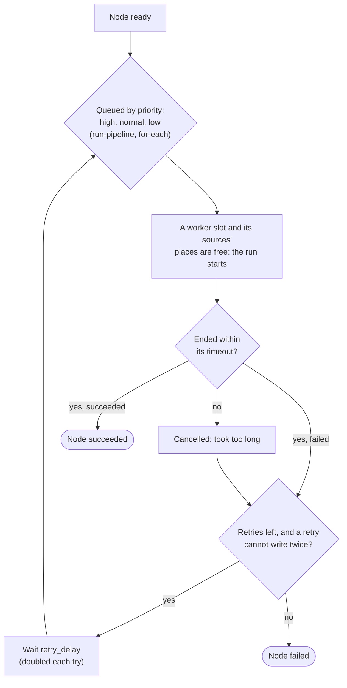
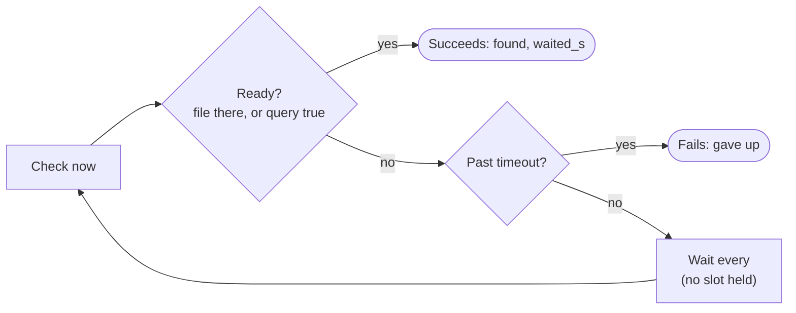
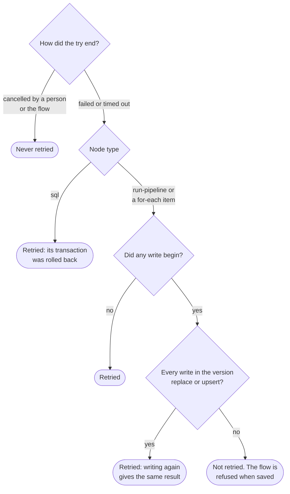

# Flow controls

Status: design, 4 November 2026. ADR 0041 records the decision. Slices: C1 `check-source`, C2
`wait-for`, C3 `timeout`, C4 `retries`, C5 `priority`. Each is marked **planned** or **built**.
It builds on [Flows](flows.md) and [Parallel runs](parallel-runs.md).

How a node with all five runs, start to end:



## C1. `check-source` (planned)

```yaml
  - id: ready
    type: check-source
    source: warehouse
    tables: [sales.orders, sales.customers]   # optional: each must exist
    files: [incoming/today.csv]               # optional, on a file or object-store source
    timeout: 2m                               # optional (C3)
```

- Connects as the source's own test does (`SourceChecks.test`), then looks each table or file up
  through the connector's listing, never reading rows. A table name is `schema.table` as the
  catalogue writes it.
- Succeeds when all are there. Fails with "Could not reach warehouse" or "2 of 3 tables are
  missing: sales.orders, ..." (names the flow wrote; never the driver's text). Results: `missing`.
- Checked when saved: the source exists and the flow's starter may use it; at most 50 names.
- Runs on the flow's watcher, not in a worker slot; it holds a connection only while it checks.
- Pairs with `failure` connections: check, then notify and stop if anything is missing.

## C2. `wait-for` (planned)



```yaml
  - id: arrived
    type: wait-for
    source: landing                # a file or object-store source
    file: "incoming/orders-*.csv"  # a pattern below the source's folder: * and ?
    at_least: 1
    every: 5m
    timeout: 2h

  - id: loaded
    type: wait-for
    source: warehouse              # PostgreSQL, Allow SQL on
    query: "select max(loaded_at) > now() - interval '1 hour' from etl.batches"
    every: 2m
    timeout: 1h
```

- One of `file` or `query`. `every` 30 seconds to 1 hour (5 minutes by default); `timeout` up to
  24 hours (1 hour by default). The first check is at once.
- **File.** Lists the source's folder through its connector and counts names matching the pattern
  (no recursion past the pattern's own folders). Results: `found` (files matched).
- **Query.** Checked when saved as custom SQL rules are (ADR 0028): one read-only `SELECT`, on a
  PostgreSQL source with Allow SQL on, run on a read-only connection with a statement timeout of 30
  seconds; true when the first column of the first row is true. Nothing it returns is stored or
  shown. Results: `found` (1 or 0).
- Waits on the flow's watcher, holding no slot and no connection between checks. Cancelling the
  flow ends the wait. Results also: `waited_s`.

## C3. `timeout` (built)

- On `run-pipeline`, `for-each` (each item), `sql` and, once C1 is built, `check-source`: a time
  written `90s`, `30m`, `2h` or `1d`, more than nothing and at most 7 days
  (`FlowDefinition.MAX_TIMEOUT`). Any other node type refuses the key when saved. No default: left
  out, there is no limit.
- The watcher measures from when the node's run started, not while it waited for a slot or a
  source's place: a pipeline run's `started_at` (set when a worker takes it, after its places on
  sources), a `sql` node's start on its thread (after its place). `started_at` is the database's
  clock and the watcher reads its own; they are the same machine's or close, and a timeout is
  minutes, not milliseconds.
- Past it:
  - **run-pipeline**: the run is cancelled (`PipelineService.cancel`, as a person's cancel), and the
    node says "Took longer than 2h and was stopped; its pipeline run is being cancelled" while it
    stops. Once the run has ended, the node **fails** ("...; its pipeline run was cancelled"), so
    nothing after it starts while it may still write. A run that succeeded as it was stopped
    succeeds.
  - **sql**: `SqlAction.Control.stop` cancels the statement and rolls back, as a flow cancel does;
    the node **fails** ("...; nothing was changed, as its statements run in one transaction").
  - **for-each**: the item's run is cancelled and the item counts as **failed**, not cancelled, so
    it does not stop the node or the flow as a run cancelled by hand does; the other items run. The
    node's message names the first item that timed out.
- A timed-out node fails, never ends cancelled, so its `failure` and `always` connections are taken.
  The flow run's error, when nothing handles a timed-out run-pipeline or sql node, is "Node load took
  longer than 2h and was stopped"; for a for-each node it stays "Node regions failed (the pipeline
  ...)", and the node's message names the first item that timed out. An item stopped for its
  timeout whose run succeeded all the same counts as succeeded, and is not marked.
- A sql node whose statements ended on their own (failed or committed) before the watcher looked
  keeps its own outcome, even past its timeout.
- The node's row records `timed_out: true` (a for-each node's, `timed_out_items: [0, 2]`), beside
  what it reported but never read by conditions. `GET /api/v1/flow-runs/{id}` returns it in
  `reported`, shows a timed-out item's status as `failed`, and the run page marks both **Timed out**.
- A worker that takes the flow over after another stopped finds a cancelled pipeline run that ran
  at least the timeout and counts it as timed out, as the first worker would have. It allows up to 5
  seconds (a tenth of a shorter timeout) for the first watcher's clock being ahead of the
  database's. A flow cancel the watcher itself asked for is never counted so. (Not covered by a
  test: a takeover needs a second worker.)
- No migration: the timeout is read from the flow's version each time.
- A timed-out try may be retried (C4) when retries allow.

## C4. `retries` (planned)



- On `run-pipeline`, `for-each` and `sql`: `retries` 0 to 5, `retry_delay` 10s to 1h (1 minute by
  default), doubled after each try.
- **Pipelines.** Checked when saved: every `write` node of the pipeline's version uses `replace`
  or `upsert`, or the flow is refused, naming the write node ("retries need writes that replace or
  upsert: write-orders appends"). At run time a failed run is also retried when it failed before any
  write began, whatever its modes. A cancelled run (by a person, or the flow) is never retried.
- **SQL.** A `sql` node runs in one transaction, rolled back on failure, so it may always be
  retried.
- Each try is a new pipeline run linked to `(flow run, node, item, try)`; `pipeline_run.flow_try`
  (0 for the first). The run page lists every try with its link; the node's status is its last
  try's.

## C5. `priority` (built)

- On `run-pipeline` and `for-each` (each item's run): `high`, `normal` (default), `low`, in any case,
  stored on the job as 1, 0 or -1 (`job.priority`, migration V33, smallint checked to -1..1). Not on
  `sql`: a sql node runs on its flow's watcher, never as a job, so a priority would order nothing;
  saving refuses it there, and on every other type (ADR 0041, amended).
- `JobQueue.claim` orders the due jobs by `priority DESC, id`, on the index `job_ready_idx (priority
  DESC, id) WHERE status = 'queued'`. Not `run_after`: since ADR 0040 a run put back to wait for a
  source's place keeps its turn among runs of its priority (first queued, not first due).
- Scans, quality checks, flow runs and a person's **Run now** of a pipeline are `normal` (the column's
  default). Priority chooses only among jobs that may start: a source's limit and a flow's or
  for-each node's `max_parallel` still hold, and a low job runs whenever nothing higher is due. It
  is strict: no ageing, so a steady stream of due high jobs holds lower ones back.
- V33 adds the check `NOT VALID` and validates it after, so only building the index holds up the
  queue while it reads `job` (which keeps every job ever queued). V32 is the samples library's
  (#98); whichever of the two merges second renumbers if it must, as Flyway refuses an older one.
- The diagram's Settings tab offers it for the two node types, and a node's summary says "high
  priority" or "low priority".

## Order of work

C3 and C5 first (small, and used by the rest), then C1, C2, C4. Migration numbers follow the parallel
runs slices (V31, V32): these take the next free one when they merge.
