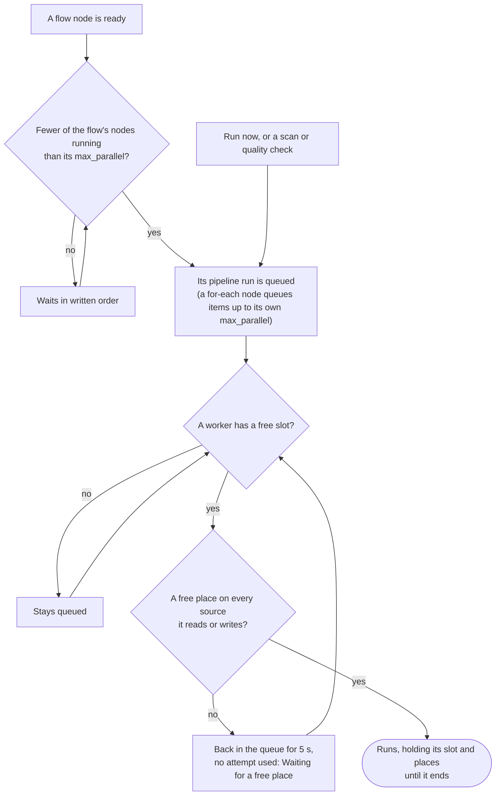

# Parallel runs

Status: design, 4 November 2026. ADR 0040 records the decision. Slices: P1 worker settings and
sizing, P2 source limits, P3 a flow's `max_parallel`, P4 the `for-each` node, P5 several workers
proven. Each is marked **planned** or **built** below.

How much Kilnmark runs at once, and the limits that keep it from overwhelming what it reads and
writes. Words: a **slot** is a worker's room for one job; a **source limit** is how many runs may use
one source at once; a run waiting for either is **waiting**, not failed.

## What other tools do

Researched 4 November 2026 from each tool's documentation.

| Tool | Default order | Limits | Fan-out |
|---|---|---|---|
| Airflow | dependency graph | whole installation (`parallelism`), per pipeline (`max_active_tasks`, `max_active_runs`), pools of slots for a shared resource, per task | dynamic task mapping, with a per-task cap |
| Dagster | dependency graph | concurrency pools across all runs (per op or per run), runs at once | yes |
| Prefect | dependency graph | global concurrency limits held by the server, work pool and queue limits, rate limits | yes |
| Argo Workflows | dependency graph | `parallelism` per workflow and template, semaphores and mutexes across workflows | yes |
| Azure Data Factory | dependency graph | ForEach `batchCount`, or `isSequential` | ForEach |
| AWS Step Functions | state machine | Map `MaxConcurrency` (Distributed Map: up to 10,000 when unset) | Map |
| Databricks Jobs | dependency graph | one run of a job at a time by default, further runs queued | for-each task |

All of them run a dependency graph in parallel by default and put limits around it at three levels:
the installation, the pipeline or flow, and the shared resource. Kilnmark already has the first
(worker slots) and the graph (ADR 0026); this adds the other two and the fan-out.

## How much runs at once



A job runs when all of these have room:

1. **A worker's slot.** `kilnmark.worker.concurrency` (2) jobs per worker: scans, quality checks and
   pipeline runs. Flows hold no slot; a worker watches up to `kilnmark.worker.flows` (8) of them.
2. **Its sources' limits** (P2): a pipeline run takes a place on every source it reads or writes.
3. **Its flow's limit** (P3, P4): a node of a flow with `max_parallel` starts only when fewer than
   that many of the flow's nodes are running; a `for-each` node's items, only when fewer than its own
   `max_parallel` are.

## P1. Worker settings and sizing (built)

- `kilnmark.worker.flows` (`KILNMARK_WORKER_FLOWS`, 8, at least 1) replaces `JobWorker.MAX_FLOWS`.
- The installation guide gains **Sizing the workers**: what a slot is, how to raise the slots, and
  the database connections it takes. Each running job holds one connection for its lease and uses
  one or two more while it works; each watched flow holds one. The pool
  (`QUARKUS_DATASOURCE_JDBC_MAX_SIZE`, 20 by default) must be at least
  `concurrency × 3 + flows + 5` for the API; PostgreSQL's `max_connections` at least the sum over
  all Kilnmark processes.
- `docs/development.md` says the concurrency setting is jobs, not scans.

Built: `KilnmarkConfig.Worker.flows()`, read by `JobWorker.start`; INSTALL.md, "Sizing the workers".

## P2. Source limits (built)

- **Setting.** A source's **Most runs at once** (`maxRuns` in the API, `max_runs` in the database),
  1 to 100, or empty for no limit. Admins and designers who may edit the source set it; changing it
  is recorded in the audit log with the source's other changes.
- **What counts.** A pipeline run takes one place on each distinct source its version reads or
  writes, and a flow's `sql` node one on its source. Scans and quality checks do not count; they
  keep their own rules.
- **Places.** Place `k` of source `s` is an advisory lock keyed from `kilnmark:source-place:s:k`
  (the 64-bit key `JobQueue.targetKey` makes), for `k` from 0 to the limit less one. A run takes
  them on its lease's connection before its nodes start, sources in id order (so two runs never hold
  one place each of what the other needs), the first free place of each. If a source has none free
  it gives back what it took, and its job goes back to the queue for 5 seconds without using an
  attempt; the run says "Waiting for a free place on source s". Places are freed when the lease
  closes, by the run or by PostgreSQL when a worker dies.
- **Lowering the limit** while runs hold places above it: they keep them; new runs see the new limit.
- Tests: a limit of 1 makes two runs on one source take turns, and neither fails; a dead worker's
  places are free again; a run on two full sources holds neither while it waits.

Built, with these changes from the plan above:

- **Stored with the source's other common settings**, as `max_runs` in `source.settings` (beside
  `allow_writing` and `sample_rows`), not in a column of its own: `CommonSettings` is the one place
  the API, bulk import and the form take a source's settings from, so the setting came with
  them, and no migration was needed. In the API it is `settings.max_runs`, a text holding 1 to 100.
- **Audited** as `source.max_runs` (before, after, via), beside `source.allow_writing`; the
  `api.request` event records the edit too.
- **The waiting note** is the queued run's `error` text, which the run page shows as a note while a
  run is not failed; `PipelineStore.startRun` clears it. The note names the source by its name,
  which the run's readers already see in the pipeline's YAML and the run's writes.
- **Which sources**: every saved source a node's source setting names (read and write nodes),
  worked out by `compiler.check` on the run's version and values before the run is marked running,
  so a waiting run stays Queued and nothing connects to a source first.
- **Same lease, counted**: advisory locks nest within one session, so the lease keeps the places it
  holds and never counts one twice. This matters for a flow, whose `sql` nodes share its lease.
- **A flow's `sql` node** takes its place on the flow job's lease and waits there, saying so in its
  message, tried again on each look at the flow; it gives the place back when it ends. A flow
  cancelled meanwhile ends it as Cancelled, unstarted. It has no time limit, as a waiting pipeline
  run has none.
- A run whose job is back in the queue goes behind runs queued since (the queue takes the earliest
  `run_after`). Fairness between waiting runs is not promised.

## P3. A flow's `max_parallel` (planned)

- A top-level key, `max_parallel: 4`, 1 to 50; checked when saved. Left out, no limit.
- `FlowService.startReady` starts ready nodes, in the order they are written, while fewer than that
  many are running (a `for-each` node counts once, however many items it runs). `stop` nodes are
  never held back, so a flow can always end.
- The flows guide and the format section of docs/design/flows.md describe it.

## P4. The `for-each` node (planned)

```yaml
  - id: regions
    type: for-each
    pipeline: sales-by-region
    items: [EMEA, APAC, AMER]     # or "${regions}", a text list or number list parameter
    as: region                    # the pipeline parameter each item fills
    with: { label: nightly }      # other parameters, as a run-pipeline node's
    max_parallel: 3               # items running at once: 1 to 50, 4 when left out
```

- Checked when saved: `pipeline` and `as` required; `as` must be a parameter of the pipeline (when
  the pipeline exists) and not also in `with`; `items` a list of 1 to 500 texts or numbers, or one
  `${...}` naming a list parameter of the flow; `max_parallel` 1 to 50. The diagram and the YAML
  editor know the type (TYPE_WORDS: "Runs a pipeline for each item").
- **Runs.** Each item is an ordinary pipeline run with the item in its parameters, linked to the
  flow run, node and item number (`pipeline_run.flow_item`, 0-based; null for other nodes). The
  pipeline's one-run rule does not apply between runs of the same for-each node (ADR 0040 decision
  5); the unique index is `(flow_run_id, flow_step, coalesce(flow_item, -1))`, so no item ever starts
  twice. Writes to one asset still take turns through the target locks.
- **Ending.** The node succeeds when every item's run succeeded, fails when any failed (after the
  others end: items already started are not stopped), and is cancelled with the flow. It reports
  `items`, `succeeded` and `failed` (numbers) for conditions, e.g. `regions.failed = 0`.
- **Run page.** The node's row says "3 of 5 items done, 1 failed", and lists each item's run with
  its value and a link. The run chart draws the node's bar from its first item's start to its last
  item's end.

## P5. Several workers (built)

- A test runs two workers in one process against one database, queues more jobs than either has
  slots, and checks every job runs once, the slots of both are used, and source limits hold across
  both.
- The installation guide says how to run a second Kilnmark with the worker role only, against the
  same database.

Built: `TwoWorkersTest` starts a second `JobWorker` beside the server's own; six held pipeline runs
fill both workers' two slots, every run starts once, and with `max_runs: 2` on the source they all
read, two run while the other four wait, across both workers. INSTALL.md, "A second worker", lists
what a worker-only process must share: the database, the key for stored passwords, the files and
drivers.
