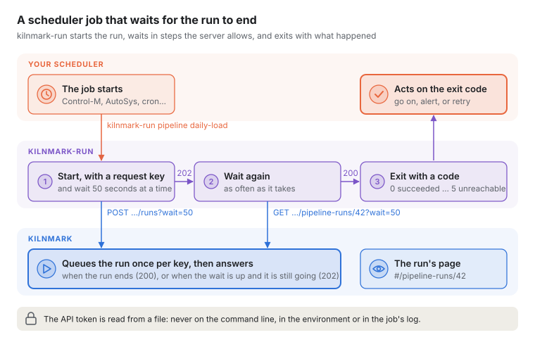
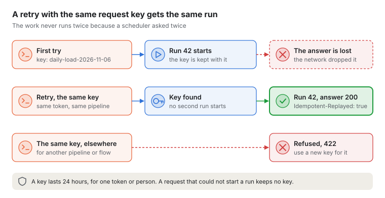

# Pipelines

Status: design, 25 October 2026. Round 3, step 1: a first pipeline that runs. The canvas
(step 2) and the quality gate with predicted scores (step 3) build on this. ADR 0022 records
the decision to run pipelines as graphs.

A pipeline reads from sources, transforms the rows and writes them somewhere, measuring the data
as it flows. It is saved as YAML, versioned, run by a worker, and every run is recorded node by
node.

## 1. Pipelines are graphs

Today's runner takes nodes in a line. Lookups, joins, unions and routing need more than one input
or output, so a pipeline is a directed acyclic graph:

- A **node** has named **ports**: inputs (`in`, or `main` and `lookup`) and outputs (`out`, or
  `out` and `rejected`). A source has no inputs; a write has no outputs.
- An **edge** joins one output port to one input port. One output may feed several inputs: the
  engine copies each batch to every reader (a tee), so each node owns what it takes.
- Each edge is a bounded `RowSet`, so back-pressure and per-node memory accounting work as they
  do today. A node that must see all its input before writing (aggregate, the lookup side of a
  lookup) has a memory limit of its own and fails with a plain message when it is exceeded.
- The graph is checked before a run: ids unique, every edge between existing ports, every
  required input connected, no cycles.
- A failing node stops the whole run, and the run reports the node where the failure started,
  as today.

The linear `Pipeline` and `Runner` stay for scanning and are run as a graph internally.

### The contract (kiln-core, `io.kilnmark.kiln.graph`)

- `PortRef(node, port)`, `Edge(from, to)`, `GraphNode(id, node, config)`,
  `PipelineGraph(name, nodes, edges)` with `check()`.
- `NodeContext` gains named ports, `input(port)` / `output(port)` with `inputPorts()` /
  `outputPorts()`, and structured settings, `config()`: the node's YAML settings as maps, lists,
  strings, numbers and booleans. `input()` / `output()` remain the `in` / `out` ports.
- `NodeFactory`, found through `ServiceLoader` and registered with `NodeFactories`: the node type,
  kind (source, transform, sink, gate), label, help, its input and output ports, a settings
  schema (`SettingSpec`) the canvas turns into the node's settings panel, `create(config)`, and
  optionally `outputSchema(port, inputSchemas, config)` so the canvas and validation know each
  node's columns before anything runs.
- `GraphRunner.run(graph, metadata)` returns a `RunResult` with rows per edge and per node.

Added while building the engine (round 3, step 1):

- `NodeContext.inputs(port)`: every row set arriving on a port, in the order the pipeline lists
  them. A factory port named with a trailing `*` (union's `in*`) is connected, read and named in
  edges without the `*`, as `in`. `input(port)` on a port with several inputs is an error that
  points to `inputs(port)`.
- `NodeContext.emit(port, batch)`: hands the batch to the port, or closes it when nothing is
  connected. `output(port)` returns `null` for an unconnected port; in a graph run it does so for
  any name, since the compiler has already checked the edges against the node type's ports.
- `RowSet.takeAny(rowSets, allocator)` returns the next batch from whichever input has one, with
  its index, or `null` once all have ended; `RowSet.poll(allocator, timeout, unit)` and
  `RowSet.atEnd()` underneath it. A node with several inputs that does not care about order
  (union) must read them this way: reading one to its end first stalls a pipeline whose inputs
  share a node upstream (a route followed by a union), because that node waits for room on the
  input not being read.
- `RunResult.edges()`: `EdgeResult(fromNode, fromPort, toNode, toPort, rows)` per edge, in the
  graph's order: the rows that edge's reader was given. `NodeResult` gains `rowsIn`,
  `rowsInByPort` and `rowsOutByPort`; `rowsOut` is the sum over connected output ports, each port
  counted once however many nodes read it. Rows dropped because a reader stopped early, or because
  a node failed, are not counted (`RowSet.rows()` counts rows when they are taken). The old
  constructors remain. `RunResult.node(name)` finds one node.
- `NodeContext.inputSchema(port)` and `inputSchema(port, index)` (for a port taking many): the
  columns arriving on an input, as worked out when the pipeline was checked, or `null` when they
  were not known before the run. A node can then act on an input that sends no batch: an
  aggregate of no rows writes SQL's one row, a union adds the columns of an empty input, a lookup
  knows the columns of an empty lookup side. The compiler puts them on `GraphNode.inputSchemas`
  (keyed `in`, `main`, `in[0]`, …; a new record component, the three-argument constructor
  remains) and the runner hands them to the node.
- In a graph run `hasInput()` and `hasOutput()` mean the `in` and `out` ports, as they did for a
  node in a line; `inputPorts()` and `outputPorts()` list every connected port.
- `RowSet.fail(cause)` never waits: it drops batches still queued (the run is failing) to make
  room for the end, so a failure always reaches the next node. `finish()` still waits for room.
  `RowSet.put` closes its batch if interrupted while waiting. Added for the engine: `discard`
  (drop a batch without counting it), `isCancelled`, and `progress`, `readerWaiting` and
  `writerWaiting` for the stall watchdog.

### Running a graph (`KilnGraphRunner`)

- Every node runs on its own virtual thread; each edge is a bounded `RowSet` of the configured
  capacity; each node's memory is a child allocator inside the run's one limit, as before.
- **One output, several readers (the tee).** The node writes to one row set. A copying thread
  takes each batch and gives every reader but the last a copy (its buffers copied whole, so
  nested columns copy too) and the last the original; each reader then moves its batch into its
  own allocator. Copies waiting to be read are accounted to the writing node, in a child of its
  allocator, as any batch waiting on an edge is. One slow reader holds the others back by at most
  the row set capacity.
- **A node that ends early** (it stops before its input ends, like a `limit`) releases its
  inputs. Each node counts its readers that have not finished, over all its ports and the readers
  behind a tee; when the last finishes, the node is stopped without failing. Until then, what it
  still writes to a finished reader is read and dropped (a tee simply stops copying to it).
- **Failures.** A failing node first cancels its inputs (the nodes before it stop, not blamed),
  then fails its outputs without waiting (the nodes after it end, not blamed), along every edge,
  so the whole connected graph stops even if a node after it is stuck. The nodes before it are
  also interrupted, so one waiting on a database or a file stops too. Nodes not joined to it at
  all are stopped. The run's error is the first failure in time; a node that did not free its
  memory is named when nothing failed first (a node stopped mid-batch is only logged). Running out
  of memory names the run's limit ("ran out of memory: the run may hold 256 MB of Arrow memory in
  all"). A tee that cannot copy is reported against the writing node.
- **Stalls.** If no batch moves through any row set for the stall timeout (120 seconds unless
  set on `KilnGraphRunner` or `Runner`) while every running node is waiting on a row set, the run
  fails: "The run stalled: no rows moved for 120 seconds while every running node waited for
  another. Waiting: seq (to read from p1.out->seq.a); p2 (to write to p2.out->seq.b) …". A node
  busy outside the row sets (a slow query) is never taken for a stall.
- **Interruption** of the calling thread stops every node and waits for every thread ever
  started before `run` throws `InterruptedException`; no thread starts once a stop has begun.
- The linear `Runner` builds a graph (`a.out -> b.in -> ...`, settings as configuration) and runs
  it with `KilnGraphRunner`. One difference from before: if one node fails and another leaks, the
  run reports the failure, not whichever node came first in the line. A node that ends before its
  input does no longer leaves the node before it waiting for ever.
- **Known limit.** A node that reads one input to its end before another (a lookup reads its
  lookup side first) stalls when both inputs come from the same node and more rows are waiting
  than the edges hold. The compiler adds a note to such pipelines (also when the inputs of a port
  taking many share a node, in case the node reads them one after another); reading the source
  twice avoids it, and the stall watchdog ends such a run with a plain message instead of hanging.
- **Outcomes.** Each `NodeResult` has an `outcome`: `FINISHED`, `ENDED_EARLY` (it stopped before
  its input ended, or every node reading it had finished), `STOPPED` (the engine stopped it
  because another node failed, the run stalled or was stopped) or `FAILED`. A UI shows a stopped
  writer as stopped, not as a clean finish. The older constructors derive it from `error`.
- If anything fails while the run is starting (building a node's context, starting a thread),
  the nodes already started are stopped and waited for before the failure is thrown. Decimal
  settings are turned into text in full only when that is short, otherwise in scientific form
  (`1E-999999999`), so a number can never become a string of a billion zeros.

### Seeing inside a run (`RunListener`, `RunProgress`)

- **Timing.** Each `NodeResult` has `startedAt`, `firstRowAt` (its first row in; for a node with
  no input, its first row out), `lastRowAt` (its last row out; for a node with no output, its last
  row in) and `finishedAt`, and `duration()`; the run's `finishedAt` is on the same monotonic clock.
  The nine-argument constructor remains (no times). `RowSet` records, as `System.nanoTime()`, the
  first and last batch with rows handed over (`firstPutNanos`, `lastPutNanos`) and taken
  (`firstTakenNanos`, `lastTakenNanos`): plain volatile writes per batch, no allocation. It also
  tells `capacity()`, `queued()` and `fill()` (0 to 1; 1 while its writer waits).
- **Where the time went.** `RowSet` adds up the time its writer waits for room (`putWaitNanos`) and
  its reader waits for a batch (`takeWaitNanos`), only when it has to wait (an `offer` or `poll`
  that succeeds at once costs nothing more) and as it goes, at most 100 ms behind; each has one
  writing thread. `NodeResult.waitingForRowsNanos` is the sum over the node's inputs (what it reads
  from: a copy, behind a tee), `heldUpNanos` over what it writes to (so a tee's waiting counts
  against the producer, whose row set fills); `working()` is the rest of its duration. Rows the
  engine drops for a finished reader are not its waiting. `takeAny` counts its wait against the
  row set it waited on.
- **Listening.** `GraphRunner.run(graph, metadata, listener)` (a default method that ignores the
  listener; `KilnGraphRunner` implements it, and `run(graph, metadata)` uses `RunListener.NONE`).
  A `RunListener` hears `nodeStarted`, `firstRowIn`, `firstRowOut`, `lastRowOut` and
  `nodeEnded(outcome)`, each with when it happened. A node is ended once its thread and any tee
  copying its rows have (a tee's failure is the node's); if memory it did not free is found once
  every node has ended, `nodeEnded` is called again with the corrected outcome (the log says "Node
  write counted as failed: it did not free all its memory").
  `progress(RunProgress)` every `progressEvery` (2 seconds unless set in the four-argument
  constructor) and once at the end; and `note(level, node, text, at)` (defaulting to the
  three-argument form) for a node's failure, a stall (error) and memory a node did not free
  (warning), with when the engine noticed it. The text may quote the data.
- **Never in the way.** Nodes only record times. The thread watching the run turns them into
  calls at each of its ticks (at most a second apart) and queues them for the listener's own
  virtual thread, which calls it in order and drops anything it throws. Past 4,096 calls waiting,
  a slow listener misses some (logged). However the run ends (an exception included), the run
  then waits up to 10 seconds for the listener to hear the rest and goes on without it. With no
  listener nothing is queued or built.
- **Progress.** `RunProgress(at, nodes, edges, slowest)`: each node's state (not started,
  waiting for its first row, running, ended), rows in and out, rows a second since the snapshot
  before, its times, its waits so far and how full its fullest output queue is (`outputFill`,
  copies behind a tee included); each edge's rows, batches queued, capacity, `fill`, and whether
  it is full (or its writer waits) or empty (or its reader waits). `slowest` is a running node
  whose input queues are full while none of its output queues is: it cannot keep up with what it
  is given and what comes after it can. With several, the one with the most full inputs, then the
  first in the graph's order; null when none (a slow source shows as empty queues everywhere, not
  as a slowest node).

### Writing a node for graphs

- Read with `input(port)` or, for a port taking many, `inputs(port)` with `RowSet.takeAny`; write
  with `emit(port, batch)`, which drops rows for an unconnected port.
- A node that polls with a timeout counts as waiting only while it waits; work between polls (a
  commit, a remote call) is never taken for a stall.
- **Close what you hold in `close()` or a `finally`.** When another node fails, the nodes before
  it are interrupted wherever they are, and every node can be stopped mid-batch. A batch taken but
  not yet handed on must still be closed, or the node is reported (or, when stopped, logged) for
  not freeing its memory.
- **Interruption closes sockets.** Interrupting a thread blocked in socket or channel I/O closes
  that socket. A node using a connection pool must validate connections before reuse, and must not
  return a connection to the pool after it was interrupted mid-call. Writers should roll back in
  `close()` when the node did not finish.
- `inputSchema(port)` gives an input's columns when they were known before the run, so a node can
  act correctly on an input that sends no batch.

## 2. The YAML format

```yaml
kilnmark: pipeline/v1
name: customer-billing
description: Monthly spend per customer, with orphan transactions set aside.
nodes:
  - id: customers
    type: read
    source: lab-db
    asset: crm.customers

  - id: transactions
    type: read
    source: lab-db
    asset: billing.transactions

  - id: tidy
    type: compute
    input: customers
    columns:
      full_name: "trim(first_name) || ' ' || trim(last_name)"
      email: "lower(trim(email))"

  - id: spend
    type: aggregate
    input: transactions
    group_by: [customer_id]
    values:
      total: "sum(amount)"
      last_seen: "max(txn_at)"

  - id: joined
    type: lookup
    inputs: { main: spend, lookup: tidy }
    on: { customer_id: customer_id }
    keep: [full_name, email]
    unmatched: rejected        # rows with no customer go to the 'rejected' port

  - id: orphans
    type: write
    input: joined.rejected
    source: lab-share
    path: quarantine/orphan-spend.csv
    format: csv

  - id: out
    type: write
    input: joined
    source: warehouse
    table: billing.customer_spend
    mode: replace              # create | append | replace | upsert (with key)
```

- `input: <id>` means that node's `out` port; `input: <id>.<port>` names another port;
  `inputs: {port: id[.port]}` connects several. `input` connects the node's only input port; a
  list (`input: [a, b, c]`, or a list under `inputs`) connects several nodes to a port that takes
  many.
- Nodes are listed in any order; the edges decide the order of work. Files written before the
  rename list them under `steps:`, which the reader and the canvas still accept (with both written,
  `nodes:` is read and the old key is a problem). Saved versions keep the YAML they were saved with;
  the canvas writes `nodes:` the first time it changes an old pipeline.
- Unknown keys are errors, with the line number, so typing mistakes are caught. One top-level key
  is the exception to "checked": `layout` (round 3, step 2) holds where the canvas draws each node,
  node id → `{ x, y }`, and reading accepts and ignores whatever it holds, so a pipeline runs the
  same however it is drawn. The canvas writes it last, under a comment saying so:

  ```yaml
  # Where the canvas draws each node. Kilnmark ignores this when it runs the pipeline.
  layout:
    customers: {x: 40, y: 120}
    tidy: {x: 320, y: 120}
  ```
- Secrets never appear: nodes name saved sources, and the source holds the credentials.

### Reading and checking (`io.kilnmark.kiln.yaml`)

- YAML is read with **SnakeYAML Engine 3.2** (YAML 1.2, Apache-2.0; its licence is listed in the
  generated third-party notices). Kilnmark builds its own tree from the parser's events, so no
  object is ever constructed from a tag. Scalars follow the YAML 1.2 core schema: `yes` and `on`
  are text, quoted values are always text, `${VAR}` is never substituted. Decimals are read as
  exact `BigDecimal`s. The text written is kept beside each value
  (`NodeDefinition.configText`), and mapping keys are always the text written (`007` stays
  `007`).
- Settings reach the node in the form their kind needs (`Compiled.configs()`): a setting that is
  text (text, expression, column, source, asset, choice, and the values of columns, expressions,
  conditions and column maps) holds exactly what was written, so `asset: 2024.10` is `"2024.10"`
  and `007` is `"007"`; a number is a whole number (Integer or Long) or a BigDecimal, never
  not-a-number, infinite, beyond a long or a double, or with more than 1,000 digits or its decimal
  point more than 1,000 places away (`1e-999999999` is refused). `settings()` at run time is the text of
  those values.
- Refused, each with its line and column: files over 1,000,000 characters, more than one
  document, anchors and aliases (a pipeline is written out in full, so the canvas can rewrite it),
  tags, duplicate keys, keys that are lists or mappings, nesting deeper than 64, more than
  100,000 values, and characters YAML forbids. Values echoed in messages are cut to 80 characters.
- `PipelineDefinition.parse(yaml)` reads the format line, names, nodes, ids, inputs and settings
  with their positions. `PipelineCompiler(nodeFactories).compile(yaml)` checks it against the node
  types and returns `Compiled`: `problems()` (line, column, node id, message), `notes()`,
  `schemas()` (columns per node and output port) and `graph()`. Checking never creates a node or
  opens a connection; `graph()` creates new nodes for one run, and closes those already made if one
  fails.
- `compile(PipelineDefinition)`, for a pipeline built in code, also checks what reading does: the
  name, node ids (pattern and uniqueness) and that each node has a type.
- Checks: the format line; unknown top-level keys; node ids (`[a-z][a-z0-9_-]{0,63}`, unique);
  unknown node types, suggesting the closest; settings against the node type's `SettingSpec`s
  (unknown keys with a suggestion, required, kind, choices) and then the factory's `check`, whose
  messages point at the setting they start with; inputs naming unknown nodes or ports; every input
  port connected; a single-input port not fed twice, nor a port fed twice by the same node;
  loops, naming the nodes in them.
- Columns are then worked out in the order rows flow with each factory's `outputSchema`. A port
  that takes many inputs is given them keyed `in[0]`, `in[1]`, … in the order listed. When a node
  returns null (columns unknown before the run), the nodes after it are not checked against
  columns, and one note on that node names them. A node with a problem of its own is skipped
  silently.
- The server registers `read` and `write` itself; the compiler works with any `NodeFactories`.

### Parameters and server variables (decisions)

Built with flows' F2 (CHANGELOG; the guide's "Parameters and server variables" is the user's view).

- **Two kinds of value.** A *parameter* is declared in the YAML (`parameters:`; `text`, `number`,
  `boolean`, `text list`, `number list`; a pipeline's each with a default) and given per run. A
  *server variable* belongs to the server (V22 `variable`, every change kept in `variable_change`),
  is set by stewards and admins through `/api/v1/variables`, and is written `${vars.name}`. A
  default may be a variable (`default: "${vars.region}"`, `Parameters.VarRef`). Variables are never
  secrets: names that look like a credential are refused. `KILNMARK_VAR_<NAME>` seeds one at
  start-up, as text, unless it exists.
- **`Parameters` (kiln-core)** declares, resolves (given value, else default; unknown names and wrong
  kinds refused) and fills `${name}`. `PipelineCompiler.compile(yaml, parameters, variables)` fills
  each node's settings before checking them, by the setting's kind: an expression or expression map
  gets the value as a literal (text quoted with `''` doubled, a list as `('a', 'b')`, a negative
  number as a decimal, in brackets when negative; `${...}` inside quotes, or touching a letter,
  digit, `_`, `.` or `(`, is a problem, so a value never joins a name or a call); text gets it only
  if it is letters, digits, spaces, `_`, `-` and `.` (never `..`, never a list); a number or boolean
  setting takes one as its whole value. Every other kind (source, asset, columns, choice, URL, rules,
  column map) refuses one. A setting can narrow that (`SettingSpec.parameters()`): the write node's
  `table` and `path` are `NAME_PART_ONLY` (a value only in the last name, after the last `/` or `\`,
  beside text the pipeline writes, and only `[A-Za-z0-9_-]`), and the gate's `rules_from` is `NONE`;
  so a value never chooses what a node reads or writes, nor another node. `$${` is a plain `${`. A pipeline that declares no parameter and names no
  variable keeps `${...}` as text, as before.
- **The filled definition is the compiled one** (`Compiled.definition()`): what reads it afterwards
  (where a write goes, lineage, profiling) sees the values, never `${...}`.
- **Runs keep their values.** `pipeline_run.parameters` (defaults filled in) and
  `pipeline_run.variables` (all the server's variables when the run was queued) are what the run
  compiles with, however the variables change before it starts. Queueing resolves and checks the
  values first: a wrong value is a 400, a version that does not check with them a 409.
- **SQL**, when nodes take SQL of their own: a value goes in as a bound parameter, never as text.

### The read node's columns and where (decisions)

The guide's "Reading" is the user's view.

- **Settings.** `columns` (the columns kept, in that order; none means all) and `where` (an
  expression, so `${...}` fills it as a literal, as above). `row_limit` counts the rows kept after
  `where`. The node's output columns are the chosen ones (`ReadShaping.outputSchema`); an unknown or
  repeated column, or a `where` that is not true or false, is a problem when the pipeline is
  checked.
- **The same rows wherever the condition runs.** The read node always applies the whole `where`
  itself as rows arrive (`ShapedRead` around the connector's reader, `ReadShaping`). What a
  database is asked to do is only ever a *superset*: it may send rows Kilnmark then drops, never
  drop a row Kilnmark would keep. So a database's collation (a case-insensitive `=`), its handling
  of time zones or its functions can never change the result, only how many rows travel.
- **What is pushed (`PushDown`, kiln-nodes).** A column compared with a value (`=`, `<>`, `<`,
  `<=`, `>`, `>=`, `between`, `in`, `is null`, `like`, a boolean column on its own), with `and`,
  `or` and `not`. Text only with `=`, `in` and a `like` without `\` or `[` (SQL Server reads `[a]`
  as a set of characters), and never under `not`, since a database may compare text differently.
  No timestamps (time zones), functions, arithmetic or column-to-column comparisons. An `and` may
  leave parts out (the database then sends more); an `or` or a `not` goes whole or not at all, and
  the SQL under a `not` is written whole or not at all too. The parts left out are named in the
  node's note.
- **Only columns stored as they are read** (`Connector.comparesAsRead(kind, sourceType)`). A
  column read as text but stored otherwise (JSON, spatial, uuid, a Postgres enum, an Oracle CLOB or
  a `NUMBER` without precision) or read as true/false but stored as a number (MySQL `tinyint(1)`)
  is never compared by the database: it would compare something else, dropping rows or failing.
  JDBC decides by the source type: the character types, plus `text` on PostgreSQL and the text
  types and `enum` on MySQL and MariaDB; `bool`, `boolean` and `bit` for true/false.
- **`ReadFilter` (kiln-core)** is the condition in no database's syntax. `ReadOptions` carries it
  with the columns needed (those chosen plus those `where` reads). A connector says whether it can
  narrow a read (`narrowsReads`); generic JDBC and files cannot, and read everything.
- **SQL (`JdbcConnector.whereSql`, each dialect's `selectSql`).** Names quoted as each database
  quotes them; every value a bound `?` through a `PreparedStatement`, never written into the SQL.
  The values travel to the reader node in its settings with their types (`value.N`,
  `type:value`). A database that cannot bind a kind of value (Oracle, true/false) leaves that part
  of an `and` to Kilnmark. With `where`, the database's own row limit is used only when it keeps
  exactly what Kilnmark keeps (the whole condition, no text: `Split.keepsExactly`); otherwise
  Kilnmark counts the rows it keeps and stops the read when it has enough.
- **Notes.** `NodeFactory.notes` lets a node add notes to a check; the read node says whether the
  database applies `where`, applies part of it (and what it leaves), or not at all.
- **The SQL shown.** `POST /api/v1/pipelines/read-sql` {yaml, node} (any role) gives the statement
  a read node sends, for the canvas to show under **Query**: `ReadNodeFactory.statement` builds the
  read's options with the same `readOptions` as `create` and asks the connector's own `reader` for
  its `query` setting, given the table as the catalogue last recorded it (`catalogued`: the same
  schema, table and columns, a view bounded as the connector counts it) and the source's settings
  without its secret, without connecting. It says how many values are bound (`?`) but never what
  they are, and when a source samples large tables. A query read gives the query as
  `queryReader` sends it. None for a file, a generic JDBC source (which writes its SQL once
  connected) or a table not yet scanned; the browser never builds SQL itself.

### The read node's query (decisions, ADR 0028)

- **Settings.** A read gives `asset` or `query`, never both. `query` is one `SELECT` or `WITH`
  statement; `columns` and `where` do not go with it (the SQL says them), `row_limit` does. Only on
  a source of kind `postgresql` with `allow_sql` on.
- **Who.** Saving a pipeline with a query read, and previewing one, need the unmask grant (ADR
  0027), as custom SQL rules do: the SQL can read any column the login can. Admins and designers
  without the grant are refused (403), including when saving a new version of a pipeline that
  already has one. Running a saved pipeline needs only the role that runs pipelines, as for any
  read; what it reads is masked for them as below. Each version records that it was saved through
  this check (`queries_checked`, V27); a version saved before the check existed that has a query read
  does not run (409) until it is saved again.
- **No parameters yet.** `${...}` in a query is refused: the setting is never filled
  (`SettingSpec.Parameters.NONE`). Bound values, `?` with each value bound so a value can never
  name a table or column, come as a later step.
- **Checked as custom rules are** (`SqlTokens.checkCustomSql`): one statement, no `;`, nothing that
  writes, no function that reaches out of the query (files, other sessions or databases, large
  objects, advisory locks, settings). Checked when the pipeline is checked and again when the run
  sets the node up. Before any row is read the login is checked as for custom SQL rules
  (`RuleRunner.privileged`): not a superuser, no file or program roles, no user mappings or foreign
  tables. The query runs on a read-only connection.
- **Columns are known when it runs.** Until then the node's output schema is unknown, as for an
  asset not scanned yet, so later nodes' column checks happen at run time. The run takes the
  columns from the result set.
- **Lineage from the database.** As the run sets the node up, `EXPLAIN (VERBOSE, FORMAT JSON)` names
  every table the query reads (a view as the tables it reads), without running it, within 30
  seconds. Each is recorded as a read of the run (`RunContext.queryRead`) and as an input of every
  write downstream (`PipelineExecution.queryReads`), so lineage shows it as it shows a read of that
  asset. Column lineage is not attempted.
- **Marks: every column, always.** Every column a query returns is marked (`*`), whatever the
  catalogue says: masked downstream for everyone but designers with the grant, and carried to what
  a write writes from it. A query can read anything its login can, in any schema and under any
  saved source on the same database, so neither the source's marks nor the plan's tables are
  enough to clear it. Kilnmark cannot follow a column through SQL, so it does not try. For the same
  reason a run with a query read is recorded as such (`kilnmark:query-read` with its assets, before
  any node is set up), and its engine messages are withheld from everyone but designers with the
  grant, as for marked data. The writes it feeds are marked `*` before any row moves, so what they
  wrote stays masked even if the run never reaches its end.
- **Row limit.** The query is wrapped, on lines of its own so a closing `--` comment cannot end the
  wrapping: `SELECT * FROM (\n<query>\n) AS kilnmark_query LIMIT n`, so the database stops at `n`
  rows.

## 3. Expressions

`filter`, `compute`, `aggregate`, `route` and later the gate use one small expression language,
parsed and checked once, evaluated a batch at a time on Arrow vectors. It never runs code.

- SQL-like: column names (quoted with `"` when needed), literals (`'text'`, numbers, `true`,
  `false`, `null`, `date '2024-01-31'`, `timestamp '2024-01-31 09:30:00'`), `+ - * / %`, `||`,
  comparisons, `and or not`, `is [not] null`, `in (...)`, `between`, `like`, `case when … then …
  else … end`, and `cast(x as type)`.
- Functions: `trim lower upper length substring replace coalesce nullif abs round floor ceil
  concat regex_match regex_replace (with time and size limits) now today date_trunc
  date_part parse_date parse_timestamp format_date`, and since ADR 0049 `if lpad rpad left right
  split_part starts_with ends_with contains greatest least date_add date_diff sha256`. Aggregates
  in `aggregate` only: `count
  count_distinct sum min max avg`. Window functions in `window` only: `row_number rank dense_rank
  lag lead` and running `count sum avg min max` (section 4, "Window functions").
- SQL null rules. Types are checked against the input schema before the run: an unknown column or
  a type mismatch is an error naming the node, the expression and the position.
- Later, a read followed by filters and computes on the same database can be pushed down as SQL.

### As built (`kiln-nodes`, `io.kilnmark.kiln.nodes.expr`)

- **Parsing.** A hand-written lexer and recursive-descent parser; no `eval`, no reflection, no
  regular expressions over the expression text. Keywords are case-insensitive; bare column names
  are case-sensitive and cannot be keywords (quote them: `"date"`). Precedence, loosest first:
  `or`, `and`, `not`, comparisons / `is null` / `in` / `between` / `like`, `||`, `+ -`,
  `* / %`, unary minus. Comparisons do not chain (`a = b = c` and `x between 1 and 2 between …`
  need brackets). Limits: 10,000 characters, nesting 64 deep (brackets, calls, `case`, `cast`,
  `in`, `not`, minus), at most 1,000 operations inside each other (so a chain like `a + b + …`
  cannot overflow the stack) and 10,000 parts in a compiled expression. Every node is compiled
  once (a `between` operand, a simple `case` operand), so checking and evaluation stay linear in
  the expression's size.
- **Types.** `boolean`, `int64` (every Arrow integer), `float64` (every Arrow float), `decimal(p,s)`
  (up to 38 digits), `utf8` (also large and view text), `date`, `timestamp` (microseconds, UTC;
  any Arrow unit or time zone reads as the same instant, and text without an offset is UTC), and
  the type of a bare `null`. Dates and timestamps are limited to years -9999 to 9999 (literals,
  parsing and date arithmetic), so every date is also a timestamp; arithmetic that still leaves the
  range is a plain error. Other Arrow types (binary, lists, structs, times) pass through nodes
  untouched but cannot be used in expressions. Results are written as `Int64`, `Float64`,
  `Decimal(38,s)`, `Utf8`, `Date(DAY)` and `Timestamp(MICROSECOND, "UTC")`.
- **Implicit conversion only widens**: `int64` → `decimal` → `float64`, and `date` → `timestamp`
  (midnight UTC); `null` becomes anything. Everything else needs `cast`. `int64 / int64` gives a
  `float64` (`7 / 2` is `3.5`). Decimal results keep precision 38 with scale: `+ - %` the larger
  scale, `*` the sum of the scales, `/` at least 6; every result scale is capped at 18, rounded half
  up. Decimal literals over 38 digits are refused. Whole-number
  overflow and division by zero are errors (guard with `nullif`); `date ± n` adds days and
  `date - date` counts them.
- **Nulls** follow SQL: three-valued `and`/`or`/`not`, `in` with a null item gives null rather
  than false, `filter` and `route` treat null as not true, `coalesce`, `nullif` and `concat`
  (which skips nulls) are the exceptions to null-in, null-out.
- **Evaluation** works a whole batch at a time into plain Java arrays, then writes each result to
  an Arrow vector from the node's allocator. A row mask passed down the tree means `case`,
  `and`, `or` and `coalesce` only work out the rows that need it, so
  `case when x <> 0 then 10 / x end` never divides by zero and a guarded `cast` never fails.
- **Casts** from text are strict: whole numbers for `int64`; plain decimals with an optional
  exponent for `float64` and `decimal` (no hexadecimal, `NaN` or suffixes, and the size checked
  before anything is built); `true/false/yes/no/1/0` for `boolean`; ISO forms for dates and
  timestamps. Digits are ASCII only, and a float that would be infinite is refused. A failed cast
  is an error that never quotes the value (it may be sensitive);
  `parse_date` and `parse_timestamp` give null instead.
- **Functions as built:** `trim lower upper length substring replace coalesce nullif abs round
  floor ceil concat regex_match regex_replace now today date_trunc date_part parse_date
  parse_timestamp format_date if lpad rpad left right split_part starts_with ends_with contains
  greatest least date_add date_diff sha256`. `now()` is fixed when the node starts. Date patterns
  use `DateTimeFormatter` letters, read strictly (31 February is rejected) and must be written out;
  so must `date_trunc` / `date_part` units and `round`'s digits, so mistakes are found before a run.
- **The functions of ADR 0049, 6.3** (decisions):
  - `if(cond, a, b)` is a function, not new syntax: `case` was already in the language, and a
    function call needs no new keyword (so no column called `if` has to be quoted). It compiles to
    the same lazy `case` node, so only the branch taken is worked out; an empty condition takes `b`,
    as SQL's `case` does.
  - Text functions count Unicode code points, as `length` and `substring` do. `lpad`, `rpad`,
    `left`, `right` and `split_part` follow PostgreSQL (padding cuts longer text to `n`; negative
    counts for `left`, `right` and `split_part` count from the other end), so a reader who knows SQL
    is not surprised; `lpad` and `rpad` are capped at 1,000,000 characters (UTF-16 units, as the
    other functions count them) and count against the batch's text budget. `contains` and
    `split_part` look for a text of more than 64 characters with the Knuth-Morris-Pratt search,
    linear in both lengths: `String.indexOf` is quadratic at worst, and both values may come from the
    data. (`replace`, which predates them, still uses `indexOf`.)
  - `date_add(d, n, 'unit')` moves by calendar units with Java's `plus` (31 January plus a month is
    the end of February); `date_diff('unit', a, b)` counts whole units elapsed (`ChronoUnit.between`),
    not boundaries crossed: the guide shows both on a month. Units are written out, as for
    `date_trunc`. A date with a time unit is refused in `date_add` and read as its midnight in
    `date_diff`.
  - `greatest` and `least` skip nulls (PostgreSQL's rule, not SQL Server's), widening to one type.
  - `sha256` hashes the UTF-8 bytes and gives lower-case hex. `md5` is left out: a bank's reviewers
    would rightly question it, and anyone who needs one to match another system can be given it
    then, labelled as not for security. A hash is a value worked out from its column, so marks
    follow it as they follow any computed column (`NodePreview.marked`), and a preview refuses to
    hash a hidden column: a hash of a sensitive value is still sensitive (ADR 0027), as a hash of a
    short value such as a date of birth can be reversed by trying every value.
- **Regular expressions** are safe on any data and pattern. Refused: a repeated group that itself
  repeats (`(a+)+`, `(\w+\s?)*`), with one exception: an unbounded repeat (`+` or `*`, never a
  counted `{n}` or `{n,m}`, which defeats the matcher's own caching) of a group that starts with
  an ASCII punctuation separator nothing else in the group can match, such as `(\.[\w-]+)+`.
  Each repetition must then begin at the separator, so there is only one way to split the text.
  The test is deliberately strict: no `_` separator (which `\w` matches), no alternatives in the
  group, no unescaped `.`, no negated or nested classes, no class range with any non-letter or
  non-digit between its ends (`[0-z]` holds `: ; < = > ? @ [ \ ] ^ _` and the backtick), and no
  escape that can spell or stand for many characters (`\x`, `\0`, `\c`, `\N`, Unicode escapes,
  `\p`, `\W` and the like). Alternatives are refused only inside such an excepted group: a plain
  `(a|b)*` is accepted, but run on values of at most 2,000 characters. Back-references and comment
  mode `(?x)` are refused too. Values over 100,000 characters are an error, and over 2,000 for any
  pattern that repeats a group (Java's matcher recurses per repetition); a stack overflow in the
  matcher is caught and reported. The matcher reads text through a wrapper that counts character
  reads: 10 million per value (roughly a fifth of a second) and 250 million per batch for each
  function call. Compiled patterns are cached, 128 per call. `regex_match` finds the pattern
  anywhere (anchor with `^ $`). `like` is matched without regular expressions, with the same value
  cap and a budget of 50 million steps per value.
- **Text results** (`||`, `concat`, `replace`, `regex_replace`, `lpad`, `rpad`) are capped at 1,000,000 characters
  per value, checked while they are built, and at 64,000,000 characters per batch for each
  operator or call, so a modest result repeated over a full batch cannot exhaust memory. Text compares in Unicode code point order (the order of
  UTF-8 bytes). `trim` strips characters Java counts as whitespace (spaces, tabs, line breaks and
  the like, but not the no-break space U+00A0).
- **Aggregates** (`aggregate` only) may be combined in expressions with group-by columns
  (`sum(price * qty) / count(*)`); a column outside an aggregate must be grouped by, and
  aggregates cannot nest. `count_distinct` is exact, counted against the node's memory limit.
- **Errors** say what, where (character position from 1) and, when there is one, a suggestion:
  `column full_name: unknown column 'frist_name' at 7; did you mean first_name?`. Validation adds
  `Node tidy: ` in front; at run time the runner adds `Node tidy (compute) failed: `.

## 4. Nodes in step 1

| Type | Ports | What it does |
| --- | --- | --- |
| `read` | → `out` | Reads a table, view or file from a saved source (existing readers) |
| `filter` | `in` → `out`, `rejected`, `errors` | Keeps rows where the condition is true; others to `rejected` if connected |
| `compute` | `in` → `out`, `errors` | Adds or replaces columns from expressions |
| `select` | `in` → `out`, `errors` | Keeps, drops, renames, reorders and casts columns |
| `lookup` | `main`, `lookup` → `out`, `rejected` | Adds columns from the lookup side by key; unmatched rows kept (left), dropped (inner) or sent to `rejected` |
| `aggregate` | `in` → `out` | Groups and summarises |
| `union` | `in` (many) → `out` | Appends inputs, matching columns by name |
| `dedupe` | `in` → `out`, `rejected` | Keeps one row per key, by a stated rule (the first by default) |
| `route` | `in` → named outputs, `out`, `errors` | Sends each row to the first matching condition's port, others to `out` |
| `limit` | `in` → `out` | First N rows, for trying a pipeline out |
| `sort` | `in` → `out` | Orders rows by columns, spilling to disk past its memory limit |
| `join` | `left`, `right` → `out` | Inner, left, right or full join of two inputs of any size (sort-merge, spilling) |
| `window` | `in` → `out` | Row numbers, ranks, running totals, lag and lead by partition and order, spilling to disk |
| `gate` | `in` → `out`, `quarantine` | Checks rows against the asset's rules and its own in the stream; stops the run, quarantines failing rows or warns (docs/design/data-quality.md section 7) |
| `write` | `in` → `errors` | Writes to a database table or a file in a saved source |

The row nodes live in the `kiln-nodes` module (`io.kilnmark.kiln.nodes`), one `NodeFactory` each,
found through `ServiceLoader`. Settings, with defaults:

- `filter`: `condition`. `compute`: `columns` (name → expression, worked out in order; each sees
  the columns computed before it; a new name is added at the end, an existing one replaced in
  place). `select`: `keep` or `drop`, `rename`, `order`, `cast` (column → type); every setting
  names columns as they arrive. `cast` is declared as kind `EXPRESSIONS` (a map of names to free
  text) for want of a column-to-type kind in `SettingSpec`.
- `lookup`: `on` (main column → lookup column), `keep` (default: every lookup column but the
  keys), `join` (`left`), `unmatched` (`keep` for left, `drop` for inner, or `rejected`),
  `duplicates` (`first`, `last`, `latest`, `earliest` or `error`; default `first`) with
  `duplicates_by`, `memory_limit_mb` (256). The lookup side is held as its
  Arrow batches plus a hash table from key to its winning row (see "Which row wins" below). Keys match by value across number types
  (1, 1.0 and 1.00) and dates match timestamps at midnight; null keys never match. While the
  lookup side loads, main batches that are ready are read and held (counted against the memory
  limit) once the lookup side has been quiet for 250 ms, until it moves again, so a main input fed by the same node
  as the lookup input does not stall the run, while a merely slow lookup side does not pull main
  into memory. An empty lookup side uses the columns the pipeline check worked out
  (`NodeContext.inputSchema`).
- `aggregate`: `group_by` (none: one row for everything, even with no rows), `values` (name →
  expression of aggregates), `memory_limit_mb` (256). Groups are emitted in the order first
  seen, 8,192 rows a batch; nulls form one group. With no input batch at all the columns come
  from `NodeContext.inputSchema`, so an aggregate without `group_by` still writes SQL's one row;
  only when those are unknown is nothing written.
- `union`: `strict` (false), `memory_limit_mb` (256). Inputs are read with `RowSet.takeAny`.
  Columns are matched by name in the order first seen across the inputs as listed; a missing
  column is null; differing types widen as expressions do (int32 and int64 to int64, whole numbers
  and decimals to decimal …) or are an error naming both. The output's columns come from the
  inputs' columns as the pipeline check worked them out (`NodeContext.inputSchema("in", i)`);
  only when those are unknown do batches wait in memory until every input has sent its first
  batch or ended (an input that then sends nothing adds no columns).
- `dedupe`: `key` (default: whole rows), `duplicates` (default `first`) with `duplicates_by`,
  `memory_limit_mb` (256); nulls equal each other.
- `route`: `routes` (port → condition, in order; port names are lower case, not `in` or `out`).
- `limit`: `rows`. Stops reading once it has its rows; the runner ends the nodes before it that
  feed nothing else.
- `sort`: `by` (kind `ORDER`: a list of `column [asc|desc] [nulls first|last]`, as SQL writes it;
  the UI writes the same text), `memory_limit_mb` (256). See "Sorting, and spilling to disk" below.
- `window`: `partition_by` (columns), `order_by` (kind `ORDER`, as `sort`'s `by`), `columns` (name →
  one window function), `memory_limit_mb` (256). See "Window functions" below.

### Which row wins

Three places keep one of several rows with the same key: `dedupe`, `lookup` (its lookup side) and
an upsert `write`. Each states the rule in `duplicates`, read by `WhichRow` in `kiln-nodes`, so
the choice is never arrival order left unsaid (backlog item 9, point 2). The defaults are what each
node did before the setting existed, so no pipeline changed: `first` for dedupe and lookup, `last`
for an upsert.

- `first` and `last` go by arrival. `latest` and `earliest` go by the value of `duplicates_by`,
  compared as `sort` compares (numbers by value across types, dates and timestamps in time, text
  by code point, `false` before `true`); a tie keeps the first of the tied rows, and a null never
  beats a value. The column must be one an expression can read; for dedupe and lookup a binary or
  list column is a problem when the pipeline is checked, and for an upsert (a sink, whose arriving
  columns the check does not hand to its factory) when the first batch arrives, before any row is
  written.
- `error` stops the run at the first repeated key with "... more than one row with the same key
  (account_id) ...": the key's column names, never the value. (Before, a lookup's error quoted
  the key's value; it no longer does.)
- `dedupe` streams under `first` and `error`, holding only the keys. Under `last`, `latest` and
  `earliest` it holds every batch (counted against `memory_limit_mb`) with the winning row of each
  key, and at the end sends each held batch on in arrival order, the winners to `out` and the rest
  to `rejected`.
- `lookup` decides while it loads its lookup side: a hash table from key to the winning row, with
  the deciding value beside it. Rows that lose stay in the stored batches unused.
- An upsert keeps the last row it is sent, so `last` uses the source's writer as it is. Any other
  rule puts `WriteGuard` in front of the writer: it reads the node's input, keeps a map from
  key to the deciding value (up to 512 MB), and hands the writer, through a row set of its own and
  one batch a call as the node contract says, only rows that leave each key's winner in the table:
  under `first` the first row of a key; under `latest` and `earliest` each row that beats every
  earlier one, which the upsert's later write puts over the earlier. Nothing is held but the keys,
  at the cost of writing a key more than once when a better row comes later; the run's log says how
  many rows were left out and how many were written again. Rows with an empty key column, and
  batches of no rows (a read's batch that says its columns), pass to the writer as before. Keys
  compare by value, not by the target's collation, and only the run's input is compared, never the
  stored row; the guide says so.
- A preview is refused, for all who cannot unmask, when `duplicates_by` names a column marked
  sensitive, as for a sort: which row wins shows how its values compare.

### Rows that fail (ADR 0054)

`compute`, `select`, `filter`, `route` and `write` have an `errors` port. With something connected
to it, a row that fails goes there instead of stopping the run; with nothing connected, the node
behaves as before (the same first failure, the same message).

- **Finding the rows** (`Failing`, kiln-nodes). Expressions run on whole batches, so an
  `ExprException` from `eval` says only that some row failed. `Failing.work` runs the node's work on
  the batch; on a `RowFailure` it splits the batch in halves (copies), tries each, and recurses into
  the halves that fail until single rows remain, then works out the passing rows in one go. A batch
  that works costs nothing; `k` failing rows of `n` cost about `k × log₂(n)` tries. When no single
  row fails, the original failure stops the run. Compute and select make every new vector before
  moving any input vector into the output, so a failed try leaves the input whole.
- **What is a row failure.** Only exceptions from evaluating rows, never from compiling against a
  schema. The sites that throw for one row's value carry a code (`ExprException.row`):
  `cast_failed`, `division_by_zero`, `out_of_range`, `too_long`, `too_slow`, `too_complex`;
  their problem and hint are fixed wordings. A single row failing without a
  code stops the run (`Failing.single`), so text built from a value can never reach an error row,
  and a wrong argument (field 0 of `split_part`, a regular expression that is not valid) stops the
  run rather than sending every row to `errors`. A coded failure on every row (`x / 0`) still sends
  every row there: set a tolerance to stop such a run.
- **Error rows** (`RowErrors`, kiln-core): the input's columns, less any `error_*` columns already
  there, then `error_node`, `error_column`, `error_code`, `error_message` (utf8, nullable). The
  errors port's columns are the input's, so marks follow by name: `NodePreview.marked` and `hidden`
  give a node one set for all its ports, which covers `errors`. `marked` adds `error_column`,
  `error_code` and `error_message` (`FAILED_ON`) when the node's expressions, casts or conditions
  touch a marked column (a column computed earlier in the same compute from a marked one counts),
  and for a write given any marked column, on the edges leaving its errors port (not on what it
  writes itself): which value failed says something about it. A preview drains (`NodePreview.drained`,
  `NodePreview.Drain`) each errors port of a compute, select, filter or route in its cut that the
  pipeline reads from outside it, so it fails no sooner than the run; a drain stops when the
  collector has its rows, so the nodes before it still end early. `RowErrors.schema` drops input
  columns named like the error columns in any case.
- **Tolerance** (`RowErrors.Tally`): `max_errors` is checked as rows fail, `max_error_share` when the
  input ends, against the rows that arrived at the node. The node's line in the run's log comes from
  the tally. With nothing on `errors` nothing is counted.
- **Write.** `JdbcTableOutput` converts and checks every bound value of a row before the row is
  handed to the loader (`rowValues`); a `Refused` (a `NodeException` with a code and a fixed wording)
  goes to `errors` when it is connected, and the row is never sent. The loaders now take the
  checked values. The database's own refusals (constraints) are found per batch and still roll the
  whole write back; splitting a failed batch needs a savepoint per batch and differs per database
  (a `COPY` cannot be split once sent), so it is left for later. The write's tolerance is judged by
  `WriteGuard`, which counts what the writer emits on `errors` and judges the share *before* it
  tells the writer the input has ended, so a write past its share never commits. A write's
  `rowsOut` stays empty in the run record; its `errors` count is in its ports.
- **Messages without values.** The write's decimal and time-precision refusals, and the dialects'
  value checks (`valueProblem`, `targetValueProblem`: TINYINT and unsigned ranges, MySQL years and
  NaN, Oracle digits and characters), no longer quote the value, in run failures as in error rows.
  A write with `commit_every` may not set `max_error_share` (it would commit before the share is
  judged).

### Sorting, and spilling to disk (ADR 0049)

`sort` (and each side of a `join`) is an external merge sort, `ExternalSorter` in `kiln-nodes`:

- **Keys as bytes.** Each row's key is encoded once, as it arrives, into bytes whose unsigned
  order is the order of the values (`KeyCodec`): whole numbers as eight bytes with the sign bit
  flipped (unsigned 64-bit numbers as their bits, so 2^63 and above sort after the rest); dates
  and timestamps as the instant to the nanosecond, whatever the column's unit (seconds since 1970,
  sign flipped, then nanoseconds into the second), so nanosecond timestamps within one microsecond
  still sort apart, although the expression language reads them to the microsecond; floating point as eight bytes in `Double.compare` order, -0.0
  made 0.0 and every NaN one value after +infinity; decimals by value at the column's scale (sign,
  length, magnitude, inverted when negative); text as its UTF-8 bytes (code point order) with zero
  bytes escaped and a two-byte end, so no key is the start of another; booleans as one byte. Each
  part starts with a byte placing its null first or last; a descending part inverts its value's
  bytes, never that byte. Sorting and merging then compare bytes only, whatever the types.
- **Ordering decisions.** The order is the expression language's `<` (section 3), so a sort agrees
  with a filter's comparisons. Text has **no collation**: Unicode code point order, the order of
  UTF-8 bytes (`B` before `a`, `é` after `z`), the same on every server and the order PostgreSQL's
  `C` collation gives. A collation per locale is left for when a customer needs one; `lower(x)` in
  a compute node gives a case-blind order today. **Nulls go last** by default in both directions
  (unlike PostgreSQL, which puts them first when descending), so the rows with values are always
  what a reader sees first; `nulls first` says otherwise.
- **Stable.** In memory, a bottom-up merge sort of row references (with each key's first eight
  bytes alongside, so most comparisons never touch the key) keeps equal rows in arrival order.
  Runs on disk hold rows that arrived before those of later runs, and merging takes the earlier
  run's row on a tie, and merges runs next to each other only, so the whole sort is stable.
- **Memory.** Rows are held as their Arrow batches, moved into an allocator of the sorter's own,
  plus their keys on the heap. When those (and 24 bytes a row for the sort's arrays) pass
  `memory_limit_mb`, the rows held are sorted and written as one **run**, and let go. At the end,
  with nothing spilled, rows are gathered in order straight from memory. Otherwise what is held is
  written as a last run and the runs are merged, at most 64 at a time: with more, each pass merges
  neighbouring runs (1-64, 65-128, ...) into one each, so every row is written once a pass and
  ties still go to the earlier run. Batches are bounded by bytes as well as rows: runs are written
  in batches small enough that 64 of them take a quarter of the limit (one row at the least, for
  very wide rows), so a merge holds about that much, and batches handed on are at most 8,192 rows
  and about an eighth of the limit.
- **Files.** A run is an Arrow IPC stream of the rows with the key as an extra binary column. Each
  file is encrypted with AES in counter mode, under a 256-bit key made for the node and held only
  in its memory, with a random IV at the head of the file: rows from a source whose columns are
  marked sensitive are never on disk in clear, and a file a crash leaves behind cannot be read.
  Each run's rows, its size and a SHA-256 digest of what was written are kept in memory and
  checked as it is read back, so a file cut short (even at a batch boundary) or changed fails the
  node rather than dropping or changing rows. Files go in a folder of the node's own inside one
  per process, `kilnmark-spill-<pid>-*`, under the system property `kilnmark.spill-dir` or else
  `java.io.tmpdir`. On POSIX the folders are `rwx------`; on Windows their access list is set to
  the folder's owner only (inherited by the files), and where that cannot be set they keep the
  temporary folder's, the user's own by default. Each process folder holds a `.lock` file its
  process keeps locked (`FileChannel.tryLock`); a folder whose lock can be taken belongs to a
  process that has gone and is deleted when a node next spills. A process ID is never relied on:
  in a container it is always 1, and a spill folder shared between machines holds others' live
  folders. A folder with no lock file yet is left for an hour, as its process may be making it.
  A run's files are deleted as the merge finishes with them, and the node's folder when it closes:
  after it finishes, fails or is stopped (an interrupt ends the sort, the merge and file reads,
  which use interruptible channels; a stop that closes a file mid-write is a stop, not a failure
  of the folder).
- **What a run shows.** The node counts the bytes it wrote (`NodeContext.spilled`, on the run's
  `NodeResult.spilledBytes`) and adds a line to the run's log (`NodeContext.note`): how many rows
  were sorted on disk, in how many parts, and how many megabytes. The bytes are not yet stored with
  the node's other figures in the database.
- **Preview.** A sort is previewable and counts as a node holding rows (its `memory_limit_mb` is
  clamped to its share of the preview's). It may spill there too: on the API process, into the
  same kind of private, encrypted folder, within the preview's caps on nodes, reads, memory and
  time, and deleted when the preview ends or is stopped. It looks
  at the values of the columns it orders by, so a preview refuses it for a caller who may not
  see a hidden column it orders by: the order would give the values' order away.

### Joining two inputs of any size (ADR 0049)

`join`: `on` (left column → right column, several allowed), `how` (`inner`, `left`, `right`,
`full`; `inner` by default, as SQL's `join`), `right_prefix` (`right_`), `memory_limit_mb` (256).

- **A sort-merge join, reusing sort's engine.** Each side goes into an `ExternalSorter` of its own
  as its batches arrive (both read at once with `RowSet.takeAny`, so two inputs fed by one node
  never stall); the two share `memory_limit_mb`, and when together they pass it the larger spills a
  run. Then the two sorted streams are merged. A hybrid hash join was the other choice: quicker
  when one side fits in memory, but its output order is not defined, it needs a second strategy
  for a skewed key anyway, and the small-side case is what `lookup` is for. Sort-merge gives a
  defined order and one code path that is already proven to spill.
- **Keys encoded by family, not by the other side's type.** A join key part is encoded without
  knowing the other side (`KeyCodec`, join mode): whole numbers and decimals by exact value (sign,
  power of ten, digits without trailing zeros, so `1`, `1.0` and `1.00` are one key; unsigned
  64-bit numbers as unsigned); a float as its shortest decimal, as `lookup` matches it, so `1.0`
  matches `1` but a float is not always its exact binary value (the float 2^60 does not match the
  whole number 1152921504606846976, as its shortest decimal is 1.15292150460684698E18); NaN and
  the infinities apart. Dates and timestamps as the instant to the nanosecond whatever their unit
  (a date at its midnight; every date Arrow can hold fits), so nanosecond timestamps match only
  the same nanosecond. Text as UTF-8, booleans as a byte. So each side starts sorting with its
  first batch. The check refuses keys of different families (text and a number)
  before the run, with "cast one of them first", as `lookup` does.
- **Nulls never match** (SQL). A key with any null part is encoded as one marker byte that sorts
  after every other key, and the merge never pairs such rows: they come out last, unmatched, the
  left's then the right's, for the kinds of join that keep them.
- **The merge.** Right rows with a smaller key than the left's come out alone (`right`, `full`);
  for an equal key, the right rows of that key (the group) are joined to each left row of that
  key, in arrival order on both sides; left rows with no match come out alone (`left`, `full`).
  An inner join stops as soon as either side is used up, and when one input ends with no rows
  while the other is still arriving, a join that cannot give a row (`inner` with either side
  empty, `left` with its left empty, `right` with its right empty) stops reading at once. When a
  key's right rows all lie in the batch at hand they are joined from it directly. Otherwise they
  form a group: rows the right side's sorter still holds (it did not spill) are pointed at, never
  copied, so the join keeps to its limit; rows read back from disk are copied, and the copies
  are written to disk (encrypted, with their rows and digest checked as runs are) once they pass
  a quarter of the limit, measured in bytes as each row is added. A group's file is read back
  once per left row of that key: a many-to-many key costs about what its output costs. Closing a
  group closes each of its parts on its own, so a stop or a full disk part-way through a write
  (when the writer fails again as it closes) still frees its memory and deletes its file.
- **Names and types.** Output columns are the left's, then the right's, each with its Arrow type
  and metadata; a right column whose name a left column has (ignoring case, as a database target
  would) is renamed with `right_prefix`, and a clash that renaming cannot clear is refused by name
  before the run. Columns of a side that may be missing are made nullable.
- **What it shows, and preview.** Bytes written count in `spilledBytes` and the run's log says how
  much each side wrote (and how many keys held their right rows on disk). A preview runs a join
  with its share of memory, refuses one matching on a column hidden from the caller, and masks a
  hidden right column under the name it leaves by, worked out by the node's own walk
  (`JoinFactory.rightNames`, so two right columns differing only in case are followed too), or
  under both names when either side's columns are not known before the run; marks follow the
  rename the same way, so a write carries them to `right_name`.
- **Quality predictor.** It does not yet estimate a join (rows depend on how keys repeat): the
  join's output columns are known, its rows are reported as not known.

### Window functions (ADR 0049)

`window` adds columns worked out over the rows of each partition in order: `row_number`, `rank`,
`dense_rank`, running `count`, `sum`, `avg`, `min` and `max`, and `lag` and `lead`. The functions are
`Windowing` in `io.kilnmark.kiln.nodes.expr`; the node is `WindowFactory`.

- **One function per column, arguments as expressions.** Each value of `columns` must be one call
  of a window function; its arguments are ordinary expressions over the row (`sum(price * qty)`),
  compiled once against the input. A window column combined with other values (`opening +
  sum(amount)`) is refused with "work out more from it in a compute node after": a later `compute`
  says the same with no second kind of expression to learn. `lag`, `lead`, `row_number`, `rank` and
  `dense_rank` are refused anywhere else, saying they belong in a window node.
- **Sorting, reused.** Rows go into an `ExternalSorter` keyed by the partition columns (ascending,
  nulls last) and then `order_by`, so the window spills to disk exactly as `sort` does (the same
  encrypted private folder, deleted at the end, the same note in the run's log, the same stability:
  rows with equal keys keep their arrival order). Where a partition starts, and where a run of equal
  `order_by` values (peers) starts, is found by encoding each sorted batch's partition and order
  columns with `KeyCodec` and comparing bytes with the row before, across batch boundaries; nulls
  are equal to each other, so empty values form one partition.
- **Frames.** Running totals use SQL's `rows between unbounded preceding and current row`, not the
  default `range` frame: a bank statement's running balance gives each row its own balance even when
  two postings share a timestamp. Ties are told apart only by arrival order, so the guide advises an
  id as the last `order_by` column. `rank` and `dense_rank` are the functions that treat peers alike.
  The totals reuse the aggregate node's accumulators and result types (`Aggregation.newAcc`,
  `Aggregation.resultType`), so a running `sum` and an `aggregate`'s `sum` always agree.
- **Lag and lead.** The offset is a literal from 0 to 1,000 (`Windowing.MAX_OFFSET`); the default is
  any expression on the current row, widened with the value to a common type (refused when there is
  none). Each sorted batch is held until the rows its furthest `lead` looks at have arrived, then
  passed on with its new columns (its own vectors moved, not copied); after that only its argument
  values are kept, as long as a later row's `lag` can reach them. A row looks at another only when
  both carry the same partition number, given as partitions start. What is held (the batches waiting
  and the lag values kept, estimated in bytes) is checked against `memory_limit_mb` on its own; past
  it the run stops with "the rows held for lag and lead take more than N MB", which only very wide
  rows and a large offset reach. The sorter's own rows are not counted in it: with nothing on disk
  they stay in memory until the node ends, so a window can hold about twice the limit, where a sort
  holds about one and an eighth. Counting both against one budget would make a window that fits in
  memory spill as soon as it has a lead.
- **Names and types.** The input's columns come out as they were, then the new ones, written with the
  expression types (`int64` for numbers and ranks, `decimal(38,s)`, `float64`, `utf8`, `date`,
  `timestamp`). A new name equal to an input column's or another new column's, ignoring case (as a
  database target would), is refused before the run.
- **Marks and preview.** A new column is marked sensitive when its arguments name a marked column,
  or when its partition or order columns are marked (a rank shows how marked values compare); input
  columns keep their marks. A preview refuses a window that groups, orders or works out a value from
  a column hidden from the caller, as it refuses `sort` and `compute`, and runs one otherwise with its
  share of the preview's memory. The quality predictor passes the rows through and reports the new
  columns as not estimated.

Memory: a node closes every batch it takes or hands it on, and splits batches by copying only
when rows go to more than one port (a batch whose rows all go one way is handed on whole).
Memory limits are checked after each batch, with messages that say what to change.

Writing (built in round 3, step 1; the guide is [Writing data from a pipeline](../guide/writing-data.md)):

- **The contract.** A `write` node is `Connector.writer(source, WriteOptions)`: target, mode, key,
  format, further settings (`options`), the asset URN and the source's profiling settings
  (`profiling`; see "What a write reports" in section 5). Connectors that write list
  `Capability.WRITE`, declare the settings they take in `Connector.writeOptions()` (`SettingSpec`s
  with kind, default and help; the service passes only those keys), find problems with a write
  without connecting in `Connector.checkWrite(source, write)` (by default, `writer`'s refusal), and
  say in
  `Connector.writtenAssetPath(source, write)` which catalogue path the written asset has: the table
  (`schema.table`; on SQL Server an existing table's catalogue spelling, since names ignore case
  there), or for files the path below the source's prefix, escaped as the catalogue escapes it
  (`raw/` + `out/a.csv` on a prefixed S3 source). The pipeline service checks that the
  source allows writing and that its hosts are allowed before it asks for the node; the node reads
  its `in` port and has no outputs.
- **Databases** (PostgreSQL, SQL Server), target `schema.table`, names used exactly and always
  quoted, values always bound or streamed, never pasted into SQL:
  - `create` makes the table from the input's columns and fails if it exists. Types: int16
    smallint, int32 integer/int, int64 bigint, decimal numeric/decimal(p,s), float real and
    double precision/float, text text/nvarchar(max) (or `text_length`), binary bytea/varbinary(max),
    date, time, timestamp timestamp/datetime2(6), timestamp_tz timestamptz/datetimeoffset(6).
    Anything else (lists, structs) is written as text.
  - `append` needs the table. Before any row is sent, every input column is matched by name and
    must fit its column (wider integers, dates into timestamps, anything but bytes into text;
    integers and decimals into any decimal column, a narrower one checked value by value and a
    value that would be rounded or overflow refused with its row, never rounded); required columns the input lacks, and two input names (differing in case)
    meeting one column, are named too, all in one message. On PostgreSQL a table whose row-level
    security applies to the login is loaded with `INSERT` instead of `COPY` (which RLS refuses).
  - `replace` always creates and fills `kiln_new_<random>`, then in the same transaction renames
    the old table to `kiln_old_<random>`, gives the new table its name and drops the old one (or,
    when there was no table, only renames the new one, so a failure never leaves a half-filled
    target). PostgreSQL's DDL is transactional; SQL Server renames with `sp_rename` inside the
    transaction. The swap waits at most `lock_timeout` seconds (default 30) for the locks it needs.
    Readers see the old rows until the commit.
    - Kept: the old table's grants (re-granted on the new table; `keep_grants: false` to skip) and
      its owner: on PostgreSQL `ALTER TABLE … OWNER TO` when the login may (a superuser, or able to
      `SET ROLE` to the owner on 16+, a member before, with the owner allowed to create in the
      schema); otherwise the owner is granted all privileges on the new table, which the login
      then owns. On SQL Server a table owned through its schema keeps that owner; one with an owner
      of its own gets `GRANT CONTROL` for that owner.
    - Not kept: indexes, constraints, triggers, comments, row-level security policies.
    - Refused before anything is written: a target that is not a plain table (a view, a
      partitioned or foreign table); a partition, an inheritance parent or child; any object that
      depends in the normal way on the table, its row type, the array of its row type or a sequence
      it owns, and is not part of it (views, foreign keys from other tables, functions with SQL
      bodies or taking its rows, columns of its type, other tables' defaults using its sequences),
      found through `pg_depend`; a publication naming the table (`pg_publication_rel`;
      publications `FOR ALL TABLES` or `FOR TABLES IN SCHEMA` take in the new table by themselves);
      on SQL Server schema-bound views and functions, foreign keys, replication and change data
      capture. A
      table with row-level security (or a SQL Server security policy) is refused unless the node
      sets `allow_dropping_row_security: true`, since the repeated grants would then see every row.
  - `upsert` with `key`: PostgreSQL `INSERT … ON CONFLICT (key) DO UPDATE`, which needs a unique
    index or primary key on exactly the key columns (checked first, with the `CREATE UNIQUE INDEX`
    to ask for); SQL Server one `MERGE … WITH (HOLDLOCK)` per row. Empty keys are refused; a
    repeated key's last row wins unless `duplicates` says otherwise ("Which row wins", section 4).
  - Speed: PostgreSQL `COPY … FROM STDIN` as CSV for create, append and replace; batches of
    prepared statements (1,000 rows a batch; 5,000 for SQL Server inserts) for upsert and for SQL
    Server, whose driver bulk-copies
    batches into tables the node created (`bulk_copy`; not for append, since bulk copy skips
    constraints and triggers).
  - One transaction per run. `commit_every: N` commits after each batch that reaches N rows; a
    failure then leaves the rows already committed, and the message says how many (a replace
    still swaps only at the end, and drops its half-filled table).
  - The login's rights are checked first (`has_any_column_privilege`, `has_schema_privilege`,
    `HAS_PERMS_BY_NAME`, counting column grants) and refused writes are explained: "the login lab
    cannot write to billing.customer_spend in warehouse: ask a database administrator to grant
    INSERT on billing.customer_spend". Append reads the table's columns from a prepared statement's
    description without running it, so an insert-only login can append. Re-granting on SQL Server
    (including `GRANT CONTROL` for a table's own owner) is not checked first: a login without the
    right to grant fails at that statement, and the transaction is rolled back. A row a row-level
    security policy refuses is reported as such, not as a missing grant.
  - Timestamps are written in UTC; decimals keep their digits; text too long for a column is
    refused with the row and column before the database truncates or fails.
- **Files** (folders and S3), `format` csv or parquet (or from the extension), `path` relative to
  the source: absolute paths, `..`, `//`, backslashes, control characters, hidden names and a
  wrong extension are refused, and the stores check again with links resolved. A local file is
  written to a hidden temporary file in its folder, flushed, and renamed into place (linked, when
  `overwrite` is false, so a file that appeared meanwhile is not replaced). An S3 object is one PUT
  when small, otherwise a multipart upload (parts of 8 MiB, growing to 32 and 128 MiB after 1,000
  and 5,000 parts, so objects to about 780 GB stay within 10,000 parts) completed at the end and
  aborted on failure or cancellation. Existing files are refused unless `overwrite: true` (or mode
  `replace`). A path a scan of the source would not find (a sub-folder of a source that is not
  recursive, or outside its containers, include and exclude) is refused unless
  `allow_unscanned: true`, since the asset registered for it would never be scanned again. Folders
  are checked by path and then used: someone able to write inside an allowed folder on the server
  could swap a checked folder for a link in between, so allowed folders should be writable only by
  Kilnmark and trusted people.
  - CSV: RFC 4180, UTF-8, header row, CRLF, `delimiter` defaulting to the source's own (a
    different one, a source reading files without a header row, or one reading another encoding
    than UTF-8 is refused, so the file reads back as written); a null is an empty field and
    an empty string `""`, so Kilnmark's reader tells them apart; ISO 8601 dates and times.
  - Parquet: Kilnmark's own streaming writer (Hardwood cannot write; parquet-java needs Hadoop,
    ADR 0015): flat optional columns, PLAIN values, RLE definition levels, pages of at most 1 MiB
    or 20,000 values, row groups of at most 64 MiB or 2^20 rows, Snappy by default
    (`compression`: zstd, gzip, none) through the codec jars reading already uses, and
    `created_by` naming the Kilnmark version. Logical types as the reader maps them back. Checked
    against Hardwood in every build and against pyarrow where it is installed (not on CI).
- **Profile as written.** The writer profiles each batch with `ProfileNode`'s own code as it
  writes it and reports only after the commit (or once the file is in place); see "What a write
  reports" in section 5. `profile_output: false` turns profiling off; `keep_values: false` keeps no
  example values.

## 5. Running and recording

- Pipelines are stored with every saved version (who, when, message, YAML). Saving checks the
  YAML; an invalid pipeline can be saved as a draft but not run.
- **Run** queues a job; a worker compiles the YAML of that exact version into a graph, resolves
  sources (credentials, allowed hosts, write permission) and runs it.
- Each run records its pipeline version, status, timings, and per node: how it ended, rows in and
  out per port, peak memory, when it started, had its first row, handed on its last and ended
  (and so its duration), and the error if it failed. While it runs, where its rows are is kept
  every two seconds, and its log as it goes. A run can be cancelled.
- **Quality on the way:** every `write` profiles what it writes in the same pass and registers or
  updates the target as an asset, with lineage from the assets that were read (OpenLineage
  events), so the next pipeline downstream starts from metadata. Rows per port show where rows
  went.
- Runs respect the same rules as scans: allowed hosts, source egress for AI, masking of sensitive
  columns in previews.

### What a write reports

The contract between the writers and the pipeline service. The writer owns the profile of what it
writes; the service adds no profile node of its own. It catalogues the asset under
`urn:kilnmark:<source>:<Connector.writtenAssetPath(source, write)>`, and passes that URN as
`WriteOptions.assetUrn`. A writer emits metadata events for that URN only after the write has
succeeded; a failed or cancelled write emits nothing (with `commit_every`, rows already committed
remain, and the node's error says so).

**Profiling settings.** `WriteOptions.profiling` is a map the service fills from the source's own
profiling settings, exactly as it builds the profile node's settings for a scan of that source,
under the same keys: `keep-values`, `examples`, `sample-size`, `sample-mode`, `sample-key`,
`sample-seed`, `sample-max-bytes` and `sketch-fields` (the fields whose distinct-value sketch is
kept). It never comes from the YAML. The node's own `keep_values: false` can keep fewer values than
the source allows, never more; `profile_output: false` turns profiling off. An empty map means the
profile node's defaults.

| Write | Events | Meaning for the service |
| --- | --- | --- |
| Table `create`, `replace`; any file | `SCHEMA` (`columns`: JSON array of `{name, kind, type}`, `type` as written; `target`, `mode` or `format`, `location`), `ROW_COUNT` (`rows`, `complete=true`, `written=true`), `PROFILE` per column, `SAMPLE` when values are kept | The asset now holds exactly these rows: register or update it, replace its fields, row count and profile, apply the source's sample controls to `SAMPLE` |
| Table `append`, `upsert` | `ROW_COUNT` only (`rows` written, `complete=false`, `written=true`, `appended=true`, `mode`) | Rows were added to or merged into an existing table: record the run's lineage and row count, but keep the table's fields, row count and profile from its last scan; a scan refreshes them |

Columns, kinds and profile attributes are those a scan reports (`JdbcColumn.Kind` names,
`ColumnStats` attributes), so the service stores them the same way. For a CSV file the `SCHEMA`
kinds and types are the ones the CSV reader infers from the written file (as a scan would), not
the input's, so a scan after a write finds no retyped column.

**Profiling never fails a write.** If profiling fails (settings it cannot read, or an error while
profiling or computing the profile), the write completes, `ROW_COUNT` is still emitted and carries
`profiled=false` and `profile_error` (the reason, in words a person can read), and no `PROFILE` or
`SAMPLE` events follow. The service turns `profile_error` into a note on the run and keeps the
asset's previous profile.

### How the server runs and records a pipeline (decisions)

- **Storage (V12).** `pipeline` (fixed name, display name, description, latest version),
  `pipeline_version` (never changed once saved: YAML, message, author, whether it was valid and its
  problems), `pipeline_run` (one version, status `queued`, `running`, `succeeded`, `failed` or
  `cancelled`, who asked and with which role, error, a JSON result), `pipeline_node_run` (renamed
  from `pipeline_step_run` in V21; outcome, rows in and out, rows per port, peak memory, error) and
  `pipeline_lineage` (written asset from read asset, kept when the pipeline is deleted). Deleting a
  pipeline deletes its versions and runs; refused while a run is queued or running.
- **Saving.** Names are `[a-z][a-z0-9-]{0,62}` and never change; the YAML's `name` must match.
  YAML over `kilnmark.pipelines.max-yaml-kb` (256 KB) is refused. `PUT` saves the next version;
  its ETag is the latest version's number and `If-Match` with an older number is refused with 409,
  as rule edits are.
- **Queueing.** `POST .../runs` checks the version again (a source may have stopped allowing
  writes since it was saved) and queues a job of kind `pipeline` with the run, in one
  transaction. A pipeline has at most one run queued or running: asking again while one is gets a
  409. A pipeline job is tried once, never repeated on its own, unless its `run: retries` allow it
  and every write replaces or upserts (ADR 0053, "Run retries and owners" below).
  It holds an advisory lock of its own (keyed by the job), not a source lock, so runs may overlap
  scans of the sources they read; recovery leaves a job alone while its lock is held, and marks
  the run failed when the job is given up.
- **One writer per target.** Before its nodes run, a run takes an advisory lock for each asset it
  writes (a 64-bit key from the URN's SHA-256), whatever the mode, and holds them until what it
  wrote is catalogued. These locks, and the written source's scan lock taken for cataloguing, are
  taken on the connection the job's own lease already holds, so a run uses one pooled connection
  for its locks however many targets it writes; closing the lease releases them all. A run
  finding a target locked waits up to `kilnmark.pipelines.wait-for-target` (30 seconds) and then
  fails plainly, naming the target, before writing anything; a cancel or shutdown ends the wait.
- **On the worker.** The worker compiles that exact version inside a run context naming who asked
  and their role. The server's `read` and `write` node factories resolve saved sources, decrypt
  their secrets and re-check the allowed hosts only then; `write` also re-checks `allow_writing`
  and that the role is steward or admin. Readers get their connector's own settings (which may
  hold the secret) through a wrapper, never through the YAML or the graph's config. Every message
  a run records has the secrets it resolved blanked out.
- **Writers own profiling.** A write profiles what it writes in the same pass and reports it as
  "What a write reports" (above) says; the server passes the source's own profiling settings
  (whether values are kept, sampling: `QualityService.profileSettings`, as for a scan of the written
  asset, with `sketch-fields` for the key-like columns arriving at the write) to the writer in
  `WriteOptions.profiling` and never profiles a write itself. After a successful run each write's
  target is registered from the writer's events (`ROW_COUNT` only with `written=true`, so a
  pipeline reading what it writes never stores its reader's count),
  as the scan registers what it finds (asset, fields from `SCHEMA`, row count, profiles, quality
  profile version and evaluation), under a finished run of kind `pipeline` on the written source;
  source run lists show scans only. The asset's kind, container, name and key are the connector's
  own view of what was written (`Connector.asset`), as a scan's are, and a later scan updates them.
  For `append` and `upsert` the server records the run's row count
  and lineage, and keeps the table's fields, row count and profile from its last scan (a table the
  catalogue does not know yet is registered with its columns, and the run notes to scan it). A
  writer that could not profile says so on its `ROW_COUNT` (`profiled=false`, `profile_error`), never
  by failing: the write counts, the asset keeps its previous profile, and the run gets a note whose
  detail (the reason) is held back as other engine messages are; the stored row count keeps no
  reason. The written asset's URN comes
  from the connector (`writtenAssetPath`: for a prefixed S3 source, prefix + path), so it is what a
  scan records. Cataloguing takes the written source's scan lock (waiting as above); if a scan
  holds it, the run notes that the source should be scanned. A scan does not mark removed an asset
  a pipeline wrote after the scan began. Lineage links each written asset to every read asset
  upstream of it (`GET /api/v1/lineage?urn=`), each under the URN its read node resolved and the
  catalogue records (a file's `#` and `%` escaped, as its asset path), which is also what the run's
  read list and its assets for Sights hold.
- **Each node's outcome** is recorded as the engine reports it (finished, ended early, stopped by the
  engine, failed), so a writer the engine stopped never looks like a clean finish.
- **Write permission stays with admins.** Only admins change `allow_writing`, and while it is on
  only admins change where the source points (any setting but its description, display name,
  sampling, AI rule and include and exclude patterns). A write node takes its own settings (where
  and how) and exactly the writer settings its connector's writer declares
  (`Connector.writeOptions()`; a connector that declares none takes none), written beside them in
  the YAML and passed to the writer in `WriteOptions.options`. Nothing else is accepted, and never a
  name that says where or as whom to connect (url, host, bucket, credentials, `profile` and the
  like), even when a writer declares one.
- **Messages from the data.** A failed run's error, its nodes' errors and the details of its notes
  (whatever the run's status) may quote values from the rows. Viewers see that a node failed, or a
  note's own words, not the detail; when the run read or wrote an asset with columns marked
  sensitive, only admins see the detail. This is decided through the request's `Sights`, as other
  views of data values are, on the assets the run recorded as it started (`pipeline_run.assets`,
  with read assets under the URNs their read nodes catalogue them by).
- **Seeing inside a run (V19).** The worker gives the engine a `RunLog` listener. Node times go
  to `pipeline_node_run` (`started_at`, `first_row_at`, `last_row_at`, `finished_at`,
  `waiting_for_rows_ms`, `held_up_ms`, and `duration_ms`, now filled). Each progress snapshot goes
  to `pipeline_run.progress` (JSON: counts, states, fills and times, never values; `progress_at`),
  written at most every two seconds and once more when the worker has finished with the run, with
  `workerStartedAt` and `workerFinishedAt` (a snapshot reaching the log after that changes
  nothing); and each node's rows a second and output fill, a point at a time, to
  `pipeline_run_point` (appended as the run goes, never rewritten; the nodes' order and the
  stride on `pipeline_run`). A point stands for `stride` snapshots and keeps their highest rate and
  fill, so spikes survive; when a run reaches 900 points they are merged in pairs the same way and
  the stride doubles, keeping them evenly spaced. All of it goes through the database because the API may run in another container. **One clock:** every
  time the run page draws counts from `workerStartedAt`, on the worker's clock, never the
  database's (`pipeline_run.started_at`) or the browser's; a live run's "now" is its last
  snapshot's `at` plus the time since the page fetched it. The log is `pipeline_run_event` (run,
  seq, at, node or null, level info, warn or error, kind, text, detail), written in batches with
  each snapshot and at the end: the run starting and ending, each node starting, its first row in
  and out, its last row out and how it ended, the engine's notes (stamped with when the engine
  noticed them), a gate starting to set rows aside (`gate_quarantining`: the first rows a gate node
  sends anywhere but `out`), a node's own words about its work (`node_note`, from
  `NodeContext.note` through `RunListener.nodeNote`: "Node ordered: Sorted 60,000 rows on disk ...",
  Kilnmark's words, never values, so they are the text), each gate's verdict (`gate_verdict`: "Gate check quarantined 229 rows (email
  format: 229)": rule names and counts, as the run's quality section shows everyone; a rule's
  message and a stop reason are the detail, as they can hold values) and the run's own notes, as
  information or warnings as each is. At most 10,000 events a run, then one `log_truncated`;
  deleted with the run. An event's `text` is always the server's words ("Node check reported an
  error"); anything an engine says is its `detail`, with the run's secrets and any NUL character
  removed, and is held back exactly as the run's error is (below). Storing the log or progress
  never fails a run, and a slow statement or a lock wait does not hold it up for long: each
  statement is given up after 5 seconds (`setQueryTimeout`). That does not cover a connection that
  has died without closing (the datasource has no socket timeout yet; that is for the hardening
  round). A batch of events the database refuses as data (SQLState class 22 or 23) is tried event
  by event; a timeout or a lost connection drops the batch with one warning, rather than waiting
  again for each event. The page reads the log again from the start when the
  run ends, so events written late, after its last live look, are not missed.
- **On the run page.** Tiles for wall-clock time, most nodes at once, the longest node and what
  limited the run. **Where each node spent its time**: per node, its time split into working,
  waiting for rows and held up by the next node (a 100% bar, each part its own pattern, with a
  table). **What limited the run** is, among the nodes others were held up by (held up for at least
  5% of their time, through the last snapshot's edges), the one working the largest share of its
  time; when nothing was held up, the source working most ("limited by reading its source").
  **Rows per second through the run**: a line per node from the series, with a band under it for
  its output queue's fill (Held up), the run's warnings, errors and gates starting to quarantine
  marked on the time axis, each point readable by pointer or keyboard, and a table. Each node's
  share of the run is in the nodes table. **Run timeline** (`RunTimeline`, without its tiles,
  which the panel above has): the Gantt chart with its critical path, a row for the run itself,
  each node's time at its bar's end, and a chosen row's details under it (docs/design/flows.md, the
  run timeline, shares its look).
- **API.** The run view adds each node's times and waits and `progress`; it stays small however
  long the run, as rows a second are read on their own: `GET /api/v1/pipeline-runs/{id}/series?after=`
  gives the nodes, the stride and the points after `after` ms (the page reads only the new ones while
  the run goes, and all of them again when the stride has changed). `GET
  /api/v1/pipeline-runs/{id}/events?node=&level=&after=&limit=` pages the log (`level` is the least
  serious shown; `next` is the `after` of the next page; at most 1,000 a page) and
  `.../events/download?format=text|ndjson` streams all of it, with the same filters, as a file
  (`after` and `limit` that are not whole numbers, 0 or more, are a 400). Both
  follow the run's own role and Sights rules: a held-back detail is null, with `withheld` saying
  why.
- **Cancelling.** A queued run is cancelled at once and its job taken off the queue; a running one
  is interrupted within about half a second, and one asked to stop while its nodes are being set
  up stops before they run. A running run reads whether it is asked to stop in memory, from its
  signal in the process's run watcher (`RunWatch`, below), never from the database itself. A cancel asked for too late to stop a run is cleared when it ends. A
  run left running by a worker that stopped is finished by a cancel, and by workers' recovery once
  its job is done or failed, so it never blocks its pipeline. A worker shutting down marks its runs failed rather
  than queueing them again.

### One run lifecycle (decisions, backlog 22.1)

Pipelines and flows share one run lifecycle, in `io.kilnmark.server.runs`, so a change to how runs
are checked, queued, cancelled, started on a worker or deleted is made once (it had been made
twice: #124, #128 and the scheduler). Nothing a person sees changed with it: the API, the tables,
the audit events, the messages and the status codes are as they were.

- **`RunKind`** says what differs: the noun (`pipeline`, `flow`), from which the tables
  (`kilnmark.<noun>`, `kilnmark.<noun>_run`), the job kind and the job's payload key follow; the
  schedule's column; the store's own refusals (`Busy`, `Missing`); and three ways the runs differ.
  A queued pipeline run may say what it waits for (a source's place), which starting it clears; a
  pipeline run records a result; and deleting a flow also waits for a run's job to end, after the
  run has (ADR 0048, decision 1), where deleting a pipeline does not (decision 5).
- **`RunTables`** holds the SQL both stores run, inside their own transactions: lock the row a
  run is queued for, refuse while a run is going (with the for-each exception, ADR 0040), add the
  run's job and wake the workers, start, finish and cancel a run, find a job's run, and delete what
  runs with its schedules, the locks in the order a fire takes them.
- **`RunStore`** is what the lifecycle needs of a store; `PipelineStore` and `FlowStore` implement
  it with `RunTables`. Inserting a run stays in each store: their columns differ.
- **`RunLifecycle`** is held by `PipelineService` and `FlowService`, each over its own store: what a
  queue, a cancel and a delete refuse and say (409, 404), a job's first steps on a worker (its run
  found, started, or finished as cancelled before it started), the check of a schedule's values,
  and the small readings both make (a recorded role, stored values).
- **`RunStarter`** is a run started in two steps, check then queue, as a request key (ADR 0047) and
  a schedule's fire (ADR 0046) need. Each service gives one (`starter()`); the scheduler uses them.
  Request keys and waits were already shared, in `RunRequests` and `RunRequestKeys`. What is
  checked (a pipeline's version compiled, a flow's pipelines read) and what a run does on a worker
  stay in the services.
- **`RunWatch`**, one per process, is below.

**The run watcher** (efficiency review, 6 November 2026). One virtual thread per process looks
every half a second (`RunWatch.EVERY`), and asks the database only for what is watched:

- **Cancels.** A pipeline or flow run that is running holds a `RunWatch.Signal`, read once from the
  database as the run starts its work, then in memory. A cancel asked on the same process turns it
  at once (`RunLifecycle.cancel` tells the watcher); one asked on another process is seen in the
  database at the watcher's next look, in one query per kind whatever the number of runs
  (`RunTables.cancelledAmong`). A running pipeline looks at its signal ten times a second, a flow at
  each of its looks. Before, each running pipeline asked the database twice a second, and each flow
  at every look; a cancel was seen within about half a second, and still is (at most about 0.6 s
  from another process). A look that fails is logged once and tried again; the signals stand as
  they were meanwhile.
- **The pipeline runs flows watch.** A flow reads the pipeline runs its nodes and items started
  through a session of the watcher (`RunWatch.Rows`): the first time it asks for one, it reads it
  itself; from then on the watcher reads every unfinished run that any flow on the process watches,
  in one query a look (`PipelineStore.runs`), then wakes the flows (`awaitTick`), which look at
  their nodes with what it read. Before, each flow read each of its running nodes' runs at every
  look: a for-each node of 500 items asked 500 times a look.
- **Tests.** `RunWatchTest` counts the watcher's queries: fifty runs are one query a look, a signal
  read a thousand times is none, ten flows watching fifty runs are one. `RunLifecycleTest` writes a
  cancel straight into a running pipeline's and flow's rows, as another process would, and sees each
  stop within seconds.

### Run retries and owners (decisions, ADR 0053)

What the lifecycle above does when a try fails, and who is told. Pipelines and flows share it, in
`io.kilnmark.server.runs`; the flow's own part (carrying on) is in docs/design/flows.md.


- **The options.** `RunOptions` (kiln-core) reads the top-level `run:` block of a pipeline and a
  flow: `retries` 0-5, `retry_delay` 10s-1h (1m), `retry_on` `any`|`lost`, `timeout` 90s-7d,
  `warn_after` 1m-7d and less than `timeout`. `RunOptions.wait` is the doubled delay, each wait at
  most an hour (node retries' `FlowDefinition.Retry.before` uses it too, which had no cap), and
  `waitWithJitter` adds up to a tenth at random. The server's `kilnmark.runs.max-retries` (5; 0
  turns run retries off) caps `retries`; `RunSettings` refuses to start with it, or
  `kilnmark.runs.lost-after` (2m, 30s-30m), out of range.
- **Saving.** `PipelineService.runProblems`: with `retries` above 0, every write must replace or
  upsert (`unsafeToRepeat`, the rule node retries use), whatever `retry_on` says, since a lost run may
  have written too; checked again when a run is queued (409). A flow: with `retries` above 0 and
  `retry_on: any`, every pipeline a node without retries of its own runs must be safe
  (`FlowService.pipelineProblems`); with `retry_on: lost` it need not, as a takeover never starts a
  pipeline run again.
- **The tries (V39).** `pipeline_run` and `flow_run` get `run_try` (from 0), `tries` (1 + retries
  after the cap; 1 for a run a flow node starts), `retry_at` and `warned_at`; a pipeline run gets
  `failed_as` (refused, gate, timed_out, lost, error, cancelled), so a flow knows whether running its
  node again could change anything. `pipeline_run_try` and `flow_run_try` hold each ended try: its
  number, status (`lost` too), start and end, error, `next` (tried again, or why not) and `asked_by`.
  `RunTables.finishRun` records the try that ends with the run; `failOrphanedRuns` records the lost
  ones.
- **One job a run, tried as many times as the run.** `RunTables.addJob` gives the job
  `max_attempts` = `tries`. A worker that ends a failed try decides with `RunRetries.decide` (pure,
  `RunRetriesTest`): never a cancel, a refusal, a gate, a commit in doubt, a flow a stop node ended,
  writes that would repeat (checked against the version the run used), a try past
  `schedule.next_at` of the schedule whose last fire started it, or one past its tries; `retry_on:
  lost` only a lost try. To try again, `RunTables.retry` does in one transaction what a new try needs:
  the try's row, the run queued again with `run_try + 1`, `retry_at` and "Try 1 of 3 failed; trying
  again at 14:05" as its message, and the job (still this worker's) queued again for then, the
  attempt counted. A source's place given back wakes the runs waiting for a place, never one waiting
  for its next try (`JobQueue.wakeWaiting`), so a wait is never cut short. So a schedule's fire is
  never repeated, one run at a time holds while it waits
  (a fire then is skipped), `?wait=` and `kilnmark-run` keep waiting, and a request key gives back
  the same run. A cancel while it waits cancels it at once and takes the job off the queue.
- **A later try of a pipeline** starts from its beginning: `clearTry` removes the earlier try's node
  runs, quality, points, progress and result; the log carries on after its last event
  (`RunLog(..., after)`), "Try 2 of 3 started".
- **Lost runs.** `JobQueue.recoverStale(staleAfter, lostAfter)` takes pipeline and flow jobs whose
  heartbeat is older than `kilnmark.runs.lost-after` and whose lock nobody holds, and queues them
  again while attempts remain. The next worker finds the run still **running**: that is a takeover.
  It decides as above with the ending `lost` (the lost-after wait is its wait); a pipeline is queued
  again as its next try (`RunTables.takeOver(..., requeue)`) and starts from its beginning; a flow
  carries on, still running. A worker that is shutting down, or whose lease was lost, ends its try as
  lost and decides then.
- **Timeout and warn_after** are watched by the process's run watcher: `RunWatch.Signal.limits`
  holds the try's start, its timeout and its warning; each look turns `timedOut()` past the timeout
  (the run stops as a cancel stops it, and the try fails "Took longer than 2h and was stopped") and
  calls the warning once past `warn_after`, which marks `warned_at` (once a run, whatever the
  process) and tells `run_taking_long`. `RunWatchTest` drives both with a clock of its own.
- **Owners** are `owners text[]` on `pipeline` and `flow`, outside the YAML (0-10; `Owners.check`:
  a sign-in name, or a team address an admin added, lower-cased), set to the first saver when
  created (and by V39 for those that existed), changed with `PUT .../owners` by designers and admins,
  each change `pipeline.owners_set` or `flow.owners_set` with the list before and after. They give no
  rights and are never what a run acts as. `GET .../owners` shows team addresses to designers and
  admins only.
- **Notifications** (docs/design/notifications.md): none for a try that is tried again; the failure
  after the last try says ", after 3 tries. Not tried again: ..."; `pipeline_recovered` and
  `flow_recovered` close the problem a failure opened; `run_taking_long` once a run. Each carries the
  pipeline or flow it is about (`NotificationEvent.ownedBy`), whose owners are told by right.
- **API.** A run's summary has `tryNumber` (from 1), `tries` and `retryAt`; its detail `tries` (each
  ended try; a pipeline's messages held back from viewers as its error is). `POST
  /api/v1/flow-runs/{id}/run-again` (docs/design/flows.md). Pages: "Retrying: try 2 of 4, next at
  14:05" on the run page, **Tries**, "Succeeded on try 3" in the history, and **Owners** on the
  pipeline and flow pages.
- **Tests.** `RunOptionsTest` (ranges, the cap, the spread), `RunRetriesTest` (every rule, a retry
  storm, the server settings, owners), `CarryOnTest` (the flow's plan), `RunWatchTest` (timeout and
  warning), and `RunRetriesApiTest` on PostgreSQL: a try again of the same run that tells nobody, one
  notice after the last try to an owner who unticked the kind, recovered, an appending pipeline
  refused, a cancel never tried again, a scheduled run not tried past its next fire, a flow carrying
  on, node retries not multiplied, a for-each node trying only its failed items, Run again from the
  failure kept and refused, a takeover, owners and the long-run notice.


- `GET/POST /api/v1/pipelines`, `GET/PUT/DELETE /api/v1/pipelines/{name}` (PUT saves a new
  version), `GET .../versions`, `GET .../versions/{n}`, `POST .../validate` (YAML in, problems
  out with line numbers, and each node's output columns), `POST .../runs`, `GET .../runs`,
  `GET /api/v1/pipeline-runs/{id}`, `POST /api/v1/pipeline-runs/{id}/cancel`,
  `GET /api/v1/node-types` (the node catalogue with settings schemas).
- Roles: viewers read; stewards edit and run; writes to a source also need that source to allow
  writing.
- UI: a **Pipelines** page (list, last run, run now), a pipeline page with a YAML editor that
  validates as you type and shows problems by line, a read-only graph of the nodes (the existing
  diagram library), versions, and runs with a per-node breakdown.

### Waiting for a run, and request keys (decisions, ADR 0047)

For schedulers outside Kilnmark (docs/guide/external-schedulers.md), which need a job to end when
its run ends, and a retried start never to run the work twice.



- **`wait`** (whole seconds) on `POST .../pipelines/{name}/runs`, `POST .../flows/{name}/runs`,
  `GET /api/v1/pipeline-runs/{id}` and `GET /api/v1/flow-runs/{id}`. The request answers when the
  run's status is final or the wait is up: a start with 200 (ended) or 202 (still going), a read
  with 200 and the run as it is. `RunRequests` does both for pipelines and flows; `RunWaits` looks at
  the run's row (`runStatus`, one row) once a second, on a virtual thread (`@RunOnVirtualThread`),
  so a waiting request holds no worker thread. `kilnmark.api.max-wait` (15 minutes) cuts every
  wait. A wait takes one of `kilnmark.api.max-waiting` (100) places, and one of its caller's
  `kilnmark.api.max-waiting-per-caller` (10); a read that finds none gets 503 with
  `Retry-After: 5`, and a start that finds none answers at once (202), its run started. A read with
  no wait, or of a run that has ended, takes no place. A waiting request whose connection has
  closed stops waiting within about a second (a test holds a place with a raw connection, closes
  it, and takes the place again).
- **`Idempotency-Key`** on the two starts (`RunRequestKeys`, table `run_request_key`, V37): keyed
  by caller (`token:<id>`, or `user:oidc:<issuer>|<subject>` for a provider sign-in) and key,
  holding the kind (pipeline or flow), the name, `request_hash` (SHA-256 of kind, name, version and
  parameters as sent, map keys sorted) and the run (a foreign key to `pipeline_run` or `flow_run`,
  deleted with it). First the key is looked up without locks (`find`): a live row for the same
  request gives its run back at once (200, `Idempotent-Replayed: true`), with no check; one for
  another request gives 422. Otherwise the run is checked (`checkRun`: the version compiled, the
  values resolved) outside any transaction, since the compile reads the catalogue on connections
  of its own. Then, in one transaction (`Db.together`, which `queueChecked`'s `Db.tx` joins), on
  the key's row and the run's tables only: lock the pipeline's or flow's row (the order a delete
  takes, and after the schedule's row a fire takes: docs/design/schedules.md); insert the key, or
  take over one older than 24 hours in place (`ON CONFLICT DO UPDATE ... WHERE` expired, never a
  delete); if it is ours, queue the run and set its id on the row, all
  committing together; else read the row as above. A second request with the same key waits on the
  first's uncommitted row, so two at once start one run. A start that throws rolls back the key
  and the run. The scheduler role deletes keys older than 24 hours every hour.
- **`Accept: text/plain`** on the four answers with `id`, `kind`, `name`, `status`, `ended`,
  `page` and `message` lines, the message on one line and as the caller may see it (Sights, as the
  JSON's `error`). Errors stay JSON.



### Node catalogue and seams (decisions)

- `GET /api/v1/node-types` lists every `NodeFactory`: those on the class path (`ServiceLoader`:
  kiln-nodes' transforms) and the server's `read` and `write`. `write` takes `target`, or `table` and
  `path` as other names for it, and `mode` defaults to `create`, which never overwrites. Its entry
  also has `writerSettings`: for each kind of source that can be written to, the keys of the writer
  settings a node writing to such a source takes, so the canvas offers only those of the chosen
  source (round 3, step 2).
- The same catalogue writes the user guide's components reference (docs/guide/components-reference.md
  and reference-*.md): each node type's and connector's ports, abilities and settings (types,
  defaults and help), and each flow node's and rule type's facts, go into marked parts of the pages, and `ComponentsReferenceTest` fails
  when a part differs from the catalogue or a component has no entry (docs/development.md, "The
  components reference"). So a `SettingSpec`'s `help` is also the reference's description of it.
- The write node calls the writers' contract directly: `Connector.writeOptions()` for its
  allow-list, `Connector.writtenAssetPath(...)` for the written asset's URN, `WriteOptions.profiling`
  for the source's profiling settings, and `WriteReport.PROFILED` and `PROFILE_ERROR` for a profile
  failure.
- The server reaches the compiler through `PipelineCompilerPort` (adapter `KilnPipelineCompiler`)
  and the runner as a `GraphRunner` bean, both produced in `PipelineCompilers`; tests replace
  the runner with an alternative bean.
- The YAML editor is a plain textarea with line numbers; the canvas (step 2) sits beside it as a
  second view of the same text.

### The canvas (round 3, step 2, decisions)

- **One document.** The YAML text is the only state. The canvas reads the graph from it with the
  `yaml` library (2.9.1, ISC). A change is made as text edits (`ui/src/pipelines/canvas/patch.ts`):
  the canvas finds the pairs and items that change by their offsets in the parsed document, writes
  just those, and splices them into the original text, so every other byte stays as it was
  (comments and their alignment, indentation, flow maps' spacing, folded and literal blocks,
  quoting, line endings). A setting that changes is written afresh: a scalar keeps the comment after
  it, an expression is double-quoted, a list is written `[a, b]`. A change whose result would not
  read back as YAML is refused, and so is one to a node with both `input` and `inputs`, which the
  compiler refuses too. Unreadable YAML leaves the last good graph on the canvas, read-only, under a
  banner.
- **Positions** go in the top-level `layout` block (section 2). Moving a node writes its position;
  a change that adds, removes, renames, duplicates, connects or disconnects nodes also writes the
  position of every node drawn without one, so nothing jumps when the layout is worked out again.
  Nodes without a position are placed by a layered layout (dagre). Run's unsaved-changes question
  ignores the layout block.
- **Room to work.** The canvas takes the page's full width and the window's height. The node list
  is an icon rail of folders (`NodeFactory.category()`, from `GET /api/v1/node-types`), expanding to a
  searchable tree docked in a column of its own, so the canvas narrows rather than being covered (over
  the canvas on a phone); a folder's rail button opens the tree at that folder. The settings are a
  drawer over the canvas, open while a node is selected; a
  minimap shows large pipelines. **Fit** fits the whole pipeline into the part of the canvas not
  under the list or the drawer; **Readable size** never goes below a readable zoom.
- **React Flow** (`@xyflow/react` 12.12.0, MIT) draws the canvas; the canvas, React Flow and
  `yaml` load lazily with the pipeline page, outside the main bundle. React Flow's own keyboard
  moves are off: the canvas's keys move between connected nodes, Shift+arrows move a node, C opens
  Connect to…, and changes are announced in a live region. Connections are not focusable; they
  are removed with Disconnect in the settings. Single-letter keys act only on the canvas and its
  toolbar.
- **Settings panels** come from `GET /api/v1/node-types`: one control per `SettingSpec` kind; column
  pickers use the columns validation worked out for the node's inputs; a write shows the writer
  settings its source's kind takes (`writerSettings`). A read's **Query** is editable only for a
  designer whose token may unmask (`Me.unmask`, `UnmaskContext`), as the server checks on saving.
  Conditions and computed columns have operator buttons and a short reference whose worked examples
  live in `ui/src/pipelines/canvas/expression-help.json`, which `ExpressionHelpTest` parses and
  checks on the server.
- **Connections** are refused before they reach the YAML when the compiler would refuse them: a
  node reading from itself, loops, a single-input port fed twice, and the same edge twice (two
  ports of one node may both feed a port that takes many). References split at the last dot, as
  `PortRef.parse` does.
- Data previews at a node (built, below). Each write's and gate's predicted score shows on the
  canvas (step 3, built).

### Preview at a node (decisions)

The first rows leaving one output of one node, for the pipeline as it stands on the canvas, saved
or not (`POST /api/v1/pipelines/preview` {yaml, node, port?, rows?}; for a saved version
`POST .../{name}/versions/{n}/preview`). `NodePreview` holds the engine-facing parts and
`PipelinePreviews` the server's.

- **What runs.** The YAML is read, then cut down to the chosen node and every node whose rows reach
  it (by the inputs the nodes name), in the order written, and that `PipelineDefinition` is compiled
  (`KilnPipelineCompiler.compile(definition, …)`). Problems elsewhere in the pipeline do not stop a
  preview; problems in the part that runs do (400). The chosen output (`out`, or the node's first,
  unless `port` names another) feeds an in-memory collector (id `Preview`: a capital letter, so never
  one of the pipeline's ids) that keeps the first N rows as text, as a source's preview writes values,
  and then finishes, so "A node that ends early" (section 1) stops the nodes before it. Other output
  ports of those nodes have nothing connected, and their rows are dropped.
- **Nothing is written.** Only `read`, `filter`, `compute`, `select`, `lookup`, `aggregate`, `union`,
  `dedupe`, `route`, `limit` and `gate` may run in a preview: an allow-list, so a node type added
  later is refused until it is known to have no side effects. A write is never upstream (it has no
  outputs); previewing one is refused, and so is any other node type, before anything is created. A
  gate's quarantine targets are writes downstream of it and never run; a preview records nothing
  (its metadata events are dropped, no run or node row is stored).
- **Ending early with unconnected ports.** Building this showed that a node whose only connected
  output had finished kept reading when it wrote only to unconnected ports (a filter previewed at
  `rejected`), since only a write to a finished reader told it. `KilnGraphRunner` now checks after
  each `process` call: when every connected output has been let go, the node ends early as it would
  on a refused write.
- **Nodes without a type** in the part that runs are refused plainly before anything is checked.
- **Where and how long.** On the API process, synchronously: the caller waits for rows, a preview is
  bounded (rows, time, memory, nodes) like a source's preview, and the worker queue's latency would
  make it slow to use. Who may start one is checked before any work: one preview per person at a
  time, `previews-per-minute` (6) per person (not used up when the next check refuses), and
  `preview-concurrency` (2) at once in a process (429 otherwise). Then the plan: at most
  `preview-max-nodes` (50) nodes and `preview-max-reads` (10) read nodes, and each node holding rows
  in its own state (aggregate, dedupe, lookup, union; that state is Java heap counted against its
  `memory_limit_mb`, which YAML may set very high) has its limit set to its share of
  `preview-memory-limit-mb` (256), whatever was written (a lower whole number is kept; a decimal,
  text or anything larger becomes the share). The nodes are created and run on a thread of their own, and the
  request waits for them at most `preview-timeout` (30 seconds), or until its HTTP connection
  closes: it then interrupts that thread, waits two seconds' grace, and answers 422 whatever the
  nodes are doing. The preview's `KilnGraphRunner` (its own Arrow memory limit, the run's row set
  capacity, the time limit as its stall timeout) waits at most five seconds for its nodes to stop
  (`KilnGraphRunner`'s `stopWait`; a node stuck where an interrupt cannot reach it is left to end
  on its own, with a warning naming it, and reported by `threadsLeftRunning()`). A preview answered
  while still stopping, or whose nodes the engine stopped waiting for, keeps its two slots until
  every one of its threads has ended, is logged when it ends and counted (`PipelinePreviews.stillStopping`), so stuck
  previews can fill the slots but never the process. Two at once, each up to 256 MB of Arrow memory,
  sit beside a run's own 1,024 MB when one process has both roles. Nodes that read all their rows
  before passing any on (an aggregate, a lookup's lookup side) are named in the answer, and in the
  message when the time runs out.
- **Same rules as previewing the sources.** Steward or admin (`@RolesAllowed`), with the existing
  error format. The nodes are created inside a `RunContext` naming the caller and their role, so
  reads resolve their saved sources, secrets and allowed hosts as a run's do, and messages have the
  secrets blanked out.
- **Columns marked sensitive: through, never inside.** For all but admins the rule is general:
  a column marked sensitive may pass through a preview untouched (kept, dropped, reordered,
  renamed, unioned, limited, carried by a lookup), and is masked where it leaves; no node upstream
  may look inside one. A preview is refused (403, "Only an admin can preview this: node … chooses
  rows by email, which is marked sensitive …") when any node names one in an expression (compute,
  filter, route, aggregate values, including casts and function calls), groups, deduplicates or
  matches by one (aggregate `group_by`, dedupe `key`, or whole rows when it has none, lookup `on`),
  changes its type (`select`'s `cast`, or a union converting it between its inputs' types: the inputs
  must agree on its kind, a decimal may come from one input only, and inputs whose columns are not
  known count as disagreeing) or checks it with a rule (a gate, whatever its `on_fail`, with its own
  rules or the asset's; a rule's columns are found as `RowChecks` finds them, `unique` by its
  `fields`, and a rule whose columns are not known counts as checking every column). Masking a value is not enough there: the rows kept, a computed value
  and even whether the preview succeeds or fails can each tell it (a gate with `max_failing_share: 0`
  checking `name` against `^Ada$` on one row answers yes or no). The marks are read through the
  request's `Sights`, for every URN an asset read may be catalogued under (as written, as the
  catalogue escapes a file's path, and as the connector resolved it), before anything connects and
  again once the nodes exist. Columns are followed by name ignoring case, and a column once hidden
  stays hidden: a computed column sharing its name in any case (`NAME: "'x'"` beside `name`) is
  masked as well, so nothing can un-hide one. Values are masked (`••••`, nulls stay null, as in a
  source's preview) inside the collector as rows are taken, so no hidden value is held and the size
  cap counts what is shown. A failure's message, which may quote values, is shown only when nothing
  read has columns marked sensitive or the caller is an admin, as for a run's errors ("Only admins
  can see why").
- **UI.** A node's context menu on the canvas (right-click, Ctrl+click on a Mac, or Shift+F10 or
  the menu key on a focused node; a right-click does not select the node first, so the drawer does
  not open under the pointer) with Preview rows, Settings, Connect to…, Duplicate and Remove; a Preview tab in the
  node's drawer, wider while it is open, with the output and rows, Stop, and the rows in
  `PreviewTable`. A preview made before the YAML changed says it is out of date. The menu's Preview
  runs once: the canvas clears its ask when the tab has acted on it, so switching tabs or nodes does
  not run it again.

## 7. Next

- **Step 2, the canvas:** drag nodes from the catalogue, connect ports, a settings panel built
  from each node's settings schema, YAML side by side kept in sync, data previews at any node
  (done; "Preview at a node" above), keyboard operation.
- **Step 3, quality:** the gate node and measured scores per run and output, with the
  pipeline's `quality.min_score` and `pipeline_low_quality` (done; docs/guide/pipelines.md,
  "Quality gates"); predicted scores beside the measured ones and suggestions (done;
  docs/guide/pipelines.md, "Predicted quality"); then version diffs.
- Flows, which run pipelines in an order joined by connections, are in [flows.md](flows.md). Schedules,
  which start pipelines and flows at set times, are in [schedules.md](schedules.md). Later: the
  importer, push-down to SQL.
