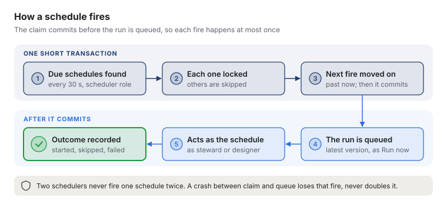
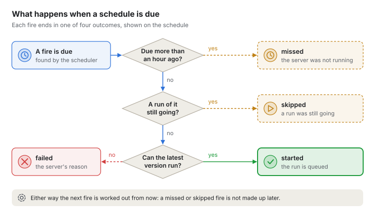

# Schedules

Pipelines and flows that run at set times, without a person pressing Run now
([ADR 0046](../adr/0046-scheduler.md); ADR 0026 decided the scheduler is built in). This note says
how a schedule is stored, how it fires, and who its runs act as. The guide is
[Running pipelines and flows on a schedule](../guide/schedules.md).

## 1. The table (V36)

One row of `schedule` per schedule; a pipeline or flow may have several.

| Column | What it holds |
| --- | --- |
| `id` | A number of its own, shown in who a run was requested by |
| `pipeline`, `flow` | What it runs: exactly one is set. Each is a foreign key that cascades. Deleting a pipeline or a flow deletes its schedules in its own transaction (`PipelineStore.deleteWithSchedules`, `FlowStore.deleteWithSchedules`, both through `ScheduleStore.deleteFor`: `DELETE … RETURNING`) and records each |
| `cron`, `zone` | When: five-field cron, read in an IANA zone (`UTC` by default) |
| `parameters` | The values each run starts with, as given; defaults are filled in at each run, from the version then latest |
| `run_as` | The role the runs have: `steward` (the default) or `designer`, never `admin` |
| `enabled` | Off while paused |
| `description` | A short line, at most 200 characters |
| `created_by`, `created_at`, `updated_by`, `updated_at` | Who added it and who last set it, and when |
| `set_by_token`, `set_by_person` | Who last set it, as an identity: the API token they used (a reference to `api_token`, whose rows are revoked, never deleted), or an opaque key for a person signed in through the identity provider (`OidcIdentityAugmentor.personRef`, a hash of issuer and subject). Both null only for a schedule saved while sign-in was off |
| `next_at` | When it fires next; null while paused, or when it never fires again |
| `last_at`, `last_outcome` | When it was last due, and what happened, in words (`starting` while its run is being queued) |
| `last_pipeline_run`, `last_flow_run` | The run the last fire started. Foreign keys set to null when the run is deleted, so the link never leads to a run that is gone |

`schedule_due_idx` on `next_at WHERE enabled` is what the scheduler reads. A schedule is not part
of the YAML: who a run acts as is the decision of the person who sets the schedule, not of the
YAML's author, and changing a time does not make a new version.

## 2. Who may do what

- **Designers and admins** add, change, pause, resume and delete schedules
  (`ScheduleResource`, `@RolesAllowed(designer)`, and again in `ScheduleService.requireSetter`).
- **Stewards** read them with their parameter values.
- **Viewers** read them without the values (`parameters` is null), as they never see the values a
  run starts with ([flows.md](flows.md) section 5), and see a failed fire's outcome only as
  `failed`. Values go through `Sights.data()`.
- Anyone signed in can try an expression (`POST /api/v1/schedules/preview`): the next five fire
  times, or the problem.

## 3. Who a run acts as

A scheduled run is requested by `schedule <id> (set by <name>)`, where the name is whoever last
set the schedule, with the schedule's role: steward or designer, never admin, and never above the
role of the person saving it. It runs the **latest version** with the schedule's values, through
`PipelineService.queueRun` or `FlowService.queueRun` exactly as Run now does, so every check Run
now makes applies: a version with problems, a missing value, a source that no longer allows
writing. The pipeline runs a scheduled flow starts carry the same name and role.

Today a designer-role and a steward-role scheduled run behave the same: a run's role is only
checked as "steward or above". The role is recorded with each run for when that changes.

When a schedule is saved, its values are checked against the latest version
(`PipelineService.checkParameters`, `FlowService.checkParameters`), so a typo is refused at once
rather than at the first fire. The latest version may still change before the fire; the fire is
checked again then.

## 4. Cron

`Cron` is a small pure class: `Cron.parse(text)` and `next(after, zone)`, the first fire strictly
after `after`.

- Five fields: minute (0-59), hour (0-23), day of the month (1-31), month (1-12 or `JAN`-`DEC`),
  day of the week (0-7 or `SUN`-`SAT`; 0 and 7 are Sunday). Each takes `*`, a number, `a-b`,
  `*/n`, `a-b/n`, `a/n` (from a to the end) and lists joined by commas. Names in any case.
- `@hourly`, `@daily` (`@midnight`), `@weekly`, `@monthly`, `@yearly` (`@annually`). No seconds
  field and no `@reboot`: both are refused, saying so.
- **The two day fields** follow Vixie cron: when both are restricted (neither starts with `*`), a
  day matching either fires (`0 0 1 * MON`: the 1st, and every Monday). Otherwise a day must match
  both, so `*/2` in the day of the month with `MON` means odd days that are Mondays.
- **Daylight saving.** Times are local to the zone. A local time that does not exist (the clocks go
  forward) fires at that time moved on by the gap, as `ZonedDateTime.ofLocal` does: in London
  `30 1 * * *` fires at 02:30 BST on the last Sunday in March. A local time that happens twice (the
  clocks go back) fires once, at the first: the earlier offset, and the second is never strictly
  after it.
- **A search limit.** `next` looks ten years ahead (3,660 days) and returns null past that. Saving
  an expression that never fires (`0 0 30 2 *`) is refused. The 29th of February is found: from
  2096 the next is 2104.

## 5. Firing

`Scheduler` runs on processes with the scheduler role, on a virtual thread, every
`kilnmark.schedules.poll-interval` (30 seconds). Each `tick()`:

1. **Claims**, in one short transaction (`ScheduleStore.claimDue`), with now read from the
   database's clock: `SELECT … WHERE enabled AND next_at <= now ORDER BY next_at LIMIT 100 FOR
   UPDATE SKIP LOCKED`; for each row, works out the next fire after now, or after its last fire if
   that is later, and writes it with `last_at = now`, the last run cleared, and `starting` as the
   outcome; then commits.
2. **Checks** each claimed run as Run now checks it (`PipelineService.starter()`,
   `FlowService.starter()`: a version compiled, a flow's pipelines read), with no lock held, on the
   schedule as it is now.
3. **Queues** the checked run and **records** the outcome and the run it started
   (`ScheduleStore.fire`), under the schedule's row lock, only while the row is still on, still says
   `starting` and still runs the same pipeline or flow. If what the run was checked for (what it
   runs, its values, its role) changed between the check and the lock, the lock is let go and the
   run checked again; after two such changes the check is made under the lock, as before.

A tick that claims a full batch of 100 is followed at once by another. Tests call
`tick(Instant)` to fix the clock.

**At most once, and why it holds.**

- **Between schedulers:** one holds the row's lock and the other skips it; once the first has
  committed, `next_at` is past now.
- **Between a scheduler and a save:** saving (`ScheduleStore.update`) locks the row first. If
  the times, zone and pausing are unchanged, `next_at` stays as it is, due or not. If they
  changed, `next_at` is worked out from the database's clock read after the lock, or from
  `last_at` if that is later, so it is never a fire already claimed. A fire that was due and not
  yet claimed is recorded as `missed: changed while it was due`.
- **Across clocks:** no process's own clock is used for `next_at`: the claim, a save and a new
  schedule all read the database's (`clock_timestamp()`). The preview alone uses the API's, since
  it only shows times.
- **A crash** between the commit and the queue loses that fire, which is the safer failure for
  loads of data. Its outcome stays `starting`; once `last_at` is older than three poll intervals
  (at least five minutes; `ScheduleStore.staleAfter`), every read shows it as
  `failed: the server stopped before the run was queued`. Nothing is written twice.

**Keeping going.** `fire()` catches anything a tick throws, an `Error` too, logs it at ERROR by
its kind (the detail at DEBUG) and looks again at the next poll; it records when it last looked.
The readiness check `scheduler` (`ReadinessChecks`) is down when a process with the scheduler
role has not looked within three poll intervals and a minute. The log says what each fire did by
its first word at INFO (`started`, `skipped`, `missed`, `failed`); the reason, which can be worked
out from the run's values, only at DEBUG.

## 6. Outcomes

| Outcome | When |
| --- | --- |
| `starting` | Claimed; its run is being queued. Seconds at most |
| `started` | The run was queued; `last_pipeline_run` or `last_flow_run` names it |
| `skipped: a run was still going` | One run at a time: the pipeline or flow already had a run queued or running (`AlreadyRunning`, a 409 for Run now). The fire is not queued for later |
| `missed: the server was not running` | The fire was due longer ago than `kilnmark.schedules.catch-up` (1 hour) when it was claimed. It does not run late |
| `failed: <message>` | The run could not be queued: the server's message, as Run now would show it (a version with problems, a missing value, a pipeline deleted since). Messages never hold secrets; a version's problems can be worked out from the run's values, so viewers see only `failed` |
| `missed: changed while it was due` | Its times, zone or pausing were changed while a fire was due and not yet claimed. That fire does not run |
| `paused: the person who set it no longer has the role` | Whoever set it no longer holds its role (section 10). The schedule is off until a designer or admin saves it. Viewers see `paused` |
| `paused: the person who set it has not signed in for 30 days` | A person set it, and their latest sign-in is older than `kilnmark.schedules.signed-in-within` (section 10). Viewers see `paused` |
| `skipped: the schedule was changed while it was starting` | Paused, changed or set to run something else while its run was being queued; nothing ran |
| `failed: the server stopped before the run was queued` | How `starting` reads once it is older than three poll intervals (at least five minutes): the process stopped before it queued the run. That fire is lost |

Within the catch-up a schedule runs once, however many fires it covers: the next fire is always
worked out from now. A schedule whose expression or zone cannot be read any more stops (its next
fire is cleared) and its outcome says why.

## 7. The API

`/api/v1/schedules`: `GET` (filters `pipeline=` and `flow=`), `GET {id}`, `POST`, `PUT {id}`
(replaces everything; `enabled` false pauses, true resumes and works the next fire out from then;
a change that keeps the times, zone and pausing keeps the next fire),
`DELETE {id}`, and `POST preview`. Each schedule shows `nextAt`, `lastAt`, `lastOutcome` and the
last run. Mistakes are 400 with `{"error": "..."}` naming the field: `cron:`, `zone:`, `runAs:`,
`parameters:`, `pipeline:` or `flow:`.

## 8. The audit log

`schedule.set` when a schedule is added or changed, and `schedule.deleted`, each on
`schedule <id>` with the pipeline or flow, cron, zone, `runAs` and `enabled`: never the parameter
values (ADR 0029). `schedule.paused` when a schedule stops because its setter lost the role, with
the reason (section 10). Deleting a pipeline or a flow records `schedule.deleted`, with
`via: pipeline deleted` or `via: flow deleted` (`ScheduleService.recordDeletedWith`), for exactly
the schedules its own transaction deleted, so one added while it was being deleted is
never removed unrecorded. The runs themselves are recorded as runs, requested by the
schedule.

## 9. Settings

| Setting | Default | Meaning |
| --- | --- | --- |
| `kilnmark.schedules.poll-interval` | `30s` | How often a process with the scheduler role looks for schedules that are due |
| `kilnmark.schedules.catch-up` | `1h` | A fire due longer ago than this when it is found is missed, not run late |
| `kilnmark.schedules.signed-in-within` | `30d` | A schedule a person set pauses when their latest sign-in is older than this |

## 10. When the setter loses the role

`Setters.problem` runs before every fire, after the claim: whoever set the schedule must still
hold at least its `run_as`.

- **A token** (`set_by_token`): `ApiTokens.workingRole`, the token's role if it still works by the
  database's clock (`worksSql`: not revoked, not expired, within the longest lifetime).
- **A person** (`set_by_person`): `AuditLog.providerStanding`, as the access review reads sign-ins:
  their latest `auth.sign_in`'s role, unless a later `auth.sign_in_refused` says none of their
  groups has a role (`OidcAccess.NO_GROUP`); other refusals take nothing away; a role this server
  does not know counts as none. Then `Setters.personProblem`:
  - **today's mapping:** a sign-in records, in `groups`, only those of the person's groups that the
    group-to-role settings name (`OidcAccess.mappedGroups`, each cleaned as logged text), never
    their other groups, whose names can be sensitive. The role is lowered to what those groups give
    under the settings now (`OidcAccess.roleOf`), never raised, so the mapped groups are all the
    check needs, and none is dropped: there are only as many as the settings name. A sign-in
    recorded before groups were keeps its recorded role;
  - **a recent sign-in:** the latest must be within `kilnmark.schedules.signed-in-within` (30 days),
    else the outcome is `paused: the person who set it has not signed in for 30 days`. Someone who
    has left and is disabled at the provider never signs in again; this bounds how long their
    schedules run.

  `AuditLog.providerStanding` reads two things, in the order the database stored events (`id`),
  not by their times, which servers with different clocks gave them: the person's latest
  successful sign-in (by their key; only when none carries it, by their name among sign-ins
  recorded without one, so a namesake never counts), and whether a sign-in refused for want of a
  group came after it. Other refusals are never read, however many there are. Each query is one
  of `AuditLog`'s constants (`LATEST_SIGN_IN_BY_KEY` and the others), with the actions written as
  literals so the partial indexes `audit_event_sign_in_person_idx` and
  `audit_event_sign_in_actor_idx` serve them; a test reads the plan of those same constants.
- **Neither**: only while sign-in is off.

**Under the row lock.** `ScheduleStore.fire` locks the schedule's row (`FOR UPDATE`) only while
it is still on, still `starting` and runs the same pipeline or flow, and holds it from the check
of its setter to the outcome, queueing the run in between. The run's own checks, which compile its
version and read the catalogue and can take seconds, are made before, with no lock held
(efficiency review, 6 November 2026): before, the fire held the row, and a connection, through
them, so a save, a pause or a delete of the schedule waited on a compile. What the lock covers is
what the guarantees need: the claim, earlier, is what fires a schedule at most once across
schedulers, and the lock from the setter's check to the outcome is what orders a pause against
the run (`ScheduleApiTest` holds a fire in its check and takes the row with `NOWAIT` meanwhile). A token revoked, or a schedule paused or changed,
meanwhile either comes first (the check fails, or the row is no longer as claimed and says
`skipped: the schedule was changed while it was starting`) or waits until the run is queued and
recorded. A run already queued or running is never cancelled by a pause. Deleting a pipeline or
a flow locks its schedules' rows before its own row (`ScheduleStore.lockFor`), the order a fire
takes them (its run locks the pipeline or flow). The order matters more than usual: the fire's row
lock is held on one connection while its run is queued on another, so PostgreSQL could not see
such a deadlock and break it; a test for each (`ScheduleApiTest`) shows the delete waiting for the
fire and then refused because the run is queued. The order covers the schedules the pipeline or
flow has when the delete starts. A schedule changed to run it just after that, and fired, is not
locked by the delete, so the two could still wait for each other. What is guaranteed: the delete
limits every lock wait to 5 seconds (`lock_timeout`, `ScheduleStore.DELETE_LOCK_TIMEOUT`), so it
never hangs. A lock not granted in time rolls the delete back, deletes nothing, and answers 409
saying to try again; the fire then goes ahead (ADR 0048).

If the check fails, nothing is queued: the row is turned off, its next fire cleared,
`last_at` set to now, and the outcome written; `schedule.paused` is recorded by the server with the
reason, describing the schedule as it is now (a change saved before the fire took the row
included). If the check itself cannot be made (the database is unreachable), the fire fails and
the schedule stays on. If the outcome cannot be written after the run was queued, the scheduler
writes it again in a transaction of its own, up to three times, only over `starting`, so a run
that started never reads as a lost fire.

**At once, too.** `TokenResource.revoke` pauses every schedule the token set
(`ScheduleService.tokenRevoked`). `SignInEvents` pauses every schedule the person set whose role is
above what their sign-in just gave them, or all of them when the sign-in was refused for want of a
group (`ScheduleService.personSignedIn`); so does each renewal of a provider session with its
refresh token (`SignInEvents.renewed`, called by `OidcIdentityAugmentor`, ADR 0036), which records
no sign-in: with the role unchanged nothing is above it and nothing pauses, and the fire-time check
still reads the latest recorded sign-in. That runs on a virtual thread of its own, never on the
thread that delivered the sign-in (which can be an event loop), locks only the schedules that will
pause (their role is in the query), and waits at most two seconds (`lock_timeout`) for one a fire
holds; a failure is logged at ERROR and never fails the sign-in, since each schedule is checked
again before it runs. **A database outage at sign-in** can lose both the sign-in's event and this
pause; the person's schedules then stand on their previous sign-in until the next one, or until
`signed-in-within` passes. Both set `last_at` to now, as a pause
at a fire does. Each is recorded as `schedule.paused`, by the admin who
revoked the token or by the person signing in. Saving a paused schedule (a designer or admin, with
`enabled` true) makes them its setter, checked against their own role; nothing resumes by itself
when a person's role comes back.

**The environment admin token.** `KILNMARK_ADMIN_TOKEN` is stored as a token. When its value
changes, start-up sets the old token aside, so the schedules it set are paused at their next fire.

**What Kilnmark cannot know.** A person removed from their groups at the provider is seen only when
they next sign in, or once their latest sign-in is older than `signed-in-within`. Tokens are not
linked to people: revoking a person's tokens stops only the schedules set with those tokens. Work
that must outlive any one person is best set with a team's designer token, which stops only when
it is revoked or expires.

**Not yet:** the access review lists tokens and people, not the schedules each set. The review
groups people by name while schedules key them by the person's key, so listing them there means
keying the review by person first; a follow-up. Until then, `GET /api/v1/schedules` shows each
schedule's `updatedBy`.

## 11. Not yet

- Event triggers: a run when a file lands, or when another flow ends.

## 12. Pages

In `ui/src/schedules`; the guide walks through them.

- **A pipeline's or flow's Schedules tab** (`SchedulesSection`), in the panel under its canvas or
  diagram, reads `GET /schedules?pipeline=` or `?flow=` when the page opens (the line under its
  name gives the next scheduled run) and again every 30 seconds while the tab shows.
- **The Schedules page** (`#/schedules`, `SchedulesPage`) reads `GET /schedules`, with filters for
  on, paused, paused by Kilnmark, and failed last time; display names come from the pipeline and
  flow lists.
- **One table** (`SchedulesTable`) for both: the cron in words for the shapes the presets make and
  the `@` shorthands (`cronWords`), else the expression; `updatedBy`, the name runs carry, in bold;
  On or Paused with the next run in the viewer's zone, and in the schedule's when that differs;
  the last outcome as a word, a tone and its reason, linked to the run. A schedule Kilnmark
  paused reads, in amber and apart from the grey Paused state, **Paused: setter lost the role**
  or **Paused: setter not signed in for 30 days** (the days as the outcome gives them); any other
  `paused:` reason reads **Paused by Kilnmark** with the reason, and viewers, who get just
  `paused`, read **Paused by Kilnmark**. The page's **Paused by Kilnmark** filter
  (`pausedByKilnmark`: off, with an outcome starting `paused`) counts them all. The values are a
  line under the schedule for stewards and above; viewers get null from the API and no line. Six
  columns at most, so the page fits 1200 pixels.
- **The form** (`ScheduleForm`, designers and admins) has presets that fill the cron (`presetCron`;
  `readPreset` reads one back, so an edit opens on its preset) and a free cron field. Every few
  minutes offers only steps that divide the hour, so the gaps stay even. A preset part that is not
  right empties the cron rather than keep an earlier one. The zone list is
  `Intl.supportedValuesOf("timeZone")` with UTC and the browser's zone. `POST /schedules/preview`
  is asked 400 ms after the last change, earlier answers aborted, and only the answer for the
  current expression and zone is shown. Parameter fields are the Run now dialog's
  (`ParameterFields`); a pipeline's parameters are read from its latest YAML (`pipelineParameters`),
  a flow's from its version. The form does not save until the parameters are read, since a PUT
  replaces every value.
- **Pause and Resume** read the schedule again (`GET /schedules/{id}`) and PUT it with only
  `enabled` changed, so a change since the list was read is kept; **Edit** opens on a fresh read
  too. Each makes the person the schedule's `set by`, as the notice says. **Delete** asks first.
