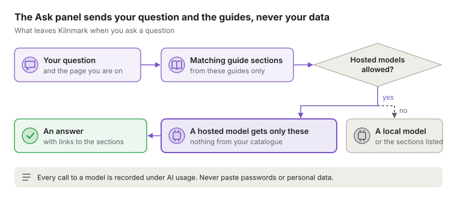

# Asking Kilnmark

The **Ask** panel answers questions about using Kilnmark from its documentation, with links to the
exact sections it used. Open it from any page and keep it open while you work.

## Opening the Ask panel

Choose **Ask Kilnmark** in the top bar of any page, or press **Alt+A**. The panel opens at the side,
so the page you are on stays in view. Press **Escape** or choose the close button (**×**) to close
it; focus goes back to where you were.

The panel suggests a few questions for the page you are on, such as *What does Fail above mean?*
on the Quality rules page. Choose one, or type your own and press **Enter**. **Shift+Enter** starts
a new line.

The conversation stays while you move around the app, so you can ask a follow-up. It is cleared
when you sign out or reload the page. **Clear** starts again.

## What it answers from

Kilnmark answers only from the documentation that ships with your version: these guides and the
released versions in **What's new**. Changes listed there as *Unreleased* are not answered from
until they are released. It does not look at your sources, assets or quality results yet, and it
does not know about other products.

The page you are on counts: on the Quality rules page, the guide to quality rules comes first.

If the documentation does not cover something, the answer says so rather than guessing.

## Sources and links

Each answer cites its sources as numbers, such as [1]. The numbers are links, and the sources are
listed under the answer. Choosing one opens that section of the documentation in the main area,
with the panel still open beside it.

Kilnmark checks every citation before showing it: an answer can only link to a section it was
given.

## When there is no model

Answers are written by the AI model an administrator chooses for the **Assistant** feature under
**Settings**, **AI models**. Without one, or when the model cannot be reached, the panel still
works: it lists the sections of the documentation that best match your question, each with a
short extract, like a search.

For administrators: give the Assistant a model profile of its own. Answers take longer than the
other features' calls, and a profile shared with **Ask in plain English** would make searches wait
behind them. Set the profile's context size to the model server's: Kilnmark sends as much
documentation and conversation as fits, and with less room it sends less. For a model server
such as Ollama on the computer running Kilnmark, see
[A model server or database on this computer](install/models-on-this-computer.md).

With an embedding model set for **Search by meaning**, sections are found by meaning as well as
by their words.

## Rating answers

Under each answer, **Did this help?** offers **Yes, it helped** and **No**. Kilnmark records your
question, which sections the answer used, and whether it helped, so administrators can see where
the documentation falls short. Administrators can list recent ratings with
`GET /api/v1/assistant/feedback`. Ratings are deleted with the AI usage records, after
`kilnmark.ai.usage-retention` (90 days by default).

## Privacy

- Your question is sent to the model chosen for the Assistant feature, together with the sections
  of documentation that match it. Nothing about your catalogue is sent.
- When the server allows only local models (the **Hosted models** rule under AI models, or the
  server's own `kilnmark.ai.hosted-models=forbidden`), the question never goes to a hosted model;
  the panel lists matching sections instead.
- Every call to the model is recorded under **AI usage**, as for other AI features. The text of
  questions and answers is kept there only if the server keeps usage text
  (`kilnmark.ai.keep-usage-text`).
- Ratings keep your question and the sections used. The answer's own text is kept with a rating
  only when the server keeps usage text.
- Do not paste passwords or personal data into a question.
