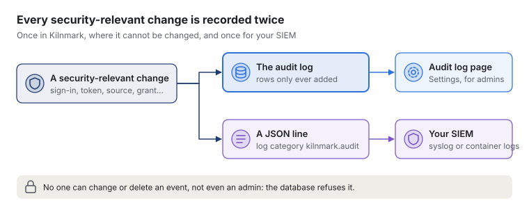
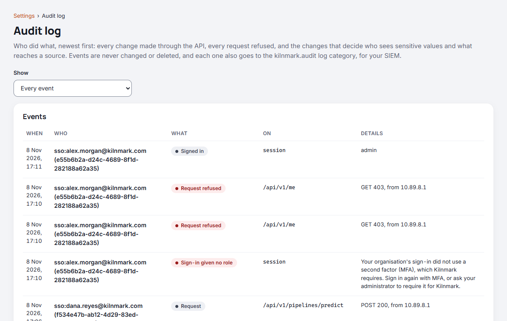

# The audit log

Kilnmark keeps an audit trail of who did what: every change made through the API, every request
refused for want of sign-in or a role, and, in more detail, the changes that decide who sees
sensitive values and what reaches a source. It is there for the controls regulated organisations
must show, such as an audit trail of changes and of access attempts, and it is the record ADR 0027
relies on for clearing marks and granting the unmask grant.

Admins read it under **Settings › Audit log**, or through `GET /api/v1/audit`. Nobody else can.

## What is recorded

Each event has when it happened, who did it (the token's name, and its number), what they did, what
it was done to, and a few details. Request events also keep the caller's address, as the server sees
it (behind a proxy, as its forwarding settings say).

| Event | What it is | Details |
| --- | --- | --- |
| Token created (`token.created`) | An API token was made | Its name, role, whether it sees unmasked values, when it expires |
| Token revoked (`token.revoked`) | A token was revoked | Its name and role, and the reason when the server revoked it |
| Signed in (`auth.sign_in`) | Someone signed in with your organisation's identity provider | The role their groups gave them, whether they see unmasked values, those of their groups that your settings map to a role (never their other groups, whose names can be sensitive), and an opaque key for the person (`person`). The groups and key are what schedules they set are checked by |
| Sign-in given no role (`auth.sign_in_refused`) | Someone signed in with the provider but was given no role | Why: no second factor, none of their groups has a role, or one of the Starter Pack's example people on a production install |
| Signed out (`auth.sign_out`) | Someone signed out of a provider sign-in | |
| Person added (`auth.person_added`) | The control script's `people add` or `people import` made a person of your own in the bundled Keycloak (INSTALL.md, "Adding people to the bundled Keycloak"); recorded as the admin token the script uses | The person, their groups, and how (one at a time, or from a file). Never a password |
| People imported (`auth.people_imported`) | The control script's `people import` ran, whether or not it made anyone | How many were made, already there (left as they were) and refused (lines that were wrong: then nobody is made) |
| Access review (`access.review`) | An admin viewed or downloaded the access review (Settings, Access review) | Its format and how many entries it had |
| Sensitive values asked for (`unmask.requested`) | A designer token was made to see sensitive values, which waits for a second admin | The token's name |
| Sensitive values approved (`unmask.approved`) | A second admin let a designer token see sensitive values | The token's name |
| Sensitive values refused (`unmask.refused`) | An admin refused a designer token seeing sensitive values; it sees them masked | The token's name |
| Database restored (`database.restored`) | Kilnmark's database was restored from a backup with `restore.sh` ([Backing up and restoring Kilnmark](backup-and-restore.md)), recorded at the first start after it. Events after the backup's time are in your SIEM and the kept database, not in the restored log | The backup, when it was taken, its Kilnmark version, the previous database's name, and whether the keys were restored |
| Schedule set (`schedule.set`) | A designer or admin added or changed a schedule ([Running pipelines and flows on a schedule](schedules.md)); the event is on `schedule <id>` | The pipeline or flow, the cron expression, the zone, the role its runs act as, and whether it is on. Never the values its runs start with |
| Schedule paused (`schedule.paused`) | A schedule stopped because whoever set it no longer has its role: their token was revoked or expired, or a sign-in gave them less of a role ([Running pipelines and flows on a schedule](schedules.md#when-the-person-who-set-it-loses-the-role)). By the admin who revoked the token, the person signing in, or the server at the schedule's time | As for Schedule set, with why |
| Schedule deleted (`schedule.deleted`) | A schedule was deleted, by itself or with its pipeline or flow | As for Schedule set, and `via: pipeline deleted` or `via: flow deleted` when its pipeline or flow was deleted |
| Starter Pack turned on (`starter.added`) | An admin turned the Starter Pack's example data on, or tried to (INSTALL.md, "Try Kilnmark with the Starter Pack") | How each step went, a failed one included; or `refused` and why, when nothing was done (`production`, which is always refused, `samples not offered`, `not ready`) |
| Starter Pack people changed (`starter.people`) | The control script's `starter people`, or its `up`, told Kilnmark what Keycloak's setup did to the Starter Pack's example people | What was done (added, gave a new password to, removed, or brought into the pack people an earlier version made) and to whom. Keycloak records the same changes as its admin events |
| Starter Pack turned off (`starter.removed`) | An admin turned the Starter Pack off, removing what it added | How each step went, and the flows, pipelines, sources and variables it deleted. Each schedule deleted with a sample is a Schedule deleted event of its own |
| Column marked sensitive (`mark.set`) | A column was marked | The column |
| Sensitive mark cleared (`mark.cleared`) | A mark was cleared: the column's values are no longer masked | The column |
| Source deleted (`source.deleted`) | A source and what was recorded about it were deleted | Its assets and runs, and whether it had marks (deleting it cleared them) |
| Allow writing changed (`source.allow_writing`) | Allow writing turned on or off | On or off, and how: in the form, or by an import |
| Allow SQL changed (`source.allow_sql`) | Allow SQL turned on or off | On or off, and how |
| Most runs at once changed (`source.max_runs`) | A source's limit on runs at once was set, changed or removed ([Sources that take a few runs at a time](pipelines.md#sources-that-take-a-few-runs-at-a-time)) | What it was and is (empty: no limit), and how: in the form, or by an import |
| Flow ran SQL (`flow.sql`) | A flow's sql node started, as the person who started the flow; the event is on `flow/run/node` | The source, how many statements, and the flow's version. Never the statements themselves, which can hold values: they are in that version of the flow |
| Request (`api.request`) | Any request that may change something (`POST`, `PUT`, `PATCH`, `DELETE`) and succeeded. Some of these only read, such as previews and dry runs | The method, status and the caller's address; the event is on the request's path |
| Request refused (`api.refused`) | A request refused for want of a role (403), or for want of sign-in when it would have changed something (401) | The method, status and address. In the table, refusals are kept at most 30 a minute for each token, and for everyone not signed in together; the next one kept says how many were not. The JSON line has every one |

Start-up records the tokens it makes or sets aside (the first admin token, `KILNMARK_ADMIN_TOKEN`)
as the server. A change is recorded as it is made, after it has succeeded. Only a request's method
and path are kept: never its query string or body, which can hold passwords, and never a token's
secret. The MCP endpoint's refusals are not recorded yet.

## Nothing changes it

Events are only ever added. The database refuses to change or delete them, or to empty the table,
so nothing Kilnmark does, and no mistake in it, can rewrite what happened. The database login
Kilnmark runs as owns the table, though, so someone with that login could switch the protection
off: that is why the events also go to your SIEM, which Kilnmark cannot change. Back the table up
with the rest of the database.

Events are stored in the background, in the order they happened (read them by number), so no
request waits for them. A flood of requests cannot keep a token, mark or source event out: request
events give way first, and those events are stored at once when the queue is full. If an event
cannot be stored (the database is unreachable, say), the change still stands and the server logs an
error; the event's JSON line, below, is written either way.

The log grows with use: roughly one event for each change made through the API. A year of a busy
team is a few hundred thousand rows, which PostgreSQL holds easily. Nothing is deleted, so it keeps
at least the five years some regulators ask for.

## Sending it to your SIEM



Every event is also written, one JSON object a line, to the log category `kilnmark.audit`:

```json
{"at":"2026-11-01T19:30:00Z","actor":"jo","tokenId":12,"action":"source.allow_sql","target":"warehouse","detail":{"on":true,"via":"form"}}
```

To send them to your SIEM's syslog collector as well, start the server with the `siem` profile and
say where the collector is:

```sh
QUARKUS_PROFILE=prod,siem
KILNMARK_AUDIT_SYSLOG_ENDPOINT=siem.example.com:514
KILNMARK_AUDIT_SYSLOG_PROTOCOL=tcp      # or udp, ssl-tcp
```

Or collect the container's own output, where the same lines appear, and filter on the category.

## Reading it



The page shows the newest events first, a hundred at a time; **Show older events** loads the next
hundred. **Show** narrows it to one kind of event. Through the API, `action` filters, `limit` sets
the page size (up to 500), and `before`, set to the `next` of the previous page, gives the page
after it.
