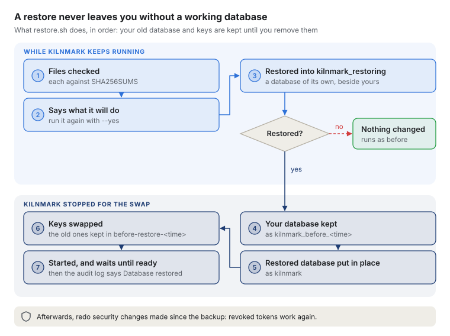

# Backing up and restoring Kilnmark

This is the runbook for keeping Kilnmark recoverable: what to back up, how, how to restore, and how
to test a restore. It covers a release installed with compose (INSTALL.md, A). Why it works this way
is in [ADR 0039](../adr/0039-backup-and-restore.md).

## What to back up

| What | Where | How |
| --- | --- | --- |
| The database: sources and their sealed passwords, pipelines and their versions, flows, runs, profiles, rules, tokens, notifications, the audit log | The `pgdata` volume | The backup dumps it |
| The keys: `secret.key`, which opens the stored source passwords, and the drivers registered under **Settings › Drivers** | The `keys` volume | The backup copies it |
| The settings: `.env` (the database password, the admin token, the sign-in settings) | The release folder | Your secrets store, once and after each change |
| Your own files: `tls/`, `branding/`, and the certificate for the database if you gave it one | The release folder, and the `pgdata` volume's `tls` folder | Your usual file backups |

The AI models volume needs no backup: download the models again. The release folder itself can be
fetched again, but keep the version you run.

**Keep the keys apart from the database dumps.** A dump holds the source passwords sealed, and the
key opens them: one copy holding both gives an attacker every password. Put the keys file in a
different place (a secrets store or a separate vault), and encrypt both. If the keys file is lost
for good, `restore.sh --without-keys` restores the database alone, and every stored password must be
entered again.

Backups are as sensitive as the database: they hold the audit log, people's names, and what
Kilnmark keeps about your sources' data. Limit who can read them as you limit who can reach the
database. Keep them where only the backup job can write: a restore runs the dump with full rights
on Kilnmark's database, so a dump someone could change, with its checksums, is a way in.

If you gave the bundled database a certificate of your own (INSTALL.md, "Kilnmark's own
database"), keep a copy of it: it lives in the database volume, not in the dump. A new volume makes
its own certificate again.

## Back up

From the install root, while Kilnmark runs (INSTALL.md, "The control script"):

```
./kilnmark.sh backup /path/to/backups       (Windows: kilnmark.cmd backup D:\backups)
```

Without a folder it uses the install root's `backups`. It writes a new folder, `kilnmark-<UTC time>`, holding:

- `kilnmark-db.dump`: the database, as one consistent snapshot, in PostgreSQL's custom format;
- `kilnmark-keys.tar`: the keys volume;
- `backup.txt`: when it was taken, the Kilnmark version, and the last database migration;
- `SHA256SUMS`: a checksum of each file, which the restore checks.

The script reads the whole dump back before it finishes, as a restore reads it, so a dump that was
cut short or damaged on the way fails the backup. On Linux the control script runs the release's
`backup.sh`, which can also be run by hand from a release folder beside `compose.yaml` (it uses
`podman compose`, or `docker compose` if Podman is not installed; `KILNMARK_COMPOSE` overrides
that). On Windows the control script does the same itself, and writes the same files, so a backup
restores on either. Then move `kilnmark-keys.tar` to where you keep keys, and the rest
to your backup store.

**How often.** Daily is a sensible start: you lose at most a day of changes. Run it from cron or a
systemd timer, for example at 02:00 (it keeps its own log in the install root's `logs`, and fails
with a non-zero exit code):

```
0 2 * * * /opt/kilnmark/kilnmark.sh backup /srv/backups
```

On Windows, a Task Scheduler task running `C:\Kilnmark\kilnmark.cmd backup D:\backups` does the
same.

Keep as many as your retention policy asks, and at least one copy off the machine. Back up again
before every upgrade.

**Your own PostgreSQL.** If Kilnmark runs on your own PostgreSQL server rather than the bundled one,
use that server's backups for the database (snapshots, or point-in-time recovery, which loses
minutes rather than a day), and still back up the keys volume.

## Restore

A restore puts Kilnmark back as it was when the backup was taken. Everything since is lost.



1. **Install the release** you ran, or a later one (INSTALL.md, A), with your `.env`. A later
   release updates the database at its first start, as an upgrade does; an earlier one cannot run a
   newer database, and the script refuses it.
2. **Restore**, from the install root:

   ```
   ./kilnmark.sh restore /path/to/backups/kilnmark-<time>     (Windows: kilnmark.cmd restore ...)
   ```

   Put `kilnmark-keys.tar` back in the backup's folder first. The script checks each of the backup's
   files against `SHA256SUMS`, then says what it will do and asks you to run it again with `--yes` (`-Yes` on Windows).
   With `--yes`, it:
   - restores the backup into a database of its own, `kilnmark_restoring`, while Kilnmark keeps
     running. If that fails, nothing has changed: Kilnmark still runs on its own database, and the
     next restore starts `kilnmark_restoring` again;
   - stops Kilnmark, and keeps the database it had as `kilnmark_before_<time>`;
   - puts the restored database in place as `kilnmark`;
   - replaces the keys volume with the backup's, keeping the keys it had in `before-restore-<time>`
     in the volume;
   - starts Kilnmark and waits until it is ready.

   If it stops part way, it says how far it got and what it left.
3. **Redo what security changes were made since the backup.** The restored database is from before
   them:
   - **Tokens revoked since then work again.** Find them in your SIEM's copy of the audit log
     (`token.revoked` events after the backup's time) and revoke them again under **API tokens**.
   - Check **Settings › Access review**, and redo marks set or cleared and grants refused since then
     (`mark.*` and `unmask.*` events).
   - People who sign in with your identity provider are not affected: their roles come from the
     provider each time.
4. **Run again** the scans, quality checks, pipelines and flows that ran after the backup, if you
   need their results.

**Settings › Audit log** shows the restore as **Database restored**, with the backup it came from,
when that was taken, and the name of the database kept; your SIEM gets the event too. Kilnmark
records it at its first start after the restore. Events between the backup and the restore are not
in the restored log: they are in your SIEM, and in the kept database. Note the restore in your
change record too.

## Going back, and tidying up

Until you remove them, the database and keys the restore replaced are kept. To go back to them,
from the release folder (with `<time>` from the restore's last lines):

```
podman compose stop kilnmark
podman compose exec postgres psql -U kilnmark -d postgres -c "ALTER DATABASE kilnmark RENAME TO kilnmark_restored" -c "ALTER DATABASE kilnmark_before_<time> RENAME TO kilnmark"
podman compose run --rm --no-deps --entrypoint sh kilnmark -c "cd /var/lib/kilnmark && rm -rf drivers drivers.loaded secret.key && mv before-restore-<time>/* ."
podman compose up -d
```

Once the restored Kilnmark has worked for a while, remove them, as they hold the same sensitive
data:

```
podman compose exec postgres dropdb -U kilnmark kilnmark_before_<time>
podman compose exec kilnmark rm -rf /var/lib/kilnmark/before-restore-<time>
```

A restore with `--without-keys` keeps the keys volume as it was.

## Test a restore

A backup is proven only by restoring it. Every quarter, or as your policy asks:

1. On a spare machine, install the same release with a copy of `.env` (a different admin token is
   fine), and restore the latest backup with `restore.sh`.
2. Check that:
   - Kilnmark starts, and you can sign in;
   - **Sources** lists your sources, and **Test** on one with a stored password succeeds (the key
     was restored with the database);
   - **Pipelines** and **Flows** list yours, with their versions;
   - **Settings › Audit log** shows the restore, and the events up to the backup's time.
3. Write down how long the restore took (your recovery time) and the backup's age (your recovery
   point), and anything that did not work.
4. Remove the spare machine's copy: it holds the same sensitive data as the backup.

## When something goes wrong

| What you see | What to do |
| --- | --- |
| `Backup failed: the database could not be dumped` | Check the database runs: `podman compose ps`, and its log with `podman compose logs postgres` |
| `kilnmark-db.dump is missing from the backup or does not match its checksum` | The backup is damaged or incomplete. Restore an earlier one |
| `kilnmark-keys.tar is missing from the backup or does not match its checksum` | Put the keys file back from where you keep keys. If it is lost for good, run with `--without-keys` |
| `Restore failed while restoring the backup into kilnmark_restoring` | Nothing changed. Read the error above it: often the disk is full, or the dump is damaged |
| `Kilnmark is still running after the stop` | Nothing was replaced. Stop it (`podman compose stop kilnmark`) and run the restore again |
| `The backup is from Kilnmark X, newer than this release` | Install release X or later, then restore |
| `Kilnmark did not become ready` | Read `podman compose logs kilnmark`: it says why it stopped |
| **Test** on a source, or Kilnmark's log at start, says "A stored password cannot be opened with this server's key" | The keys were not restored, or came from another backup: restore the database and the keys from the same backup, or enter each password again under **Sources** (and AI models' keys and the mail password under **Settings**) |
