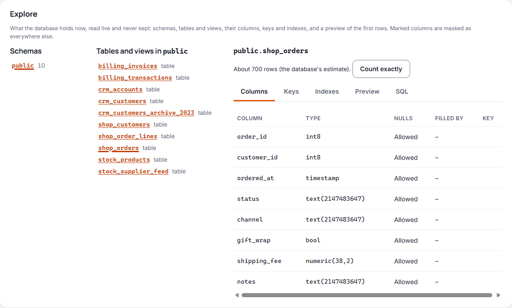
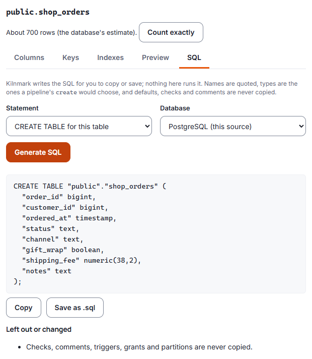

# Database tools

A database source's page has tools for looking at the database itself, as it is now, without
leaving Kilnmark: **Explore** its schemas, tables and views, their columns, keys and indexes, and
the first rows of a table, and **generate SQL** for a table to copy or save. More tools follow
(ADR 0045): connection settings on tabs, and changes to a database behind controls.

## Explore a database

Open **Sources**, choose a database source (PostgreSQL, SQL Server, MySQL, MariaDB, Oracle or
Generic JDBC) and scroll to **Explore**. Stewards, designers and admins see it; viewers do not.

1. Choose a schema. Each shows how many tables and views it holds.
2. Choose a table or view. Long lists come a page at a time.
3. Read the table on its tabs:
   - **Columns**: each column's name and type (with its length, or its digits before and after the
     point), whether it allows nulls, whether the database fills it (an identity or a generated
     column) or a default does when a row leaves it out, and whether it is in the primary key.
   - **Keys**: the primary key, the foreign keys that point from this table to others, and the
     tables whose foreign keys point here.
   - **Indexes**: each index with its key columns in order, whether it is unique or holds the
     primary key, its kind where the database says, and whether it is partial (it covers only the
     rows a condition picks; the condition is not shown).
   - **Preview**: the first 50 rows.
   - **SQL**: the SQL generator ([below](#generate-sql-for-a-table)).

The address keeps the schema and table you chose, so you can send a colleague a link to the same
table.

### What Explore shows, and what it does not

- **It is live.** Explore asks the database each time, so it shows tables a scan has not recorded
  yet, and nothing it shows is kept.
- **Row counts.** The table's line gives the database's own estimate, "About 1,204,000 rows (the
  database's estimate)". Databases update their estimates from time to time (PostgreSQL when it
  analyses a table), so a new or busy table can be off. **Count exactly** asks the database to count
  them now. On a big table a count can take a while; if it takes longer than people's checks are
  allowed (15 seconds unless your administrator changed it), it stops and the estimate stands.
- **Values are masked as everywhere.** The preview is the source's own preview: a column a
  steward marked sensitive shows `••••` to everyone without the grant to see unmasked values,
  admins included ([Signing in, roles and tokens](signing-in.md)). A table that has never been
  scanned has no marks yet, so scan and mark a table that holds personal data before people
  preview it.
- **No text that can hold a value.** A column's default is shown as "a default", never its text;
  an index on an expression shows as `(expression)`, and a partial index's condition is not shown.
  Each can quote a value from the data (`WHERE ssn = '…'`).
- **Errors give a code, not the database's message.** When the database refuses a read of a
  table's details, a count or a preview, the message gives its SQLSTATE or error code (or says the
  database refused), never the database's own text, as that can quote a value. A failure to
  connect is still explained, as **Test connection** explains it.
- **Not the database's own tables.** Tables in `information_schema`, `pg_catalog`, MySQL's
  `performance_schema`, `sys` and `mysql`, SQL Server's `sys` and the schemas Oracle maintains are
  not shown or previewed, even by name, nor are tables a PostgreSQL extension owns (such as
  `pg_stat_statements`, and also PostGIS's `spatial_ref_sys` or an extension's settings table) or
  SQL Server ships (change data capture's tables among them): some keep other sessions' statements
  with their values.
- **Count exactly counts ordinary tables only.** A view, or a foreign, federated, linked or external
  table, keeps its estimate: counting it would run the view's query, or reach another server.
- **Generic JDBC sources** show their schemas, tables, columns and primary key as a scan reads
  them, without foreign keys, indexes or counts: each driver places schemas and catalogues its own
  way.

### What it needs

The source's login must be able to read the database's catalogue (every login can see the tables
it has rights on) and, for the preview and **Count exactly**, to `SELECT` from the table. Explore
connects read-only and runs only queries Kilnmark writes; nothing you type goes into SQL. It shares
the time limit and the number of checks at once that **Test connection** has, so many people
exploring one source at the same moment wait their turn rather than load the database.

## Generate SQL for a table

On Explore's **SQL** tab, Kilnmark writes the SQL for the table you chose, for you to copy or save
as a `.sql` file. **Nothing is run**: take the text to your database's own tools, or to a change
request. Stewards, designers and admins can use it.

1. Choose the **Statement**:
   - **CREATE TABLE for this table**: its columns, whether each allows nulls, its primary key, and
     its plain indexes;
   - **ALTER TABLE: add a column**: a name, a kind, and a length for text or digits for a decimal;
   - **CREATE INDEX**: a name, its columns in the order you tick them, and whether it is unique;
   - **DROP INDEX**: one of the table's indexes (not the primary key's);
   - **DROP TABLE** and **TRUNCATE TABLE**.
2. Choose the **Database** to write it for. It is the source's own by default; choose another to
   move a table, for example from SQL Server to PostgreSQL. A Generic JDBC source has no dialect
   of its own, so you choose one.
3. Press **Generate SQL**, then **Copy** or **Save as .sql**.

### What the SQL holds

- **The types a pipeline would choose.** Each column gets the type a pipeline's write node gives
  it in `create` mode ([Writing data](writing-data.md)), so the table is the one a pipeline would
  make. Text keeps its length; decimals keep their digits.
- **Names always quoted** and with their schema, so a name with a space or a capital letter is
  kept exactly.
- **Nothing that can quote a value.** Defaults, checks, comments, triggers, grants, partitions, an
  index on an expression and a partial index are never copied: their text can hold values from the
  data. A column whose type Kilnmark has no kind for (a JSON or range type, say) is written as
  text. Foreign keys are left for you to add once the tables they point to exist. Under **Left
  out or changed**, the page lists what it left out of this table and what it wrote differently.
- **What each database can hold.** A decimal without digits of its own is written as the database's
  own unconstrained decimal where it has one (PostgreSQL `numeric`, Oracle `NUMBER`) and with the
  most digits it keeps where it has not. A text column in a key or an index gets a length where the
  database cannot index text without one (450 characters on SQL Server, 768 on MySQL and MariaDB,
  1,000 on Oracle). MySQL and MariaDB tables are UTF-8 (`utf8mb4`), as a pipeline makes them.
- **Names as the database keeps them.** Names read from the same database are written exactly as
  they are stored. Names you type, and every name when writing for another database, are written
  as that database stores a plain name: Oracle keeps `orders` as `ORDERS`.
- **Indexes are plain.** Full-text, spatial, GIN or GiST kinds, descending order and prefix lengths
  are not copied; check them. A Generic JDBC source says nothing of its indexes or sizes, so its
  SQL has none.
- **Safe forms.** `DROP TABLE` never cascades to other objects; on PostgreSQL a truncate is
  `TRUNCATE ONLY`, so child tables are not emptied with it (a partitioned table is truncated a
  partition at a time instead); on Oracle a dropped table goes to the recycle bin. Adding a column
  that allows no nulls works only on an empty table, and the page says so.
