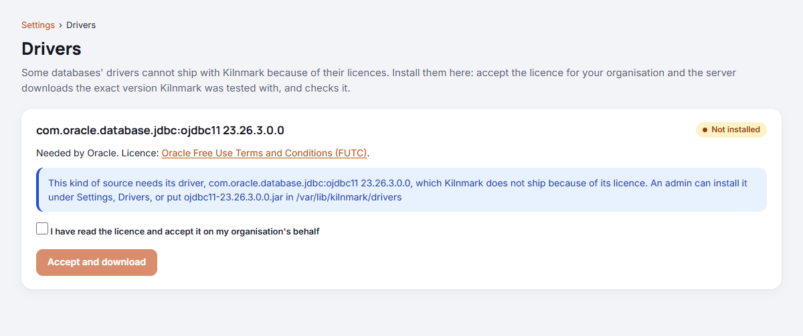

# Database drivers

Kilnmark connects to most databases with drivers it ships. A few databases' drivers have licences
that do not allow that, so an admin installs them, once, for the whole server. Today that is
**Oracle**: its driver is Oracle's own, under the Oracle Free Use Terms and Conditions. For a
database with no connector of its own, an admin registers the vendor's driver for **Generic JDBC**.
Each connector's entry in [Reference: connectors](reference-connectors.md) says which driver it
uses.

## Drivers Kilnmark ships

These come with Kilnmark, in the server's folder, and need nothing installed:

| Driver | Version | Licence | Used by |
| --- | --- | --- | --- |
| [PostgreSQL JDBC driver](https://jdbc.postgresql.org/) | `42.7.14` | BSD 2-Clause | `postgresql` |
| [Microsoft JDBC Driver for SQL Server](https://learn.microsoft.com/sql/connect/jdbc/microsoft-jdbc-driver-for-sql-server) | `13.6.2.jre11` | MIT | `sqlserver` |
| [MariaDB Connector/J](https://mariadb.com/kb/en/about-mariadb-connector-j/) | `3.5.10` | LGPL 2.1 or later, used unmodified | `mariadb`, `mysql` |

MySQL sources use MariaDB Connector/J too: MySQL's own driver is under the GPL, so Kilnmark never
uses it. The files, S3 and sample data connectors need no driver.

## Drivers an admin installs

| Driver | Version | Licence | Used by |
| --- | --- | --- | --- |
| [Oracle JDBC driver](https://www.oracle.com/database/technologies/appdev/jdbc.html) (`ojdbc11`) | `23.26.3.0.0` | Oracle Free Use Terms and Conditions | `oracle` |

Until its driver is installed, such a connector shows **Needs its driver** when you add a
connection, and a connection test says that the driver is missing.

## Install a driver (admins)

A connector whose driver Kilnmark cannot ship says so on its card in **Add a connection**: **Needs
its driver**, with the exact driver and version Kilnmark is tested with, for example **Tested with
`ojdbc11 23.26.3.0.0`**, and a link to **Settings**, **Drivers**. Once it is installed, the card
names the driver in place of that.



Open **Settings**, **Drivers**. Each driver your server's connectors need is listed with the
connectors that use it, its licence and whether it is installed.

1. Read the licence (the link opens it).
2. Tick **I have read the licence and accept it on my organisation's behalf**.
3. Press **Accept and download**.

Kilnmark records who accepted the licence and when, downloads the exact version it was tested
with, and checks it before using it. The page then says **Installed**. Nothing needs restarting:
test your connection again.

## A server without internet access

If your server cannot reach Maven Central, your administrator may have turned downloads off
(`kilnmark.drivers.download=false`), or point Kilnmark at your organisation's Maven mirror
(`kilnmark.drivers.maven-url`). Without downloads, **Settings**, **Drivers** shows instead:

- the file to get, with its address, for example `ojdbc11-23.26.3.0.0.jar`;
- its checksum (SHA-256); and
- the drivers folder on the server.

Download the file on a machine that can, after accepting its licence, and copy it, unchanged, into
the drivers folder. With the release's `compose.yaml`, the folder is `/var/lib/kilnmark/drivers`
in the `keys` volume, for example:

```
podman cp ojdbc11-23.26.3.0.0.jar "$(podman ps -q --filter label=com.docker.compose.project=kilnmark --filter label=com.docker.compose.service=kilnmark)":/var/lib/kilnmark/drivers/
```

This copies the file with the engine itself into Kilnmark's running container, which it finds by
the labels every compose tool gives it (`compose cp` is not there in podman-compose). Run it as the
account that runs Kilnmark (`sudo -iu kilnmark`, with the file somewhere that account can read);
on Windows, the same line in PowerShell, as the operator; with Docker, `docker` in place of
`podman`. With a project name other than `kilnmark`, put yours in the first label. Running the server without containers, the folder is
`kilnmark.drivers.dir`, by default `~/.kilnmark/drivers` for the user running Kilnmark.

## After an upgrade

When an upgrade of Kilnmark moves to a newer version of a driver, the installed file is no longer
used: the driver shows as **Missing** again, and sources needing it cannot connect until an admin
accepts its licence again under **Settings**, **Drivers** (or copies the new file into the drivers
folder). The release notes say when this happens, and the server's log names the old file at
start. The old file can then be deleted.

## If it says Wrong file

Kilnmark only uses the exact file it was tested with. A file of the right name with other
contents (another version renamed, or a damaged download) is ignored and shows **Wrong file**.
Delete it and install the driver again.

## Databases without a connector of their own

For a database Kilnmark has no connector for, such as **Db2**, **Teradata**, **Sybase** or
**Informix**, you bring its JDBC driver from the database's vendor and connect through **Generic
JDBC**. Generic JDBC reaches database servers over the network only, and its drivers may be given
only settings Kilnmark has vetted (below), so no driver can run code in Kilnmark, read its files or
sign in as it. Snowflake, Vertica and Exasol are not used through Generic JDBC: their drivers read
and write files on the machine they run on for ordinary SQL (`PUT` and `GET`, `COPY FROM LOCAL`,
`IMPORT` and `EXPORT ... LOCAL`).

### Register the driver (admins)

Open **Settings**, **JDBC drivers**.

1. Put the driver's jar in the drivers folder (above), or use **Upload to the drivers folder**,
   up to the size the page shows (the server's upload limit, 10 MB unless your administrator raised
   it). Larger jars, such as Snowflake's, are copied into the drivers folder by hand. A file of the
   same name is never replaced.
2. Under **Register a driver**, choose the jar, then give the driver a **name** (what sources
   choose, such as `db2`), its **driver class**, how its **URLs start**, and the **properties sources
   may set**, such as `currentSchema, sslConnection`. **Fill in for a known database** suggests them
   for common drivers; check them against the driver's documentation. A source may use only the
   properties listed here, in its URL or as driver properties, and only settings Kilnmark has vetted
   may be listed: time limits (names ending in `timeout`, `timeoutMs`, `timeout_ms` or
   `timeoutSeconds`), TLS
   (`ssl`, `sslMode`, `sslConnection`, `encrypt`, `trustServerCertificate`, and the like),
   characters (`charset`, `encoding`), where to read (`database`, `schema`, `currentSchema`,
   `catalog`, `warehouse`, `role`), the application's name, fetch and batch sizes, compression
   (`compress`, `compression`), time zones, keep-alive and failover servers, and a few databases'
   own harmless settings (`readOnly`, H2's `MODE`, Derby's `create`, Teradata's `TMODE`, Informix's
   `INFORMIXSERVER`, SQL Server's `instanceName`). Anything else is refused, as are passwords, keys
   and tokens. Whatever the list, Kilnmark turns off a MySQL, MariaDB or SingleStore driver's
   loading of local files.

   A SQL Server named instance without a port is given as `instanceName`, as in
   `jdbc:sqlserver://db.example.com;instanceName=SALES`, once the driver allows it. The
   `host\SALES` form is refused, as Kilnmark refuses a backslash anywhere in a URL.
3. Tick that the jar comes from the database's vendor or another source you trust, and press
   **Register driver**.

Kilnmark loads the class to check it, and records the jar's checksum, who registered it and when.
From then on the driver is used only while the jar is unchanged. If someone replaces the file, the
driver shows **Jar changed** and its sources stop connecting, saying why, until the original file is
back or the registration is removed and the new file registered. Nothing is ever downloaded for
these drivers.

A registered driver runs inside the Kilnmark server, so register only drivers you trust. The page's
**History** keeps every registration and removal. A driver that sources still use cannot be
removed; point them at another driver first.

### Connect a source (admins)

In **Sources**, **Add a connection**, choose **Generic JDBC**:

- **JDBC driver**: one of the registered drivers.
- **JDBC URL**: as the driver's documentation gives it, starting as the driver's URLs do, for
  example `jdbc:db2://db.example.com:50000/SALES`. Never put the password in it. The URL must name
  the database server's host, as `//host` or `//host:port` (or Sybase's `jdbc:sybase:Tds:host:port`):
  a URL for a database file or an in-memory database, which the driver would open inside the
  Kilnmark server (SQLite, DuckDB, H2 or HSQLDB files, embedded Derby and the like), is refused, for
  admins too. Run such a database as a server and give its network address instead.
- **User name** and **password**: the password is stored encrypted, as for every source.
- **Driver properties** (optional): further settings as `name=value`, separated by semicolons, such
  as `sslConnection=true; currentSchema=SALES`. Here and in the URL, only the properties the driver
  was registered with are accepted, and never a password, key or token. A URL whose settings
  Kilnmark cannot read (quotes, spaces, encoded characters) is refused; write values plainly.
- **Schemas**: which to scan; leave empty for all. Databases that have only catalogues list those.
- **Read only**: on by default. Kilnmark then asks the driver for read-only connections, and
  pipelines cannot write to the source.

Only admins can add a Generic JDBC source or change these settings, because the URL goes to a
driver Kilnmark cannot vet. Stewards can still test, scan and preview it.

A server that requires encrypted connections to sources (`kilnmark.sources.require-tls`) refuses
Generic JDBC sources, saved ones included: Kilnmark cannot tell how an arbitrary driver encrypts, so
it cannot promise the connection is encrypted, whatever `sslConnection` or similar says.

Kilnmark reads the tables' columns with their types: whole numbers, decimals (never rounded),
dates, times and timestamps keep their type; a type Kilnmark does not know is read as text, and its
column says so. Quality rules for these sources are checked on the rows read.
