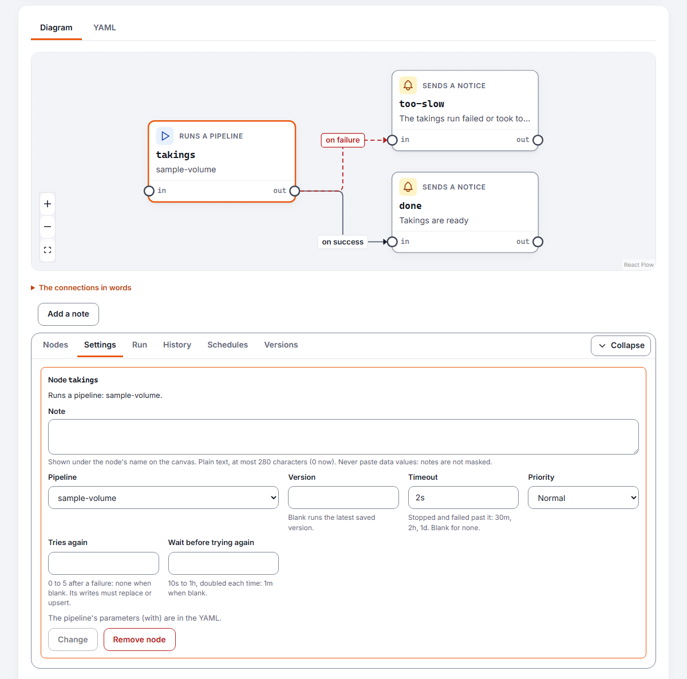
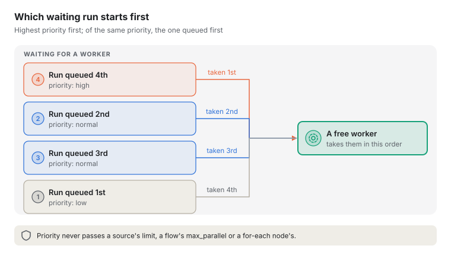

# Building and running a flow

A pipeline moves and checks data. A **flow** runs pipelines in an order, and decides what runs next
from how each ended and what it measured: carry on only if a gate set aside under 2% of the rows,
else tell the stewards and stop. Each flow is saved as YAML, with every version, and every run is
recorded node by node.

## Before you start

- **Viewers** read flows and their runs.
- **Stewards** run flows, give their parameters values, and cancel runs.
- **Designers** add flows and save new versions. A flow with a `sql` node is saved only by a
  designer whose token sees unmasked values, since SQL can read and change any column its source's
  login can.

A flow runs saved pipelines, so build those first, under **Pipelines**. The pipelines a flow starts
run as the person who started the flow, with their role: a flow cannot do what its starter could
not.

## The Flows page

**Flows**, in the sidebar after Pipelines, lists every flow with its latest version, whether that
version can run, and its last run. Stewards see **Run now** beside each; designers see **New flow**.

A flow's own page is laid out as a pipeline's: its name with **Run now**, then the flow on two tabs,
**Diagram** and **YAML**, which show and edit the same flow. Under them, a panel with the pipeline
page's tabs:

- **Nodes**: every node, what it runs after, and how it went in the latest run;
- **Settings**: the node or connection chosen on the diagram, while one is chosen (designers only);
- **Run**: the latest run's summary, as its run page gives it, kept current while it goes;
- **History**: each run with its status, version, when it was asked for and by whom, how long it
  took, and the rows its pipeline runs wrote;
- **Versions**: every saved version.

The problems, the parameters and saving come last, whichever tab is shown. **Collapse** folds the
panel to its tabs.

## Writing a flow

Choose **New flow**. The page starts from a small flow that runs one of your pipelines and, if it
fails, sends a notice and stops. Change it to what you need; the name on its `name:` line is the
flow's, and is fixed once saved.

```yaml
kilnmark: flow/v1
name: nightly-customers
description: Clean customers, then total the orders only if quality holds.

parameters:
  limit_share: { type: number, default: 0.05 }

nodes:
  - id: clean
    type: run-pipeline
    pipeline: customers-clean

  - id: totals
    type: run-pipeline
    pipeline: order-totals

  - id: halt
    type: stop
    message: Too many customers were set aside

connections:
  - { from: clean, to: totals, when: "clean.quarantined_share < limit_share" }
  - { from: clean, to: halt, when: "clean.quarantined_share >= limit_share" }
  - { from: clean, to: halt, when: failure }
```

- **Nodes** do the work: `run-pipeline` runs a saved pipeline, `for-each` runs one once for each
  item of a list, `notify` sends a notice, `wait` waits a while, `stop` ends the flow, and `sql`
  runs statements on a PostgreSQL source.
- **Connections** say what runs after what, and when: `success` (the default), `failure`,
  `always`, or a condition on what an earlier node reported, such as its `score`,
  `quarantined_share`, `rows_written` or `status`.
- **Parameters** are values each run can change. One with no default must be given when the flow
  runs.

Nodes with no connection between them run at the same time. The full format, the condition
language and how a run decides what starts next are in the design notes (`docs/design/flows.md`). The sample flows that ship with Kilnmark, in `samples/08-flows`,
show one idea each.

## Running one pipeline for each item

A `for-each` node runs one pipeline once for each item of a list, giving each run the item as one of
the pipeline's parameters. Use it to load each region, each file or each year with the same
pipeline, several at once.

```yaml
kilnmark: flow/v1
name: nightly-regions
max_parallel: 2               # at most two of this flow's nodes run at once

nodes:
  - id: regions
    type: for-each
    pipeline: sales-by-region
    items: [EMEA, APAC, AMER]   # or "${regions}", a text list or number list parameter of the flow
    as: region                  # the pipeline's parameter that each item fills
    with: { label: nightly }    # its other parameters, as for run-pipeline
    max_parallel: 3             # items running at once; 4 when left out, 50 at most

  - id: tell
    type: notify
    title: "${regions.succeeded} of ${regions.items} regions loaded"

connections:
  - { from: regions, to: tell, when: "regions.failed = 0" }
```

- **Items** are 1 to 500 texts or numbers written in the node, all of one kind, or one list
  parameter of the flow, so each run of the flow can give its own list; a list parameter holds at
  most 200 values. `as` must be a parameter the pipeline takes, of the items' kind; saving the flow
  says so if it is not.
- **Each item is an ordinary pipeline run**, started as you, so it shows on the pipeline's own runs
  and waits for a free worker like any other. The items of one node may run the pipeline at the same
  time. While they run, **Run now** on that pipeline is refused (a run is already going); another
  flow's node that runs it waits for them, and the items wait for any other run of it.
- **Each item must write its own table or file.** A run waits only a short while for another
  writing the same one, then fails. So when items run at once, saving the flow refuses a pipeline
  whose write does not name the item's parameter in its target (here, `${region}` in the path), and
  says to put it there or to set the node's `max_parallel: 1`, which runs the items one after
  another.
- **Every item runs**, even when one fails. The node then succeeds if every item did, and fails if
  any failed; a connection's condition can read `regions.items`, `regions.succeeded` and
  `regions.failed`. An item the pipeline would not run with its value counts as failed, and the
  node's message says why. Cancelling the flow cancels the items still running and starts no more.
  Cancelling one item's pipeline run by hand cancels the whole flow, as cancelling a run-pipeline
  node's run does.
- **The flow's own `max_parallel`** (1 to 50) caps how many of its nodes run at once; nodes wait
  their turn in the order they are written. A for-each node counts once, however many items it
  runs, and a `stop` node never waits, so a flow can always end. Left out, there is no limit.

The sample `samples/08-flows/for-each-region.yaml` runs one pipeline for three regions, two at once.

## Stopping a node that takes too long

A `run-pipeline`, `for-each` or `sql` node may say how long its work may take, with `timeout`. Use it
so a load that hangs, or a statement stuck behind a lock, fails the flow in good time rather than
holding up everything after it.

![What a node's timeout does: time spent ready, waiting for a worker or a source is not counted; once a worker takes the node's work, the timeout counts while it runs. If it ends within the timeout it ends as it ended, succeeded or failed. Past the timeout it is stopped (its pipeline run cancelled, or its SQL rolled back), the node fails saying it took longer than its timeout, and its failure connection is taken. A for-each node gives each item's run the whole timeout; an item stopped for it counts as failed.](images/flow-timeout.svg)

```yaml
nodes:
  - id: load
    type: run-pipeline
    pipeline: orders-load
    timeout: 2h                 # 90s, 30m, 2h or 1d; 7d at most; no limit when left out

  - id: regions
    type: for-each
    pipeline: sales-by-region
    items: [EMEA, APAC, AMER]
    as: region
    timeout: 30m                # for each item's run, on its own

  - id: tidy
    type: sql
    source: warehouse
    statements: ["DELETE FROM staging.orders"]
    timeout: 5m

  - id: tell
    type: notify
    severity: high
    title: The orders load failed or took too long

connections:
  - { from: load, to: tell, when: failure }
```

- **The time counts from when the work starts**: when a worker takes the pipeline run, or when a
  `sql` node's statements start. Time spent waiting for a worker, for a free place on a source, or
  for another run of the same pipeline to finish does not count.
- **Past it, the work is stopped.** A pipeline run is cancelled, as **Cancel** on its page would
  (what it had already written stays written); a `sql` node's statement is cancelled and its
  transaction rolled back, so nothing it ran is kept. The node then **fails**, saying "Took longer
  than 2h and was stopped". It is not cancelled, so a `failure` or `always` connection from it is
  taken, as above, and the flow carries on as for any other failure.
- **For a `for-each` node**, each item's run has the whole timeout to itself. An item stopped for it
  counts as failed; the others still run, and the node fails once they have ended, its message
  naming the first item that took too long.
- The node waits for the stopped work to end before it fails, so nothing after it starts while its
  pipeline may still be writing. A run that succeeds just as it is stopped counts as succeeded.
- Saving the flow checks the value: a time in seconds (`s`), minutes (`m`), hours (`h`) or days
  (`d`), more than nothing and at most 7 days. Only these three node types take one: a `wait` node
  has `for`, and `notify` and `stop` nodes end at once.
- On the diagram, choose the node and set **Timeout** on its Settings tab; leave it blank for none.



On the run's page the node shows **Failed** with **Timed out** beside it, and its message says how
long it was allowed:


## Choosing which runs start first

When more pipeline runs wait than there are workers free, a `run-pipeline` or `for-each` node's
`priority` says which start first: `high`, `normal` (the default) or `low`.

```yaml
nodes:
  - id: close-of-day
    type: run-pipeline
    pipeline: ledger-close
    priority: high              # starts before normal and low runs waiting with it

  - id: archive
    type: for-each
    pipeline: archive-month
    items: [2024, 2025]
    as: year
    priority: low               # each item's run waits behind the rest
```



- **A worker takes the waiting run with the highest priority first**, and of those the one queued
  first. Scans, quality checks and a person's **Run now** are normal.
- **Priority only chooses among runs that may start.** It never lets a run past a source's limit
  on runs at once (**Most runs at once**), a flow's `max_parallel` or a for-each node's, and it never
  stops a run already going. A low run starts whenever no higher run is ready to start; there is no
  ageing, so while high runs keep coming, low ones keep waiting. Use `high` for the few runs that
  must not wait.
- Only nodes that queue pipeline runs take one: a `sql` node runs on its flow's own watcher, never
  waiting in the queue, so saving refuses `priority` on it, and on any other node type.
- On the diagram, choose the node and set **Priority** on its Settings tab. A node of high or low
  priority says so under its name.


## Checking a source before the work starts

A `check-source` node checks that a source can be reached and holds the tables or files the work
needs, before anything runs. Put it first, with a `failure` connection to a notice, so a source that
is down or a file that has not arrived stops the flow at once, saying why, instead of failing a
pipeline halfway.

```yaml
nodes:
  - id: ready
    type: check-source
    source: warehouse
    tables: [sales.orders, sales.customers]   # as the catalogue names them: schema.table
    timeout: 2m                               # optional

  - id: arrived
    type: check-source
    source: landing                           # a file or object-store source
    files: [incoming/orders.csv]              # paths below the source's folder

  - id: load
    type: run-pipeline
    pipeline: orders-load

  - id: tell
    type: notify
    severity: high
    title: Not everything the load needs is there; it did not run

connections:
  - { from: ready, to: arrived }
  - { from: arrived, to: load }
  - { from: ready, to: tell, when: failure }
```


- **It keeps and shows no data.** It connects as the source's **Test** button does, then looks
  each name up as a scan would: a table's columns from the database's own lists, never a row; a
  file's columns from its start, as a scan reads it (up to 1 MiB). It holds a connection only while
  it checks (a database is logged in to once for each table), and no worker: it runs beside the
  flow, as a `sql` node does.
- **It succeeds when everything it names is there**, and fails when something is not: "2 of 3
  tables are missing on warehouse: sales.orders, sales.returns". A source it cannot reach fails it
  with "Could not reach warehouse". Its messages hold only the names you wrote, never what the
  source or its driver said, which can name hosts and users.
- **`missing`** is how many were not there, for conditions and notices (`${ready.missing}`). It
  has no value when the source could not be reached, as nothing was looked for.
- With neither `tables` nor `files`, it checks only that the source can be reached. Together the
  two lists name at most 50.
- **Checked when saved:** the source must exist; `tables` need a database source, and `files` a
  file or object-store source.
- It takes a `timeout`, as in [Stopping a node that takes too long](#stopping-a-node-that-takes-too-long);
  with none, a check that hangs is stopped after 10 minutes. A file path copied from the catalogue
  (`%23` for `#`) finds the file, as a read node does.


## The diagram

The **Diagram** tab draws the flow as you write it. Each node is a card, as on a pipeline's
canvas: its type, with an icon, its id, what it does (the pipeline it runs, the notice it sends,
how long it waits), and its connectors, `in` on the left and `out` on the right. Each connection is
an arrow from one node's `out` to another's `in`, labelled with when it is taken:

- a solid arrow, **on success**: the next node runs when this one succeeds (the default);
- a red dashed arrow, **on failure**: it runs when this one fails;
- a dotted arrow, **always**: it runs whether this one succeeds or fails;
- an amber arrow with the condition: it runs when this one succeeds and the condition holds.

The diagram is drawn from left to right, with each arrow in square steps round the nodes it
passes, turning only in the gaps between them. It
follows the text a moment after you stop typing; while the YAML cannot be read, it says so and
keeps showing the flow as it last could be read. Zoom with the buttons in its corner; **The
connections in words**, under it, lists every connection as a sentence.

## Changing the flow on the diagram

Designers can change the flow on the diagram, and in the panel under it, as well as in the YAML.
Each change is written into the YAML at once, changing only the lines it must, so your comments and
spacing stay as they are. Nothing is saved until you save a new version.

The panel under the diagram has the same tabs as a pipeline's:

- **Nodes** lists every node: what it does, what it runs after and when, and how it went in the
  flow's latest run (its status, when it started, how long it took, the rows its pipeline wrote and
  a link to that pipeline run). Choose a node's name to show its settings. Under the table are the
  forms to add a node and to connect two.
- **Settings** shows the node or connection chosen on the diagram or in the table, while one is
  chosen.
- **Run**, **History** and **Versions** show the latest run, every run and every saved version.


- **Add a node.** In the **Nodes** tab, choose its type (and, for one that runs a pipeline, the
  pipeline), then **Add node**. It gets an id from its type or pipeline, and the settings it starts
  with, and its settings open; the problems under the flow say what else it needs, such as a `sql`
  node's source.
- **Connect two nodes.** Drag from a node's `out` connector to another node: that connection is taken
  when the first succeeds. Or, in the **Nodes** tab, choose **From**, **To** and when it is taken,
  then **Connect**. A connection that would join a node to itself, make a loop or repeat one already
  there is refused, and the note under the diagram says why.
- **Change a node's settings.** Choose it on the diagram (click it, or Tab to it and press Enter)
  or by its name in the **Nodes** tab. The **Settings** tab shows the settings its type takes one
  value for: the pipeline and version it runs, the parameter a `for-each` node's items fill and how
  many run at once, a notice's severity, title and message, how long to wait, how a `stop` node ends
  the run, and a `sql` node's source. Change them and choose **Change**; a setting left blank is
  removed. Lists and mappings (a `for-each` node's items, the parameters given with `with`, a `sql`
  node's statements) are changed in the YAML.
- **Change or remove a connection.** Choose it on the diagram, or choose **Change** beside it in
  **The connections in words**. The **Settings** tab shows when it is taken, including its
  condition, to change, or **Remove connection**. **Remove node**, in a node's settings, removes its
  connections too.
- **Move a node.** Drag it, or choose it and use the arrow keys. The diagram then keeps every node where you see it, in a `layout:`
  block at the end of the YAML; connections between the same two nodes are drawn apart, and labels
  are drawn over the nodes. **Lay out again** removes the block, and the diagram lays the flow out
  itself.
- **Undo** puts back what the last change on the diagram changed, while the YAML is as that change
  left it. To go back to the saved version, choose **Undo my changes** under the flow.

The `layout:` block only says where the diagram draws each node: a flow runs the same however it
is drawn.

## Checking as you type

The YAML is checked a moment after you stop typing: its shape, its connections (no loops), its
conditions, and that every pipeline it runs exists. Problems are listed under the flow with their
line; choose one to move to that line in the YAML tab. Lines with a problem are marked in the margin.

The parameters the flow declares are listed under the problems, saying which must be given.

## Saving versions

Every save keeps a new version; earlier ones never change.

1. Say what you changed under **What changed**.
2. Choose **Save new version**.

A flow with problems can be saved as a draft, so you can come back to it, but it cannot run until
they are fixed.

If someone else saved a version after you opened the page, Kilnmark refuses your save rather than
undo theirs unseen. Your text stays on the page. **Load the latest version and keep my text** loads
theirs, and **Put my changes back** brings yours back, to compare or to make your change again.

The **Versions** tab, in the panel under the flow, lists every version with who saved it, when and why. Open
one to see its YAML exactly as it was saved.

## Running a flow

Choose **Run now**, on the Flows page or the flow's own page. A flow with parameters asks for their
values first, each filled with its default: change what you need and choose **Run**. Lists are
written with commas between the values.

Kilnmark checks the latest saved version again first, since a pipeline may have changed, then
queues the run. Unsaved changes on the page are not part of it. Only one run of a flow is queued or
running at a time.

## Reading a run

Open a run from the **History** tab on the flow's page, or the last run from the line under its name.
A run page is laid out as a pipeline run's, in this order:

- **Summary**: its status, the version that ran, who started it, when it was asked for, started and
  finished, and how long it took; its nodes by how they stand ("2 succeeded, 1 skipped"); how many
  pipeline runs it asked for, the rows they wrote (so far, while it runs), and the lowest quality
  score among them (each pipeline run's score is already the lowest of what it wrote). If the run
  failed, or a stop node gave a message, it is said under the summary.
- **Values it ran with**, for stewards and above. Viewers do not see them, nor the messages that
  quote them, since they can hold server variables.
- **Where each node spent its time**: four tiles give the run at a glance: its **wall-clock time**,
  the **most nodes at once**, the **longest node** and its share of the run, and the time its
  pipeline runs were **queued for a worker**, added up. A line under them says what the run waited
  for: workers; a pipeline busy with another run (a pipeline runs once at a time), counted until a
  node asked for its run or, if it gave up, until it ended; time a `for-each` node had no item
  running or queued (Kilnmark does not record whether it waited for a busy pipeline or between
  items, and says so); its `wait` nodes; and, when several ran together, the most pipeline runs at
  once. Then a bar per node that started, each as long as its time on the run's scale, so bars
  compare, and split three ways, each with its own pattern:
  - **Working**: its pipeline running (for a `for-each` node, any of its items), or its own work,
    such as a `sql` node's statements or a notice;
  - **Queued for a worker**: none of its pipeline runs running, and one waiting for a worker;
  - **Waiting**: the rest, such as a `wait` node waiting, a node waiting for its pipeline to finish
    another run, or the moment the flow takes to see a pipeline run end.

  Beside each bar, its share working and what it did. **Show where each node spent its time as a
  table** gives the same as figures. All of it comes from the times Kilnmark records for each node
  and each pipeline run. A node whose pipeline run times are not known (its pipeline run was
  deleted, or the run is from before these were recorded) has a plain bar, not split; the tiles and
  the line then add up what is known and say of how many pipeline runs.
- the **diagram** of that version, each node outlined and labelled with how it stands in the run,
  kept current while the run goes;
- the **run timeline**: the whole run on one time line from its start, nested as it ran. One
  sentence says when it started, how long it took and how it ended. Under the flow's own row is a
  row for each node, with an icon for its type, the pipeline it runs beside its name, and how long
  it took at the end of its bar. A node that ran a pipeline opens (▾) into that pipeline run's
  nodes, placed from when the run started; a `for-each` node opens into a row per item, its value
  beside it, and each item into its pipeline's nodes. Bars are soft violet for the flow, teal for
  its nodes and blue for a pipeline's nodes; red when it failed, striped while it runs; a skipped
  node says so. **Choose a row** (its name, or anywhere on its bar) for everything recorded about
  it below the chart: its status, start, end and time, the pipeline and its run, the time it
  waited for a worker, its message and what it reported, an item's value, or a pipeline node's
  rows, quality and error. An open pipeline run that is queued says it is waiting to start, one stopped
  before its nodes started says they were not timed, and one that could not be read offers to try
  again;
- **Nodes**: every node of that version in order: its status (Not started, Running, Succeeded,
  Failed, Cancelled or Skipped), when it started, how long it took, and what happened, such as the
  rows a pipeline wrote and its score, with a link to its **pipeline run**, where its nodes, rows
  and errors are. For a `for-each` node, how far its items have got ("3 of 5 items done, 1
  failed") and each item with its status and a link to its pipeline run; an item that could not be
  started is shown failed, with no run, and the node's message says why. A node, or an item, that
  took longer than its `timeout` is shown **Failed** with **Timed out** beside it; the timed-out
  item's link opens its cancelled pipeline run. On the run timeline its bar runs from its first
  item's start to its last item's end. Viewers see the items' values when they
  are written in the flow, not when they came from the run's values.

![The Diagram, Run timeline and Nodes panels of a run page that succeeded: the diagram shows each node as a card, the two pipeline nodes and the closing notice outlined green as Succeeded and the other notice dashed as Skipped, each with its status in its card; the run timeline nests the flow, its two pipeline nodes (each with its pipeline's name and time) and, under each, its pipeline's nodes, with the flow's details below; the Nodes table gives each node's status, start, time taken, rows written and score, with a link to its pipeline run](images/flow-run-page.png)

A node's message says that a pipeline failed and where to look, never why: why can quote values
from the data, and the pipeline run's own page shows it to those who may see it.

A node is **Skipped** when no connection into it was taken: the flow went another way.

A source can limit how many runs use it at once (**Most runs at once**, see
[Sources that take a few runs at a time](pipelines.md#sources-that-take-a-few-runs-at-a-time)). A
`sql` node on a full source stays Running and says "Waiting for a free place on source warehouse";
it starts when a place is free, and a run cancelled meanwhile never starts it. A pipeline run a
node started waits the same way, on its own page.

To stop a run, open it and choose **Cancel run** (stewards). Nothing more starts, and the pipeline
runs it started that are still going are cancelled. What they had already written stays written.

## What is not here yet

- Changing a node's settings on the diagram: for now, change them in the YAML.
- Deleting a flow.
- Running flows on a schedule.
