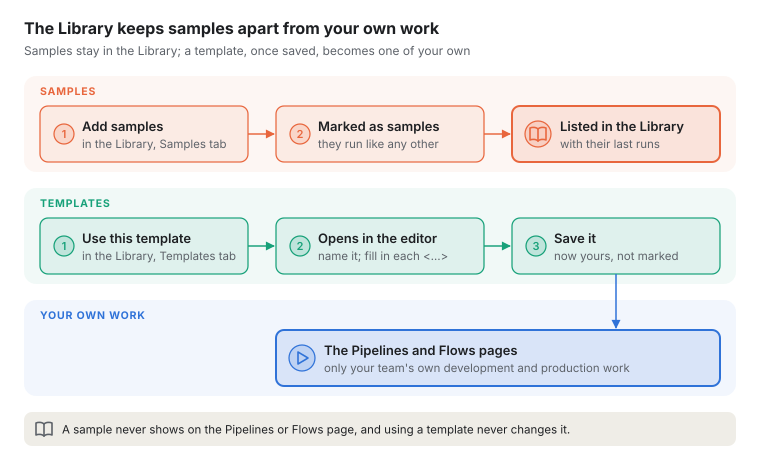
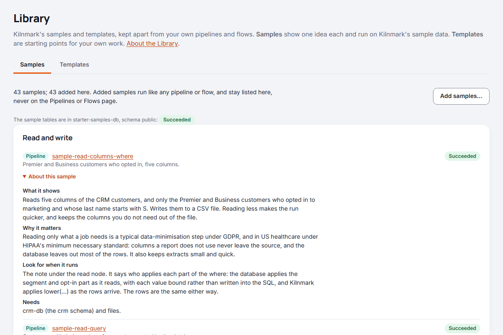
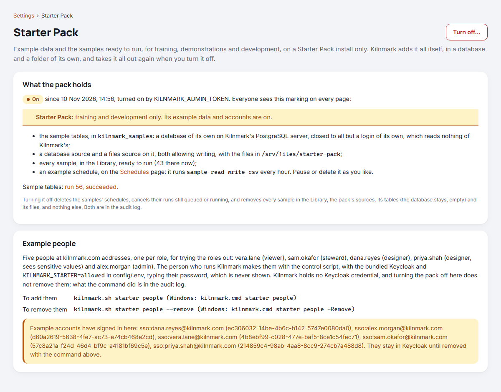
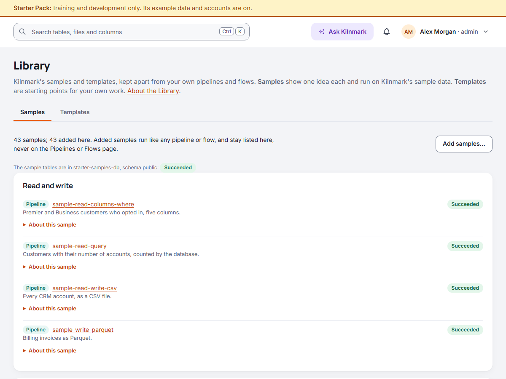
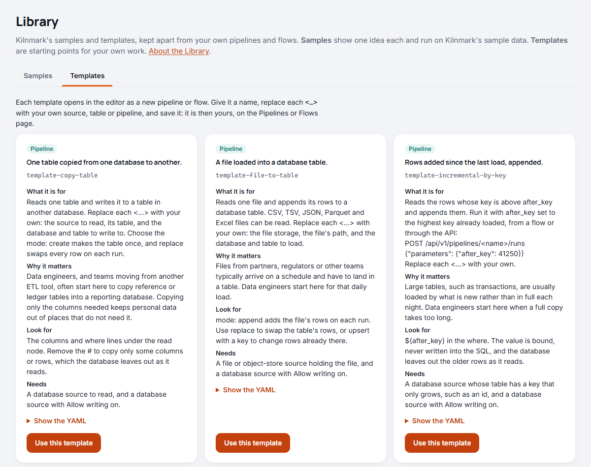

# The Library: samples and templates

Choose **Library** in the navigation. It holds what ships with Kilnmark, kept apart from your own
work so the two never mix:

- **Samples**: small pipelines and flows, one idea each, that run on Kilnmark's sample data. Added
  samples stay in the Library; they never appear on the **Pipelines** or **Flows** page, which hold
  only your team's own development and production work.
- **Templates**: starting points for common jobs, such as copying a table or loading a file. A
  template opens in the editor as a new pipeline or flow; once you save it, it is yours, on the
  Pipelines or Flows page.

## Samples

The **Samples** tab lists every sample by what it shows: reading and writing, filtering and
routing, transforming, combining, totals, quality gates, parameters, flows, volume and, last, the
business scenarios: customer onboarding, a supplier's file arriving and the month-end close, each a
whole process of several pipelines and a flow ([Business scenarios](scenarios.md)). Each row
shows:

- whether it is a **Pipeline** or a **Flow**, and its name, `sample-...`. Once added, the name
  links to its own page;
- one line on what it does;
- **About this sample**, which opens its explanation in four parts:
  - **What it shows**: what it does, in two or three sentences;
  - **Why it matters**: the real need it meets and who typically has it, such as banks typically
    reporting each account's latest balance;
  - **Look for when it runs**: what to notice on the canvas or on the run's page;
  - **Needs**: the sources it reads and writes (`crm-db`, `shop-db`, `files`), and any setting or
    right it relies on, such as Allow SQL or a server variable;
- on the right, its last run once added, or **Not added**.

The explanation is the comment at the top of the sample's file, so it reads the same in the app, in
the YAML and in the release's `samples` folder.

Once added, a sample's own page shows the same explanation under its name, as **About this
sample**, and a pipeline's canvas shows it in **Settings** when no node is selected. It comes from
the sample's file as this release ships it, not from the saved pipeline or flow. A sample changed
since it was added (more than moving its nodes on the canvas) still shows it, labelled **Based on a
sample; changed since**. The business scenarios' samples link to
[Business scenarios](scenarios.md); the others to this page.

Among them: `sample-functions` tidies values and works out new ones with the expression functions,
including a `sha256` of an email as a key that stays marked sensitive; `sample-which-row` keeps the
latest row of each key with `duplicates: latest`; `sample-retries` tries a flow and a node again
only where it is safe; and `sample-checks-and-waits` checks a source and waits for a file before the
work.

A sample you change stays a sample, in the Library. To build real work from one, copy its YAML
into a **New pipeline** or **New flow** under a name of your own, or start from a template.

One sample, `sample-volume`, reads four million made-up sales, enough for a run of several seconds:
run it and open the run's page to see where each node spent its time, how many rows a second went
through, and which node held the others up.

The samples are on a Starter Pack install only (INSTALL.md, "Choosing a deployment"). A production
install never has them, by any route: its Samples tab says so, and the samples' API, **Add
samples** and the sample tables included, refuses. On a Starter Pack install an admin can stop
offering them too: under **Settings**, **Administration**, clear **Offer the samples**; samples
already added stay. The templates are offered on every install.

### Samples ready to run: the Starter Pack

On a **Starter Pack install**, for training, demonstrations and development, an admin turns on the
**Starter Pack** under **Settings** (INSTALL.md, "Try Kilnmark with the Starter Pack"; install turns
it on itself). Kilnmark then creates the sample tables in a database of their own,
`kilnmark_samples`, adds a database source and a files source that allow writing, and adds every
sample here, reading those tables: nothing to prepare, and every sample can run. It also sets one
example schedule, running `sample-read-write-csv` every hour
([The example schedule on a Starter Pack install](schedules.md#the-example-schedule-on-a-starter-pack-install)). Turning
the pack off takes all of it out again. A production install never has the pack: its page under
**Settings** says so and offers nothing. The templates are here on every install.

The pack does not add the three samples that run SQL (`sample-read-query`,
`sample-sql-before-and-after` and the month-end scenario's flow, `sample-close-month-end`): an admin
may not see unmasked values. A designer who may adds them
with **Add samples**, choosing the pack's database, `starter-samples-db`, which has **Allow SQL**
on.

### The starter pack in Add samples

Without the Starter Pack, the quickest way to try the samples, with nothing of your own to prepare
but a database and a file source that allow writing:

1. In the **Library**, on the **Samples** tab, choose **Add samples** (designers and admins).
2. Under **Starter pack**, choose the **Database for the tables**, a **Schema** in it (it must
   exist; tables of the same names there are replaced), and where the samples' **Files go to**.
3. Choose **Add the starter pack**.

Kilnmark creates the sample tables in that schema (`crm_customers`, `shop_orders` and so on) with a
pipeline called `sample-tables`, which you can open and run again to put them back as they were.
Adding the starter pack again recreates the tables too, but not while they are being created, and
not over a `sample-tables` pipeline that has been changed (rename or delete it first). It
adds every sample, reading those tables, and sets the server variable `sample_region` to `EMEA` if it
is not set, since one sample reads it. The dialog lists each sample, with a link to the run creating
the tables. Every sample can then run. The sample data's own read-only source, **Kilnmark sample
data** (`sample-data`), is added too: you can browse its files and read them like any other.

### With your own sources

The samples name their sources by placeholders rather than real sources:

| Placeholder | Stands for |
| --- | --- |
| `crm-db` | A database with schemas `crm` (customers, customers_archive_2023, accounts) and `billing` (transactions, invoices, periods) |
| `shop-db` | A database with schemas `shop` (customers, orders, order_lines) and `stock` (products, supplier_feed, product_costs) |
| `files` | File storage the samples write to, under `samples/`; a designer or an admin must turn on **Allow writing** for it |

1. In the **Library**, on the **Samples** tab, choose **Add samples** (designers and admins).
2. Under **Or choose your own sources**, choose one of your saved sources for each placeholder, or
   leave it as **Don't add the samples that use it**. The dialog says how many samples use each.
   Once the sample tables have been created, it offers to read them instead.
3. Choose **Add samples**. The dialog lists what happened to each: added, already here (a sample
   whose name is taken is left as it is, so your changes are kept), or not added and why.

Each sample is checked against what Kilnmark has scanned of your sources, so scan them first: a
table a sample reads that the scan did not find saves it as a draft with problems. Open it and
change its `asset` to one of yours, or its columns.

The sample flows are added after the pipelines they run. A flow whose pipelines were not all added
(because a placeholder they use was left out) is not added either, and the dialog says which
pipeline it needs. `sample-sql-before-and-after` and `sample-close-month-end` run SQL, so each is
added only when the database it runs SQL on (`shop-db` and `crm-db`) is a PostgreSQL source with
**Allow SQL** on, by a designer who may see unmasked values.

**Known issue in 0.1.2:** `sample-sql-before-and-after` can be added and read, but **Run now**
refuses it. A flow's `sql` node refuses a statement holding the word `GROUP`, and one of this sample's
statements uses `GROUP BY`. Nothing is run or changed. The other samples run; this one
will run from the next release.

## Templates

The **Templates** tab shows each template as a card: whether it is a pipeline or a flow, what it
does and its name, then its explanation: **What it is for**, **Why it matters** (who typically starts from it, and
why), **Look for** (what to notice or change
once it is yours) and **Needs** (the sources it needs, such as a database that allows writing).
**Show the YAML** shows it in full, with comments on what to change. Designers choose **Use this
template**:

1. The template opens in the editor as a new pipeline or flow, named `my-pipeline` or `my-flow`.
2. Give it a **Name** of your own.
3. Replace each `<…>` with one of your own sources, tables or pipelines. The check lists each one
   still to fill in, on the canvas and in the YAML.
4. Save it. It is now yours, on the **Pipelines** or **Flows** page, with versions like any other.
   The template itself is never changed.

| Template | What it does |
| --- | --- |
| `template-copy-table` | Copies one table from one database to another |
| `template-file-to-table` | Loads a file (CSV, TSV, JSON, Parquet or Excel) into a database table |
| `template-quality-gate` | Checks rows on the way, writes those that pass, and sets failing rows aside |
| `template-incremental-by-key` | Loads only the rows whose key is above the last one loaded, with a parameter |
| `template-run-in-order` | A flow: two pipelines one after the other, then a notice |

On the **Pipelines** and **Flows** pages, **From a template** opens this tab.

## Through the API

- `GET /api/v1/samples` lists the placeholders and samples, with whether each is added;
  `POST /api/v1/samples` with `{"sources": {"crm-db": "my-database", "files": "my-bucket"}}` adds
  them; `POST /api/v1/samples/tables` with `{"source": "my-database", "schema": "public"}` creates
  the sample tables, and `"schema": "public"` added to the first points the samples at them.
- `GET /api/v1/templates` lists the templates with their YAML.
- Both give each sample's and template's `explanation`: its `title`, `shows`, `why`, `lookFor`
  and `needs`, read from the comment its file starts with.
- `GET /api/v1/pipelines` and `GET /api/v1/flows` give each one's `library`: `sample` for one added
  from the samples, empty for your own.
- `GET /api/v1/pipelines/{name}` and `GET /api/v1/flows/{name}` give one added from the samples its
  `sample`: the sample's `file`, its `explanation` from the file this release ships, and `changed`,
  true once it has been changed since it was added (moving its nodes on the canvas does not count).

Why samples are kept apart, and how: [ADR 0043](../adr/0043-library-of-samples-and-templates.md).
