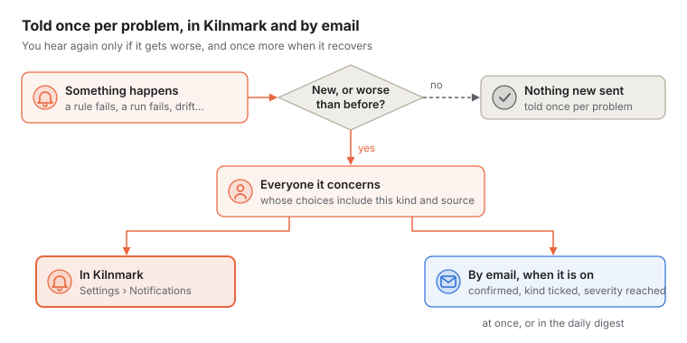
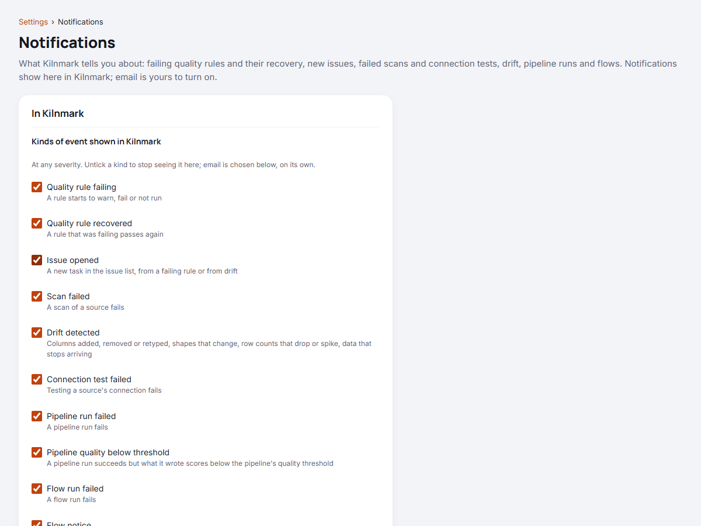

# Notifications and email alerts

This guide shows you how Kilnmark tells you when something needs attention: in the app, and by
email if you want it. It covers what can notify you, how to choose what you get, how an admin sets
up email, and what an email contains.

## What can notify you

| Event | When | Severity |
| --- | --- | --- |
| **Quality rule failing** | A rule starts to warn, fail or not run | High for a failure, medium for a warning, low when it could not run |
| **Quality rule recovered** | A rule that was failing passes again | The failure's severity by email; shown as information in the app |
| **Issue opened** | A new task appears in the issue list, from a failing rule or from drift | The issue's severity |
| **Scan failed** | A scan of a source fails | High |
| **Drift detected** | A scan finds changes since the previous one: columns added, removed, renamed or retyped, value shapes or nulls that shift, row counts that drop or spike, data that stops arriving | The highest severity among the changes |
| **Connection test failed** | Testing a saved source's connection fails | Medium |
| **Pipeline run failed** | A pipeline run fails | High |
| **Pipeline quality below threshold** | A pipeline run succeeds, but what it wrote scores below the pipeline's quality threshold | Medium |
| **Flow run failed** | A flow run fails | High |
| **Flow notice** | A flow's `notify` node sends its message ([Building and running a flow](flows.md)) | The node's own `severity` |
| **Pipeline run recovered** | A pipeline run succeeds after a failed run that was told | The failure's severity by email; shown as information in the app |
| **Flow run recovered** | A flow run succeeds after a failed run that was told | The failure's severity by email; shown as information in the app |
| **Run taking longer than expected** | A pipeline or flow run is still going past its `run: warn_after` | Medium |

**Runs tried again.** A pipeline or flow with `run: retries` is tried again after a failure
([Trying a run again](pipelines.md#trying-a-run-again)). Nobody is told about a try that will be
tried again: **Pipeline run failed** and **Flow run failed** come once, after the last try, and say
how many tries were made and why there were no more. A run that succeeds on a later try tells
nobody.

**Owners are always told** about their pipeline's or flow's runs: see
[Owners of pipelines and flows](#owners-of-pipelines-and-flows), below.

A pipeline has a quality threshold when its YAML sets one, such as `quality: {min_score: 0.95}`
(see [Quality of what a run writes](quality-gates.md#quality-of-what-a-run-writes)). Each run
measures the quality of every table or file it writes; when the lowest score is below the
threshold, the notification names the write node and says the score and the threshold.

**One message per problem.** A rule that fails on every scan tells you once, when it starts
failing. You hear again only if it gets worse, for example when a warning becomes a failure, and
once more when it recovers. A failed scan is told once until a scan of that source succeeds again.
A failed connection test is told once until a connection test or a scan of that source succeeds.
A failed pipeline run is told once until a run of that pipeline succeeds, and a failed flow run
once until a run of that flow succeeds; that success is told as **recovered**. Drift, new issues, pipeline runs below their quality
threshold and flow notices are told each time they happen, once per run.



## Owners of pipelines and flows

Each pipeline and each flow has **owners**: the people, or team addresses, who answer for it. They
are told when its run fails after its last try, when it runs again successfully after a failure
that was told, and when a run takes longer than its `run: warn_after`.

- The pipeline's or flow's page shows them under **Owners**, one a line, each saying whether it is
  a person or a team address: a token by its name, and someone who signs in through your identity
  provider by their `sso:` name, with the full record on hover. Designers and admins choose
  **Change owners** and give up to 10 sign-in names (as Kilnmark records who did something, such as
  `token 1 (KILNMARK_ADMIN_TOKEN)`) or team addresses, one a line. A team address must be one an
  admin added under **Settings**, **Email** ([Team addresses](#team-addresses)). Others see a team
  address as "A team address".
- **By default the owner is whoever first saved it.** Owners are kept apart from the YAML, so
  changing them makes no new version. Each change is in the [audit log](audit-log.md).
- **Owners are always told**: its **run failed**, **run recovered** and **taking longer than
  expected** notifications reach them in the app, and by email when their email is on and their
  address confirmed, even if their own choices leave the kind out. The hourly limit and the digest
  still apply. Each sees what their role may see, and a team address what a viewer sees. Everyone
  else gets them as their own choices say.
- **Owning gives no rights.** An owner who is a viewer still cannot run or change the pipeline or
  flow, and a run never acts as its owner: it acts as whoever, or whichever schedule, started it.
- **With no owner**, the page says so, and admins are told in their place. The same holds when no
  owner can be told (a person whose token no longer works, or who has not used Kilnmark lately).
  People who sign in through your identity provider get no notifications yet, so name a team
  address too.

## In the app



Notifications appear in Kilnmark for every role, with nothing to set up, for people who use an API
token. People who sign in through your identity provider get none yet, and this page offers them no
choices. Each one says what
happened and links to where to look: the asset, the source or the issue list. Open
**Settings**, then **Notifications**, to see your latest ones under **Your latest
notifications** and to mark them read.

- Kilnmark starts keeping notifications for you once you have opened the app with your token.
  Tokens used only by scripts, and tokens marked as used by a local AI assistant, get none.
- You see every kind of event, at every severity, until you untick a kind under **Kinds of event
  shown in Kilnmark**.
- If you limit your notifications to some sources (see [Choosing what you get](#choosing-what-you-get)),
  that applies here too.
- Notifications are kept for 90 days, read or not.
- Each notification shows whether an email went to you about it, and its status: sent, queued,
  failed or skipped. Admins also see which team addresses got it.

## By email

Email is off until you turn it on, except for admins, who get high-severity events at once as soon
as they give and confirm an address. Email works only once an admin has set up the mail server
(see [Setting up email (admins)](#setting-up-email-admins)); until then the settings page says so,
and you can still make your choices.

To turn it on:

1. Open **Settings**, then **Notifications**.
2. Under **By email**, switch **Send me emails** on.
3. Enter your **Email address**.
4. Choose what you get, as described below.
5. Choose **Save notification settings**.
6. **Confirm your address.** Kilnmark sends it an email with a link and a code. Open the link while
   signed in, or type the code under **Confirm your address** on the same page. Until you do, you
   get no email at all. The code works for 7 days; **Send another confirmation email** sends a new
   one. Changing your address asks for a new confirmation.

Some servers send email only to some domains, for example your organisation's. The page then says
which, and refuses other addresses.

## Choosing what you get

| Setting | What it does |
| --- | --- |
| **Kinds of event by email** | Tick the events you want emails about. Admins start with every kind but **Issue opened**, since issues come from failing rules and drift, which are already ticked |
| **Least severity by email** | High only, medium and high, low and above, or everything |
| **When emails go** | **Each one as it happens**, or **One email a day**, a digest of everything since the last one, at the **Digest time** you choose |
| **Sources** | **Every source, including ones added later**, or only the sources you tick. This applies to notifications in the app too |

**Times are the server's.** The digest time is in the server's time zone, which the page names,
for example *Europe/London*. If you are in another time zone, choose the hour that suits you there.

**The hourly limit.** Kilnmark sends one address at most 20 emails of their own in an hour (an
admin can change the number). Anything more waits for that address's next daily digest, so a burst
of alerts becomes one summary rather than a flood.

## What an email looks like

Every email has a plain text version and a simple HTML version, with no images and nothing that
tracks whether you opened it. The subject says the severity and what happened, for example:

```
[Kilnmark] High: email not null fails on crm.customers
```

The email then says what happened, for example *312 of 48,210 rows (0.65%) fail*, when it happened
(in the server's time zone), which source and asset it concerns, and links to it in Kilnmark. The
footer links to your notification settings. A daily digest groups its events by kind, most severe
first.

**No values from your data.** Emails and notifications give counts, shares, and the names of
sources, tables, columns and rules. They never carry values from the rows for anyone who could not
see them in Kilnmark:

- Some events carry more detail, such as what a database said when a scan failed or a connection
  test failed, or why a rule could not run. Such text can name hosts and users or quote values, so
  only stewards and admins see it; everyone else gets plain words, such as *The scan failed. Open
  the source to see why.*
- For a source or table with a column marked sensitive, that detail goes to designers and admins
  only, and never for the sensitive column itself, whoever you are.
- Team addresses get what a viewer gets.

## Setting up email (admins)

Open **Settings**, then **Email**. A setting the server's operator has fixed shows read-only,
labelled *Set by the server's configuration*.

### The mail server

| Field | What to enter |
| --- | --- |
| **Send emails** | On to send. Off pauses every email: they wait (see [Retries and limits](#retries-and-limits)). Notifications in the app carry on either way |
| **SMTP server** | The mail server's name, such as `smtp.example.com`, without `smtp://` or a port |
| **Port** | Empty for the usual one: 587 for STARTTLS, 465 for TLS, 25 for none |
| **Security** | **STARTTLS** (the usual choice), **TLS from the start**, or **None** for a relay on a trusted network only |
| **User name** and **Password** | The account to sign in as, or empty to send without signing in. The password is kept encrypted and never shown again: leave the box empty to keep it, or tick **Remove the stored password** |
| **Allow sign-in without encryption** | Off by default. See below |
| **From address** and **From name** | Who emails come from, such as `kilnmark@example.com` and *Kilnmark* |
| **Address of Kilnmark, for links** | How people open Kilnmark, such as `https://kilnmark.example.com`. Emails link back with it, and confirmation emails carry their link with it; leave it empty for emails without links (confirmation then works with the code alone) |

**The password stays with its server.** A stored password is only ever sent to the server, port,
security and user name it was entered with. Change any of them and saving asks for the password
again (or for **Remove the stored password**); the page warns you before you save.

**Signing in without encryption.** With security **None**, a user name and password would cross
the network unencrypted, readable by anyone in between. Kilnmark refuses that unless you switch on
**Allow sign-in without encryption**, which you should do only for a relay on a trusted network.
It applies only to a password entered on this page. Turning it on is written to the server log
with your name.

Choose **Save mail settings**, then **Send a test email** to your own address. The answer says
whether it went or, if not, what the mail server said and what to check. A user name or password
the server repeats back is never shown.

### Who may get email

- **Allowed email domains.** Add domains one at a time, such as `example.com`; each also allows
  its subdomains, such as `mail.example.com`. Empty allows any domain. The list applies to
  personal and team addresses alike. When you save a list that leaves out addresses already in
  use, those addresses are paused, not deleted, and listed with a warning; they get email again
  once the list includes them or their owners change them.
- **Personal addresses need confirming.** On by default: a person's new address gets nothing until
  they confirm it. Turn it off only on a closed network where confirmation links cannot be opened;
  without it, anyone who can sign in can have alerts sent to any address. Team addresses, which
  only admins add, need no confirmation.

### Retries and limits

| Setting | Default | Range | What it does |
| --- | --- | --- | --- |
| **Tries before giving up** | 5 | 1 to 10 | A failed email is tried again after 1, 3, 9 and 27 minutes, then hourly, until this many tries in all. A mail server that refuses an email outright is not asked again |
| **Emails per address per hour** | 20 | 1 to 1,000 | Beyond this, an address's emails wait for its next daily digest. Digests do not count |
| **Undelivered emails wait** | 24 hours | 1 to 168 hours | How long an email may stay unsent, because sending is paused or the mail server is down, before the rule below applies |
| **Then** | Put it in the digest | Digest or drop | **Put it in the recipient's next daily digest**, so a long pause ends in one summary each rather than a flood; or **Drop it**, which marks it skipped (digests overdue by as long are dropped too) |

An email goes at least once: if a server stops just after the mail server accepted an email and
before recording it, the email is sent again later.

### Team addresses

A team address is a plain email address, such as a distribution list, with its own choices of
kinds, severity, timing and sources. Under **Team addresses**, choose **Add a team address**, give
it a name and an address, choose what it gets, and save. New team addresses get high-severity
events in a daily digest at 08:00.

Team emails are written for a viewer: they never include detail that only stewards may see. Team
addresses get no notifications in the app, as there is no one to sign in. In the feed, admins see
team addresses by name, never by address.

### Sent emails

**Settings**, **Sent emails** lists every attempt to send an email for the last 30 days: when, to
whom, the subject, and the outcome.

| Status | Meaning |
| --- | --- |
| **Sent** | The mail server accepted it |
| **Will try again** | It failed; Kilnmark tries again, as **Tries before giving up** says |
| **Given up** | It failed every time, or the mail server refused it outright |
| **Moved to digest** | The address had reached its hourly limit; the email waits for its daily digest |

Only the subject is kept, never the email's text.

## For operators

- **Set the server's time zone.** Digests go at an hour of the server's clock. Containers usually
  run on UTC: set `TZ`, for example `TZ=Europe/London`, on the Kilnmark container so digests go at
  local hours.
- **Defaults and locks.** `kilnmark.mail.*` gives the settings until an admin saves them. List any
  in `kilnmark.mail.locked`, for example `kilnmark.mail.locked=allow-plain-auth,allowed-domains`,
  and admins cannot change them; they show read-only in the UI.
- **The configured password** (`KILNMARK_MAIL_PASSWORD`) is used only while the server and user
  name in force are the configured ones, and is never sent unencrypted.

## For developers: the notifications API

The app's notifications come from three endpoints, each answering for whoever's API token is
used. Nobody can read or mark another person's notifications.

- `GET /api/v1/notifications?limit=N&unread=true|false`: the latest notifications, newest first
  (`limit` 20 by default, at most 100; `unread=true` for unread ones only), with the number
  unread.
- `GET /api/v1/notifications/unread-count`: only the number unread, `{"unread": 3}`. Cheap enough
  to ask every minute. The count stops at 99: beyond that it answers `{"unread": 99, "more": true}`,
  for a bell that shows *99+*.
- `POST /api/v1/notifications/read` with `{"ids": ["12", "13"]}` or `{"all": true}`: marks them
  read and answers 204. Ids that are not yours are ignored.

An item looks like this:

```json
{
  "id": "12",
  "kind": "rule_failed",
  "severity": "high",
  "title": "email not null fails on crm.customers",
  "detail": "312 of 48,210 rows (0.65%) fail.",
  "link": "#/asset/urn%3Akilnmark%3Alab%3Acrm.customers",
  "createdAt": "2026-10-25T06:00:00Z",
  "read": false,
  "channels": [{"type": "in_app"}, {"type": "email", "status": "sent", "at": "2026-10-25T06:00:04Z"}],
  "teamEmails": [{"name": "Data team", "status": "queued"}]
}
```

`kind` is one of `rule_failed`, `rule_recovered`, `issue_opened`, `scan_failed`, `drift`,
`connection_failed`, `pipeline_failed` and `pipeline_low_quality`; `severity` one of `high`,
`medium`, `low` and `info`. The email channel is there only when an email about the event was
meant for you, with `status` `sent`, `queued`, `failed` or `skipped`. `teamEmails` is there for
admins only. Email addresses never appear in the feed. The list's `unread` follows the same rule as
the count, with `more` when it stops at 99.

Your own choices are at `GET` and `PUT /api/v1/me/notifications` (a field left out keeps its
value; `allSources: true` for every source), with `POST /api/v1/me/notifications/confirm`
(`{"code": "..."}`) and `POST /api/v1/me/notifications/confirm/resend`. Email settings, team
addresses and the send log are at `/api/v1/mail/...` for admins. The interactive API documentation
at `/api/docs` lists them all.

## When something goes wrong

| What you see | What to do |
| --- | --- |
| *Email is not set up yet* | Ask an admin to enter the mail server under **Settings**, **Email** |
| *Email is paused* | An admin switched **Send emails** off. Emails wait, then go into digests or are dropped after the undelivered time |
| *Not confirmed yet* | Open the confirmation email's link, or type its code. **Send another confirmation email** if it has gone |
| *this server sends email only to …* | Use an address in one of the domains listed |
| *password: the server, port, security or user name changed* | Type the password again, or remove it. A password is only sent where it was entered for |
| *security: with None, the user name and password would be sent unencrypted* | Choose STARTTLS or TLS, or, on a trusted network only, switch on **Allow sign-in without encryption** |
| *… is set by the server's configuration* | The operator fixed that setting; ask them to change `kilnmark.mail.*` |
| *The mail server refused the user name or password* | Check them. Some services need an app password, or signing in allowed for the account |
| *Nothing accepted a connection at …* | Check the server name and port, and that a firewall lets the Kilnmark server reach it |
| *… did not answer within … seconds* | The port or the security setting is probably wrong: port 465 usually takes TLS, port 587 STARTTLS |
| *… does not offer STARTTLS* | Choose **TLS from the start** if the server listens for TLS, or **None** for a relay on a trusted network |
| *The mail server's certificate is not trusted* | Use a certificate from a public authority, or add the one that issued it to the server's Java trust store |
| No emails, but the test email works | Check that **Send me emails** is on and your address is confirmed, that the kinds and least severity cover the event, and that the source is among yours. Admins can check **Sent emails** |
| An email you expected came in the digest | The address reached its hourly limit, sending was paused, or digest is chosen under **When emails go** |
