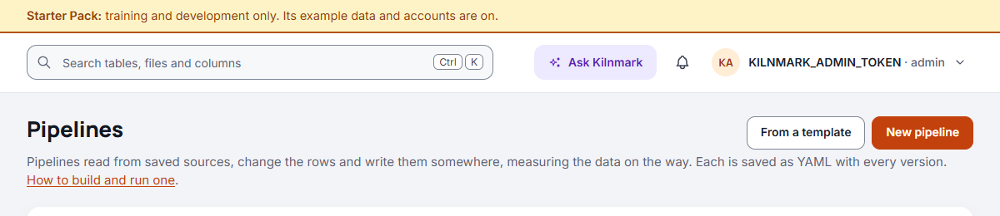
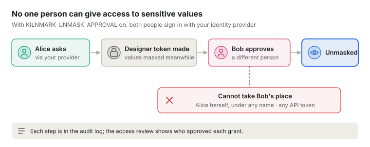

# People and access

For administrators: making and revoking API tokens, mapping your identity provider's groups to
roles, adding people to the Keycloak that comes with Kilnmark, limiting how long tokens last,
reviewing who can do what, and the controls an auditor will ask about. How people sign in, and what
each role may do, is in [Signing in, roles and tokens](signing-in.md).

## API tokens

An API token is a password for a program. It starts with `km_`, is shown **once** when it is made,
and Kilnmark keeps only a fingerprint of it (a hash), so nobody can read it back later, not even an
admin.

- **Making one:** an admin goes to **API tokens**, gives it a name (like `nightly-ci`), the least
  role that will do, and an expiry.
- **Using one:** see [Using an API token](signing-in.md#using-an-api-token). A scheduler that runs
  pipelines and flows needs a **Steward** token, kept in a file only its jobs can read: see
  [Running from an external scheduler](external-schedulers.md#before-you-start).
- **Revoking one:** **API tokens**, revoke. It stops working at once, on every server.
- **Last used:** Kilnmark records when each token was last used, so you can spot and remove ones
  nobody uses.

**The first admin token.** A new install has no tokens, so the server writes a one-off admin token to
a private file (`admin-token`), good for 24 hours: sign in with it and make a proper one. Or the
operator sets `KILNMARK_ADMIN_TOKEN` in the server's settings, which is the operator's own
break-glass key. If ever no admin token works, the next restart writes a fresh 24-hour file, so you
cannot be locked out for good.

No token may be named `sso:...`: that prefix is kept for people who sign in through your
organisation, so a token can never pass for a person in the records.

## Your identity provider

People sign in with your organisation's login through **OpenID Connect**
([Signing in with your organisation](signing-in.md#signing-in-with-your-organisation)). Kilnmark is
registered with your identity provider once (INSTALL.md, "Sign in with your identity provider").

**Roles come only from your settings.** You list which groups give which role, for example
`km-admins` gives admin. A group that merely happens to be called "admin" at the provider gives
nothing unless you name it. Someone in several groups gets the highest role among them. Someone in
none signs in but gets **no role**, and the page tells them why.

If a person's role changes at the provider (moved to a group with a lower role), the next renewal
gives them the new role, and pauses any schedule they set that the new role no longer covers. A renewal is
not a new sign-in: the audit log records the sign-in once.

**Taking access away** is done at the provider: remove them from the group, or disable them, and
their sign-in ends at its next renewal (within 5 minutes with Keycloak, within the hour with most
other providers).

## Keycloak, if you have no identity provider

An organisation with no identity provider of its own (or with only Active Directory or LDAP) can use
the **Keycloak** that comes with Kilnmark: an open-source identity provider, started beside Kilnmark
only when asked for. Your administrator turns it on (INSTALL.md, "Keycloak, if you have no identity
provider"). It works like any other provider, with Kilnmark's own look; how people sign in with
it is in [Signing in with Keycloak](signing-in.md#signing-in-with-keycloak).

- **Groups give roles.** Keycloak has five groups ready: `kilnmark-viewers`, `kilnmark-stewards`,
  `kilnmark-designers`, `kilnmark-admins`, and `kilnmark-sensitive-data` for designers who see
  sensitive values.
- **Adding people.** The person who runs Kilnmark adds people with the control script:
  `kilnmark.sh people add` for one person, admins included (install offers to add Kilnmark's first
  admin this way), `people import` for a class or a team from a CSV file (never admins), `people
  activate` to give one waiting person a temporary password of their own, and `people list` to see
  who has not yet signed in (INSTALL.md, "Adding people to the bundled Keycloak"). Or in Keycloak's
  console. A class on a Starter Pack install shares one temporary password; a team imported on
  production waits, disabled, until each person is activated. Everyone chooses their own password
  at their first sign-in, and a temporary password the control script gave, unused for 72 hours,
  disables its person (checked every hour) until activated again. Kilnmark itself cannot add
  people: it holds no Keycloak credential.
- **Two admins, in two places.** Keycloak's own admin (`KILNMARK_KEYCLOAK_ADMIN`) signs in to
  Keycloak's console, to manage people; it is not a Kilnmark account. Kilnmark's first admin is a
  person in Keycloak's realm `kilnmark`, in `kilnmark-admins`, who signs in to Kilnmark.

**On a Starter Pack install**, for training and demonstrations, the person who runs Kilnmark can
add five example people, one per role, all at `kilnmark.com` addresses that receive no mail from
here, with the control script: `kilnmark.sh starter people` (Windows: `kilnmark.cmd starter
people`; INSTALL.md, "Try Kilnmark with the Starter Pack"). Keycloak's own setup makes them; they
share one password, which that person types (it is not shown) and nothing keeps. Kilnmark itself
never makes them and never sees their password. A Starter Pack install always signs in with the
bundled Keycloak, never an outside provider.

| Person | Signs in as | Role |
| --- | --- | --- |
| Vera Lane | `vera.lane@kilnmark.com` | Viewer |
| Sam Okafor | `sam.okafor@kilnmark.com` | Steward |
| Dana Reyes | `dana.reyes@kilnmark.com` | Designer |
| Priya Shah | `priya.shah@kilnmark.com` | Designer who sees sensitive values |
| Alex Morgan | `alex.morgan@kilnmark.com` | Admin |

Each sets up their own one-time code on first sign-in, as above. They are for showing Kilnmark only:
never add them where real data is. The access review marks each of them as an **Example account**,
and Settings, Starter Pack lists those that have signed in. `kilnmark.sh starter people --remove`
deletes them again, as does removing `KILNMARK_STARTER=allowed`, at the next start: only the
members of the pack's group, never people added with `people add` or `people import`. Every page of
a Starter Pack install says what it is, and when its example data is on:

**A production install** never has the example people. Kilnmark refuses the sign-in of anyone in
the group `kilnmark-starter-pack`, and of the five example addresses ("Your sign-in is one of the
Starter Pack's example people, which are for training and development installs only"), and records
each refusal in the audit log.

## Token lifetime and the access review

**Longest token lifetime.** An administrator can set, for example,
`KILNMARK_TOKEN_MAX_LIFETIME=90d`. Then:

- every new token must expire within 90 days (the form only offers expiries that fit);
- any token **older than 90 days stops working**, even if it was made earlier with a longer expiry,
  or none.

So **look at the access review before turning it on**, and replace any old token a script still
relies on. The operator's own `KILNMARK_ADMIN_TOKEN` is not limited, and Kilnmark makes sure a fresh
first-admin file is written if the limit would otherwise leave no admin able to sign in. It is off
unless set, and must be between 1 and 3650 days, so a typing mistake cannot quietly mean "no limit".

**Access review** (Settings › Access review) is one list of who can do what:

- every API token: its role, whether it sees sensitive values, who made it, when it expires and
  when it was last used;
- everyone who has signed in through your organisation: the role their last sign-in gave them (or
  none, if it was refused), when, and how often.

**Download CSV** gives your auditors a copy to keep. Each view and download is recorded in the audit
log.

Schedules follow what the access review shows: a schedule runs only while the token or person that
set it still has its role, and a person must have signed in within 30 days; it is paused when that
stops being so ([Running pipelines and flows on a schedule](schedules.md#when-the-person-who-set-it-loses-the-role)).
Revoking a token pauses the schedules set with it at once; a person's tokens are separate from the
schedules they set while signed in. For this, each sign-in records, in the audit log, only those of
the person's groups that your settings map to a role, never their other groups. The review does not yet list the schedules each one set: use
`GET /api/v1/schedules` and its `updatedBy`.

## Two people for sensitive values

Without it, an admin could make a designer token that sees sensitive values and use it themselves:
one person alone giving that access. With `KILNMARK_UNMASK_APPROVAL=true` it takes two people:

1. **Someone asks**, signed in with your identity provider: they make a designer token asking to see
   sensitive values. It is made, but sees them **masked** for now.
2. **Someone else approves** it under **API tokens**, also signed in with your provider. From then on
   the token sees the values.

**Why it has to be people, not tokens.** An admin can make another admin token at any moment, so two
tokens never prove two people were involved. Your identity provider knows who each person is, and
Kilnmark compares them by the provider's fixed ID, not their name. So the person who asked cannot
approve their own request, not even after changing their display name, and no token can ask or
approve. That is also why this setting needs sign-in through your organisation: without it, the
server will not start with the setting on.

**What is recorded:** each request, approval and refusal is in the audit log, naming who asked. The
access review shows who approved each grant. Anyone can refuse or withdraw a request, and the token
stays, without the grant.

**The limit:** one person with two accounts at your identity provider could still do it alone.
Managing those accounts is the provider's job. For people who sign in themselves, the grant comes
from the "unmask" group at your provider, so there the second person is whoever approves membership
of that group.

## Downloading files a run wrote

A file a pipeline run wrote to a folder source can be downloaded from the run's page
([Downloading the files a run wrote](pipelines.md#downloading-the-files-a-run-wrote)). A file holds
every value of every column it has, and cannot be masked, so who may download it follows the rule
for seeing values:

| Who | A file with no sensitive columns | A file holding a column marked sensitive, or whose columns are not known |
| --- | --- | --- |
| Viewers | No: they see no values from the data | No |
| Stewards, designers without the unmask grant, admins | Yes | No |
| Designers with the unmask grant (approved, when two people are needed) | Yes | Yes |

Anyone who may see the run sees its files listed, and the reason when the button is off. A file is
treated as sensitive when a column it holds is marked (by a steward, or carried by the run from what
it read), when its columns are not in the catalogue or the run did not record the file, and when something it was made from has had a
column marked since the run. Every download and every refusal is in the audit log, with who, the
run, the source and path, and the size; never the file's contents.

## What keeps it honest

- **The audit log** (Settings › Audit log) records, and never changes or deletes: tokens made and
  revoked, every sign-in through your organisation and every one given no role, signing out, access
  reviews, and every request refused for want of a role. It can also go to your security team's
  SIEM.
- **Scripts never get a login page.** A request without credentials gets a plain "not signed in"
  answer, never a redirect.
- **Another website cannot act as you.** A browser session only changes anything when the request
  comes from Kilnmark's own pages, which mark every request in a way other sites cannot copy.
- **Session cookies** are sent over HTTPS only in production, so sign-in through your organisation
  needs Kilnmark on HTTPS.

## Still open

- **A copied session cookie** keeps working, and renewing, as long as the session it was copied
  from would, because sessions are not stored on the server. Signing out asks the provider to stop
  the copy renewing (where the provider allows it, as Keycloak does), so a copy then lasts until
  its token expires. Storing sessions would let signing out end every copy at once.
- **The provider's own session**: signing out of Kilnmark ends Kilnmark's session, then takes the
  browser to the provider's own sign-out page (its end-session endpoint, with the session's ID token
  as the hint), which ends the provider's session too and sends the browser back to Kilnmark. So
  signing in again asks for the password and code, rather than letting the same person straight
  back in. The provider must accept Kilnmark's address as where to send the browser back: the
  bundled Keycloak does; for your own provider, register it
  ([Production with your own identity provider](install/production-own-identity-provider.md)).
  A provider that names no end-session endpoint keeps its session: sign out there too on a shared
  computer.
