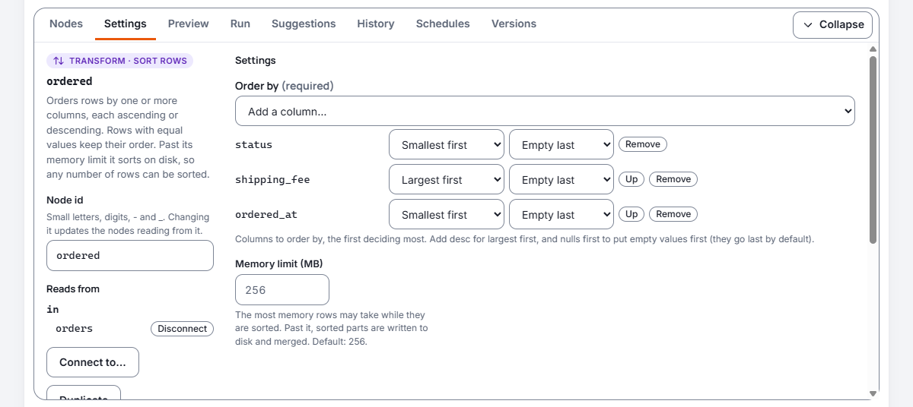
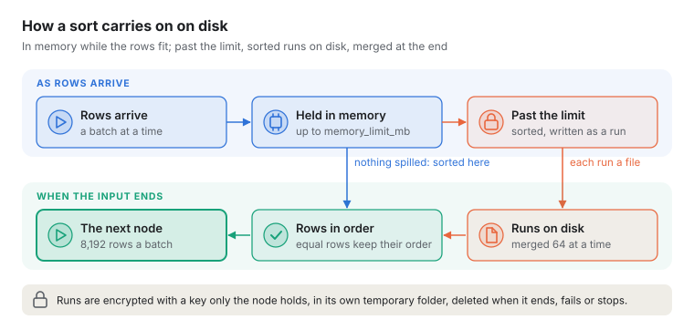

# Pipeline nodes and expressions

This guide describes the nodes that change rows in a pipeline (filter, compute, select, lookup,
aggregate, union, dedupe, route, limit and sort) and the expression language several of them
share. Each node has a YAML example you can copy into a pipeline. Every node, with each setting's
type and default, is also in [Reference: pipeline nodes](reference-pipeline-nodes.md).

## How nodes connect


Every node has named **ports**. Most nodes read from `in` and write to `out`; some have more:

| Node | Reads from | Writes to |
| --- | --- | --- |
| `filter` | `in` | `out`, `rejected` |
| `compute` | `in` | `out` |
| `select` | `in` | `out` |
| `lookup` | `main`, `lookup` | `out`, `rejected` |
| `aggregate` | `in` | `out` |
| `union` | `in` (any number of inputs) | `out` |
| `dedupe` | `in` | `out`, `rejected` |
| `route` | `in` | one port per route, and `out` |
| `limit` | `in` | `out` |
| `sort` | `in` | `out` |
| `gate` | `in` | `out`, `quarantine`: see [Quality gates](pipelines.md#quality-gates) |

In YAML, `input: tidy` reads the `out` port of the node called `tidy`, and `input: tidy.rejected`
reads its `rejected` port. A node with two inputs names them: `inputs: { main: spend, lookup:
tidy }`. A union lists its inputs: `input: [north, south]`.

Rows sent to a port that nothing reads are dropped. For example, a filter whose `rejected` port is
not connected simply drops the rows it does not keep.

## filter

Keeps the rows where a condition is true. Rows where it is false, or empty (null), go to
`rejected`.

```yaml
- id: active
  type: filter
  input: customers
  condition: "status = 'active' and balance > 0"
```

| Setting | What it does |
| --- | --- |
| `condition` | The rows to keep. Required. |

## compute

Adds or replaces columns, each worked out from an expression. A name that is already a column
replaces it where it stands; a new name is added at the end. Expressions are worked out in the
order you write them, and each can use the columns computed before it.

```yaml
- id: tidy
  type: compute
  input: customers
  columns:
    first_name: "trim(first_name)"
    full_name: "first_name || ' ' || trim(last_name)"
    email: "lower(trim(email))"
    vat: "round(amount * 0.2, 2)"
```

| Setting | What it does |
| --- | --- |
| `columns` | Each column's name and its expression. Required. |

## select

Keeps or drops columns, renames them, puts them in order and changes their type. Every setting
names columns as they arrive, before any renaming. The steps happen in this order: keep or drop,
change type, rename, order.

```yaml
- id: shape
  type: select
  input: tidy
  drop: [internal_notes]
  rename: { last_name: surname }
  order: [customer_id, full_name]
  cast: { customer_id: utf8, balance: "decimal(12,2)" }
```

| Setting | What it does |
| --- | --- |
| `keep` | Only these columns, in this order. Use `keep` or `drop`, not both. |
| `drop` | Columns to leave out. |
| `rename` | Each column and its new name. |
| `order` | Columns to put first; the rest follow as they were. |
| `cast` | Each column and its new type (see [Types](#types)). |

## lookup

Adds columns from the `lookup` input to each row of the `main` input with the same key, like a
join. The lookup input is read in full and held in memory first; then main rows stream through.

```yaml
- id: joined
  type: lookup
  inputs: { main: spend, lookup: tidy }
  on: { customer_id: customer_id }
  keep: [full_name, email]
  unmatched: rejected
```

| Setting | What it does | Default |
| --- | --- | --- |
| `on` | Key columns: each main column and the lookup column it must equal. Required. | |
| `keep` | Lookup columns to add. | Every lookup column except the keys |
| `join` | `left` keeps main rows with no match; `inner` drops them. | `left` |
| `unmatched` | What happens to main rows with no match: `keep` (with the added columns empty), `drop`, or `rejected` (sent unchanged to the `rejected` port). Overrides `join`. | From `join` |
| `duplicates` | When the lookup input has a key more than once: `first` uses the first row; `error` stops the run, naming the key. | `first` |
| `memory_limit_mb` | The most memory the lookup input may take. | 256 |

Good to know:

- Keys match by value: `1`, `1.0` and `1.00` match, whatever the column types, and a date matches a
  timestamp at midnight. Text never matches a number; change one with `select` first.
- Empty (null) keys never match.
- An added column must not have the same name as a main column. List the ones you want in `keep`,
  or rename one side with `select`.
- If the lookup input is larger than the memory limit, the run stops with a message saying so.
  Raise `memory_limit_mb`, or keep fewer columns.
- While the lookup input loads, main rows that are ready may be held in memory too (counted
  against the same limit), so a pipeline where both inputs come from one node keeps moving.

## aggregate

Groups rows that share values and summarises each group. Without `group_by`, it summarises all
rows into one, even when there are no rows (a count of 0).

```yaml
- id: spend
  type: aggregate
  input: transactions
  group_by: [customer_id]
  values:
    total: "sum(amount)"
    orders: "count(*)"
    last_seen: "max(txn_at)"
    products: "count_distinct(product_id)"
    average_line: "sum(price * quantity) / count(*)"
```

| Setting | What it does | Default |
| --- | --- | --- |
| `group_by` | The columns whose values make a group. Empty values form a group of their own. | None: one row |
| `values` | Each output column and its summary. Required. | |
| `memory_limit_mb` | The most memory the groups may take while they are collected. | 256 |

The aggregate functions are:

| Function | Gives |
| --- | --- |
| `count(*)` | The number of rows. |
| `count(x)` | The number of rows where `x` is not empty. |
| `count_distinct(x)` | The number of different non-empty values of `x`, counted exactly. |
| `sum(x)` | The total of `x`; empty when every value is empty. |
| `min(x)`, `max(x)` | The smallest or largest value: numbers, text, dates, timestamps. |
| `avg(x)` | The average of the non-empty values (a decimal for decimals, otherwise a float). |

A value can combine aggregates and group-by columns in an expression, such as
`sum(amount) / count(*)` or `upper(region) || ':'`. A column used outside an aggregate must be in
`group_by`, and aggregates cannot be inside each other. Groups come out in the order they were
first seen.

## union

Appends the rows of all its inputs, matching columns by name.

```yaml
- id: everyone
  type: union
  input: [north_customers, south_customers, legacy_customers]
```

| Setting | What it does | Default |
| --- | --- | --- |
| `strict` | Stop unless every input has exactly the same columns with the same types. | `false` |
| `memory_limit_mb` | The most memory rows may take while the union waits for every input's first rows. | 256 |

Good to know:

- Columns come out in the order they first appear across the inputs, as listed, including the
  columns of an input that turns out to have no rows.
- A column missing from an input is empty in that input's rows.
- A column whose type differs between inputs is widened to a type that holds both: whole numbers of
  different sizes to `int64`, whole numbers and decimals to `decimal`, numbers to `float64` when
  one side is a float, dates and timestamps to `timestamp`. Other differences (text and a number,
  say) stop the pipeline before it runs; change one with `select`.

## dedupe

Keeps the first row for each key. Later rows with the same key go to `rejected`. Empty values
count as equal to each other.

```yaml
- id: one_per_email
  type: dedupe
  input: tidy
  key: [email]
```

| Setting | What it does | Default |
| --- | --- | --- |
| `key` | The columns that make rows duplicates. | Whole rows |
| `memory_limit_mb` | The most memory the keys seen so far may take. | 256 |

## route

Sends each row to the first route whose condition it meets, in the order written. Rows that meet
none go to `out`. Each route's name is an output port that other nodes can read.

```yaml
- id: by_size
  type: route
  input: orders
  routes:
    large: "amount >= 10000"
    overseas: "country <> 'GB'"

- id: review
  type: write
  input: by_size.large
  # ...
```

| Setting | What it does |
| --- | --- |
| `routes` | Each port name and its condition. Port names use small letters, digits, `-` and `_`, and cannot be `in` or `out`. Required. |

## limit

Passes on only the first rows, for trying a pipeline out on a little data. Once it has its rows
it stops reading, and nodes before it that feed nothing else stop too.

```yaml
- id: sample
  type: limit
  input: transactions
  rows: 1000
```

| Setting | What it does |
| --- | --- |
| `rows` | How many rows to pass on. Required. |

## sort

Orders rows by one or more columns, each ascending or descending. Write each column as in SQL's
`order by`: the column, then perhaps `desc` for largest first, then perhaps `nulls first`.

```yaml
- id: ordered
  type: sort
  input: orders
  by: [country, amount desc, ordered_at nulls first]
```

| Setting | What it does | Default |
| --- | --- | --- |
| `by` | The columns to order by, the first deciding most. Required. | |
| `memory_limit_mb` | The most memory rows may take while they are sorted. Past it, the sort carries on on disk. | 256 |

On the canvas, each column in **Order by** has its direction (Smallest first or Largest first) and
where its empty values go, and **Up** moves it before the column above:



Good to know:

- Empty (null) values go last, ascending or descending, unless the column says `nulls first`.
- Values order as conditions compare them (`<`, `>`): numbers by value, dates and timestamps in
  time, `false` before `true`. Text is ordered by Unicode code point, not by any language's rules:
  capital letters come before small ones (`B` before `a`), and accented letters after `z`. To sort
  ignoring case, add a column with `lower(name)` in a `compute` node and sort by that.
- Rows with equal values keep the order they arrived in (the sort is stable), so sorting by
  `region` keeps each region's rows in their earlier order.
- A sort passes nothing on until all its rows have arrived.
- Any number of rows can be sorted. Up to `memory_limit_mb` the sort works in memory; past it, it
  writes sorted parts to a temporary folder on the server and merges them at the end. The files
  are encrypted with a key only the running node holds, and deleted when the node ends, fails or
  is stopped. The run's log says how much was written.

  
- A table read in a fixed order is not guaranteed to arrive in that order. Sort just before a
  write when the order matters, for example for a file someone reads.

## Expressions

`filter`, `compute`, `aggregate` and `route` use one small expression language, much like SQL. It
is checked against the columns before the pipeline runs, so a typing mistake or a type mismatch is
reported with its position and, often, a suggestion:

```text
Node tidy: column full_name: unknown column 'frist_name' at 7; did you mean first_name?
```

Expressions only ever compute values: they cannot run code, read files or reach the network.

### Values

| Write | For |
| --- | --- |
| `amount`, `"order date"` | A column. Quote names with spaces, capitals you want to keep as typed, or that are words of the language (`"date"`, `"end"`). Names are case-sensitive. |
| `'text'`, `'it''s'` | Text; double a quote inside it. |
| `42`, `-7` | A whole number. |
| `12.50` | An exact decimal. |
| `1.5e3` | A floating-point number. |
| `true`, `false`, `null` | True, false and empty. |
| `date '2024-01-31'` | A date. |
| `timestamp '2024-01-31 09:30:00'` | A time, in UTC unless it ends with an offset such as `+01:00` or `Z`. |

### Operators

From loosest to tightest:

| Operators | Meaning |
| --- | --- |
| `or` | Either is true. |
| `and` | Both are true. |
| `not` | The opposite. |
| `=`, `<>` (or `!=`), `<`, `<=`, `>`, `>=` | Comparisons. Text compares character by character in Unicode order. |
| `is null`, `is not null` | Whether a value is empty. |
| `x in (a, b, c)`, `not in` | Whether `x` equals any of them. |
| `x between a and b`, `not between` | `x >= a and x <= b`. |
| `x like 'A%'`, `not like` | Text pattern: `%` is any run of characters, `_` one character, `\%` a real percent sign. Case matters. |
| `\|\|` | Joins text. |
| `+`, `-` | Add, subtract. A date plus or minus a whole number moves it by days; a date minus a date counts the days between. |
| `*`, `/`, `%` | Multiply, divide, remainder. Dividing two whole numbers gives a float: `7 / 2` is `3.5`. |
| `-x` | Negative. |

Choices:

```sql
case when amount >= 1000 then 'large' when amount >= 100 then 'medium' else 'small' end
case status when 'A' then 'active' when 'C' then 'closed' end
```

A `case` without `else` gives empty when nothing matches. Only the branch a row takes is worked
out, so `case when qty <> 0 then total / qty end` never divides by zero.

### Empty values (null)

Empty values follow SQL's rules:

- Arithmetic, comparisons and most functions with an empty input give empty: `null + 1` and
  `null = null` are both empty, not true.
- `false and null` is false and `true or null` is true; otherwise `and`, `or` and `not` with an
  empty value give empty.
- `x in (1, null)` is true when `x` is 1 and empty otherwise.
- `filter` and `route` treat empty as not true.
- Use `is null`, `coalesce` and `nullif` to handle empty values on purpose.

### Types

| Type | Holds |
| --- | --- |
| `boolean` | True or false. |
| `int64` | Whole numbers. Every integer column reads as this. |
| `float64` | Floating-point numbers. |
| `decimal(p,s)` | Exact decimals with up to 38 digits, `s` of them after the point. |
| `utf8` | Text. |
| `date` | A calendar day. |
| `timestamp` | An instant, to the microsecond, always in UTC. |

Numbers widen on their own when mixed (`int64` to `decimal` to `float64`), and a date compared
with a timestamp counts as midnight UTC. Anything else needs `cast(x as type)`, for example
`cast(customer_id as utf8)` or `cast(amount as decimal(10,2))`. Other names work too: `integer`,
`bigint`, `double`, `numeric`, `text`, `string`, `varchar`.

Casting text is strict: `cast('12a' as int64)` stops the run. To handle bad values, test them
first, as in `case when regex_match(code, '^[0-9]+$') then cast(code as int64) end`, or use
`parse_date` and `parse_timestamp`, which give empty instead.

Whole numbers that overflow, and division by zero, stop the run. Guard a division with `nullif`:
`total / nullif(qty, 0)`.

### Functions

| Function | Gives |
| --- | --- |
| `trim(s)` | `s` without spaces, tabs, line breaks or other whitespace at either end (a no-break space is kept). |
| `lower(s)`, `upper(s)` | `s` in small or capital letters. |
| `length(s)` | The number of characters. |
| `substring(s, start)`, `substring(s, start, length)` | Part of `s`, counting characters from 1. |
| `replace(s, from, to)` | `s` with every `from` replaced by `to`. |
| `concat(a, b, ...)` | The values joined as text, of any type, skipping empty ones. |
| `coalesce(a, b, ...)` | The first value that is not empty. |
| `nullif(a, b)` | Empty when `a` equals `b`, otherwise `a`. |
| `abs(x)` | `x` without its sign. |
| `round(x)`, `round(x, digits)` | `x` rounded half away from zero; `digits` may be negative (`round(1234, -2)` is 1200). |
| `floor(x)`, `ceil(x)` | `x` rounded down or up to a whole number. |
| `regex_match(s, pattern)` | Whether the regular expression is found in `s`; use `^` and `$` to match all of it. |
| `regex_replace(s, pattern, replacement)` | `s` with every match replaced; `$1` in the replacement is the first group. |
| `now()` | The time the node started, the same for every row. |
| `today()` | Today's date in UTC. |
| `date_trunc('unit', d)` | The start of the year, quarter, month, week (Monday), day, hour, minute or second holding `d`. |
| `date_part('unit', d)` | A part of `d` as a whole number: `year`, `quarter`, `month`, `week` (ISO), `day`, `day_of_week` (1 is Monday), `day_of_year`, `hour`, `minute`, `second`. |
| `parse_date(s)`, `parse_date(s, 'pattern')` | Text read as a date, or empty when it does not fit. |
| `parse_timestamp(s)`, `parse_timestamp(s, 'pattern')` | Text read as a timestamp (UTC unless the text has an offset), or empty. |
| `format_date(d, 'pattern')` | A date or timestamp as text, in UTC. |

Date patterns use letters such as `yyyy` (year), `MM` (month), `MMM` (Jan), `dd` (day), `HH`
(hour), `mm` (minute), `ss` (second) and `XXX` (offset); put other words in single quotes, as in
`'dd/MM/yyyy'` or `'yyyy-MM-dd''T''HH:mm'`. Patterns and units must be written out in quotes, so
mistakes are found before the pipeline runs. Dates are read strictly: 31 February is empty, not
3 March.

### Regular expressions are kept safe

Some regular expressions can take practically for ever on unlucky text. To keep every pipeline
running:

- Patterns that repeat a group which itself repeats, such as `(a+)+` or `(\w+\s?)*`, are refused.
  They can almost always be simplified: `(a+)+` matches the same as `a+`, and `(a|b)*` as
  `[ab]*`. One kind is allowed: a group repeated with `+` or `*` that starts with a punctuation
  separator nothing else in it can match, as in `^[\w-]+(\.[\w-]+)+$` for host names. A group
  repeated a counted number of times, such as `(\.[a-z]+){2,5}`, must not repeat inside.
- Back-references such as `\1` and comment mode `(?x)` are refused.
- Text longer than 100,000 characters is an error, and longer than 2,000 characters for patterns
  that repeat a group.
- Each value gets a fixed amount of work (roughly a fifth of a second), and each batch of rows a
  larger one. A pattern that needs more stops the run with a message naming the expression.
- `like` has the same 100,000-character limit and a work limit of its own.

### Limits

- An expression may be up to 10,000 characters long.
- It may be nested up to 64 levels deep: brackets, function calls, `case`, `cast`, `in (...)`,
  `not` and a leading minus each count as a level.
- It may have at most 1,000 operations inside each other, counting a chain such as `a + b + c`
  as one operation inside the next.
- Comparisons do not chain: write `a = b and b = c`, or use brackets.
- A text value may grow to at most 1,000,000 characters (`||`, `concat`, `replace`,
  `regex_replace`), and each of them may produce at most 64,000,000 characters for one batch of
  rows.
- Dates and timestamps run from year -9999 to 9999.

For longer logic, split it over several `compute` columns.
