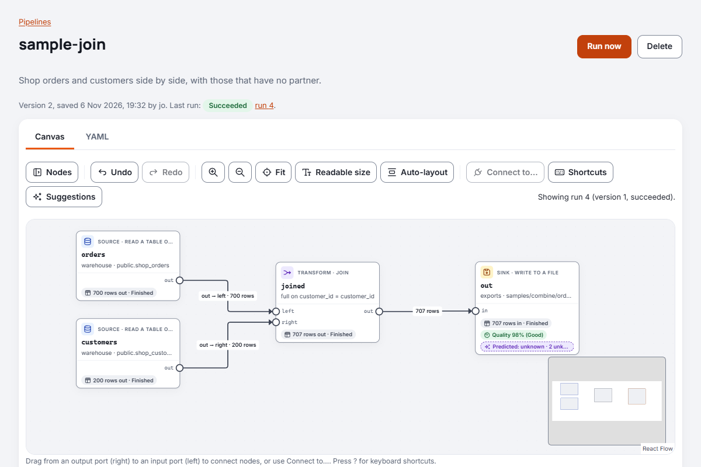
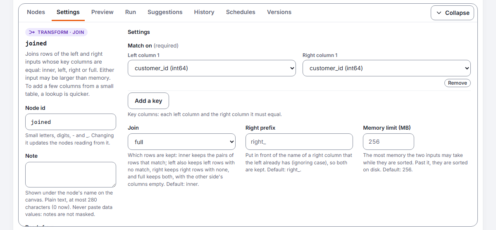

# Pipeline nodes and expressions

This guide describes the nodes that change rows in a pipeline (filter, compute, select, lookup,
join, aggregate, union, dedupe, route, limit, sort and window) and the expression language several of
them share. Each node has a YAML example you can copy into a pipeline. Every node, with each setting's
type and default, is also in [Reference: pipeline nodes](reference-pipeline-nodes.md).

## How nodes connect


Every node has named **ports**. Most nodes read from `in` and write to `out`; some have more:

| Node | Reads from | Writes to |
| --- | --- | --- |
| `filter` | `in` | `out`, `rejected`, `errors` |
| `compute` | `in` | `out`, `errors` |
| `select` | `in` | `out`, `errors` |
| `lookup` | `main`, `lookup` | `out`, `rejected` |
| `join` | `left`, `right` | `out` |
| `aggregate` | `in` | `out` |
| `union` | `in` (any number of inputs) | `out` |
| `dedupe` | `in` | `out`, `rejected` |
| `route` | `in` | one port per route, `out`, and `errors` |
| `limit` | `in` | `out` |
| `sort` | `in` | `out` |
| `window` | `in` | `out` |
| `gate` | `in` | `out`, `quarantine`: see [Quality gates](pipelines.md#quality-gates) |

In YAML, `input: tidy` reads the `out` port of the node called `tidy`, and `input: tidy.rejected`
reads its `rejected` port. A node with two inputs names them: `inputs: { main: spend, lookup:
tidy }`, or `inputs: { left: orders, right: customers }` for a join. A union lists its inputs: `input: [north, south]`.

Rows sent to a port that nothing reads are dropped. For example, a filter whose `rejected` port is
not connected simply drops the rows it does not keep. The `errors` port is the exception: with
nothing connected to it, a row that fails stops the run, as it always has ([Rows that
fail](#rows-that-fail)). A `write` to a database has an `errors` port too
([Writing data](writing-data.md#rows-the-table-would-refuse)).

## Rows that fail

A row *fails* when a node cannot work it out: a cast of `'12a'` to a number, a division by zero, a
number too large for its type, a date out of range. Without an `errors` port connected, the first
such row stops the run. Connect something to the node's `errors` port (a write to a quarantine
file, say) and failing rows go there instead, while the others carry on:

```yaml
- id: amounts
  type: compute
  input: feed
  columns:
    amount_pence: "cast(amount as int64) * 100"
  max_error_share: 0.01

- id: aside
  type: write
  input: amounts.errors
  source: files
  path: quarantine/feed-errors.csv
  mode: replace
```

| Node | A row fails when |
| --- | --- |
| `compute` | an expression fails on it |
| `select` | a `cast` fails on it |
| `filter` | the condition fails on it (a condition that is false or empty still sends the row to `rejected`) |
| `route` | a route's condition fails on it |

**An error row** is the row as it arrived at the node, with four columns added at the end:

| Column | What it holds |
| --- | --- |
| `error_node` | The node's id. |
| `error_column` | The column being worked out (compute) or cast (select); for a condition, `condition` or `routes.<name>`. |
| `error_code` | `cast_failed`, `division_by_zero`, `out_of_range`, `too_long`, `too_slow`, `invalid_argument`, or `expression_failed` for anything else. |
| `error_message` | What went wrong and what to do. It never holds the value: the value is in the row's own column. |

The row keeps its columns' names, so a column marked sensitive stays marked in the error rows: it
is masked wherever they are shown, and a write of them carries the mark to what it writes. A row
that already has the four columns (it failed at an earlier node and was routed on) takes the latest
failure.

**The error tolerance** stops the run when too many rows fail, judged over the whole run:

| Setting | What it does | Default |
| --- | --- | --- |
| `max_errors` | Stop the run when more than this many rows fail. | No limit |
| `max_error_share` | Stop the run when more than this share of the rows fail, from 0 to 1, judged when the input ends. | No limit |

The tolerance counts the rows sent to `errors`, so it applies only with the port connected. The
run page shows each node's rows in and out per port, `errors` among them, and each node with
failing rows adds a line to the run's log, such as "12 rows of 48,000 failed and went to the errors
port (limits: max_error_share 1.00%)", so rows read, written and set aside can be reconciled.

How the rows are found: a node works on a batch of rows at once, so when a batch fails the node
splits it in halves, and each failing half again, until it has the single rows that fail. A batch
that works costs nothing extra. A failure that is not about one row (a setting that is wrong for
every row) still stops the run.

## filter

Keeps the rows where a condition is true. Rows where it is false, or empty (null), go to
`rejected`.

```yaml
- id: active
  type: filter
  input: customers
  condition: "status = 'active' and balance > 0"
```

| Setting | What it does |
| --- | --- |
| `condition` | The rows to keep. Required. |

## compute

Adds or replaces columns, each worked out from an expression. A name that is already a column
replaces it where it stands; a new name is added at the end. Expressions are worked out in the
order you write them, and each can use the columns computed before it.

```yaml
- id: tidy
  type: compute
  input: customers
  columns:
    first_name: "trim(first_name)"
    full_name: "first_name || ' ' || trim(last_name)"
    email: "lower(trim(email))"
    vat: "round(amount * 0.2, 2)"
```

| Setting | What it does |
| --- | --- |
| `columns` | Each column's name and its expression. Required. |

## select

Keeps or drops columns, renames them, puts them in order and changes their type. Every setting
names columns as they arrive, before any renaming. The steps happen in this order: keep or drop,
change type, rename, order.

```yaml
- id: shape
  type: select
  input: tidy
  drop: [internal_notes]
  rename: { last_name: surname }
  order: [customer_id, full_name]
  cast: { customer_id: utf8, balance: "decimal(12,2)" }
```

| Setting | What it does |
| --- | --- |
| `keep` | Only these columns, in this order. Use `keep` or `drop`, not both. |
| `drop` | Columns to leave out. |
| `rename` | Each column and its new name. |
| `order` | Columns to put first; the rest follow as they were. |
| `cast` | Each column and its new type (see [Types](#types)). |

## lookup

Adds columns from the `lookup` input to each row of the `main` input with the same key, like a
join. The lookup input is read in full and held in memory first; then main rows stream through.

```yaml
- id: joined
  type: lookup
  inputs: { main: spend, lookup: tidy }
  on: { customer_id: customer_id }
  keep: [full_name, email]
  unmatched: rejected
```

| Setting | What it does | Default |
| --- | --- | --- |
| `on` | Key columns: each main column and the lookup column it must equal. Required. | |
| `keep` | Lookup columns to add. | Every lookup column except the keys |
| `join` | `left` keeps main rows with no match; `inner` drops them. | `left` |
| `unmatched` | What happens to main rows with no match: `keep` (with the added columns empty), `drop`, or `rejected` (sent unchanged to the `rejected` port). Overrides `join`. | From `join` |
| `duplicates` | When the lookup input has a key more than once, which of its rows is used: `first`, `last`, `latest`, `earliest` or `error` (see [Which row wins](#which-row-wins)). | `first` |
| `duplicates_by` | For `latest` and `earliest`: the lookup column that decides. It need not be among the columns kept. | |
| `memory_limit_mb` | The most memory the lookup input may take. | 256 |

Good to know:

- Keys match by value: `1`, `1.0` and `1.00` match, whatever the column types, and a date matches a
  timestamp at midnight. Text never matches a number; change one with `select` first.
- Empty (null) keys never match.
- An added column must not have the same name as a main column. List the ones you want in `keep`,
  or rename one side with `select`.
- If the lookup input is larger than the memory limit, the run stops with a message saying so.
  Raise `memory_limit_mb`, or keep fewer columns.
- While the lookup input loads, main rows that are ready may be held in memory too (counted
  against the same limit), so a pipeline where both inputs come from one node keeps moving.

## join

Joins the rows of the `left` and `right` inputs whose key columns are equal, as SQL does. Use it
when both inputs may be large, when you want rows from either side that have no match, or when a
key can repeat on both sides.

```yaml
- id: joined
  type: join
  inputs: { left: orders, right: customers }
  on: { customer_id: customer_id }
  how: left
```

| Setting | What it does | Default |
| --- | --- | --- |
| `on` | Key columns: each left column and the right column it must equal. Required. | |
| `how` | `inner` keeps the pairs of rows that match; `left` also keeps left rows with no match; `right` keeps right rows with none; `full` keeps both. | `inner` |
| `right_prefix` | Put in front of a right column's name when a left column already has it. | `right_` |
| `memory_limit_mb` | The most memory the two inputs may take while they are sorted. Past it, the join carries on on disk. | 256 |



In its settings, **Match on** pairs each left column with the right column it must equal, and
**Join** chooses which rows with no match to keep:




Good to know:

- Every pair comes out: a key on three left rows and two right rows gives six rows.
- Keys match by value, as a lookup's do: `1`, `1.0` and `1.00` match, and a date matches a
  timestamp at midnight. A floating-point number matches by its shortest decimal, so a very large
  float may not match the whole number it holds; cast it with `select` to match exactly.
  Timestamps match to the nanosecond. Text never matches a number; change one with `select`
  first. Several key columns must all be equal.
- An empty (null) key never matches anything, not even another empty key, as in SQL.
- Every column of both inputs comes out with its type, the left's first. A right column whose
  name a left column already has (ignoring case) is renamed with `right_prefix`, so a join on
  `customer_id` gives `customer_id` and `right_customer_id`; drop the one you do not need with
  `select`. Columns of a side that may have no match can be empty.
- Rows come out in order of their keys, rows with an empty key last. Within a key, each left row
  comes in the order it arrived, with its right rows in theirs.
- Any number of rows can be joined: both inputs are sorted by their keys, in memory up to
  `memory_limit_mb` between them and on disk past it, as a sort does. A key with more right rows
  than a quarter of that limit holds them on disk while its left rows are joined to them. Nothing
  is passed on until both inputs have ended, except that a join that can give no rows (an `inner`
  join with an empty input, say) stops as soon as it knows. The run's log says how much was
  written to disk.

**join or lookup?** A `lookup` reads its lookup input into memory and streams the main input past
it, keeping the main rows' order: quickest when one side is small, such as a table of codes.
It uses one row of a repeated key, by a rule you state (or stops), and sends main rows with no match to
`rejected` if you like. A `join` sorts both sides, so either may be larger than memory, keeps
every pair when keys repeat, can keep the rows of either side with no match, and passes both
sides' columns on.

## aggregate

Groups rows that share values and summarises each group. Without `group_by`, it summarises all
rows into one, even when there are no rows (a count of 0).

```yaml
- id: spend
  type: aggregate
  input: transactions
  group_by: [customer_id]
  values:
    total: "sum(amount)"
    orders: "count(*)"
    last_seen: "max(txn_at)"
    products: "count_distinct(product_id)"
    average_line: "sum(price * quantity) / count(*)"
```

| Setting | What it does | Default |
| --- | --- | --- |
| `group_by` | The columns whose values make a group. Empty values form a group of their own. | None: one row |
| `values` | Each output column and its summary. Required. | |
| `memory_limit_mb` | The most memory the groups may take while they are collected. | 256 |

The aggregate functions are:

| Function | Gives |
| --- | --- |
| `count(*)` | The number of rows. |
| `count(x)` | The number of rows where `x` is not empty. |
| `count_distinct(x)` | The number of different non-empty values of `x`, counted exactly. |
| `sum(x)` | The total of `x`; empty when every value is empty. |
| `min(x)`, `max(x)` | The smallest or largest value: numbers, text, dates, timestamps. |
| `avg(x)` | The average of the non-empty values (a decimal for decimals, otherwise a float). |

A value can combine aggregates and group-by columns in an expression, such as
`sum(amount) / count(*)` or `upper(region) || ':'`. A column used outside an aggregate must be in
`group_by`, and aggregates cannot be inside each other. Groups come out in the order they were
first seen.

## union

Appends the rows of all its inputs, matching columns by name.

```yaml
- id: everyone
  type: union
  input: [north_customers, south_customers, legacy_customers]
```

| Setting | What it does | Default |
| --- | --- | --- |
| `strict` | Stop unless every input has exactly the same columns with the same types. | `false` |
| `memory_limit_mb` | The most memory rows may take while the union waits for every input's first rows. | 256 |

Good to know:

- Columns come out in the order they first appear across the inputs, as listed, including the
  columns of an input that turns out to have no rows.
- A column missing from an input is empty in that input's rows.
- A column whose type differs between inputs is widened to a type that holds both: whole numbers of
  different sizes to `int64`, whole numbers and decimals to `decimal`, numbers to `float64` when
  one side is a float, dates and timestamps to `timestamp`. Other differences (text and a number,
  say) stop the pipeline before it runs; change one with `select`.

## dedupe

Keeps one row for each key: the first to arrive, unless `duplicates` says otherwise. The other
rows with the same key go to `rejected`. Empty values count as equal to each other.

```yaml
- id: one_per_email
  type: dedupe
  input: tidy
  key: [email]
```

| Setting | What it does | Default |
| --- | --- | --- |
| `key` | The columns that make rows duplicates. | Whole rows |
| `duplicates` | Which row of a key is kept: `first`, `last`, `latest`, `earliest` or `error` (see [Which row wins](#which-row-wins)). | `first` |
| `duplicates_by` | For `latest` and `earliest`: the column that decides. | |
| `memory_limit_mb` | The most memory the keys seen so far may take, with the rows held under `last`, `latest` and `earliest`. | 256 |

Under `first` and `error`, rows pass on as they arrive. Under `last`, `latest` and `earliest` a
row's fate is known only once every row has arrived, so the rows are held until the input ends and
then sent on in the order they came: the winners to `out`, the rest to `rejected`.

```yaml
- id: latest_balance
  type: dedupe
  input: balances
  key: [account_id]
  duplicates: latest
  duplicates_by: as_of
```

### Which row wins

The rule for which row wins, `duplicates`, is the same on `dedupe`, `lookup` (its lookup side) and an
upsert `write`:

| `duplicates` | Which row of a key is kept |
| --- | --- |
| `first` | The first to arrive. The default for `dedupe` and `lookup`. |
| `last` | The last to arrive. The default for an upsert. |
| `latest` | The one with the largest value in the column `duplicates_by` names. |
| `earliest` | The one with the smallest value in that column. |
| `error` | None: the run stops when a key repeats. The message names the key's columns, never its value. |

Under `latest` and `earliest`, a tie goes to the first of the tied rows to arrive, and an empty
value never beats a value. Values order as `sort` orders them: numbers by value, dates and times
in time, text by Unicode code point, `false` before `true`. The canvas shows each node's rule on
its card ("first kept", "latest by updated_at kept"), the default too, so the rule is always in
sight.

Upsert writes are in [Writing data](writing-data.md#which-row-an-upsert-keeps).

## route

Sends each row to the first route whose condition it meets, in the order written. A route may not
be called `errors`: that is the port for [rows that fail](#rows-that-fail). Rows that meet
none go to `out`. Each route's name is an output port that other nodes can read.

```yaml
- id: by_size
  type: route
  input: orders
  routes:
    large: "amount >= 10000"
    overseas: "country <> 'GB'"

- id: review
  type: write
  input: by_size.large
  # ...
```

| Setting | What it does |
| --- | --- |
| `routes` | Each port name and its condition. Port names use small letters, digits, `-` and `_`, and cannot be `in` or `out`. Required. |

## limit

Passes on only the first rows, for trying a pipeline out on a little data. Once it has its rows
it stops reading, and nodes before it that feed nothing else stop too.

```yaml
- id: sample
  type: limit
  input: transactions
  rows: 1000
```

| Setting | What it does |
| --- | --- |
| `rows` | How many rows to pass on. Required. |

## sort

Orders rows by one or more columns, each ascending or descending. Write each column as in SQL's
`order by`: the column, then perhaps `desc` for largest first, then perhaps `nulls first`.

```yaml
- id: ordered
  type: sort
  input: orders
  by: [country, amount desc, ordered_at nulls first]
```

| Setting | What it does | Default |
| --- | --- | --- |
| `by` | The columns to order by, the first deciding most. Required. | |
| `memory_limit_mb` | The most memory rows may take while they are sorted. Past it, the sort carries on on disk. | 256 |

On the canvas, each column in **Order by** has its direction (Smallest first or Largest first) and
where its empty values go, and **Up** moves it before the column above:


Good to know:

- Empty (null) values go last, ascending or descending, unless the column says `nulls first`.
- Values order as conditions compare them (`<`, `>`): numbers by value, dates and timestamps in
  time (to the nanosecond, for columns that hold nanoseconds), `false` before `true`. Text is ordered by Unicode code point, not by any language's rules:
  capital letters come before small ones (`B` before `a`), and accented letters after `z`. To sort
  ignoring case, add a column with `lower(name)` in a `compute` node and sort by that.
- Rows with equal values keep the order they arrived in (the sort is stable), so sorting by
  `region` keeps each region's rows in their earlier order.
- A sort passes nothing on until all its rows have arrived.
- Any number of rows can be sorted. Up to `memory_limit_mb` the sort works in memory; past it, it
  writes sorted parts to a temporary folder on the server and merges them at the end. The files
  are encrypted with a key only the running node holds, readable only by the server's user, and
  deleted when the node ends, fails or is stopped; if a file is damaged while it is there, the
  run fails rather than losing rows. The run's log says how much was written.

  
- A table read in a fixed order is not guaranteed to arrive in that order. Sort just before a
  write when the order matters, for example for a file someone reads.

## window

Adds columns worked out over the rows around each row: a row number, a rank, a running total, or
the value of the row before or after. Rows are taken in groups (a **partition**: the rows with equal
`partition_by` values, such as one account's transactions) and, within each group, in `order_by`
order. Every row comes out, with its own columns and then the new ones.

A running balance for each account, numbering each account's transactions, with the amount before:

```yaml
kilnmark: pipeline/v1
name: running-balance
nodes:
  - id: transactions
    type: read
    source: sales-db
    asset: sales.orders

  - id: balances
    type: window
    input: transactions
    partition_by: [customer_id]
    order_by: [ordered_at, order_id]
    columns:
      balance: "sum(amount)"
      order_number: "row_number()"
      previous_amount: "lag(amount, 1, 0)"

  - id: out
    type: write
    input: balances
    source: files
    path: out/balances.csv
    mode: replace
```

The latest row for each key: number each group's rows newest first, then keep row number 1.

```yaml
kilnmark: pipeline/v1
name: latest-order
nodes:
  - id: orders
    type: read
    source: sales-db
    asset: sales.orders

  - id: newest_first
    type: window
    input: orders
    partition_by: [customer_id]
    order_by: [ordered_at desc, order_id desc]
    columns:
      recency: "row_number()"

  - id: latest
    type: filter
    input: newest_first
    condition: "recency = 1"

  - id: out
    type: write
    input: latest
    source: files
    path: out/latest_orders.csv
    mode: replace
```

| Setting | What it does | Default |
| --- | --- | --- |
| `partition_by` | The columns whose values make a group. Numbers and totals start again in each group. Empty values form a group of their own. | None: one group |
| `order_by` | The order rows are taken in within each group, written as for `sort`: a column, then perhaps `desc`, then perhaps `nulls first`. Required. | |
| `columns` | Each new column's name and its window function. Required. | |
| `memory_limit_mb` | The most memory rows may take while they are put in order and worked out. Past it, the node carries on on disk. | 256 |

Each new column is one of these window functions:

| Function | Gives |
| --- | --- |
| `row_number()` | The row's place in its group: 1, 2, 3, ... |
| `rank()` | The row's place, rows with equal `order_by` values sharing one, with a gap after them: 1, 1, 3. |
| `dense_rank()` | As `rank`, without the gaps: 1, 1, 2. |
| `count(*)`, `count(x)` | The rows so far in the group, or those where `x` is not empty. |
| `sum(x)` | The running total of `x`; empty until the first value that is not empty. |
| `avg(x)` | The average of the values so far (a decimal for decimals, otherwise a float). |
| `min(x)`, `max(x)` | The smallest or largest value so far. |
| `lag(x)`, `lag(x, offset)`, `lag(x, offset, default)` | `x` from the row `offset` rows before in the group (1 unless you say), or `default` when there is none (empty unless you give one). |
| `lead(x)`, `lead(x, offset)`, `lead(x, offset, default)` | The same, from the row after. |

In the settings, **Partition by** lists the grouping columns, **Order by** takes each column with
its direction and where its empty values go, as a sort's does, and **Columns** pairs each new
column's name with its function.

Good to know:

- The arguments are expressions, so `sum(price * quantity)` and `lag(upper(status))` work. A
  window column is one function: to work more out from it, such as `opening + balance`, add a
  `compute` node after the window node.
- Running totals take the rows so far, this one included, one row at a time. Rows with equal
  `order_by` values get different running totals, in the order they arrived; add a column to
  `order_by`, such as an id, to make the order exact. (SQL's default for a running total gives tied
  rows the same total; `rank` and `dense_rank` are the functions here that treat ties alike.)
- Rows with equal `order_by` values keep the order they arrived in, as in a sort, and `row_number`
  numbers them in that order.
- Empty values in an `order_by` column go last, unless the column says `nulls first`.
- Sums, counts, averages, minimums and maximums have the types an `aggregate` gives. A `lag` or
  `lead` has the type of its value, widened to hold its default; the offset is a whole number from
  0 to 1,000, written out, and the default must be of the same kind of value (cast one if not).
- A new column cannot have the name of a column already there, in any case; rename or drop that
  column first.
- Rows come out in order of their group (empty values last) and then of `order_by`. A window passes
  nothing on until all its rows have arrived.
- Any number of rows can be used: rows are put in order as a `sort` puts them, in memory up to
  `memory_limit_mb` and on disk past it, in a temporary folder only the server can read, encrypted
  and deleted when the node ends. The run's log says how much was written. The rows a `lead` looks
  ahead to, and the values a `lag` looks back to, are held too, within a limit of the same size, so
  a window may hold up to about twice `memory_limit_mb` in all; with very wide rows and a large
  offset the run stops and says so.
- `lag`, `lead`, `row_number`, `rank` and `dense_rank` work only in a window node.

## Expressions

`filter`, `compute`, `aggregate`, `route` and `window` use one small expression language, much like SQL. It
is checked against the columns before the pipeline runs, so a typing mistake or a type mismatch is
reported with its position and, often, a suggestion:

```text
Node tidy: column full_name: unknown column 'frist_name' at 7; did you mean first_name?
```

Expressions only ever compute values: they cannot run code, read files or reach the network.

### Values

| Write | For |
| --- | --- |
| `amount`, `"order date"` | A column. Quote names with spaces, capitals you want to keep as typed, or that are words of the language (`"date"`, `"end"`). Names are case-sensitive. |
| `'text'`, `'it''s'` | Text; double a quote inside it. |
| `42`, `-7` | A whole number. |
| `12.50` | An exact decimal. |
| `1.5e3` | A floating-point number. |
| `true`, `false`, `null` | True, false and empty. |
| `date '2024-01-31'` | A date. |
| `timestamp '2024-01-31 09:30:00'` | A time, in UTC unless it ends with an offset such as `+01:00` or `Z`. |

### Operators

From loosest to tightest:

| Operators | Meaning |
| --- | --- |
| `or` | Either is true. |
| `and` | Both are true. |
| `not` | The opposite. |
| `=`, `<>` (or `!=`), `<`, `<=`, `>`, `>=` | Comparisons. Text compares character by character in Unicode order. |
| `is null`, `is not null` | Whether a value is empty. |
| `x in (a, b, c)`, `not in` | Whether `x` equals any of them. |
| `x between a and b`, `not between` | `x >= a and x <= b`. |
| `x like 'A%'`, `not like` | Text pattern: `%` is any run of characters, `_` one character, `\%` a real percent sign. Case matters. |
| `\|\|` | Joins text. |
| `+`, `-` | Add, subtract. A date plus or minus a whole number moves it by days; a date minus a date counts the days between. |
| `*`, `/`, `%` | Multiply, divide, remainder. Dividing two whole numbers gives a float: `7 / 2` is `3.5`. |
| `-x` | Negative. |

Choices:

```sql
if(amount >= 1000, 'large', 'small')
case when amount >= 1000 then 'large' when amount >= 100 then 'medium' else 'small' end
case status when 'A' then 'active' when 'C' then 'closed' end
```

`if(condition, a, b)` gives `a` where the condition is true and `b` where it is false or empty; for
more than two choices, use `case`. A `case` without `else` gives empty when nothing matches. Both
work out only the branch a row takes, so `if(qty <> 0, total / qty, null)` never divides by zero.
The results must be of one kind of value: numbers widen to one type, as in arithmetic.

### Empty values (null)

Empty values follow SQL's rules:

- Arithmetic, comparisons and most functions with an empty input give empty: `null + 1` and
  `null = null` are both empty, not true.
- `false and null` is false and `true or null` is true; otherwise `and`, `or` and `not` with an
  empty value give empty.
- `x in (1, null)` is true when `x` is 1 and empty otherwise.
- `filter` and `route` treat empty as not true.
- Use `is null`, `coalesce` and `nullif` to handle empty values on purpose.

### Types

| Type | Holds |
| --- | --- |
| `boolean` | True or false. |
| `int64` | Whole numbers. Every integer column reads as this. |
| `float64` | Floating-point numbers. |
| `decimal(p,s)` | Exact decimals with up to 38 digits, `s` of them after the point. |
| `utf8` | Text. |
| `date` | A calendar day. |
| `timestamp` | An instant, to the microsecond, always in UTC. |

Numbers widen on their own when mixed (`int64` to `decimal` to `float64`), and a date compared
with a timestamp counts as midnight UTC. Anything else needs `cast(x as type)`, for example
`cast(customer_id as utf8)` or `cast(amount as decimal(10,2))`. Other names work too: `integer`,
`bigint`, `double`, `numeric`, `text`, `string`, `varchar`.

Casting text is strict: `cast('12a' as int64)` stops the run. To handle bad values, test them
first, as in `case when regex_match(code, '^[0-9]+$') then cast(code as int64) end`, or use
`parse_date` and `parse_timestamp`, which give empty instead.

Whole numbers that overflow, and division by zero, stop the run. Guard a division with `nullif`:
`total / nullif(qty, 0)`.

### Functions

| Function | Gives |
| --- | --- |
| `if(condition, a, b)` | `a` where the condition is true, otherwise `b` (see [Operators](#operators)). |
| `trim(s)` | `s` without spaces, tabs, line breaks or other whitespace at either end (a no-break space is kept). |
| `lower(s)`, `upper(s)` | `s` in small or capital letters. |
| `length(s)` | The number of characters. |
| `substring(s, start)`, `substring(s, start, length)` | Part of `s`, counting characters from 1. |
| `replace(s, from, to)` | `s` with every `from` replaced by `to`. |
| `lpad(s, n)`, `lpad(s, n, fill)`, `rpad(s, n)`, `rpad(s, n, fill)` | `s` filled on the left or right with `fill` (a space unless given) to `n` characters: `lpad('42', 5, '0')` is `00042`. Longer text is cut to its first `n` characters; an empty `fill` leaves `s` as it is. |
| `left(s, n)`, `right(s, n)` | The first or last `n` characters; with a negative `n`, all but the last or first `-n`. |
| `split_part(s, separator, n)` | Field `n` of `s` split at each `separator`, counting from 1, or from the end with -1 for the last; empty text when there is no such field. `split_part(email, '@', 2)` is the domain. 0 stops the run. |
| `starts_with(s, x)`, `ends_with(s, x)`, `contains(s, x)` | Whether `s` starts with, ends with or holds `x`. Case matters. |
| `concat(a, b, ...)` | The values joined as text, of any type, skipping empty ones. |
| `coalesce(a, b, ...)` | The first value that is not empty. |
| `nullif(a, b)` | Empty when `a` equals `b`, otherwise `a`. |
| `greatest(a, b, ...)`, `least(a, b, ...)` | The largest or smallest value, widened to one type as in arithmetic; empty values are skipped, and the result is empty only when all are. |
| `abs(x)` | `x` without its sign. |
| `round(x)`, `round(x, digits)` | `x` rounded half away from zero; `digits` may be negative (`round(1234, -2)` is 1200). |
| `floor(x)`, `ceil(x)` | `x` rounded down or up to a whole number. |
| `regex_match(s, pattern)` | Whether the regular expression is found in `s`; use `^` and `$` to match all of it. |
| `regex_replace(s, pattern, replacement)` | `s` with every match replaced; `$1` in the replacement is the first group. |
| `now()` | The time the node started, the same for every row. |
| `today()` | Today's date in UTC. |
| `date_trunc('unit', d)` | The start of the year, quarter, month, week (Monday), day, hour, minute or second holding `d`. |
| `date_part('unit', d)` | A part of `d` as a whole number: `year`, `quarter`, `month`, `week` (ISO), `day`, `day_of_week` (1 is Monday), `day_of_year`, `hour`, `minute`, `second`. |
| `parse_date(s)`, `parse_date(s, 'pattern')` | Text read as a date, or empty when it does not fit. |
| `parse_timestamp(s)`, `parse_timestamp(s, 'pattern')` | Text read as a timestamp (UTC unless the text has an offset), or empty. |
| `format_date(d, 'pattern')` | A date or timestamp as text, in UTC. |
| `date_add(d, n, 'unit')` | `d` moved by `n` (negative to go back) years, quarters, months, weeks, days, hours, minutes or seconds, as a calendar moves: `date_add(date '2024-01-31', 1, 'month')` is 29 February. A date takes year to day; cast it to a timestamp for hours. Leaving years -9999 to 9999 stops the run. |
| `date_diff('unit', a, b)` | How many whole units from `a` to `b` (negative when `b` is earlier), in the same units: `date_diff('month', date '2024-01-31', date '2024-02-29')` is 0, and `date_diff('day', ...)` 29. A date counts from its midnight beside a timestamp. |
| `sha256(s)` | The SHA-256 hash of the text (its UTF-8 bytes) as 64 small hexadecimal digits, for comparing values or spotting changes without keeping the text. Cast other values first: `sha256(cast(id as utf8))`. A hash of a column marked sensitive is marked too. |

Functions take empty (null) values as operators do: an empty argument gives an empty result, except
`if`, `coalesce`, `nullif`, `concat`, `greatest` and `least`, which say what they do with them.
Function names are not case-sensitive (`IF` and `if` are one). There is no `md5`: it is not safe
for anything that matters, so `sha256` is the hash to use.

Date patterns use letters such as `yyyy` (year), `MM` (month), `MMM` (Jan), `dd` (day), `HH`
(hour), `mm` (minute), `ss` (second) and `XXX` (offset); put other words in single quotes, as in
`'dd/MM/yyyy'` or `'yyyy-MM-dd''T''HH:mm'`. Patterns and units (for `date_trunc`, `date_part`,
`date_add` and `date_diff`) must be written out in quotes, so mistakes are found before the
pipeline runs. Dates are read strictly: 31 February is empty, not
3 March.

### Regular expressions are kept safe

Some regular expressions can take practically for ever on unlucky text. To keep every pipeline
running:

- Patterns that repeat a group which itself repeats, such as `(a+)+` or `(\w+\s?)*`, are refused.
  They can almost always be simplified: `(a+)+` matches the same as `a+`, and `(a|b)*` as
  `[ab]*`. One kind is allowed: a group repeated with `+` or `*` that starts with a punctuation
  separator nothing else in it can match, as in `^[\w-]+(\.[\w-]+)+$` for host names. A group
  repeated a counted number of times, such as `(\.[a-z]+){2,5}`, must not repeat inside.
- Back-references such as `\1` and comment mode `(?x)` are refused.
- Text longer than 100,000 characters is an error, and longer than 2,000 characters for patterns
  that repeat a group.
- Each value gets a fixed amount of work (roughly a fifth of a second), and each batch of rows a
  larger one. A pattern that needs more stops the run with a message naming the expression.
- `like` has the same 100,000-character limit and a work limit of its own.

### Limits

- An expression may be up to 10,000 characters long.
- It may be nested up to 64 levels deep: brackets, function calls, `case`, `cast`, `in (...)`,
  `not` and a leading minus each count as a level.
- It may have at most 1,000 operations inside each other, counting a chain such as `a + b + c`
  as one operation inside the next.
- Comparisons do not chain: write `a = b and b = c`, or use brackets.
- A text value may grow to at most 1,000,000 characters (`||`, `concat`, `replace`,
  `regex_replace`, `lpad`, `rpad`), and each of them may produce at most 64,000,000 characters for
  one batch of rows.
- Dates and timestamps run from year -9999 to 9999.

For longer logic, split it over several `compute` columns.
