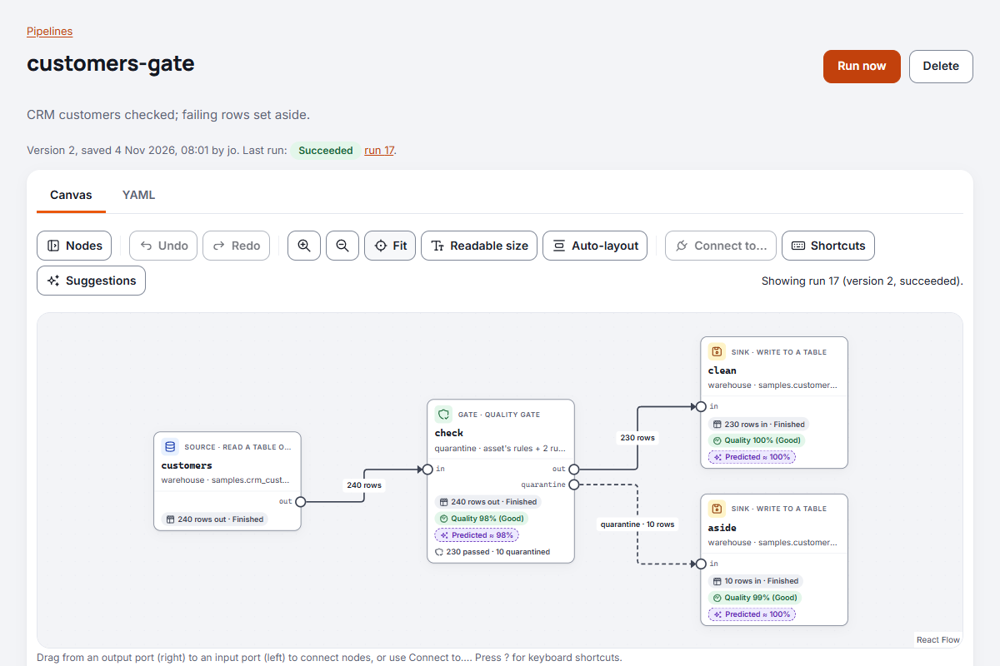
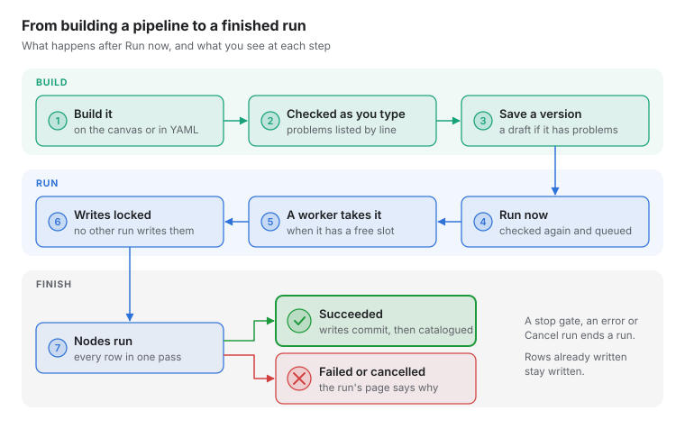
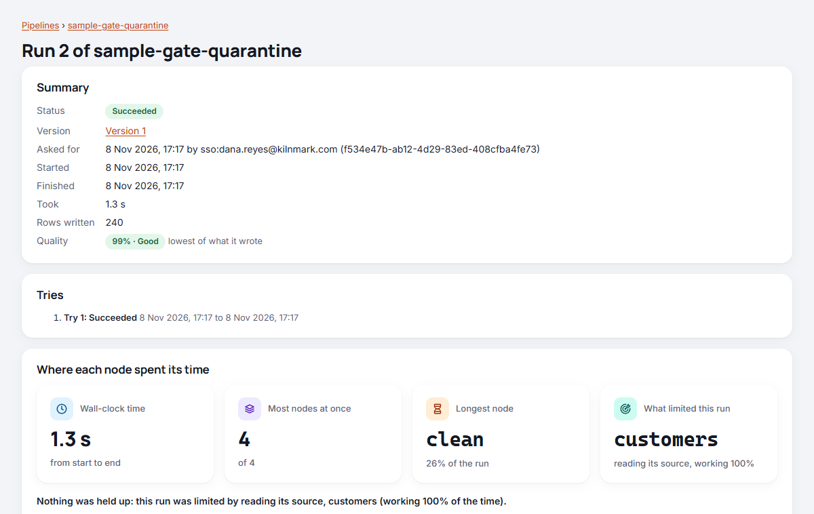

# Building and running a pipeline

This guide shows you how to build a pipeline in Kilnmark: where pipelines live, how their YAML is
written, how saving keeps every version, how to run one and how to read what a run did.

A pipeline reads rows from saved sources, changes them and writes them somewhere. Kilnmark checks
it as you write it, runs it on a worker, records every node, and adds what it wrote to the
catalogue with where it came from.

## Before you start

- **Your role.** Everyone signed in can see pipelines and their runs. You need the steward role or
  above to run them, and the designer role or above to add, change or delete them.
- **Sources.** Pipelines name saved sources; they never hold passwords. Add the sources first
  (see **Sources**), and scan the ones you read from, so Kilnmark knows their columns.
- **Writing needs permission.** Every source is read-only to pipelines until a designer or an
  admin turns on **Allow writing** for it: open the source, choose **Edit**, and set it on the last
  step.
- **Who does what.** Viewers read pipelines and their runs. Stewards also run them and cancel
  runs. Designers also build them: add, change, preview and delete pipelines and flows, add and
  change sources, turn on writing, and set server variables; they see values of columns marked
  sensitive, since they cannot transform data they cannot see. Admins also have the Settings
  pages. Only designers see sensitive values: admins, stewards and viewers see them masked
  ([ADR 0027](../adr/0027-unmasking-is-a-grant.md)).

## The Pipelines page

Choose **Pipelines** in the navigation. The list shows your team's own pipelines, each with its
description, its latest version (and whether that version has problems), and its last run with its
status in words: Queued, Running, Succeeded, Failed or Cancelled. Samples are not listed here: they
are in the [Library](library.md), and a line under the list says how many there are.

Stewards see **Run now** beside each pipeline; designers also see **From a template** and **New
pipeline** at the top.

## Starting a new pipeline

Choose **New pipeline**. The pipeline opens on the canvas with a template that reads the first 100
rows of a table or file from one of your sources and writes them to a source that allows writing:
the first of each that you have, by name. Where you have no such source yet, the template shows a
placeholder in angle brackets, such as `<your source>`, which the check reports until you replace
it with a source's name. To start from nothing instead, choose **Start with an empty canvas**;
**Start from the template** brings the template back.

1. Give the pipeline a **Name**: small letters, digits and dashes, such as `customer-billing`.
   The name cannot change once saved; the YAML's `name` line follows what you type.
2. Optionally give it a **Display name**, which is what people see.
3. Build it on the canvas (see [Building on the canvas](#building-on-the-canvas)) or change its
   YAML (see below), watching the problems list under both.
4. Choose **Save pipeline**.

## Samples and templates

Kilnmark's samples (small pipelines and flows, one idea each, with sample data to read) and its
templates (starting points for common jobs) are in the **Library**, apart from your own pipelines:
see [The Library: samples and templates](library.md). Added samples stay there, never on the
Pipelines page. On the Pipelines page, **From a template** opens the Library's templates.

A pipeline added from the samples shows **About this sample** under its name: what it shows, why it
matters, what to look for when it runs and what it needs, as the Library shows them, with a link to
this guide. Once the pipeline has been changed since it was added (more than moving its nodes), it
is labelled **Based on a sample; changed since**: what it says is about the sample as it was added.

## Building on the canvas



The **Canvas** and **YAML** tabs show the same pipeline: a change on the canvas rewrites only the
lines it changes in the YAML, so your comments, layout and every other setting stay exactly as
they were, and a change to the YAML redraws the canvas. Kilnmark remembers which tab you used last.

The canvas uses the page's full width. On the left is the node list, which **Nodes** in the canvas
toolbar hides and shows again; the pipeline fills the rest, with an overview in its corner for
finding your way around a large one. Nothing covers the canvas: under it is one panel of tabs,
which **Collapse** in its tab bar folds away to give the canvas more room (Kilnmark remembers which
you chose):

- **Settings**, for the selected node, and with no node selected the pipeline's own: **About this
  sample** for a pipeline added from the samples, and its **Parameters** (see
  [Parameters in the canvas](#parameters-in-the-canvas)). Selecting a node (a click, or moving to
  it with Tab or the arrow keys) shows its **Settings**, and the focus stays where it was. Enter or
  a double-click also moves you into the settings.
- **Preview**, for the selected node: there only while a node is selected. When the node whose
  settings or preview you were looking at is no longer selected, the panel shows **Run** if a run
  is going or Run was the last of the pipeline's tabs you looked at, else **Nodes**.
- **Run**: the run the canvas shows (the latest), with its status, when it started and how long it
  took, the rows read and written, and each node's rows in and out, time, peak memory, quality and
  error. While it runs it updates every two seconds. **Open run** goes to the run's own page, with
  its timeline and log.
- **Suggestions**, **Nodes** (the nodes as a table), **History** (every run), **Schedules** (the
  times it runs on its own; see [Running pipelines and flows on a schedule](schedules.md)) and
  **Versions**.

**Settings**, **Preview** and **Suggestions** need the canvas; **Run**, **Nodes**, **History**,
**Schedules** and **Versions** also work beside the YAML. A node you add shows its settings at once.

### Adding and connecting nodes

- **Add a node** by dragging its type from the list onto the canvas, or by choosing it: with a node
  selected, the new node is added after it and reads from it.
- **The node list** is in folders: Read, Write, Filter and route, Transform, Combine, Aggregate,
  Quality, AI and Other, each with how many types it holds, and **Recently used** first with the
  last five types you added. **Find a node** searches every folder at once (the folders with a
  match open by themselves). The list sits beside the canvas, which narrows to make room, so it never covers your nodes (on a phone it opens over the canvas). Folders
  holding the nodes your pipeline uses start open, and Kilnmark remembers in this browser which
  folders you open.
- **Each node** shows its type, its id, a line summing up its settings, its input ports on the
  left and output ports on the right, and how many problems it has. Hover over a node, or move the
  focus to it, to see the columns leaving it.
- **Connect nodes** by dragging from an output port to an input port. A connection Kilnmark cannot
  make is refused with the reason: a node reading from itself, a loop, or an input that already
  reads from another node (combine rows with a union node instead). A solid line leaves a node's
  main output, `out`; a line from any other output (a filter's or lookup's `rejected`, a gate's
  `quarantine`, a route's named routes) is dashed and labelled with that output's name.
- **One output feeding several nodes gives each of them every row.** Connect a node's `out` to an
  aggregate and to a write, and the aggregate totals all the rows while the write writes all of
  them. Rows are never shared out between the nodes. To send different rows different ways, say
  which way each goes: a **route** node sends each row down the first route whose condition it
  meets (and the rest through `out`), a **filter** keeps the rows meeting its condition and sends
  the others through `rejected`, and a quality gate can set failing rows aside through
  `quarantine`.
- **Remove a connection** with **Disconnect** beside it in the settings of the node it feeds, or
  click it and press Delete.
- **Move** a node by dragging it. **Auto-layout** lays the nodes out again from left to right.
  **Fit** shows the whole pipeline, however small that makes it, beside the overview in the corner,
  never under it; **Readable size** shows it at a size you can read, from its first nodes if it is
  too wide for that. The overview shows where you are: drag in it to move around. Auto-layout
  stacks the nodes that feed one node in the order of its inputs, so a join's `left` input sits
  above its `right` one and their connections do not cross.
- **Duplicate** copies a node with its settings and inputs; **Delete node** removes it and its
  connections. **Undo** and **Redo** step back and forward through your changes, including a burst
  of typing in the YAML tab and loading the latest version; they are off while the canvas cannot
  change the pipeline.

Where each node is drawn is kept at the end of the YAML, in a `layout` block. Kilnmark ignores it
when it runs the pipeline, so moving nodes never changes what a pipeline does, and **Run now** does
not ask about unsaved changes that only move nodes (saving them suggests the message "Moved
nodes"):

```yaml
# Where the canvas draws each node. Kilnmark ignores this when it runs the pipeline.
layout:
  customers: {x: 40, y: 120}
  tidy: {x: 320, y: 120}
```

### Settings

Select a node to see its settings. Each has its help and, where there is one, its default; a
setting left at its default is left out of the YAML. Designers and admins change a pipeline;
viewers and stewards see its canvas and settings read-only.

- On and off settings are switches; numbers, choices and text are fields and lists.
- **Source** lists your saved sources; for a write, those that do not allow writing say so.
  **Table or file** suggests the tables and files of the chosen source.
- Column settings offer the columns arriving at the node, as the last check worked them out, so
  you choose rather than type. Before the columns are known you can type names.
- Expressions (a filter's condition, computed columns, aggregate values, routes) have the arriving
  columns as buttons below them: choosing one puts its name where the cursor is. A condition or a
  read's **Where** also has the pipeline's parameters as `${name}` buttons.
- Each `${name}` says what it is when you point at it or move to it with Tab: a parameter's type,
  default and description, such as "statuses: text list, default delivered. The order statuses to
  keep."; a server variable (`${vars.name}`) that it is one, and its value now if you are a steward
  or above. Escape hides it. A setting that puts in a parameter or variable, such as a write's path
  `orders_${label}.csv`, lists them under its box the same way, also when you can only read it.
- A filter's condition, a read's **Where**, a route's conditions and a compute's columns also have
  the operators as buttons, in groups (**Compare**, **Test**, **Combine**, **Arithmetic**), which
  go in where the cursor is, and **How to write it**: the operators, how to nest a test in brackets
  (`and` binds tighter than `or`), worked examples, and a link to
  [Expressions](expressions.md#operators). It starts open when a condition the node needs is still empty, and folded otherwise.
- A `read` node shows **SQL Kilnmark runs** under its **Query** box, read-only: the statement it
  sends to the database for the table, columns, **Where** and row limit chosen, with a `?` for each
  value of **Where**, bound as it runs. The server works it out as a run sets the read up, from the
  table as last scanned, so it is the SQL that runs, with the pipeline's parameters at their
  defaults (a run given other values may read another table). A file, a table not yet scanned, or a
  generic JDBC source, which writes its SQL once connected, says why there is none. The **Query**
  box itself, for SQL of your own ([Reading with a query](#reading-with-a-query)), can be changed
  only by a designer whose token may see unmasked values; everyone else sees it read-only, with
  why. A designer who may not write a query cannot save or preview a pipeline while a read has one,
  and can choose **Remove the query** to read a table instead.
- **Columns leaving this node**, beside the settings, lists each output (out, and rejected or
  errors where the node has them) with its columns and their types. An output with more than ten
  columns starts folded: choose its name to open it.
- A write node shows the settings of its source's writer, such as **Commit every N rows** for a
  database or **Overwrite** for files, once you choose the source.
- **Node id** renames the node, and the nodes reading from it follow.

Problems the check finds show on the node (as a count), under the setting they are about, and in
the problems list under the canvas. Choosing a problem in the list selects its node and moves to
the setting. If the YAML cannot be read at all (a typing mistake in the YAML tab), the canvas shows
the last pipeline that could be read, does not let you change it, and says so; fix the YAML to go
on.

### After a run

Once a run has finished, each node on the canvas shows the rows it passed on and how it ended
(Finished, Ended early, Stopped by the engine or Failed), and each connection its rows. Each write
and each quality gate also shows its measured quality, as a percentage and a word (Good, Fair or
Poor), and a gate what it did with the rows, such as "900 passed · 100 quarantined" (see
[Quality gates](quality-gates.md)), beside the score Kilnmark predicted for it (see
[Predicted quality](quality-gates.md#predicted-quality)). The nodes table under the canvas, and the node's settings panel
with its score per dimension and each rule's result, say the same in words.

Each kind has its own look, and its own words, so none depends on colour: the rows (and
"Finished") in a grey chip with a rows icon, with Ended early, Stopped or Failed in a chip of its
own; the measured score in a solid chip with a gauge icon, green, amber or red as its word says;
the prediction in a violet chip with a dashed edge and a sparkles icon, **Predicted ≈ 97%**, as it
is an estimate; and a gate's counts as plain text. Each is on a line of its own.

The canvas makes room for these lines and for the connections' labels: where a layout saved before
the run is too tight, it moves nodes apart on the screen only, and the YAML's `layout:` stays as it
was. **Auto-layout** saves a layout with room for them, and moving a node saves where it is shown.

**While a run goes**, the canvas looks again every two seconds. Each node shows its rows so far
and how many it is handling a second ("19,814 out · 8,351 rows/s"), or "Waiting for rows", and
each connection the rows that have crossed it. The node holding the run back says **Slowest**, in
a chip of its own with an hourglass, and has an orange edge: rows are queuing in front of it while
the nodes after it keep up, so it is the one to look at first (a slow query in a `read`, a
`lookup` against a large table, a `write` to a busy database).

**Run now** runs the saved version. If you have changes that are not saved, Kilnmark says so first
and asks you to confirm; save them to run them.

### Preview a node

To see the rows leaving a node before you run anything, right-click it (Ctrl+click on a Mac) and
choose **Preview rows**,
or select it and open the **Preview** tab in the panel under the canvas. From the keyboard, press Shift+F10
(or the menu key) on a node for the same menu. For a node with more than one output, such as a
quality gate's **out** and **quarantine** or a filter's **out** and **rejected**, choose the
**Output**; choose how many **Rows** to see (100 unless you choose another number, at most 1,000).

The preview runs the pipeline as it is on the canvas, saved or not, but only the node and the nodes
before it. Nothing is written: writes never run in a preview, and a gate's quarantined rows go
nowhere. It shows the columns with their kinds, the rows, and how long it took. Each node before it
stops as soon as the preview has its rows, so a preview of a large table is quick, unless a node
before it has to read all its rows first: an aggregate, or a lookup's lookup side. The preview then
says so, and a preview stops after 30 seconds. To try such a pipeline out, set a **Row limit** on
the read node for a while.

Previews follow the same rules as previewing a source:

- They are for designers and admins. Each person runs one preview at a time and up to six a minute,
  and a server runs two at once. A preview runs at most 50 nodes, 10 of them reads; a node that holds
  rows (an aggregate, a dedupe, a lookup or a union) is given a share of the preview's memory,
  whatever its own `memory_limit_mb` says.
- Sources are reached as a run reaches them, with their saved credentials and the allowed hosts.
- Columns marked sensitive can pass through a preview, kept, renamed or carried along, and are
  masked (••••) for everyone but designers, admins included. For them, no node before the one you
  preview may look at their values: a calculation or condition that uses one, a cast, a group,
  dedupe or lookup key on one, or a quality gate with a rule on one. For them such a preview is
  refused, and says which node and column, because the rows shown, a value worked out from it, or
  even whether the preview works, could give the values away. Preview the node before it, or ask a
  designer.
- When a node fails, its message may quote values from the rows; if anything read has columns
  marked sensitive, only designers see it, as with a run's errors.

The rows are read when you ask and not kept. After you change the pipeline, the preview says it is
out of date; choose **Preview again**.

### Using the keyboard

Everything on the canvas can be done without a mouse. Press Tab to move from node to node (each
node is described when it gets the focus), and on to the panel under the canvas. Press `?` on the canvas for this
list:

| Keys | What they do |
| --- | --- |
| Tab, Shift+Tab | Move between nodes, and on to the panel under the canvas |
| Arrow keys | Move to a connected node: right to the next, left to the one before; up and down to the node above or below |
| Shift+arrow keys | Move the node on the canvas |
| Alt+arrow keys | Pan the canvas |
| A | Open the node list at **Find a node**; type, Tab to the type and press Enter to add it after the selected node |
| Arrow keys in the node list | Up and down through the folders and nodes; Right opens a folder, Left closes it; Enter adds the node |
| C | **Connect to…**: a list of the nodes this node can send rows to or read rows from |
| Enter | Open the node's settings and go to them (a double-click does the same) |
| Shift+F10 or the menu key | The node's menu: **Preview rows**, **Settings**, **Connect to…**, **Duplicate**, **Remove** |
| Delete or Backspace | Remove the node (or a connection you clicked) |
| Ctrl+D | Duplicate the node |
| Ctrl+Z; Ctrl+Shift+Z or Ctrl+Y | Undo; redo |
| + and - | Zoom in and out |
| F | Fit the whole pipeline in view |
| R | Readable size |
| L | Lay the nodes out again |
| Escape | Clear the selection, or close a list |

On a Mac, use Cmd for Ctrl. These keys work on the canvas and its tools, not while you are in the
panel under the canvas or the node list; in its tab bar, the arrow keys, Home and End move between
its tabs. Connections are not in the Tab order: remove one with **Disconnect**
in the settings, and add one with **Connect to…**. What each change did is announced to screen readers, the nodes are
also listed as a table under the canvas, and the canvas does not animate when your system asks for
reduced motion.

## YAML basics

A pipeline starts with the format line and its name, then lists its nodes:

```yaml
kilnmark: pipeline/v1
name: customer-billing
description: Monthly spend per customer.
nodes:
  - id: customers
    type: read
    source: sales-db
    asset: crm.customers

  - id: spend
    type: write
    input: customers
    source: warehouse
    table: billing.customer_spend
    mode: replace
```

- Each node has an **id** (small letters, digits, `-` and `_`) and a **type**. The other keys are
  the node's settings.
- An optional `quality:` block sets the pipeline's quality threshold (see
  [Quality of what a run writes](quality-gates.md#quality-of-what-a-run-writes)).
- **input** says which node feeds this one: `input: customers` takes that node's main output.
  `input: joined.rejected` takes another output port, here the rows a lookup could not match.
  A node with several inputs names each one: `inputs: {main: spend, lookup: customers}`.
- Nodes can be listed in any order; the inputs decide the order of work.
- A key Kilnmark does not know is a problem, with its line, so typing mistakes are caught early.
- Comments start with `#`.

### Reading

The `read` node takes `source` (a saved source's name) and `asset`: a table or view as
`schema.table`, or a file's path inside the source. `row_limit` reads only the first rows, which
is handy while you try a pipeline out; 0 reads them all.

`columns` and `where` read only what you need:

```yaml
  - id: orders
    type: read
    source: sales-db
    asset: shop.orders
    columns: [order_id, customer_id, status, shipping_fee]   # in this order; leave out to read all
    where: "status in ${statuses} and shipping_fee >= ${min_fee}"
```

- `columns` lists the columns kept, in the order you want them. On the canvas, tick them in the
  read node's **Columns** list, which shows each column of the table with its type; the order you
  tick them in is the order they come out.
- `where` is a condition, written as in a `filter` node. It may use any column of the table, chosen
  or not, and the pipeline's parameters as `${name}`. The canvas offers both as buttons under the
  box. A parameter's value always goes in as a value, never as part of a name.
- With `where`, `row_limit` counts the rows that meet the condition.
- **Who does the work.** For a database table, Kilnmark asks the database to do as much of the
  `where` as it safely can, so fewer rows travel; each value is sent separately from the SQL (bound),
  never written into it. Kilnmark then checks every row against the whole condition anyway, so the
  rows are the same whichever does the work, even where the database compares text differently
  (ignoring case, say). Text compared with `=`, `in` or `like`, numbers, dates and true/false go to
  the database; functions such as `lower(...)`, date-times (time zones differ) and arithmetic stay with
  Kilnmark. So do columns the database stores differently from how Kilnmark reads them, such as
  JSON, spatial or uuid columns read as text. Files, and sources added through a generic JDBC
  driver, read every row and Kilnmark applies `where`.
- The read node's note, under its settings on the canvas and with the check's notes on the YAML
  tab, says which: "applied by the database while reading", "applied in part by the database"
  (naming what Kilnmark does), or "applied by Kilnmark as the rows arrive".

The samples `sample-read-columns-where` and `sample-orders-by-status` show both (see
[The Library](library.md#samples)).

#### Reading with a query

On a PostgreSQL source with **Allow SQL** on, a read can run one `SELECT` in place of a table:

```yaml
  - id: accounts_per_customer
    type: read
    source: crm-db
    query: >-
      SELECT c.customer_id, c.segment, count(a.account_id) AS accounts
      FROM crm.customers c LEFT JOIN crm.accounts a ON a.customer_id = c.customer_id
      GROUP BY c.customer_id, c.segment
    row_limit: 1000
```

- A read gives `asset` or `query`, not both. `columns` and `where` do not go with a query: choose
  the columns and rows in the SQL. `row_limit` does, and the database stops at that many rows.
- The query is checked as custom SQL rules are (see [Quality rules](quality-rules.md)): one
  `SELECT` or `WITH`, no `;` between statements, nothing that writes, and no function that reaches
  outside the query, such as reading files or other databases. It runs on a read-only connection,
  and not at all when the source's login is a superuser or may read the server's files.
- Parameters (`${name}`) are not filled in a query yet; write the value in the SQL.
- Its columns are known only when it runs, so the nodes after it are checked against them then.
- Only a designer who may see unmasked values saves or previews a pipeline with a query, since a
  query can read any column the login can. Others, admins included, can run it. On the canvas, the
  **Query** box is read-only for them, and says why.
- Every column the query returns is treated as marked sensitive, since a query can read any table
  its login can: masked for everyone else, and marked on what a write writes from it. A run's error
  messages are held back the same way. Once someone has checked that what was written holds nothing
  sensitive, an admin can clear its marks.
- Each run records the tables the query reads, as the database plans it, so lineage shows them as
  the inputs of what the pipeline writes.

The sample `sample-read-query` shows one; adding the samples skips it unless `crm-db` is a
PostgreSQL source with Allow SQL on.

### Writing

The `write` node takes `source` and where to write: `table` for a database, `path` for a file
(or `target` for either). Files also take `format`: `csv` or `parquet`.

`mode` says what happens to what is already there: `create` (the default), `append`, `replace` or
`upsert`. A write node also takes the settings of the source's writer, such as `commit_every` for
large table writes or `compression` for Parquet; a setting the source's writer does not take is a
problem, with its line. The modes, the writer settings and the rights each needs are in
[Writing data from a pipeline](writing-data.md).

The nodes between reading and writing (filter, compute, select, lookup, join, aggregate, union,
dedupe, route, limit, sort and window), and the gate, are in
[Reference: pipeline nodes](reference-pipeline-nodes.md), with every setting, its type and default,
and an example; the language their conditions and columns use is in [Expressions](expressions.md).
The node catalogue (`GET /api/v1/node-types`) lists every type this server has, with the settings
each takes.

## Parameters and server variables

A pipeline can take values when it runs, so one pipeline serves many runs: the orders in a status,
the rows since a date, a file named after the run. There are two kinds of value, written in two ways:

| | Parameter | Server variable |
| --- | --- | --- |
| What it is | An input the pipeline (or a flow) declares, like a function's argument | A value of the server, the same for every pipeline and flow on it |
| Where it is set | In the YAML: `parameters:`, each with a type and a default | On the server, by a designer or admin (`/api/v1/variables`) |
| Written as | `${status}` | `${vars.target_schema}` |
| Changes | With each run: whoever runs it, or the flow running it, can give another value | When the environment does: a new schema, another bucket |
| Kinds | text, number, boolean, text list, number list | text, number, boolean |

The same YAML runs unchanged on a test server and on the live one: each server holds its own
variables, and each run its own parameter values.

### Declaring parameters

```yaml
parameters:
  statuses: { type: text list, default: [delivered], description: The order statuses to keep }
  min_fee:  { type: number, default: 0 }
  label:    { type: text, default: "${vars.default_label}" }
nodes:
  - id: wanted
    type: filter
    input: orders
    condition: "status in ${statuses} and shipping_fee >= ${min_fee}"
  - id: out
    type: write
    input: wanted
    source: warehouse
    path: orders/${label}.csv
```

- Every pipeline parameter has a default, so the pipeline also runs on its own. A default may be a
  server variable, as `label`'s is: the variable's value, unless the run gives another.
- Names start with a lower-case letter and use a-z, 0-9 and `_`. `and`, `or`, `not`, `true`,
  `false`, `good`, `fair` and `poor` are taken.
- Inside `{ }`, write a value that is `${...}` in quotes: YAML reads `{` as the start of a mapping.

### Where a value can go, and how it goes in

A parameter fills a value, never anything else. It can never choose what a node reads or writes
to: not a node's type, its inputs, its source, its table or file to read, its columns or a choice,
nor another node (`rules_from`).

| Setting | How the value goes in | Example |
| --- | --- | --- |
| An expression (`condition`, `columns` of compute, `routes`, ...) | As a value of the expression language: text in quotes, a number as a decimal, a list as `('a', 'b')` | `status in ${statuses}` becomes `status in ('delivered')` |
| Where a write goes (`table`, `path`) | As part of the last name only, beside text the pipeline writes there, holding only letters, digits, `_` and `-`: the pipeline fixes the schema or folder and the rest of the name | `orders/${label}.csv`, `sales.orders_${region}` (not `${table}`, `${folder}/x.csv` or a value with `.` or `/`) |
| Other text (`delimiter`, ...) | As text, holding only letters, digits, spaces, `_`, `-` and `.` (never `..`) | `delimiter: ${sep}` |
| A number or true/false (`rows`, `max_failing_share`, `strict`, ...) | As the whole value | `rows: ${limit}` |

- In an expression, write `${status}` without quotes: it goes in quoted already, and quoting it
  again is a problem. A value can never become part of the expression: `x' or 1=1` is compared
  as that text. Nor can it join a name: `amount_${year}` is a problem (put a space or an operator
  between them), so a value never chooses a column.
- A number goes into an expression as a decimal (`10` as `10.0`), so what the expression works out
  has the same type whatever the value. Numbers have at most 15 digits before the point and 30 in
  all; a list has at most 200 values (and an expression, lists included, at most 10,000 characters).
- `$${` writes a plain `${`. A pipeline with no parameters that names no server variable keeps
  `${...}` as plain text, as before.
- Everything is checked with the values the run will get: a wrong kind (a number where text is
  compared), an unknown name (with the closest suggested) or a value that does not fit is a problem
  before anything runs.

### Parameters in the canvas

With no node selected, the **Settings** tab under the canvas shows the pipeline's own settings. Its
**Parameters** table lists each parameter the pipeline declares: its name, type, default,
description, and the nodes that put it in with `${name}`.

Designers and admins change them there:

- **Add a parameter** asks for its name, type, default and, if you like, a description. **Change**
  and **Remove** are on each row.
- They are checked as the server checks the YAML: names start with a small letter and use a-z,
  0-9 and `_`; the words conditions use (`and`, `or`, `not`, `true`, `false`, `good`, `fair`,
  `poor`) are taken; every parameter needs a default that fits its type, or a server variable
  written as `${vars.name}`; lists are separated by commas.
- Each change is written to the YAML as you would write it by hand: only that parameter's line
  changes, written on one line as the others are, and **Undo** takes it back. The first parameter
  starts a `parameters:` block under the description; removing the last removes the block. A
  default you leave as it is when you change a parameter is written back exactly as it was.
- Renaming or removing a parameter does not change the nodes that put it in: the check then names
  them, and the panel says which.

Viewers and stewards see the table read-only.

### Running with values

On the pipeline's page, **Run now** on a pipeline with parameters opens the **Run** tab under the
canvas, with a field for each parameter of the saved version, filled with its default. Change what
you need and choose **Run with these values**: a field left as its default, or empty, runs with the
default (for a default that is a server variable, the variable's value), and lists are separated by
commas. Only the values you changed are sent, with the version whose parameters were shown, so
they never go to a version someone saved since. A value of the wrong kind is caught before anything
is sent; anything the server refuses, such as a value that does not fit, is shown beside the fields.
**Back to the defaults** fills them in again. On the Pipelines page, **Run now** runs with the
defaults. Through the API, give values in the run's body:

```
POST /api/v1/pipelines/orders-by-status/runs
{ "parameters": { "statuses": ["shipped", "delivered"], "label": "both" } }
```

A run keeps the values it started with, its parameters and the server variables as they were when
it was queued, and uses those however the variables change before it runs. A value of the wrong
kind, or a parameter the pipeline does not take, is refused at once.

### Server variables

Designers and admins set them with `PUT /api/v1/variables/{name}` (`{ "type": "text", "value":
"sales_prod", "description": "..." }`) and delete them with `DELETE`; everyone with the steward role
can list them. Every change is kept, with who made it and when, also after a variable is deleted
(`GET /api/v1/variables/{name}/changes`). There is no page for them in the app yet: use the API.

Server variables are never secrets: they are shown to stewards and recorded with every run. A name
that looks like a credential (`password`, `token`, `secret`, `api_key` and the like) is refused.
Passwords and keys belong in a source, which holds them encrypted.

## Quality gates

A `gate` node checks the rows passing through it against quality rules, in the same pass that moves
them, and stops the run, sets failing rows aside or lets them through with a warning. Every run
also measures the quality of what it writes, and Kilnmark predicts it before the run. All of this is
in [Quality gates](quality-gates.md).

## Checking as you type

A moment after you stop typing, or after a change on the canvas, Kilnmark checks the pipeline.
Under the canvas or the editor it says how many problems it found, and lists each one with its line
and the node it is about. In the editor, lines with a problem are marked with `!` beside their
number.

- **Choose a problem** to move the cursor to its line (on the canvas: to select its node).
- **Notes** do not stop a run. For example, a table that has not been scanned yet has columns
  Kilnmark only learns when the pipeline runs.
- In the editor, Tab indents by two spaces. Press Escape and then Tab to move on to the next
  control.

Beside the YAML, **Nodes** draws the pipeline as a read-only graph: each node with its input ports
on the left and output ports on the right, and lines from port to port. Hover over or move the
focus to a node to see the columns leaving it. The **Nodes** tab of the panel under it lists them
as a table in words; choose a node's id there to go to its line (or, on the canvas, to select it).

## Saving versions

Every save keeps a new version; earlier ones never change.

1. Say what you changed under **What changed**, such as "Drop test customers".
2. Choose **Save new version**.

A pipeline with problems can be saved as a draft, so you can come back to it, but it cannot run
until they are fixed.

If someone else saved a version after you opened the page, Kilnmark refuses your save rather than
undo theirs unseen. Your changes stay on the page. **Show my version in the YAML tab** shows them as
text; **Load the latest and keep mine as an undo step** loads the latest version in their place,
and **Undo** brings yours back, to compare or to make your change again.

The **Versions** tab, under the canvas, shows every version with who saved it, when and why. Open one to see its
YAML exactly as it was saved.

## Running a pipeline



Choose **Run now**, on the Pipelines page or the pipeline's own page. Kilnmark checks the latest
version again first, since a source may have changed, then queues the run for a worker. The run
appears in the **History** tab, under the canvas, as Queued, then Running, and the panel shows the
**Run** tab, following the run as it goes.

A run uses the version that was latest when you asked, even if someone saves another while it
waits. A pipeline with parameters asks for their values first, in the **Run** tab, filled with
their defaults; see [Running with values](#running-with-values).

To stop a run, open it and choose **Cancel run**. A queued run is cancelled at once; a running one
stops within a few seconds. Rows already written stay written.

To run a pipeline at set times, such as 02:00 every weekday, give it a schedule in the
**Schedules** tab under the canvas (designers and admins): see
[Running pipelines and flows on a schedule](schedules.md). The line under the pipeline's name says
when it next runs on a schedule. A run a schedule started shows `schedule <id> (set by <name>)` as
who asked for it. Deleting a pipeline deletes its schedules.

To run a pipeline from your organisation's scheduler (Control-M, AutoSys, cron, Windows Task
Scheduler), so that the job waits for the run and ends with its outcome, see
[Running from an external scheduler](external-schedulers.md).

### Sources that take a few runs at a time

A source can say how many runs may use it at once, so a busy production database has a cap its
administrators agree to. The cap counts runs, not database sessions: one run may open a few
connections to the source (a read and a write, say), and previews, scans and quality checks are not
counted. Open the source, choose **Edit**, and on the
last step set **Most runs at once** (1 to 100; leave it empty for no limit). Designers and admins
can change it, and each change is in the [audit log](audit-log.md).

A pipeline run counts once against every source it reads or writes, and a flow's `sql` node against
its source. Scans and quality checks do not count: a source is scanned once at a time anyway.

A run whose source is full waits in the queue. It stays **Queued**, and its page says
"Waiting for a free place on source warehouse. The run starts by itself when another run using the
source ends." Waiting is not failing: the run starts when a place is free, and its one attempt is
not used. A run that uses several sources takes a place on all of them or none, so two runs never
hold up each other. You can cancel a waiting run as any queued run.

Lowering the limit stops no run already going: those above the new limit finish. Until they have,
new runs fill only the places below the new limit, so for a while up to the old limit may run at
once. A limit of 1 makes the runs that use the source take turns.

A run that has waited goes before runs queued after it: when a place is freed, the waiting runs
are looked at again at once, oldest first. This is not a strict queue: a run queued at the moment a
place frees can still take it first.

## Trying a run again

A pipeline's `run:` block tries a failed run again, from its beginning. Use it for failures that
pass on their own: a database restarting, a network drop, a target another run was writing.

```yaml
run:
  retries: 2          # 2 more tries after a failed one; 0 to 5
  retry_delay: 5m     # wait 5m, then 10m; 10s to 1h, each wait at most 1h
  retry_on: any       # any (the default), or lost: only a run lost with its worker
  timeout: 2h         # each try; 90s to 7d
  warn_after: 1h      # tell the owners once if it is still going; less than timeout
```

- **Every write must replace or upsert.** A try again writes again from the beginning, so saving
  refuses `retries` on a pipeline with a `write` that appends or creates its target ("every write
  must replace or upsert: out appends"), whatever `retry_on` says: a worker that stopped may have
  written too.
- **A retry is a new try of the same run.** While it waits the run shows **Retrying** in the
  History tab, and its page says "Retrying: try 2 of 3, next at 14:05". It holds no worker. A
  schedule never fires twice for it; `kilnmark-run` waits across the tries and ends with the last
  one's outcome. Each wait doubles, is at most an hour, and has a little added at random, so runs
  that failed together do not all come back at the same moment.
- **What is never tried again**: a cancel; a version that cannot run, or a run refused as it is set
  up; a quality gate that stopped the run, which would stop it the same way; and a try that would
  start after the schedule's next fire. Tried again: an error, a lost worker or connection, a
  timeout, a source that could not be reached.
- **Nobody is told about a try that is tried again.** After the last try, one **Pipeline run
  failed** goes to the pipeline's owners and to those who chose it, saying how many tries were made
  and why no more. When a run then succeeds, **Pipeline run recovered** is told. See
  [Owners](#owners).
- The run's page lists each try under **Tries**, and the History tab says "Succeeded on try 2". A
  later try's nodes, quality and charts replace the earlier try's; the log keeps every try.
- A run that a flow node starts never uses these: the node's own `retries` decide
  ([Building and running a flow](flows.md#trying-a-whole-run-again)).
- A pipeline starts again in full: there is no Run again from the failure for one. To carry on
  part-way, make its stages the nodes of a flow.

## Owners

Each pipeline has **owners**: the people, or team addresses, who answer for it. They are told when
its run fails after its last try, when it runs again successfully after a failure that was told,
and when a run takes longer than its `run: warn_after`. The pipeline's page shows them under
**Owners**, and designers and admins choose **Change owners**. Who can be an owner, and how they are
told, is in [Owners of pipelines and flows](notifications.md#owners-of-pipelines-and-flows).

## Reading a run



Open a run from the **History** tab. The page updates itself until the run ends, and says when its
status changes.

- **Summary:** the status, the version that ran, who asked, when it started and finished, how long
  it took and how many rows its writes received. A failed run says why, naming the node where the
  failure started.
- **The run at a glance:** four tiles: its **wall-clock time**, the **most nodes at once**, the
  **longest node** (while it runs, the slowest node now) and **what limited this run**. Every time
  on the page counts from when the worker started on the run, by the worker's own clock.
- **Where each node spent its time:** one bar per node, its whole time from start to end split into
  **Working** (solid), **Waiting for rows** (light hatching: the nodes before it had nothing for it)
  and **Held up by the next node** (amber cross-hatching: the node after it was not keeping up, so
  there was no room to hand rows on; this is back-pressure). At the right, how much of its time it
  was working and what it did: a gate's verdict (Passed, Quarantined 229, Stopped the run), a
  write's measured quality (Quality 99% (Good)), else its rows. Above the bars one line says **what
  limited this run**: of the nodes that others were held up by, the one working the largest share
  of its time, such as "What limited this run: check, working 90% of the time". When nothing was
  held up it says the run was limited by reading its source. Speed that node up (a simpler rule, a
  smaller lookup, a faster target) and the run gets faster; speeding up the others does little.
  **Show where each node spent its time as a table** gives the same in words. While the run goes
  this is drawn from its latest progress.
- **Run timeline:** the run on one time line, as a Gantt chart. One sentence says when it started,
  how long it took and how it ended. The run's own row comes first, then a bar per node from its
  start to its end, lighter while it waits for its first row, so nodes working at the same time
  overlap; its time is at the end of its bar, and a gate's verdict
  or a write's quality beside it. **Show the critical path** colours the bars of the nodes that held the run's
  end back (it is off at first, to keep the chart plain). **Choose a row** for everything recorded about that node below the chart: its type, how
  it ended, its start, first row, last row and end, its share of the run, rows in and out, peak
  memory, quality and error. **Show the timeline as a table** gives the same as figures.

  
- **Rows per second through the run:** a line per node of the rows it handled each second, from
  the snapshots taken every two seconds, with its peak at the right. Under it, an amber band shows
  how full its output queue was (**Held up**: the taller and stronger, the fuller; full means the
  node was waiting for the next one), and the words "output queue full 78% of the time". Numbered
  marks on the time axis show the run's warnings and errors, and a gate starting to set rows aside,
  listed under the chart. Point at a line, or focus it and use the arrow keys, to read the time,
  rows a second and how full the queue was at that point. **Show rows a second as a table** gives
  each node's peak, average and how often its output queue was full.
- **Nodes:** for each node, how it ended (Finished; Ended early, as a `limit` does once it has its
  rows; Stopped by the engine, because another node failed or the run was stopped; or Failed), the
  rows that came in and went out, with the count on each port when a node has several (for
  example, a filter's `out` and `rejected`), the most memory it held, how long it took and its
  share of the run's time, and its error if it failed. A write that was stopped wrote nothing, unless
  it used `commit_every`. While the run goes, the table shows each node's rows so far and rows a
  second instead.
- **Log:** what happened, in order: the run starting, each node starting, its first row in and
  out, its last row out and how it ended, a gate starting to set rows aside and its verdict ("Gate
  check quarantined 229 rows (email format: 229)", the rules that failed and their counts; a rule's
  own message, which can quote the data, is its detail), what a node says about its own work (a
  sort, a join or a window that ran out of memory and carried on on disk says how much it wrote), warnings
  and errors, and the run's notes.
  The log is read again from the start when the run ends, so nothing written at the last moment is
  missed. Choose a node,
  or **Warnings and errors** or **Errors only**, to narrow it, and **Download as text** (or
  **NDJSON**, one JSON object a line) to save it with the same choices. Where the engine's own
  message could quote values from your data, it shows only to those who may see why the run
  failed (stewards and above, or only designers when the run touched columns marked sensitive); others see that it
  was held back. A run keeps up to 10,000 events; the log says if it was cut short.
- **What it wrote:** each table or file a write node wrote, with its mode and rows. Choose one to
  open it in the catalogue.
- **Lineage:** which assets each written asset came from.

## What Kilnmark records about what you write

When a run succeeds, each table or file it wrote is added to the catalogue, or updated there, as a
scan would add it: its columns, and for `create`, `replace` and files its row count and the
profile of each column, which the write measures as it writes the rows, so its quality scores
update too. The source's own rules on keeping example values apply. An `append` or `upsert` adds
to what was there, so Kilnmark records how many rows the run wrote and leaves the table's columns,
row count and profile as its last scan found them; scan the source to refresh them. If a profile
could not be made, the write still counts and the run says so.

Kilnmark also records the lineage: the written asset came from the assets the pipeline read. It is
kept even if the pipeline is later deleted, so the next pipeline that reads the written table
starts from what is known about it.

**Marks follow the data.** A column the run writes from a column marked sensitive is marked
sensitive where it is written too, whoever ran it and however the run ended: a column passed on
or renamed, looked up, or worked out from one (a computed column, an aggregate's value or group).
So it is masked there for everyone but designers, as it was where it came from, even before the
written table is catalogued. A column made only from unmarked columns is not marked. When a node
works on marked columns in a way Kilnmark cannot follow, every column it writes is marked, also
columns it adds later; that mark is cleared as a whole, not one column at a time. Marks
match column names ignoring case. Where a source, table or path comes from a parameter, the marks
land on what the run actually wrote with the values it used. Only an admin
can clear a mark. A path a write writes to is written as the source lists it (`/` between
folders, no empty or `.` folders), so what is recorded about it is found again.

Messages never include a source's password, and pipelines connect only to the hosts your
administrator allows.
