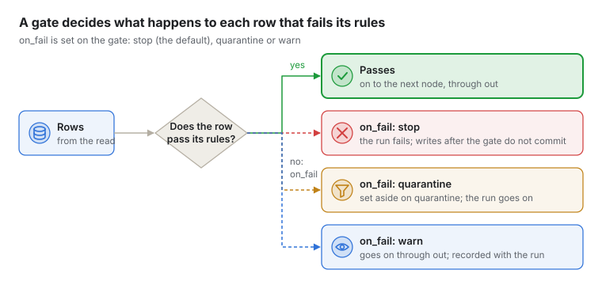

# Quality gates

A `gate` node checks the rows passing through it against quality rules, in the same pass that moves
them: nothing is read twice. Its rules are

- **the asset's own rules**: the enabled rules of the table or file read upstream, as stewards set
  them in **Quality** (on unless you set `asset_rules: false`). When rows reach the gate from more
  than one read node, name the one whose rules apply with `rules_from: <read node id>`;
- **rules written on the gate**, for this pipeline only, under `rules`.

Rows a node cannot work out at all (a cast that does not fit, a division by zero) are another
matter: see [Rows that fail](rows-that-fail.md). Each setting of the gate node is in
[Reference: pipeline nodes](reference-pipeline-nodes.md#gate).

```yaml
  - id: check
    type: gate
    input: customers
    on_fail: quarantine          # stop (the default), quarantine or warn
    rules:
      - {type: not_null, field: email}
      - {name: known country, type: allowed_values, field: country, values: [GB, IE, FR]}
      - {type: in_range, field: amount, min: 0, max: 10000, fail_above: 0.01}
    max_failing_share: 0.05      # stop the run if more than 5% of rows fail a rule

  - id: good
    type: write
    input: check                 # the rows that passed
    source: warehouse
    table: crm.customers_clean
    mode: replace

  - id: aside
    type: write
    input: check.quarantine      # the rows that failed
    source: warehouse
    table: quarantine.customers
    mode: append
```

On the canvas, the gate is in the **Quality** folder, with two outputs: `out` and `quarantine`. Its
settings panel lists the rules written on it, each with its check, its column and the check's own
settings.

## Writing rules on a gate

Each rule has a `type` and, except for checks of the whole data, a `field` (a column arriving at the
gate). The checks and their own settings are those of rules made in **Quality**, written in
`snake_case`: every type a gate takes, with its keys and an example, is in
[Reference: quality rules](reference-quality-rules.md).

- Empty values pass every check but `not_null`.
- Every rule may also have a `name` (by default its column and type, such as "email not null"), a
  `dimension`, and its own limit: `fail_above` is how many rows may fail before the rule fails, 0
  when left out, so any failing row fails the rule. `warn_above` makes the rule warn below that.
- Rules that run in a database, `references` and `custom_sql`, cannot check rows in a pipeline;
  make them rules on the asset instead.
- A gate counts only the repeats of a key as failing for `unique`, so its count, its result, its
  score and the rows it sets aside agree. How many keys it can remember is in
  [unique](reference-quality-rules.md#unique).

## What happens when rows fail



`on_fail` decides:

| `on_fail` | Rows | The run |
| --- | --- | --- |
| `stop` (the default) | All go on to `out` | Fails when any rule fails by its own limit, or a threshold below is crossed. It stops as soon as a rule cannot pass any more (a failing row where none may fail, or more failing rows than its count allows); otherwise when the rows end. The writes after the gate have not reached the end of their rows, so they do not commit. |
| `quarantine` | Rows failing any rule go to `quarantine`; the rest to `out` | Goes on, unless a threshold below is crossed, or a check of the whole data (row count, freshness) fails: no row can be set aside for that. |
| `warn` | All go on to `out` | Goes on whatever fails. What failed is recorded with the run. |

A stop gate holds back only the writes after it, and only because they commit at the end of their
rows. So Kilnmark refuses, with a problem at the setting:

- a write after a stop gate with `commit_every` in mode `create`, `append` or `upsert`, which commits
  as the rows arrive. (`replace` swaps the new rows in at the end, so it may keep `commit_every`.)
- a `limit` after a stop gate: it ends the rows early, so the gate never sees their end.

And it notes, without stopping the pipeline:

- a write that gets the same rows by another path, not through the gate (read → gate → good, and
  read → raw): it is written even when the gate stops the run;
- `on_fail: quarantine` with nothing connected to `quarantine`: the failing rows are dropped;
- something connected to `quarantine` when `on_fail` is `stop` or `warn`: it never gets rows, and a
  write there in mode `replace` or `create` empties or creates an empty table on every run.

Two thresholds judge the rows as a whole, with `stop` and `quarantine` (with `warn` they are
recorded only):

- `max_failing_share`: the run stops when more than this share of the rows (0 to 1) fail at least
  one rule. A share equal to it is allowed.
- `min_score`: the run stops when the gate's score (below) is under this (0 to 1). A score equal
  to it is allowed.

A run the gate stopped says why, naming the rule and its counts, for example "The quality gate
stopped the run: rule 'email not null' failed on 120 of 9,000 rows (1.3%), more than its limit of 1%".
If a rule's column does not arrive at the gate, the rule cannot run: it is shown as **Could not
run** and does not fail the rows. A gate with no rows to check passes every check of rows, but a
`row_count` with a `min` fails, and so does `freshness`: there is no latest value to be recent.
If the run ends the gate's rows before it sees their end (another node failed), it shows what it
checked so far and says it saw only the first rows.

The gate always uses the rules as they are when the run starts. It checks every row: it does not yet
reuse a recent result of the asset's rules when the data has not changed.

## Quality of what a run writes

Every run measures quality as it goes, without reading anything again:

- **Each gate** gets a score from its rules' results: for each rule, the share of rows that passed,
  by the rule's dimension (completeness, validity and so on), and overall the mean of the
  dimensions.
- **Each write** gets a score from the profile made of the rows as they were written (see
  [What Kilnmark records about what you write](pipelines.md#what-kilnmark-records-about-what-you-write)): the
  same measures the catalogue makes after a scan, such as empty values, repeated keys and competing
  formats, per dimension and overall. Measures that need history, such as freshness and volume,
  are left out: the rows of one run have none. An `append` or `upsert`, and a write with
  `profile_output: false`, is not profiled, so it has no score, and the run says so.

The run's page lists them under **Quality**: each write and gate with its score as a percentage and
a word, its score per dimension, and for a gate what it decided, its row counts and each rule's
result. The run's summary shows the lowest score of what it wrote.

To be told when a run writes data below a level, give the pipeline a threshold:

```yaml
kilnmark: pipeline/v1
name: customer-billing
quality:
  min_score: 0.95
nodes:
  ...
```

When a run succeeds but a write scores below `min_score`, everyone following the pipeline's
notifications is told, once for that run, naming the write (**Pipeline quality below threshold**, see
[Notifications and email alerts](notifications.md)). The threshold only tells; to stop a run on
quality, use a gate.

## Predicted quality

Before a pipeline runs, Kilnmark predicts the quality of each write and gate from what the catalogue
already knows about the tables and files it reads: their profiles (empty values, distinct values,
value shapes, formats, most common values, spread), accepted patterns, relationships and rule
results. No data is read. The estimate is carried through the nodes, each with its own rule, and
each write is then scored with the same measures a run uses for what it wrote, so the prediction
and the measurement compare directly.

On the canvas, each write and gate shows **Predicted ≈ 91%**, in a violet chip with a dashed edge (an estimate), a moment after you stop
editing; select it to see the score per dimension, what a gate is expected to do with each rule,
and what the estimate could not tell or had to assume. A read node that has not been scanned has
no profile, so what follows it is **unknown**: scan its source first. Kilnmark never fills a gap
with a guess; a dimension it cannot judge has no score. The chip says how many things the estimate
could not tell ("1 unknown"); the node's settings list them.

The estimate uses a column's values (its most common values and its spread) only when you may see
them, as the Quality pages decide: not at all for viewers, and for a column marked sensitive only
for designers and admins. Otherwise what depends on them, such as how many rows `salary <= 50000` keeps, is
unknown, so the estimate never gives the values away.

How each node carries the estimate:

| Node | Rule |
| --- | --- |
| `read` | The asset's latest profile; with `row_limit`, the first rows are taken to be like the rest |
| `filter`, `route` | `is [not] null` drops the known share of empty values; `=`, `<>`, `in` use the column's most common values when they account for every value (for a number or time, a value not among them is unknown, since it may be written another way); `<`, `>`, `between` use its quantiles, and bounds on one column joined with `and` make one range; `regex_match` tests each value shape with several letters and digits, and is unknown when they disagree or the pattern names particular letters or digits; `not` leaves out the rows where its test is empty, as SQL does; other conditions joined with `and` and `or` are combined as if independent, which the estimate says. Anything else keeps an unknown share of rows. The columns not tested are taken to be spread the same in the rows kept |
| `compute` | A copied column keeps its profile; `trim` removes padding, `lower`/`upper` change case, `coalesce(x, 'v')` fills the empty values, `parse_date` empties the values in other shapes, `format_date` writes one shape. Arithmetic and joined text are empty when any part is. Other expressions are unknown |
| `select` | Kept and renamed columns keep their profile; a cast keeps its empty values |
| `lookup` | Rows with no match are the main key's empty values plus the share of its distinct values missing from the lookup side, from the stored relationship or the two columns' sketches. `keep` leaves those rows with empty lookup columns; `drop` and `rejected` take them out. With no relationship or sketches, unknown |
| `aggregate` | One row per distinct value of a single group column; each group is unique. Several group columns, or an input whose rows are unknown: the row count is unknown |
| `union` | Rows add up; each column's shares are weighted by its inputs' rows, a column an input lacks is empty there. Uniqueness is not predicted |
| `dedupe` | One row per distinct key value; the key becomes unique. Whole rows: unchanged when a column is already unique |
| `limit` | At most its rows, taken to be like the rest |
| `gate` | Each rule's failing share from the column as it arrives (empty values, distinct values, most common values, value shapes, quantiles); for one of the asset's own rules on a column that arrives unchanged, its last result when the profile cannot tell. `quarantine` takes the failing share out of `out` (rules counted as failing independently), and what the rules guarantee holds there (no empty values for a not-null rule) |

When a run starts, each write's and gate's prediction is stored with it. The run's page then shows
**measured beside predicted**, per dimension, with the gap and what it says: a wide gap means the
catalogue's metadata, or the pipeline, needs attention (a source changed since its last scan, or a
node does something the estimate could not see).

## Suggestions

**Suggestions** on the canvas toolbar (or the panel's **Suggestions** tab) lists nodes that would raise a write's predicted score, each
with its predicted effect (an estimate), such as "Predicted 89% → 94% (+5 points, estimate)":

- trim the spaces from padded text columns;
- standardise a column whose dates are written in several formats (to `yyyy-MM-dd`; dates such as
  `01/02/2024` are read day first);
- keep one row per key when a key repeats;
- drop the rows whose key has no match in the related table, with a lookup (the score does not
  measure this, so the suggestion says how many rows it leaves out);
- set aside, with a quarantining gate, rows outside a column's accepted patterns, or without a key.

A suggestion that takes rows out (a dedupe, a gate, a lookup that drops rows with no match) also says
how many fewer rows reach the write, since fewer rows can score higher. Choose **Add** to insert a
suggestion's nodes before the write: the YAML changes only where the nodes go, and one **Undo** takes
it out again. Suggestions are for designers and admins.

When an admin sets a model for **Pipeline suggestions** under **AI models**, it ranks and explains
the suggestions and may add its own. It sees metadata only (asset and column names, kinds, shares
and value shapes, never a value from the data) and only of sources whose AI rule lets that model
see them: a source set to `none` is never shown, and one set to `local_only` only to a local
model. What it suggests is checked before it is shown: only node types this server has, settings
those nodes take, and columns that reach that point; anything else is left out, and the panel says
how many. A node that would read another table is only shown to the model when that table's source allows it.
The model is asked when the panel opens and when you choose **Ask again**, at most six times a minute
for each person; after an edit or an **Add**, only Kilnmark's own suggestions are worked out again.
Without a model, or when it is refused, slow or fails, the suggestions are Kilnmark's own and the
panel says why. Turn **Ask the AI model too** off to skip it.
