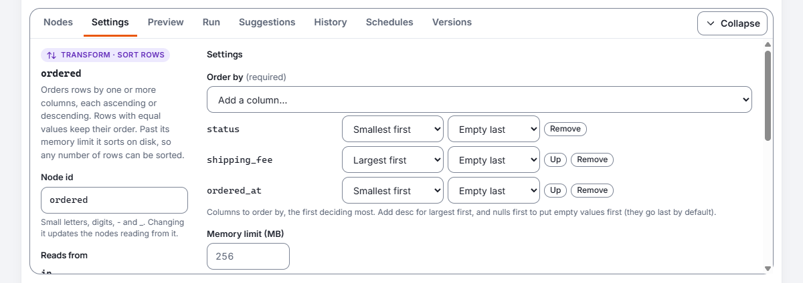
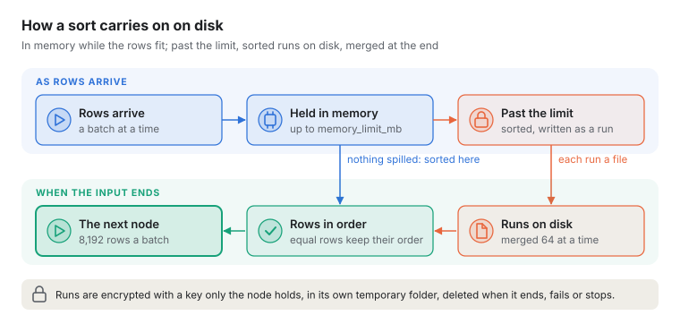
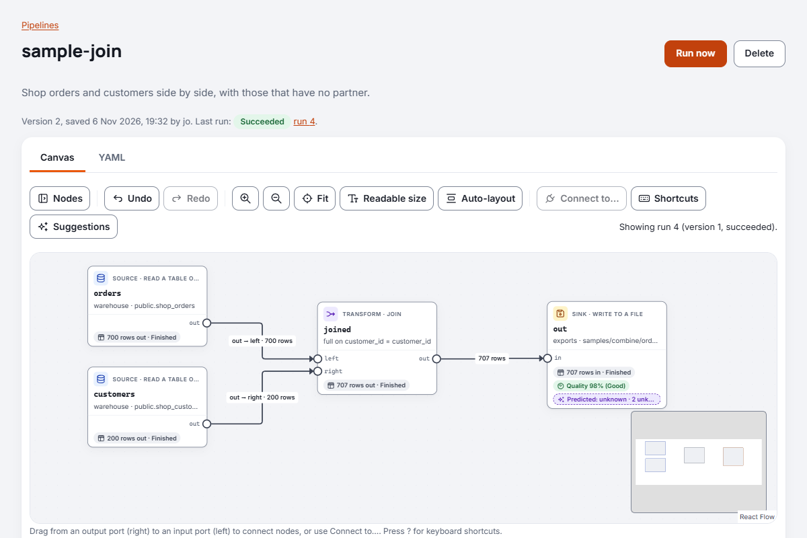
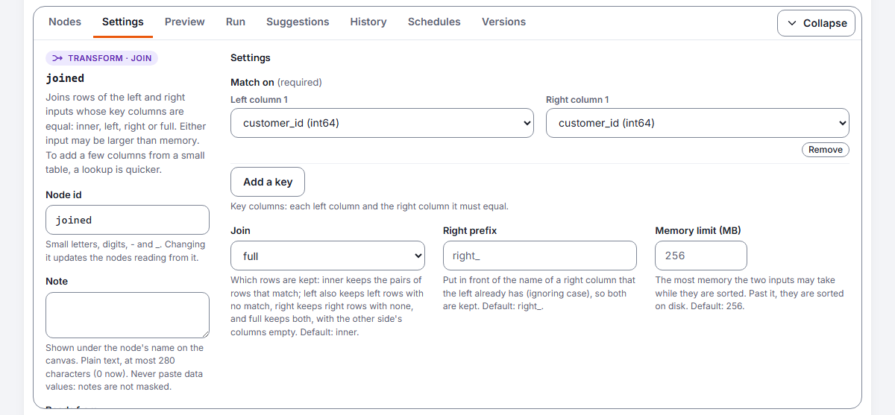

# Reference: pipeline nodes

Every node a pipeline can use, with every setting it takes and what to know about it. A pipeline
reads rows from sources, changes them, checks them and writes them, in one pass; how to build and
run one is in [Building and running a pipeline](pipelines.md). The expression language several
nodes share is in [Expressions](expressions.md). For the other kinds of component, see the
[Components reference](components-reference.md).

Each entry gives what the node does and its kind, the ports it reads from and writes to, a table
of its settings, what to know about it, who may use it, and a whole pipeline you can copy. The
first part of each entry, up to the settings table, comes from the node catalogue the server uses
(`GET /api/v1/node-types`), so it always matches this version. The **Parameters** column says what
`${...}` may do in a setting, as [Parameters and server
variables](pipelines.md#parameters-and-server-variables) explains.

## Keys every node has

| Key | What it does |
| --- | --- |
| `id` | The node's name in the pipeline: a small letter, then small letters, digits, `-` and `_`, at most 64 characters. Required. |
| `type` | The node's type: one of the entries below. Required. |
| `input` | The node that feeds this one: `input: tidy` reads the `out` port of `tidy`, `input: tidy.rejected` its `rejected` port. A `union` lists several: `input: [north, south]`. |
| `inputs` | For a node with named inputs, each input and the node feeding it: `inputs: { main: orders, lookup: customers }`. |
| `note` | A short note for people, shown under the node's name on the canvas: plain text, at most 280 characters. Kilnmark ignores it when it runs the pipeline. Never put data values in it: notes are not masked ([Notes on the canvas](pipelines.md#notes-on-the-canvas)). |

Every other key of a node is one of its settings; a key the node does not take is a problem, with
its line.

## How nodes connect


Every node has named **ports**, which each entry below lists. Most nodes read from `in` and write
to `out`; some have more, such as a filter's `rejected`, a gate's `quarantine` or a route's named
routes. In YAML, `input: tidy` reads the `out` port of the node called `tidy`, and
`input: tidy.rejected` reads its `rejected` port. A node with two inputs names them:
`inputs: { main: spend, lookup: tidy }`, or `inputs: { left: orders, right: customers }` for a
join. A union lists its inputs: `input: [north, south]`.

Rows sent to a port that nothing reads are dropped. For example, a filter whose `rejected` port is
not connected simply drops the rows it does not keep. The `errors` port is the exception: with
nothing connected to it, a row that fails stops the run ([Rows that fail](rows-that-fail.md)).

## The pipeline's own keys

A pipeline's own keys are `kilnmark` (always `pipeline/v1`), `name`, `description`, `parameters`
([Parameters and server variables](pipelines.md#parameters-and-server-variables)), `quality`
(`min_score`, [Quality of what a run writes](quality-gates.md#quality-of-what-a-run-writes)), `run`
(below), `nodes`, `layout` (where the canvas draws each node) and `notes` (the notes on the canvas,
at most 50, each with `text` of at most 2,000 characters and optionally `node`, `x`, `y`, `width`,
`height` and `colour`: [Notes on the canvas](pipelines.md#notes-on-the-canvas)). Kilnmark ignores
`layout` and `notes` when it runs the pipeline.

`run:` says how each run of the pipeline is tried, as in `run: { retries: 2, retry_delay: 5m }`
([Trying a run again](pipelines.md#trying-a-run-again)):

| Key | Type | Default | What it does |
| --- | --- | --- | --- |
| `retries` | whole number | `0` | How many more tries a failed run gets, 0 to 5, before it fails and its owners are told. The server may allow fewer (`kilnmark.runs.max-retries`). |
| `retry_delay` | time | `1m` | The wait before the second try, `10s` to `1h`, doubled before each later try. Each wait is at most an hour, and up to a tenth more is added at random. Needs `retries`. |
| `retry_on` | choice | `any` | `any`: any failure a second try could change. `lost`: only a try lost with its worker or its connection to Kilnmark's database. Needs `retries`. |
| `timeout` | time | no limit | How long each try may take, `90s` to `7d`. Past it the try is stopped and fails; it may be tried again. |
| `warn_after` | time | none | How long a run may go before its owners are told it is taking longer than expected, `1m` to `7d`, less than `timeout`. It does not stop the run. |

A pipeline tried again starts again from its beginning, so with `retries` above 0 every `write`
must use `replace` or `upsert`, whatever `retry_on` says: the pipeline is refused when saved
otherwise. A run that a flow node starts never uses the pipeline's own `run: retries`: the node's
`retries` decide.

Who may do what, for every node: designers save pipelines, stewards run them, and viewers see them
and their runs. A run acts as the person who started it, or as the schedule that did
([Running pipelines and flows on a schedule](schedules.md)), so a pipeline that writes needs each
target source to allow writing. An enterprise scheduler starts a pipeline with `kilnmark-run`,
whose exit code says whether the run succeeded, failed (a stop gate fails it) or was cancelled
([Running from an external scheduler](external-schedulers.md)).

## read

Reads a table, view or file from a saved source, or the rows of one query.

[generated: node read]: #

**Read a table or file**: a source node, in the palette's Read folder. Reads a table, view or file from a saved source. The source holds the credentials, so the pipeline only names it.

- Reads from: nothing
- Writes to: `out`

| Setting | Type | Required | Default | Parameters | What it does |
| --- | --- | --- | --- | --- | --- |
| `source` | saved source | yes |  | no | The saved source to read from. |
| `asset` | table or file | no |  | no | A table or view as schema.table, or a file's path inside the source. Leave out to run a query. |
| `query` | text | no |  | no | One SELECT run as written, in place of a table (PostgreSQL sources with Allow SQL on). Its columns are known when it runs. |
| `columns` | list of columns | no |  | no | Only these columns, in this order; all of them when left out. A database reads only these. |
| `where` | expression | no |  | yes | Only the rows meeting this condition, such as status = 'delivered'. A database applies what it can while reading, with each value bound; Kilnmark checks every row that arrives. |
| `row_limit` | number | no | `0` | whole value | Reads at most this many rows (after where); 0 reads them all. Handy while trying a pipeline out. |

[end: node read]: #

**What to know.**

- `asset` is a table or view as `schema.table`, or a file's path inside the source as the
  catalogue shows it. A read gives `asset` or `query`, not both.
- With `columns` and `where`, a database reads only those columns and applies as much of the
  condition as it safely can, each value bound, never written into the SQL. Kilnmark checks every
  row that arrives against the whole condition anyway. Files, and generic JDBC sources, read every
  row and Kilnmark applies `where`. The node's note on the canvas says which.
- `row_limit` counts the rows that meet `where`; 0 reads them all.
- A `query` is one `SELECT` or `WITH`, checked as custom SQL rules are, run on a read-only
  connection, and never under a login that is a superuser or may read the server's files. Its
  columns are known only when it runs. Parameters are not filled in a query.

**Governance.** A query can read any column its login can, so only a designer who may see unmasked
values saves or previews a pipeline with one, and only on a PostgreSQL source with Allow SQL on.
Every column a query returns is treated as marked sensitive: masked for everyone else, and marked on
what a write writes from it. Values read from a table keep the table's own marks.

```yaml
kilnmark: pipeline/v1
name: orders-by-country
description: One country's delivered orders, in a table of their own.

parameters:
  country: { type: text, default: GB }

nodes:
  - id: orders
    type: read
    source: sales-db
    asset: sales.orders
    columns: [order_id, customer_id, amount, country, status]
    where: "country = ${country} and status = 'delivered'"

  - id: out
    type: write
    input: orders
    source: warehouse
    table: sales.orders_${country}
    mode: replace
```

Reading with a query:

```yaml
kilnmark: pipeline/v1
name: orders-per-country-query
description: Orders counted per country by the database.

nodes:
  - id: counts
    type: read
    source: sales-db
    query: >-
      SELECT country, count(*) AS orders
      FROM sales.orders GROUP BY country
    row_limit: 1000

  - id: out
    type: write
    input: counts
    source: files
    path: exports/orders-per-country.csv
    mode: replace
```

Related: [Reading](pipelines.md#reading), [Reading with a query](pipelines.md#reading-with-a-query),
[Reference: connectors](reference-connectors.md).

## write

Writes the rows it receives to a table or a file in a saved source.

[generated: node write]: #

**Write to a table or file**: a sink node, in the palette's Write folder. Writes rows to a database table or a file in a saved source. The source must allow writing, which a designer or an admin sets; what is written is registered in the catalogue with its lineage. Rows a table would refuse go to the errors port, if something is connected to it.

- Reads from: `in`
- Writes to: `errors`

| Setting | Type | Required | Default | Parameters | What it does |
| --- | --- | --- | --- | --- | --- |
| `source` | saved source | yes |  | no | The saved source to write to. |
| `target` | table or file | no |  | no | A table as schema.table, or a path inside the source for files. |
| `table` | text | no |  | part of the name | Another name for target, for a table. |
| `path` | text | no |  | part of the name | Another name for target, for a file. |
| `mode` | choice | no | `create` | no | How rows are written: create fails if the table or file exists; append adds rows; replace swaps in the new rows at the end; upsert updates rows with the same key and adds the rest. One of `create`, `append`, `replace`, `upsert`. |
| `key` | list of columns | no |  | no | The columns that identify a row, for upsert. |
| `duplicates` | choice | no | `last` | no | For upsert, when the input has a key more than once: which of its rows the table keeps. The first or last to arrive, the latest or earliest by a column, or error to stop the run. One of `first`, `last`, `latest`, `earliest`, `error`. |
| `duplicates_by` | column | no |  | no | For latest or earliest: the column whose largest (latest) or smallest (earliest) value wins. On a tie the first of the tied rows to arrive wins, and an empty value never beats a value. |
| `format` | choice | no |  | no | For files: csv or parquet. Taken from the path's extension when left out. One of `csv`, `parquet`. |
| `max_errors` | number | no |  | whole value | With the errors port connected: stop the run when more than this many rows fail. Leave empty for no limit. |
| `max_error_share` | number | no |  | whole value | With the errors port connected: stop the run when more than this share of the rows fail, from 0 to 1, judged when the input ends. Leave empty for no limit. |

The writer settings, which only some kinds of source take:

| Setting | Type | Default | Sources that take it | What it does |
| --- | --- | --- | --- | --- |
| `overwrite` | true or false | `false` | `files`, `s3` | Replace a file of the same name; otherwise an existing file stops the write. |
| `delimiter` | text |  | `files`, `s3` | CSV only: one character, or \t for a tab; by default the source's own delimiter, else a comma. A delimiter other than the source's is refused. |
| `compression` | choice | `snappy` | `files`, `s3` | Parquet only: how pages are compressed. One of `snappy`, `zstd`, `gzip`, `none`. |
| `allow_unscanned` | true or false | `false` | `files`, `s3` | Write even where scans of this source would not find the file. |
| `profile_output` | true or false | `true` | `files`, `jdbc`, `mariadb`, `mysql`, `oracle`, `postgresql`, `s3`, `sqlserver` | Profile the rows in the same pass and record the profile with the written table or file. |
| `keep_values` | true or false | `true` | `files`, `jdbc`, `mariadb`, `mysql`, `oracle`, `postgresql`, `s3`, `sqlserver` | Whether the profile keeps example values and sample rows; off keeps the statistics only. The source's own rule still applies. |
| `commit_every` | number | `0` | `jdbc`, `mariadb`, `mysql`, `oracle`, `postgresql`, `sqlserver` | 0 (the default) writes in one transaction; otherwise commit after each batch reaching N rows. A failure then keeps the rows already committed. |
| `batch_size` | number | `1000` | `jdbc`, `mariadb`, `mysql`, `oracle`, `postgresql`, `sqlserver` | Differs by kind of source: see each one in [Reference: connectors](reference-connectors.md). |
| `text_length` | number | `0` | `jdbc`, `mariadb`, `mysql`, `oracle`, `postgresql`, `sqlserver` | Differs by kind of source: see each one in [Reference: connectors](reference-connectors.md). |
| `lock_timeout` | number | `30` | `mariadb`, `mysql`, `oracle`, `postgresql`, `sqlserver` | For replace: how long the swap waits for others using the old table. |
| `bulk_load` | true or false | `true` | `mariadb`, `mysql` | Load tables this node creates with LOAD DATA LOCAL INFILE, sent from memory, when the server allows it (local_infile); otherwise, or when false, with batched inserts. |
| `allow_other_unique_keys` | true or false | `false` | `mariadb`, `mysql` | For upsert: a row matching any unique index is updated, not only one matching the key, so a table with a unique index lacking a key column is refused. true allows it, accepting that such rows are updated. |
| `keep_grants` | true or false | `true` | `oracle`, `postgresql`, `sqlserver` | For replace: repeat the old table's grants on the new one. |
| `allow_dropping_row_security` | true or false | `false` | `oracle`, `postgresql`, `sqlserver` | Differs by kind of source: see each one in [Reference: connectors](reference-connectors.md). |
| `empty_text_as_null` | true or false | `false` | `oracle` | Oracle stores empty text as null. false (the default) refuses empty text, so nothing changes silently; true writes it as null. |
| `bulk_copy` | true or false | `true` | `sqlserver` | Load tables this node creates through the driver's bulk copy. |

[end: node write]: #

**What to know.**

- Give the target as `table` (`schema.table`) for a database, `path` for a file, or `target` for
  either. A file's `format` is `csv` or `parquet`, taken from its extension when left out.
- `mode` is as the settings table says; what each needs of the table, and the column types a
  `create` chooses, are in [Modes](writing-data.md#modes). Each source kind's writer may refuse a
  mode: generic JDBC sources take `append` and `create` only, and files `create` and `replace`
  only, as files are written whole.
- Nothing appears until the write has finished: a table write is one transaction, and a file is
  written under a temporary name and put in place at the end, unless `commit_every` says otherwise.
- The writer settings depend on the target source's kind: a setting the source's writer does not
  take is a problem. Where the writers taking a setting describe it differently, the table says so;
  each connector's own are in [Reference: connectors](reference-connectors.md).
- What a create, replace or file write writes is profiled in the same pass and recorded in the
  catalogue with its lineage; an append or upsert records only how many rows it wrote.

**Governance.** The source must allow writing (`allow_writing`), which only designers and admins
turn on, and the write uses the source's own login, so that login needs write rights. A parameter
can fill only part of the last name of `table` or `path`, never choose the schema, the folder or
the source. Columns marked sensitive upstream are marked on what is written.

```yaml
kilnmark: pipeline/v1
name: orders-from-files
description: The day's orders from a file, upserted into the warehouse and kept as Parquet.

nodes:
  - id: orders
    type: read
    source: landing
    asset: incoming/orders.csv

  - id: table
    type: write
    input: orders
    source: warehouse
    table: sales.orders
    mode: upsert
    key: [order_id]
    commit_every: 50000

  - id: file
    type: write
    input: orders
    source: lake
    path: exports/orders.parquet
    mode: replace
    compression: zstd
```

Related: [Writing data from a pipeline](writing-data.md), with the modes, the column types a
create chooses and the rights each mode needs.

## gate

Checks the rows passing through it against quality rules, in the same pass that moves them.

[generated: node gate]: #

**Quality gate**: a gate node, in the palette's Quality folder. Checks rows against quality rules as they pass, with no second read: the rules of the asset read upstream and any written here. Stops the run, sets failing rows aside on the quarantine port, or lets them through with a warning.

- Reads from: `in`
- Writes to: `out`, `quarantine`

| Setting | Type | Required | Default | Parameters | What it does |
| --- | --- | --- | --- | --- | --- |
| `on_fail` | choice | no | `stop` | no | What to do when rows fail: stop fails the run, so the writes after the gate do not commit; quarantine sends failing rows to the quarantine port and the rest on; warn lets every row through and records what failed. One of `stop`, `quarantine`, `warn`. |
| `asset_rules` | true or false | no | `true` | whole value | Checks the enabled quality rules of the table or file read upstream. |
| `rules_from` | text | no |  | no | When rows come from more than one read node: the id of the one whose asset's rules to check. |
| `rules` | list of rules | no |  | no | Rules for this pipeline only, each with a type, a column and its own settings. |
| `min_score` | number | no |  | whole value | Stops the run (with stop or quarantine) when the rows score below this, from 0 to 1. |
| `max_failing_share` | number | no |  | whole value | Stops the run (with stop or quarantine) when more than this share of rows fail a rule, from 0 to 1. |

[end: node gate]: #

**What to know.**

- Its rules are the enabled rules of the asset read upstream (unless `asset_rules: false`; with
  several read nodes upstream, name one in `rules_from`) and any written under `rules`, each a
  mapping with a `type`, usually a `field`, and the type's own keys, as
  [Reference: quality rules](reference-quality-rules.md) lists them. At most 100 rules on a gate.
- `on_fail: stop` fails the run when a rule fails, so the writes after the gate do not commit;
  `quarantine` sends failing rows to `quarantine` and the rest on; `warn` lets every row through and
  records what failed.
- `max_failing_share` and `min_score` judge the rows as a whole, with `stop` and `quarantine`.
- A stop gate refuses a later write that commits as rows arrive (`commit_every` with `create`,
  `append` or `upsert`) and a later `limit`.
- `references` and `custom_sql` rules run in a database, so they cannot go on a gate.

**Governance.** Rows set aside on `quarantine` keep their columns' marks. What failed is recorded
with the run, and counts towards the scores of what the run writes.

```yaml
kilnmark: pipeline/v1
name: customers-checked
description: Customers with an email and a known country; the rest set aside.

nodes:
  - id: customers
    type: read
    source: sales-db
    asset: crm.customers

  - id: check
    type: gate
    input: customers
    on_fail: quarantine
    rules:
      - {type: not_null, field: email}
      - {name: known country, type: allowed_values, field: country, values: [GB, IE, FR]}
    max_failing_share: 0.05

  - id: good
    type: write
    input: check
    source: warehouse
    table: crm.customers_clean
    mode: replace

  - id: aside
    type: write
    input: check.quarantine
    source: files
    path: quarantine/customers.csv
    mode: replace
```

Related: [Quality gates](quality-gates.md), [What a gate does when rows
fail](quality-gates.md#what-happens-when-rows-fail).

## filter

Keeps the rows where a condition is true.

[generated: node filter]: #

**Filter rows**: a transform node, in the palette's Filter and route folder. Keeps the rows where a condition is true. Rows where it is false or empty (null) go to the rejected port, and rows where it fails go to the errors port, if something is connected to them.

- Reads from: `in`
- Writes to: `out`, `rejected`, `errors`

| Setting | Type | Required | Default | Parameters | What it does |
| --- | --- | --- | --- | --- | --- |
| `condition` | expression | yes |  | yes | The rows to keep, for example status = 'active' and amount > 0. |
| `max_errors` | number | no |  | whole value | With the errors port connected: stop the run when more than this many rows fail. Leave empty for no limit. |
| `max_error_share` | number | no |  | whole value | With the errors port connected: stop the run when more than this share of the rows fail, from 0 to 1, judged when the input ends. Leave empty for no limit. |

[end: node filter]: #

**What to know.** Rows where the condition is false or empty (null) go to `rejected`; if nothing
reads `rejected`, they are dropped. The condition is an [expression](expressions.md), checked
against the columns before the pipeline runs. A row where the condition fails (a cast that does not
fit, say) is a [row that fails](rows-that-fail.md).

```yaml
kilnmark: pipeline/v1
name: active-customers
description: Active customers in credit, and the rest apart.

nodes:
  - id: customers
    type: read
    source: sales-db
    asset: crm.customers

  - id: active
    type: filter
    input: customers
    condition: "status = 'active' and balance > 0"

  - id: kept
    type: write
    input: active
    source: files
    path: exports/active-customers.csv
    mode: replace

  - id: others
    type: write
    input: active.rejected
    source: files
    path: exports/other-customers.csv
    mode: replace
```

## compute

Adds or replaces columns, each worked out from an expression.

[generated: node compute]: #

**Compute columns**: a transform node, in the palette's Transform folder. Adds or replaces columns, each worked out from an expression. Later expressions can use columns computed earlier in the list. Rows whose expressions fail go to the errors port, if something is connected to it.

- Reads from: `in`
- Writes to: `out`, `errors`

| Setting | Type | Required | Default | Parameters | What it does |
| --- | --- | --- | --- | --- | --- |
| `columns` | names and expressions | yes |  | yes | Each column's name and the expression that works it out, for example full_name: trim(first_name) \|\| ' ' \|\| trim(last_name). |
| `max_errors` | number | no |  | whole value | With the errors port connected: stop the run when more than this many rows fail. Leave empty for no limit. |
| `max_error_share` | number | no |  | whole value | With the errors port connected: stop the run when more than this share of the rows fail, from 0 to 1, judged when the input ends. Leave empty for no limit. |

[end: node compute]: #

**What to know.** A name that is already a column replaces it where it stands; a new name is added
at the end. Expressions are worked out in the order written, and each can use the columns computed
before it.

```yaml
kilnmark: pipeline/v1
name: customer-names
description: Tidy names and emails.

nodes:
  - id: customers
    type: read
    source: sales-db
    asset: crm.customers

  - id: tidy
    type: compute
    input: customers
    columns:
      first_name: "trim(first_name)"
      full_name: "first_name || ' ' || trim(last_name)"
      email: "lower(trim(email))"

  - id: out
    type: write
    input: tidy
    source: warehouse
    table: crm.customer_names
    mode: replace
```

Related: [Functions](expressions.md#functions), [Rows that fail](rows-that-fail.md).

## select

Keeps or drops columns, renames them, puts them in order and changes their type.

[generated: node select]: #

**Select columns**: a transform node, in the palette's Transform folder. Keeps or drops columns, and renames, reorders and changes the type of the columns kept. Every setting names columns as they arrive. Rows whose cast fails go to the errors port, if something is connected to it.

- Reads from: `in`
- Writes to: `out`, `errors`

| Setting | Type | Required | Default | Parameters | What it does |
| --- | --- | --- | --- | --- | --- |
| `keep` | list of columns | no |  | no | Only these columns, in this order. Leave empty to keep them all. |
| `drop` | list of columns | no |  | no | Columns to leave out. Use either keep or drop, not both. |
| `rename` | column to column | no |  | no | New names: each column as it arrives, and its new name. |
| `order` | list of columns | no |  | no | Columns to put first, in this order; the rest follow as they were. |
| `cast` | names and expressions | no |  | yes | Columns to convert, and the type for each: boolean, int64, float64, decimal(p,s), utf8, date or timestamp. |
| `max_errors` | number | no |  | whole value | With the errors port connected: stop the run when more than this many rows fail. Leave empty for no limit. |
| `max_error_share` | number | no |  | whole value | With the errors port connected: stop the run when more than this share of the rows fail, from 0 to 1, judged when the input ends. Leave empty for no limit. |

[end: node select]: #

**What to know.** Every setting names columns as they arrive. They apply in this order: keep
or drop, change type, rename, order. `cast` takes the [types](expressions.md#types) of the
expression language. Casting text is strict: a value that does not fit stops the run, or goes to
`errors` when something reads it ([Rows that fail](rows-that-fail.md)).

```yaml
kilnmark: pipeline/v1
name: customer-shape
description: The columns a report needs, named as it wants them.

nodes:
  - id: customers
    type: read
    source: sales-db
    asset: crm.customers

  - id: shape
    type: select
    input: customers
    drop: [created_at]
    rename: { last_name: surname }
    order: [customer_id, first_name]
    cast: { customer_id: utf8, balance: "decimal(12,2)" }

  - id: out
    type: write
    input: shape
    source: files
    path: exports/customers.csv
    mode: replace
```

## lookup

Adds columns from the `lookup` input to each row of the `main` input with the same key, like a
join.

[generated: node lookup]: #

**Look up**: a transform node, in the palette's Combine folder. Adds columns from the lookup input to each main row with the same key, like a join. Rows with no match are kept, dropped or sent to the rejected port.

- Reads from: `main`, `lookup`
- Writes to: `out`, `rejected`

| Setting | Type | Required | Default | Parameters | What it does |
| --- | --- | --- | --- | --- | --- |
| `on` | column to column | yes |  | no | Key columns: each main column and the lookup column it must equal. |
| `keep` | list of columns | no |  | no | Lookup columns to add to main rows. Leave empty to add every lookup column except the keys. |
| `join` | choice | no | `left` | no | What happens to main rows with no match: left keeps them, inner drops them. One of `left`, `inner`. |
| `unmatched` | choice | no |  | no | What to do with a main row that has no match: keep it, drop it, or send it to the rejected port. Overrides join when set. One of `keep`, `drop`, `rejected`. |
| `duplicates` | choice | no | `first` | no | When the lookup side has a key more than once, which of its rows is used: the first or last to arrive, the latest or earliest by a column, or error to stop the run. One of `first`, `last`, `latest`, `earliest`, `error`. |
| `duplicates_by` | column | no |  | no | For latest or earliest: the lookup column whose largest (latest) or smallest (earliest) value wins. On a tie the first of the tied rows to arrive wins, and an empty value never beats a value. |
| `memory_limit_mb` | number | no | `256` | whole value | The most memory the lookup side (and main rows waiting for it) may take. |

[end: node lookup]: #

**What to know.**

- The lookup input is read in full and held in memory first; then main rows stream through, in
  their order. If the lookup input is larger than `memory_limit_mb`, the run stops with a message
  saying so: raise the limit, or keep fewer columns.
- While the lookup input loads, main rows that are ready may be held in memory too (counted
  against the same limit), so a pipeline where both inputs come from one node keeps moving.
- Keys match by value: `1`, `1.0` and `1.00` match, whatever the column types, and a date matches
  a timestamp at midnight. Text never matches a number; change one with `select` first. Empty
  (null) keys never match.
- An added column must not have the same name as a main column. List the ones you want in `keep`,
  or rename one side with `select`.
- When the lookup side has a key more than once, `duplicates` says which of its rows is used: the
  first to arrive unless you say otherwise ([Which row wins](#which-row-wins)). `duplicates_by`
  need not be among the columns kept.
- To join two large inputs, or keep every pair when keys repeat on both sides, use a
  [`join`](#join).

```yaml
kilnmark: pipeline/v1
name: orders-with-customers
description: Each order with its customer's name; orders with no customer apart.

nodes:
  - id: orders
    type: read
    source: sales-db
    asset: sales.orders

  - id: customers
    type: read
    source: sales-db
    asset: crm.customers
    columns: [customer_id, first_name, last_name]

  - id: joined
    type: lookup
    inputs: { main: orders, lookup: customers }
    on: { customer_id: customer_id }
    keep: [first_name, last_name]
    unmatched: rejected

  - id: out
    type: write
    input: joined
    source: warehouse
    table: sales.orders_named
    mode: replace

  - id: orphans
    type: write
    input: joined.rejected
    source: files
    path: quarantine/orders-without-customer.csv
    mode: replace
```

## aggregate

Groups rows that share values and summarises each group.

[generated: node aggregate]: #

**Aggregate**: a transform node, in the palette's Aggregate folder. Groups rows that share values and summarises each group with count, sum, min, max, avg or count_distinct. Without group_by, summarises all rows into one.

- Reads from: `in`
- Writes to: `out`

| Setting | Type | Required | Default | Parameters | What it does |
| --- | --- | --- | --- | --- | --- |
| `group_by` | list of columns | no |  | no | The columns whose values make a group. Leave empty for one row summarising everything. |
| `values` | names and expressions | yes |  | yes | Each output column's name and its summary, for example total: sum(amount). |
| `memory_limit_mb` | number | no | `256` | whole value | The most memory the groups may take while they are collected. |

[end: node aggregate]: #

**What to know.** Without `group_by` it summarises all rows into one, even when there are none (a
count of 0). Empty values in a `group_by` column form a group of their own. A value can combine
[aggregate functions](expressions.md#aggregate-functions) and group-by columns, such as
`sum(amount) / count(*)`; a column used outside an aggregate must be in `group_by`, and aggregates
cannot be inside each other. Groups are held in memory up to `memory_limit_mb`, and come out in the
order they were first seen.

```yaml
kilnmark: pipeline/v1
name: orders-per-customer
description: Each customer's orders and spend.

nodes:
  - id: orders
    type: read
    source: sales-db
    asset: sales.orders

  - id: spend
    type: aggregate
    input: orders
    group_by: [customer_id]
    values:
      orders: "count(*)"
      total: "sum(amount)"
      last_order: "max(ordered_at)"

  - id: out
    type: write
    input: spend
    source: warehouse
    table: sales.orders_per_customer
    mode: replace
```

Related: [Aggregate functions](expressions.md#aggregate-functions).

## union

Appends the rows of all its inputs, matching columns by name.

[generated: node union]: #

**Union**: a transform node, in the palette's Combine folder. Appends the rows of all its inputs, matching columns by name. Columns an input lacks are left empty (null). Or, with mode, keeps the rows of the first input that the other inputs lack (except) or have too (intersect).

- Reads from: `in` (any number of edges)
- Writes to: `out`

| Setting | Type | Required | Default | Parameters | What it does |
| --- | --- | --- | --- | --- | --- |
| `mode` | choice | no | `all` | no | Which rows come out: all appends the rows of every input. Except keeps the rows of the first input found in no other input, and intersect those found in every other input, comparing whole rows; only the first input's rows and columns come out. One of `all`, `except`, `intersect`. |
| `compare_on` | list of columns | no |  | no | For except and intersect: the columns to compare, when not every column. Leave out a column only one input has, or one that differs on every row, such as a load time. |
| `strict` | true or false | no | `false` | whole value | Fail unless every input has exactly the same columns, with the same types. |
| `memory_limit_mb` | number | no | `256` | whole value | The most memory batches may take while the union waits for every input's first batch. For except and intersect, the most the inputs may take while they are sorted; past it, they are sorted on disk. |

[end: node union]: #

**What to know.**

- Columns come out in the order they first appear across the inputs, as listed, including the
  columns of an input that turns out to have no rows.
- A column missing from an input is empty in that input's rows.
- A column whose type differs between inputs is widened to a type that holds both: whole numbers of
  different sizes to `int64`, whole numbers and decimals to `decimal`, numbers to `float64` when
  one side is a float, dates and timestamps to `timestamp`. Other differences (text and a number,
  say) stop the pipeline before it runs; change one with `select`.
- With `strict: true`, every input must have exactly the same columns and types.
- `mode: except` and `mode: intersect` compare instead of appending. `except` keeps the rows of the
  first input (the first in `input: [...]`) that no other input has, and `intersect` those that
  every other input has. Only the first input's rows and columns come out; the canvas says which
  input that is on the node.
- Whole rows are compared, so every input must then have the same column names, in any order. A
  column only one input has is refused when the pipeline is checked, since no row could be the
  same. Name the columns to compare with `compare_on` instead, leaving out that column and any
  that differs on every row, such as a load time or a `came_from` mark.
- Values are compared as a join's keys are: `1`, `1.0` and `1.00` are equal, and text never equals
  a number. Empty (null) values are equal to each other, as in SQL's `EXCEPT` and `INTERSECT`, so
  two rows that are empty in the same column and equal elsewhere are the same row. (A join's keys
  differ: an empty key matches nothing.)
- Unlike SQL's `EXCEPT` and `INTERSECT`, repeats are not folded into one: a row that is in the
  first input twice comes out twice, or not at all. Add a `dedupe` after it to fold them.
- Under `except` and `intersect` every input is sorted by the compared columns, in memory up to
  `memory_limit_mb` between them and on disk past it, so any number of rows can be compared. Rows
  come out in the order of those columns, empty values last, once every input has ended.

Appending, the default:

```yaml
kilnmark: pipeline/v1
name: all-customers
description: Today's customers and the archive, together.

nodes:
  - id: current
    type: read
    source: sales-db
    asset: crm.customers

  - id: archived
    type: read
    source: sales-db
    asset: crm.customers_archive

  - id: everyone
    type: union
    input: [current, archived]

  - id: out
    type: write
    input: everyone
    source: warehouse
    table: crm.all_customers
    mode: replace
```

Comparing: the archived rows that today's table no longer has as they were.

```yaml
kilnmark: pipeline/v1
name: archived-rows-not-in-current
description: Archived customers that today's table does not have, comparing whole rows.

nodes:
  - id: archived
    type: read
    source: sales-db
    asset: crm.customers_archive

  - id: current
    type: read
    source: sales-db
    asset: crm.customers

  - id: gone_or_changed
    type: union
    input: [archived, current]       # the first input's rows come out
    mode: except

  - id: out
    type: write
    input: gone_or_changed
    source: warehouse
    table: crm.archived_not_in_current
    mode: replace
```

Related: [Rows in one input and not the other](pipelines.md#rows-in-one-input-and-not-the-other).

## dedupe

Keeps one row for each key, the first to arrive unless you say otherwise; the other rows with the
same key go to `rejected`.

[generated: node dedupe]: #

**Remove duplicates**: a transform node, in the palette's Filter and route folder. Keeps one row for each key: the first to arrive, unless Which row wins says otherwise. The other rows with the same key go to the rejected port, if something is connected to it.

- Reads from: `in`
- Writes to: `out`, `rejected`

| Setting | Type | Required | Default | Parameters | What it does |
| --- | --- | --- | --- | --- | --- |
| `key` | list of columns | no |  | no | The columns that make rows duplicates of each other. Leave empty to compare whole rows. |
| `duplicates` | choice | no | `first` | no | Which row of a key is kept: the first or last to arrive, the latest or earliest by a column, or error to stop the run when a key repeats. One of `first`, `last`, `latest`, `earliest`, `error`. |
| `duplicates_by` | column | no |  | no | For latest or earliest: the column whose largest (latest) or smallest (earliest) value wins. On a tie the first of the tied rows to arrive wins, and an empty value never beats a value. |
| `memory_limit_mb` | number | no | `256` | whole value | The most memory the keys seen so far may take, with the rows held under last, latest and earliest. |

[end: node dedupe]: #

**What to know.** Empty values count as equal to each other. Without `key`, whole rows are
compared. Which row of a key is kept is `duplicates` ([Which row wins](#which-row-wins), below).
The keys seen so far are held in memory up to `memory_limit_mb`. Under `first` and `error`, rows
pass on as they arrive. Under `last`, `latest` and `earliest` a row's fate is known only once every
row has arrived, so the rows are held too, until the input ends, and then sent on in the order they
came: the winners to `out`, the rest to `rejected`.

```yaml
kilnmark: pipeline/v1
name: one-per-email
description: One customer for each email address.

nodes:
  - id: customers
    type: read
    source: sales-db
    asset: crm.customers

  - id: unique
    type: dedupe
    input: customers
    key: [email]

  - id: out
    type: write
    input: unique
    source: warehouse
    table: crm.customers_by_email
    mode: replace

  - id: repeats
    type: write
    input: unique.rejected
    source: files
    path: quarantine/repeated-emails.csv
    mode: replace
```

### Which row wins

The rule for which row wins, `duplicates`, is the same on `dedupe`, `lookup` (its lookup side) and an
upsert `write`:

| `duplicates` | Which row of a key is kept |
| --- | --- |
| `first` | The first to arrive. The default for `dedupe` and `lookup`. |
| `last` | The last to arrive. The default for an upsert. |
| `latest` | The one with the largest value in the column `duplicates_by` names. |
| `earliest` | The one with the smallest value in that column. |
| `error` | None: the run stops when a key repeats. The message names the key's columns, never its value. |

Under `latest` and `earliest`, a tie goes to the first of the tied rows to arrive, and an empty
value never beats a value. Values order as `sort` orders them: numbers by value, dates and times
in time, text by Unicode code point, `false` before `true`. The canvas shows each node's rule on
its card ("first kept", "latest by updated_at kept"), the default too, so the rule is always in
sight.

Upsert writes are in [Writing data](writing-data.md#which-row-an-upsert-keeps). The sample
`sample-which-row` keeps the latest customer of each email with a dedupe, and the latest delivery
price of each product with a lookup.

## route

Sends each row to the first route whose condition it meets; rows that meet none go to `out`.

[generated: node route]: #

**Route rows**: a transform node, in the palette's Filter and route folder. Sends each row to the first route whose condition it meets, in order. Rows that meet none go to the out port; rows where a condition fails go to the errors port, if something is connected to it.

- Reads from: `in`
- Writes to: `out`, `errors`

| Setting | Type | Required | Default | Parameters | What it does |
| --- | --- | --- | --- | --- | --- |
| `routes` | names and conditions | yes |  | yes | Each route's port name and its condition, checked in order, for example large: amount > 1000. |
| `max_errors` | number | no |  | whole value | With the errors port connected: stop the run when more than this many rows fail. Leave empty for no limit. |
| `max_error_share` | number | no |  | whole value | With the errors port connected: stop the run when more than this share of the rows fail, from 0 to 1, judged when the input ends. Leave empty for no limit. |

[end: node route]: #

**What to know.** Each route's name is an output port of its own, besides `out`, that other nodes
read as `input: <node>.<route>`. Port names use small letters, digits, `-` and `_`, and cannot be
`in` or `out`; nor `errors`, which is the port for [rows that fail](rows-that-fail.md). Routes are
tried in the order written, and each row goes to the first it meets.

```yaml
kilnmark: pipeline/v1
name: orders-by-size
description: Large and overseas orders apart from the rest.

nodes:
  - id: orders
    type: read
    source: sales-db
    asset: sales.orders

  - id: by_size
    type: route
    input: orders
    routes:
      large: "amount >= 10000"
      overseas: "country <> 'GB'"

  - id: large
    type: write
    input: by_size.large
    source: files
    path: review/large-orders.csv
    mode: replace

  - id: overseas
    type: write
    input: by_size.overseas
    source: files
    path: review/overseas-orders.csv
    mode: replace

  - id: rest
    type: write
    input: by_size
    source: warehouse
    table: sales.orders_home
    mode: replace
```

## limit

Passes on only the first rows, for trying a pipeline out on a little data.

[generated: node limit]: #

**Limit rows**: a transform node, in the palette's Filter and route folder. Passes on only the first rows, for trying a pipeline out on a little data.

- Reads from: `in`
- Writes to: `out`

| Setting | Type | Required | Default | Parameters | What it does |
| --- | --- | --- | --- | --- | --- |
| `rows` | number | yes |  | whole value | How many rows to pass on. |

[end: node limit]: #

**What to know.** Once it has its rows it stops reading, and nodes before it that feed nothing else
stop too. A `limit` after a gate with `on_fail: stop` is refused: the gate would never see the end
of its rows. To read fewer rows from a source, a read node's `row_limit` does it at the source.

```yaml
kilnmark: pipeline/v1
name: orders-sample
description: The first thousand orders, to try a pipeline out.

nodes:
  - id: orders
    type: read
    source: sales-db
    asset: sales.orders

  - id: sample
    type: limit
    input: orders
    rows: 1000

  - id: out
    type: write
    input: sample
    source: files
    path: samples/orders.csv
    mode: replace
```

## sort

Orders rows by one or more columns, each ascending or descending.

[generated: node sort]: #

**Sort rows**: a transform node, in the palette's Transform folder. Orders rows by one or more columns, each ascending or descending. Rows with equal values keep their order. Past its memory limit it sorts on disk, so any number of rows can be sorted.

- Reads from: `in`
- Writes to: `out`

| Setting | Type | Required | Default | Parameters | What it does |
| --- | --- | --- | --- | --- | --- |
| `by` | columns in order | yes |  | no | Columns to order by, the first deciding most. Add desc for largest first, and nulls first to put empty values first (they go last by default). |
| `memory_limit_mb` | number | no | `256` | whole value | The most memory rows may take while they are sorted. Past it, sorted parts are written to disk and merged. |

[end: node sort]: #

On the canvas, each column in **Order by** has its direction (Smallest first or Largest first) and
where its empty values go, and **Up** moves it before the column above:



**What to know.**

- Each entry in `by` is a column, then perhaps `desc` (largest first; `asc` is the default), then
  perhaps `nulls first`, as in SQL's `order by`. Empty (null) values go last, ascending or
  descending, unless the column says `nulls first`.
- Values order as conditions compare them (`<`, `>`): numbers by value (unsigned whole numbers
  too), dates and timestamps in time (to the nanosecond, for columns that hold nanoseconds),
  `false` before `true`, and a floating-point NaN after every other number. Text is ordered by
  Unicode code point, not by any language's rules: capital letters come before small ones (`B`
  before `a`), and accented letters after `z`. To sort ignoring case, add a column with
  `lower(name)` in a `compute` node and sort by that.
- Rows with equal values keep the order they arrived in (the sort is stable), so sorting by
  `region` keeps each region's rows in their earlier order.
- A sort passes nothing on until all its rows have arrived.
- Any number of rows can be sorted. Up to `memory_limit_mb` the sort works in memory; past it, it
  writes sorted parts to a temporary folder on the server and merges them at the end. The files
  are encrypted with a key only the running node holds, readable only by the server's user, and
  deleted when the node ends, fails or is stopped; if a file is damaged while it is there, the
  run fails rather than losing rows. The run's log says how much was written.

  
- A table read in a fixed order is not guaranteed to arrive in that order. Sort just before a
  write when the order matters, for example for a file someone reads.

```yaml
kilnmark: pipeline/v1
name: orders-sorted
description: Orders, by country and then largest first.

nodes:
  - id: orders
    type: read
    source: sales-db
    asset: sales.orders

  - id: ordered
    type: sort
    input: orders
    by: [country, amount desc, ordered_at nulls first]

  - id: out
    type: write
    input: ordered
    source: files
    path: exports/orders-sorted.csv
    mode: replace
```

## join

Joins the rows of a `left` and a `right` input whose key columns are equal, as SQL joins them.

[generated: node join]: #

**Join**: a transform node, in the palette's Combine folder. Joins rows of the left and right inputs whose key columns are equal: inner, left, right or full. Semi and anti keep only the left rows that have a match, or have none. Either input may be larger than memory. To add a few columns from a small table, a lookup is quicker.

- Reads from: `left`, `right`
- Writes to: `out`

| Setting | Type | Required | Default | Parameters | What it does |
| --- | --- | --- | --- | --- | --- |
| `on` | column to column | yes |  | no | Key columns: each left column and the right column it must equal. |
| `how` | choice | no | `inner` | no | Which rows are kept: inner keeps the pairs of rows that match; left also keeps left rows with no match, right keeps right rows with none, and full keeps both, with the other side's columns empty. Semi keeps each left row that has a match and anti each left row that has none, with the left's columns only. One of `inner`, `left`, `right`, `full`, `semi`, `anti`. |
| `right_prefix` | text | no | `right_` | no | Put in front of the name of a right column that the left already has (ignoring case), so both are kept. Not used by semi and anti, which keep no right column. |
| `memory_limit_mb` | number | no | `256` | whole value | The most memory the two inputs may take while they are sorted. Past it, they are sorted on disk. |

[end: node join]: #



In its settings, **Match on** pairs each left column with the right column it must equal, and
**Join** chooses which rows with no match to keep:




**What to know.**

- `semi` and `anti` are not in the picture: they keep left rows only. `semi` keeps each left row
  that has at least one match on the right, and `anti` each left row that has none. Only the
  left's columns come out, as they are, and each left row once, however many right rows match it.
  Nothing is renamed, so `right_prefix` is not used. They are SQL's `EXISTS` and `NOT EXISTS`: a
  left row with an empty key has no match, so `anti` keeps it and `semi` does not, and an empty
  key on the right hides nothing. See
  [Rows in one input and not the other](pipelines.md#rows-in-one-input-and-not-the-other).
- Every pair comes out (but for `semi` and `anti`): a key on three left rows and two right rows
  gives six rows.
- Keys match by value, as a lookup's do: `1`, `1.0` and `1.00` match, and a date matches a
  timestamp at midnight. A floating-point number matches by its shortest decimal, so a very large
  float may not match the whole number it holds; cast it with `select` to match exactly.
  Timestamps match to the nanosecond. Text never matches a number; change one with `select`
  first. Several key columns must all be equal.
- An empty (null) key never matches anything, not even another empty key, as in SQL.
- Every column of both inputs comes out with its type, the left's first (`semi` and `anti` pass on
  the left's only). A right column whose
  name a left column already has (ignoring case) is renamed with `right_prefix`, so a join on
  `customer_id` gives `customer_id` and `right_customer_id`; drop the one you do not need with
  `select`. Columns of a side that may have no match can be empty.
- Rows come out in order of their keys, rows with an empty key last. Within a key, each left row
  comes in the order it arrived, with its right rows in theirs.
- Any number of rows can be joined: both inputs are sorted by their keys, in memory up to
  `memory_limit_mb` between them and on disk past it, as a sort does. A key with more right rows
  than a quarter of that limit holds them on disk while its left rows are joined to them. Nothing
  is passed on until both inputs have ended, except that a join that can give no rows (an `inner`
  join with an empty input, say) stops as soon as it knows. The run's log says how much was
  written to disk.

**join or lookup?** A `lookup` reads its lookup input into memory and streams the main input past
it, keeping the main rows' order: quickest when one side is small, such as a table of codes. It
uses one row of a repeated key, by a rule you state (or stops), and sends main rows with no match
to `rejected` if you like. A `join` sorts both sides, so either may be larger than memory, keeps
every pair when keys repeat, can keep the rows of either side with no match (or, with `anti`,
only the left rows with none), and passes both
sides' columns on.

```yaml
kilnmark: pipeline/v1
name: orders-and-customers
description: Every order with its customer, and the orders with none.

nodes:
  - id: orders
    type: read
    source: sales-db
    asset: sales.orders

  - id: customers
    type: read
    source: sales-db
    asset: crm.customers
    columns: [customer_id, first_name, last_name]

  - id: joined
    type: join
    inputs: { left: orders, right: customers }
    on: { customer_id: customer_id }
    how: left

  - id: out
    type: write
    input: joined
    source: warehouse
    table: sales.orders_with_customers
    mode: replace
```

## window

Adds row numbers, ranks, running totals and the previous or next row's values, worked out over
each group of rows in order.

[generated: node window]: #

**Window functions**: a transform node, in the palette's Transform folder. Adds row numbers, ranks, running totals and the previous or next row's values, worked out over the rows of each group in order. Every row comes out, with the new columns. Past its memory limit it orders rows on disk, so any number of rows can be used.

- Reads from: `in`
- Writes to: `out`

| Setting | Type | Required | Default | Parameters | What it does |
| --- | --- | --- | --- | --- | --- |
| `partition_by` | list of columns | no |  | no | Rows with equal values in these columns form a group, worked out on its own: numbers and totals start again in each. Empty values form a group of their own. Leave empty for one group. |
| `order_by` | columns in order | yes |  | no | The order rows are worked out in within each group, the first column deciding most. Add desc for largest first, and nulls first to put empty values first (they go last by default). |
| `columns` | names and expressions | yes |  | yes | Each new column's name and its window function, for example balance: sum(amount) or previous: lag(amount, 1, 0). |
| `memory_limit_mb` | number | no | `256` | whole value | The most memory rows may take while they are put in order and worked out. Past it, sorted parts are written to disk and merged. |

[end: node window]: #

In the settings, **Partition by** lists the grouping columns, **Order by** takes each column with
its direction and where its empty values go, as a sort's does, and **Columns** pairs each new
column's name with its function.

**What to know.**

- Rows with equal `partition_by` values form a group (a **partition**, such as one account's
  transactions; empty values form a group of their own), and each group is worked out on its own,
  in `order_by` order, written as for `sort`. Every row comes out, with its own columns and then
  the new ones.
- Each new column is one [window function](expressions.md#window-functions): a row number, a rank,
  a running total, or the value of the row before or after (`lag`, `lead`).
- Rows with equal `order_by` values keep the order they arrived in, as in a sort, and `row_number`
  numbers them in that order. Empty values in an `order_by` column go last, unless the column says
  `nulls first`.
- A new column cannot have the name of a column already there, in any case; rename or drop that
  column first.
- Rows come out in order of their group (empty values last) and then of `order_by`. A window passes
  nothing on until all its rows have arrived.
- Any number of rows can be used: rows are put in order as a `sort` puts them, in memory up to
  `memory_limit_mb` and on disk past it, in a temporary folder only the server can read, encrypted
  and deleted when the node ends. The run's log says how much was written. The rows a `lead` looks
  ahead to, and the values a `lag` looks back to, are held too, within a limit of the same size, so
  a window may hold up to about twice `memory_limit_mb` in all; with very wide rows and a large
  offset the run stops and says so.

```yaml
kilnmark: pipeline/v1
name: orders-running-total
description: Each customer's orders with a running total and the order before.

nodes:
  - id: orders
    type: read
    source: sales-db
    asset: sales.orders

  - id: totals
    type: window
    input: orders
    partition_by: [customer_id]
    order_by: [ordered_at, order_id]
    columns:
      running_total: "sum(amount)"
      order_number: "row_number()"
      previous_amount: "lag(amount, 1, 0)"

  - id: out
    type: write
    input: totals
    source: files
    path: exports/orders-running-total.csv
    mode: replace
```

The latest row for each key: number each group's rows newest first, then keep row number 1.

```yaml
kilnmark: pipeline/v1
name: latest-order
description: Each customer's latest order.

nodes:
  - id: orders
    type: read
    source: sales-db
    asset: sales.orders

  - id: newest_first
    type: window
    input: orders
    partition_by: [customer_id]
    order_by: [ordered_at desc, order_id desc]
    columns:
      recency: "row_number()"

  - id: latest
    type: filter
    input: newest_first
    condition: "recency = 1"

  - id: out
    type: write
    input: latest
    source: files
    path: exports/latest-orders.csv
    mode: replace
```

Related: [Window functions](expressions.md#window-functions).
