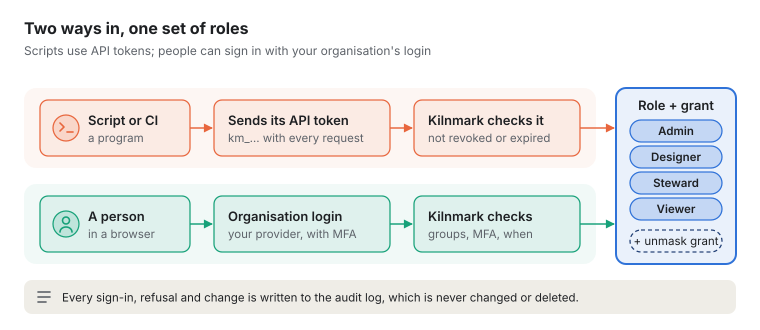
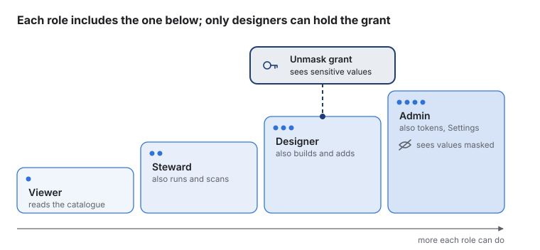
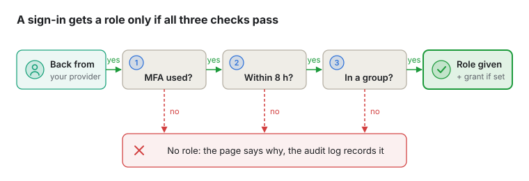
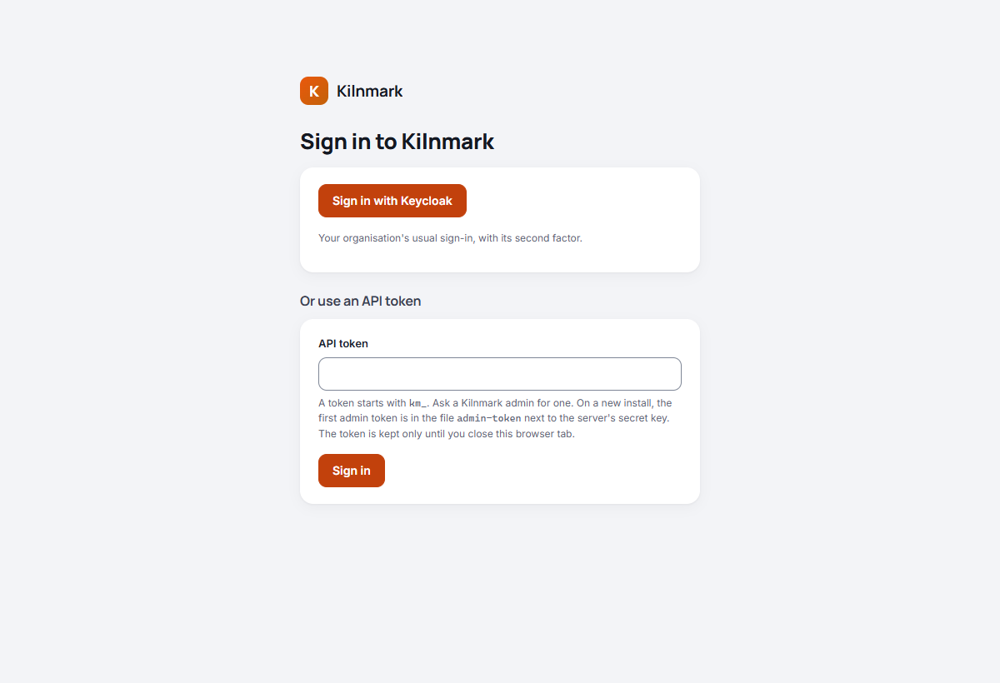
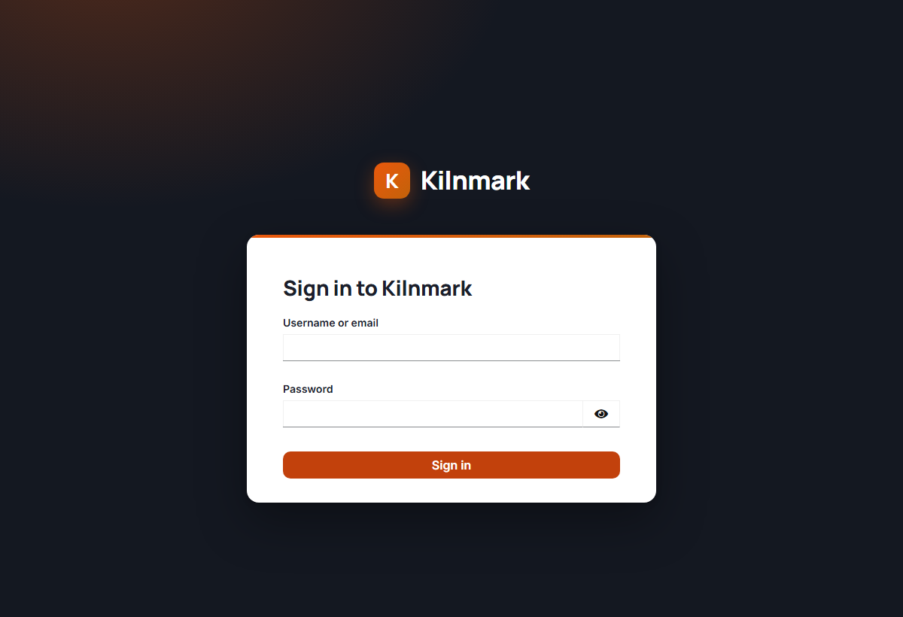
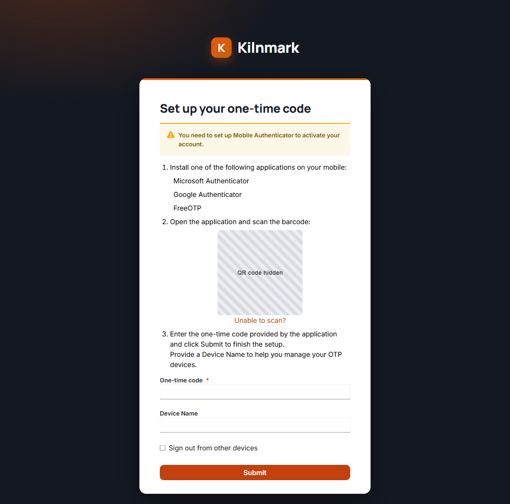
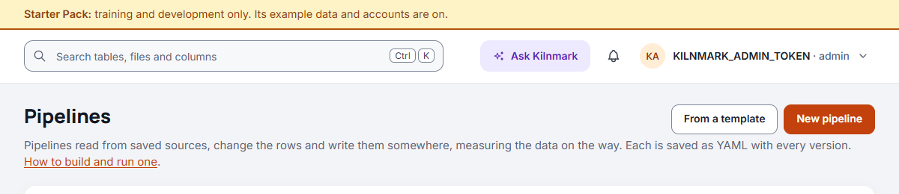
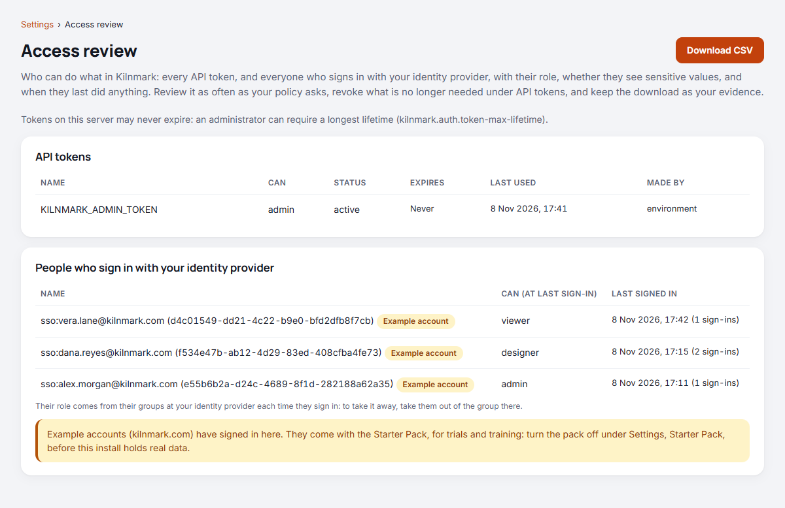
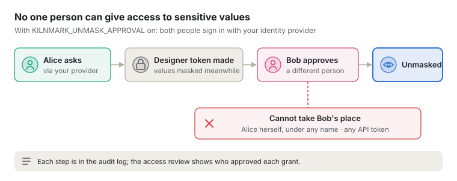

# Signing in, roles and tokens

How people and programs get into Kilnmark, what each role may do, and the controls an auditor will
ask about. Administrators set these up; everyone else only needs the first two sections.

## The short version

- **Two ways in.** Scripts and tools use **API tokens**. People can also **sign in with your
  organisation's own login** (Microsoft Entra ID, Okta and the like), with a second factor.
- **Four roles**, each including the one below: viewer, steward, designer, admin. Seeing
  **sensitive values unmasked** is a separate grant that only designers can hold.
- **Roles for people come from their groups** at your identity provider, as you map them in
  Kilnmark's settings. Kilnmark never stores anyone's password.
- **Tokens can be made to expire**: set a longest lifetime (say 90 days) and no token lasts longer.
- **Settings › Access review** lists who can do what, and when they last did anything, as a CSV for
  auditors. Every sign-in, refusal and review download is in the [audit log](audit-log.md).

## Two ways in

| | API token | Sign in with your organisation |
| --- | --- | --- |
| **Who it's for** | Scripts, CI pipelines, the MCP server, AI assistants, and people who prefer it | People in a browser |
| **What it is** | A long secret starting `km_`, sent with each request | Your organisation's normal login page, then a session in that browser |
| **Who decides the role** | The admin who made the token | Your groups at the identity provider, mapped in Kilnmark's settings |
| **Second factor (MFA)** | No: the token itself is the credential | Yes, required by default |
| **How long it lasts** | Until its expiry, or the server's longest lifetime | At most 8 hours, then sign in again |

Both can be used on the same server. If your organisation's login is not set up, the sign-in page
shows only the token box.

## Roles, and seeing sensitive values

Everyone, and every token, has exactly one role. Each role can do everything the one below it can:

- **Viewer**: search and read the catalogue, pipelines, flows and runs.
- **Steward**: also run pipelines and flows, scan sources, and look after quality rules and issues.
- **Designer**: also build pipelines and flows, give them schedules, add and edit sources, write
  custom SQL rules.
- **Admin**: also Settings, API tokens and the audit log.

**Seeing sensitive values unmasked** (columns marked sensitive, such as customer emails) is not part
of any role. It is a separate **grant** that only a designer can hold. Admins always see those
values masked, on purpose: the people who manage access are not the people who read the data. For a
token, the admin ticks it when making a designer token. For a person signing in through your
organisation, they need to be in a designer group *and* an "unmask" group.

## API tokens

An API token is a password for a program. It starts with `km_`, is shown **once** when it is made,
and Kilnmark keeps only a fingerprint of it (a hash), so nobody can read it back later, not even an
admin.

- **Making one:** an admin goes to **API tokens**, gives it a name (like `nightly-ci`), the least
  role that will do, and an expiry.
- **Using one:** the program sends it in a header with every request. The web UI can use one too:
  paste it on the sign-in page. A scheduler that runs pipelines and flows needs a **Steward**
  token, kept in a file only its jobs can read: see
  [Running from an external scheduler](external-schedulers.md#before-you-start).
- **Revoking one:** **API tokens**, revoke. It stops working at once, on every server.
- **Last used:** Kilnmark records when each token was last used, so you can spot and remove ones
  nobody uses.

**The first admin token.** A new install has no tokens, so the server writes a one-off admin token to
a private file (`admin-token`), good for 24 hours: sign in with it and make a proper one. Or the
operator sets `KILNMARK_ADMIN_TOKEN` in the server's settings, which is the operator's own
break-glass key. If ever no admin token works, the next restart writes a fresh 24-hour file, so you
cannot be locked out for good.

No token may be named `sso:...`: that prefix is kept for people who sign in through your
organisation, so a token can never pass for a person in the records.

## Signing in with your organisation

This uses **OpenID Connect**, the standard behind "Sign in with Microsoft" and the like. Kilnmark is
registered with your identity provider once (INSTALL.md, "Sign in with your identity provider");
after that:

1. On Kilnmark's sign-in page, the person chooses **Sign in with** *your organisation*.
2. They go to your normal login page, sign in there with their usual second factor, and come back.
3. Kilnmark reads what the provider says about them (their groups, how they signed in, when) and
   gives them a role.

**Roles come only from your settings.** You list which groups give which role, for example
`km-admins` gives admin. A group that merely happens to be called "admin" at the provider gives
nothing unless you name it. Someone in several groups gets the highest role among them. Someone in
none signs in but gets **no role**, and the page tells them why.

**MFA is checked, not assumed.** The provider says how the person signed in. Kilnmark wants either
"mfa", or two different *kinds* of factor: something you know (a password), something you have (a
code, a key, a phone), something you are (a fingerprint). One factor alone, even a strong one, or two
of the same kind, is not enough. Without it: no role, and the reason shown.

**How long a sign-in lasts.** While the person works, their sign-in renews itself every few
minutes, without asking them anything: Kilnmark gets a fresh token from the provider (with Keycloak,
every 5 minutes) and checks it as it checked the sign-in, MFA, groups and all. It ends, and the page
says "Your sign-in has ended. Sign in again.", when:

- it is **8 hours** since the person last signed in at the provider. Renewing never moves this on.
  Kilnmark asks the provider to make them sign in again after that, and refuses an older sign-in if
  the provider does not;
- the provider's own session ends: with the Keycloak that comes with Kilnmark, after 2 hours
  without using it, or 8 hours at most; or the person is disabled at the provider;
- a renewal no longer passes: they left every group that gives a role, or the provider stopped
  showing a second factor. Signing in again says why;
- they sign out.

If their role changes at the provider (moved to a group with a lower role), the next renewal gives
them the new role, and pauses any schedule they set that the new role no longer covers. A renewal is
not a new sign-in: the audit log records the sign-in once.

**On screen**, Kilnmark greets a person by their name at the provider, for example "Alex
Morgan", with their initials in the top bar. **In the records** (the audit log, usage, "created
by"), they show as `sso:` plus their user name and the provider's fixed ID for them, for example
`sso:alex.morgan@kilnmark.com (3f2a…)`, so a chosen display name cannot pass for anyone else. The
menu under their name shows both.

**Taking access away** is done at the provider: remove them from the group, or disable them, and
their sign-in ends at its next renewal (within 5 minutes with Keycloak, within the hour with most
other providers).

## Keycloak, if you have no identity provider

An organisation with no identity provider of its own (or with only Active Directory or LDAP) can use
the **Keycloak** that comes with Kilnmark: an open-source identity provider, started beside Kilnmark
only when asked for. Your administrator turns it on (INSTALL.md, "Keycloak, if you have no identity
provider"). It works like any other provider above, with Kilnmark's own look:

- **Groups give roles.** Keycloak has five groups ready: `kilnmark-viewers`, `kilnmark-stewards`,
  `kilnmark-designers`, `kilnmark-admins`, and `kilnmark-sensitive-data` for designers who see
  sensitive values. Your administrator puts each person in one in Keycloak's console.
- **Every sign-in has two factors**: a password and a one-time code from an authenticator app on
  the person's phone (Microsoft Authenticator, Google Authenticator, FreeOTP and the like).
- **The first time**, Keycloak asks the person to set up the code: scan the QR code with the app,
  then type the code it shows. Keycloak does not count setting it up as using it, so Kilnmark then
  says the sign-in did not use a second factor: choose **Sign in with Keycloak** again, give the
  password and the code, and you are in. A code works once, so wait for the app to show a new one
  if it still shows the code you just set up with. From then on, each sign-in asks for both.

**For a demonstration**, the person who runs Kilnmark can add five example people, one per role,
all at `kilnmark.com` addresses that receive no mail from here, with the control script:
`kilnmark.sh starter people` (Windows: `kilnmark.cmd starter people`), where
`KILNMARK_STARTER=allowed` is set and the install is not marked production (INSTALL.md, "Try
Kilnmark with the Starter Pack"). Keycloak's own setup makes them; they share one new password,
which that command shows once on its terminal and nothing keeps. Kilnmark itself never makes them
and never sees their password.

| Person | Signs in as | Role |
| --- | --- | --- |
| Vera Lane | `vera.lane@kilnmark.com` | Viewer |
| Sam Okafor | `sam.okafor@kilnmark.com` | Steward |
| Dana Reyes | `dana.reyes@kilnmark.com` | Designer |
| Priya Shah | `priya.shah@kilnmark.com` | Designer who sees sensitive values |
| Alex Morgan | `alex.morgan@kilnmark.com` | Admin |

Each sets up their own one-time code on first sign-in, as above. They are for showing Kilnmark only:
never add them where real data is. The access review marks each of them as an **Example account**,
and Settings, Starter Pack lists those that have signed in. `kilnmark.sh starter people --remove`
deletes the five again, as does removing `KILNMARK_STARTER=allowed`, at the next start; only people
the pack made, never someone else with one of those addresses. On an install marked production
(`KILNMARK_PRODUCTION=true`), Kilnmark refuses every kilnmark.com sign-in ("This is one of the
Starter Pack's example accounts"), and revokes the tokens they made and pauses the schedules they
set. While the Starter Pack's example data is on, every page says so in a banner:

## Token lifetime and the access review

**Longest token lifetime.** An administrator can set, for example,
`KILNMARK_TOKEN_MAX_LIFETIME=90d`. Then:

- every new token must expire within 90 days (the form only offers expiries that fit);
- any token **older than 90 days stops working**, even if it was made earlier with a longer expiry,
  or none.

So **look at the access review before turning it on**, and replace any old token a script still
relies on. The operator's own `KILNMARK_ADMIN_TOKEN` is not limited, and Kilnmark makes sure a fresh
first-admin file is written if the limit would otherwise leave no admin able to sign in. It is off
unless set, and must be between 1 and 3650 days, so a typing mistake cannot quietly mean "no limit".

**Access review** (Settings › Access review) is one list of who can do what:

- every API token: its role, whether it sees sensitive values, who made it, when it expires and
  when it was last used;
- everyone who has signed in through your organisation: the role their last sign-in gave them (or
  none, if it was refused), when, and how often.

**Download CSV** gives your auditors a copy to keep. Each view and download is recorded in the audit
log.

Schedules follow what the access review shows: a schedule runs only while the token or person that
set it still has its role, and a person must have signed in within 30 days; it is paused when that
stops being so ([Running pipelines and flows on a schedule](schedules.md#when-the-person-who-set-it-loses-the-role)).
Revoking a token pauses the schedules set with it at once; a person's tokens are separate from the
schedules they set while signed in. For this, each sign-in records, in the audit log, only those of
the person's groups that your settings map to a role, never their other groups. The review does not yet list the schedules each one set: use
`GET /api/v1/schedules` and its `updatedBy`.

## Two people for sensitive values

Without it, an admin could make a designer token that sees sensitive values and use it themselves:
one person alone giving that access. With `KILNMARK_UNMASK_APPROVAL=true` it takes two people:

1. **Someone asks**, signed in with your identity provider: they make a designer token asking to see
   sensitive values. It is made, but sees them **masked** for now.
2. **Someone else approves** it under **API tokens**, also signed in with your provider. From then on
   the token sees the values.

**Why it has to be people, not tokens.** An admin can make another admin token at any moment, so two
tokens never prove two people were involved. Your identity provider knows who each person is, and
Kilnmark compares them by the provider's fixed ID, not their name. So the person who asked cannot
approve their own request, not even after changing their display name, and no token can ask or
approve. That is also why this setting needs sign-in through your organisation: without it, the
server will not start with the setting on.

**What is recorded:** each request, approval and refusal is in the audit log, naming who asked. The
access review shows who approved each grant. Anyone can refuse or withdraw a request, and the token
stays, without the grant.

**The limit:** one person with two accounts at your identity provider could still do it alone.
Managing those accounts is the provider's job. For people who sign in themselves, the grant comes
from the "unmask" group at your provider, so there the second person is whoever approves membership
of that group.

## What keeps it honest

- **The audit log** (Settings › Audit log) records, and never changes or deletes: tokens made and
  revoked, every sign-in through your organisation and every one given no role, signing out, access
  reviews, and every request refused for want of a role. It can also go to your security team's
  SIEM.
- **Scripts never get a login page.** A request without credentials gets a plain "not signed in"
  answer, never a redirect.
- **Another website cannot act as you.** A browser session only changes anything when the request
  comes from Kilnmark's own pages, which mark every request in a way other sites cannot copy.
- **Session cookies** are sent over HTTPS only in production, so sign-in through your organisation
  needs Kilnmark on HTTPS.

## Still open

- **A copied session cookie** keeps working, and renewing, as long as the session it was copied
  from would, because sessions are not stored on the server. Signing out asks the provider to stop
  the copy renewing (where the provider allows it, as Keycloak does), so a copy then lasts until
  its token expires. Storing sessions would let signing out end every copy at once.
- **The provider's own session**: signing out of Kilnmark ends Kilnmark's session. With the Keycloak
  that comes with Kilnmark it ends Keycloak's too (Kilnmark revokes its refresh token, and Keycloak
  then ends a session no other application uses), so signing in again asks for the password and
  code. Other providers' sessions are theirs: sign out there too on a shared computer.
